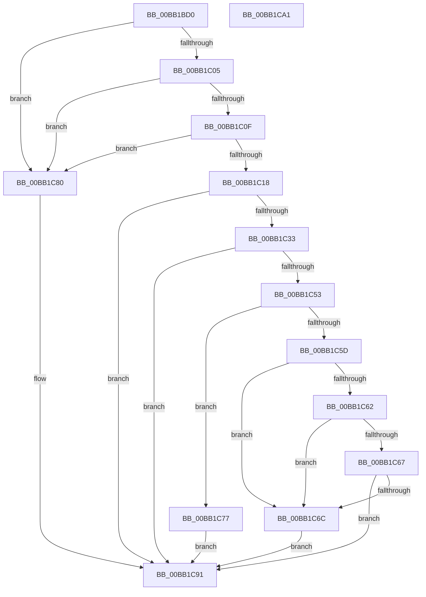

# VerifierIoConnectInterruptEx

- RVA: `0x00BB1BD0`–`0x00BB1CA2` (길이 `210` bytes)
- VA: `0x0000000140BB1BD0`
- 실행 섹션: `PAGEVRFY`
- PDB 이름 있음: `예`; PDB Function 태그: `아니요`
- unwind 정보 RVA: `0x000D29B0`
- 디코드: `61`개 명령, `210/210` bytes 표시
- 미해석 바이트: `0` (있으면 어셈블리에 `.byte`로 보존)

> 이 문서는 커널 이미지의 기계어와 PDB 기호를 분석해 생성했습니다. 4번과 5번은 함수 원형과 자료형을 바이너리 사용 방식에서 추정한 C 해석이며 원본 소스 복구 결과는 아닙니다.

## 1. Dependencies

- 직접 호출 지점: **5**; 고유 호출 대상: **4**
- 직접 호출자로 확인된 함수: **0**
- RIP 상대 이미지 참조: **3**

### Outgoing calls
- `0x00BB1BF4` → [memset](../../text/6C/memset_function_006C6C40.md) (function, `0x006C6C40`)
- `0x00BB1C28` → [ViCtxSetPrivateConnectParameters](ViCtxSetPrivateConnectParameters_function_00BB224C.md) (function, `0x00BB224C`)
- `0x00BB1C3F` → [guard_dispatch_icall](../../text/6B/guard_dispatch_icall_function_006BAAD0.md) (function, `0x006BAAD0`)
- `0x00BB1C79` → [ExFreePoolWithTag](../../poolcode/B8/ExFreePoolWithTag_function_00B82870.md) (function, `0x00B82870`)
- `0x00BB1C8A` → [guard_dispatch_icall](../../text/6B/guard_dispatch_icall_function_006BAAD0.md) (function, `0x006BAAD0`)

### Direct callers
- 이 함수 시작 RVA로 연결되는 직접 call은 확인되지 않았습니다. 간접 호출은 완전히 역산할 수 없습니다.

### Static image references
- `0x00BB1BF9` → RVA `0x00E681A0` (`.data`; read)
- `0x00BB1C05` → RVA `0x00FFDA94` (`PAGEVRFD`; read)
- `0x00BB1C33` → RVA `0x00FFDC30` (`PAGEVRFD`; read)

## 2. Other-region calls and transfers

- 다른 실행 섹션으로 향하는 call: **4**
  - `0x00BB1BF4` → [memset](../../text/6C/memset_function_006C6C40.md) (`PAGEVRFY` → `.text`)
  - `0x00BB1C3F` → [guard_dispatch_icall](../../text/6B/guard_dispatch_icall_function_006BAAD0.md) (`PAGEVRFY` → `.text`)
  - `0x00BB1C79` → [ExFreePoolWithTag](../../poolcode/B8/ExFreePoolWithTag_function_00B82870.md) (`PAGEVRFY` → `POOLCODE`)
  - `0x00BB1C8A` → [guard_dispatch_icall](../../text/6B/guard_dispatch_icall_function_006BAAD0.md) (`PAGEVRFY` → `.text`)
- 별도 외부 분기/꼬리 이동을 확인하지 못했습니다.

## 3. Assembly (complete function range)

```asm
00BB1BD0  4C 8B DC                        mov r11, rsp
00BB1BD3  49 89 5B 08                     mov qword ptr [r11 + 8], rbx
00BB1BD7  57                              push rdi
00BB1BD8  48 83 EC 70                     sub rsp, 0x70
00BB1BDC  49 83 63 10 00                  and qword ptr [r11 + 0x10], 0
00BB1BE1  33 C0                           xor eax, eax
00BB1BE3  48 8B D9                        mov rbx, rcx
00BB1BE6  89 44 24 24                     mov dword ptr [rsp + 0x24], eax
00BB1BEA  33 D2                           xor edx, edx
00BB1BEC  49 8D 4B A8                     lea rcx, [r11 - 0x58]
00BB1BF0  44 8D 40 4C                     lea r8d, [rax + 0x4c]
00BB1BF4  E8 47 50 B1 FF                  call 0x1406c6c40
00BB1BF9  F7 05 9D 65 2B 00 00 08 00 00   test dword ptr [rip + 0x2b659d], 0x800
00BB1C03  74 7B                           je 0x140bb1c80
00BB1C05  8B 05 89 BE 44 00               mov eax, dword ptr [rip + 0x44be89]
00BB1C0B  85 C0                           test eax, eax
00BB1C0D  74 71                           je 0x140bb1c80
00BB1C0F  8B 03                           mov eax, dword ptr [rbx]
00BB1C11  FF C8                           dec eax
00BB1C13  83 F8 02                        cmp eax, 2
00BB1C16  77 68                           ja 0x140bb1c80
00BB1C18  4C 8D 84 24 88 00 00 00         lea r8, [rsp + 0x88]
00BB1C20  48 8B D3                        mov rdx, rbx
00BB1C23  48 8D 4C 24 20                  lea rcx, [rsp + 0x20]
00BB1C28  E8 1F 06 00 00                  call 0x140bb224c
00BB1C2D  8B F8                           mov edi, eax
00BB1C2F  85 C0                           test eax, eax
00BB1C31  78 5E                           js 0x140bb1c91
00BB1C33  48 8B 05 F6 BF 44 00            mov rax, qword ptr [rip + 0x44bff6]
00BB1C3A  48 8D 4C 24 20                  lea rcx, [rsp + 0x20]
00BB1C3F  E8 8C 8E B0 FF                  call 0x1406baad0
00BB1C44  48 8B 8C 24 88 00 00 00         mov rcx, qword ptr [rsp + 0x88]
00BB1C4C  8B F8                           mov edi, eax
00BB1C4E  48 85 C9                        test rcx, rcx
00BB1C51  74 3E                           je 0x140bb1c91
00BB1C53  8B 44 24 20                     mov eax, dword ptr [rsp + 0x20]
00BB1C57  89 03                           mov dword ptr [rbx], eax
00BB1C59  85 FF                           test edi, edi
00BB1C5B  78 1A                           js 0x140bb1c77
00BB1C5D  83 E8 01                        sub eax, 1
00BB1C60  74 0A                           je 0x140bb1c6c
00BB1C62  83 E8 01                        sub eax, 1
00BB1C65  74 05                           je 0x140bb1c6c
00BB1C67  83 F8 01                        cmp eax, 1
00BB1C6A  75 25                           jne 0x140bb1c91
00BB1C6C  48 8B 44 24 30                  mov rax, qword ptr [rsp + 0x30]
00BB1C71  48 89 43 10                     mov qword ptr [rbx + 0x10], rax
00BB1C75  EB 1A                           jmp 0x140bb1c91
00BB1C77  33 D2                           xor edx, edx
00BB1C79  E8 F2 0B FD FF                  call 0x140b82870
00BB1C7E  EB 11                           jmp 0x140bb1c91
00BB1C80  48 8B 05 A9 BF 44 00            mov rax, qword ptr [rip + 0x44bfa9]
00BB1C87  48 8B CB                        mov rcx, rbx
00BB1C8A  E8 41 8E B0 FF                  call 0x1406baad0
00BB1C8F  8B F8                           mov edi, eax
00BB1C91  48 8B 9C 24 80 00 00 00         mov rbx, qword ptr [rsp + 0x80]
00BB1C99  8B C7                           mov eax, edi
00BB1C9B  48 83 C4 70                     add rsp, 0x70
00BB1C9F  5F                              pop rdi
00BB1CA0  C3                              ret
00BB1CA1  CC                              int3
```

## 4. C-style interpretation (structured pseudocode)

```c
__int64 __fastcall VerifierIoConnectInterruptEx(__int64 a1, int a2)
{
    __int64 result;
    __int64 v_rsp;
    unsigned __int64 v_stack_m48;
    unsigned int v_stack_m54;
    unsigned __int64 v_stack_m58;
    unsigned __int64 v_stack_p10;
    unsigned __int64 v_stack_p8;

    *(unsigned __int64 *)(v_rsp + 8) = v_rbx;
    v_rsp = (v_rsp) - (112);
    result = 0;
    v_stack_m54 = 0;
    a2 = 0;
    result = memset(v_rsp - 88, a2, result + 76, a4);
    if (((*(unsigned int *)(v_rip + 2844061)) & (0x800ULL)) == 0) goto loc_00BB1C80;
    if ((unsigned int)((unsigned int)(*(unsigned int *)(v_rip + 4505225))) == 0) goto loc_00BB1C80;
    result = (unsigned int)(((unsigned int)(*(unsigned int *)(a1))) - 1);
    if (((unsigned int)(result)) > 2) goto loc_00BB1C80;
    result = ViCtxSetPrivateConnectParameters(v_stack_m58, a1, v_stack_p10, a4);
    if (sign_flag) goto loc_00BB1C91;
    result = guard_dispatch_icall(v_stack_m58, a1, v_stack_p10, a4);
    if (v_stack_p10 == 0) goto loc_00BB1C91;
    *(unsigned int *)(a1) = (unsigned int)((unsigned int)(v_stack_m58));
    if (sign_flag) goto loc_00BB1C77;
    result = (unsigned int)(((unsigned int)(v_stack_m58)) - (1));
    if (condition_is_equal) goto loc_00BB1C6C;
    result = (unsigned int)((result) - (1));
    if (condition_is_equal) goto loc_00BB1C6C;
    if (((unsigned int)(result)) != 1) goto loc_00BB1C91;
loc_00BB1C6C:
    *(unsigned __int64 *)(a1 + 16) = v_stack_m48;
    goto loc_00BB1C91;
loc_00BB1C77:
    a2 = 0;
    result = ExFreePoolWithTag(v_stack_p10, a2, v_stack_p10, a4);
    goto loc_00BB1C91;
loc_00BB1C80:
    result = guard_dispatch_icall(a1, a2, v_stack_p10, a4);
loc_00BB1C91:
    v_rsp = (v_rsp) + (112);
    return (unsigned int)((unsigned int)((unsigned int)((unsigned int)(result))));
}
```

## 5. (Beta) C Style

```c
int64_t VerifierIoConnectInterruptEx(void *Arg1, int32_t Arg2)
{
    uint8_t *arg1 = (uint8_t *)Arg1;

    int64_t result;
    int64_t local_rsp;
    uint64_t v_stack_m48;
    uint32_t v_stack_m54;
    uint64_t v_stack_m58;
    uint64_t v_stack_p10;
    uint64_t v_stack_p8;

    *(uint64_t *)(local_rsp + 0x8) = local_rbx;
    local_rsp = (local_rsp) - (112);
    result = 0;
    v_stack_m54 = 0;
    Arg2 = 0;
    result = memset(local_rsp - 88, Arg2, result + 76, a4);
    if (((*(uint32_t *)(v_rip + 0x2B659D)) & (0x800ULL)) == 0) goto loc_00BB1C80;
    if ((uint32_t)((uint32_t)(*(uint32_t *)(v_rip + 0x44BE89))) == 0) goto loc_00BB1C80;
    result = (uint32_t)(((uint32_t)(*(uint32_t *)(arg1))) - 1);
    if (((uint32_t)(result)) > 2) goto loc_00BB1C80;
    result = ViCtxSetPrivateConnectParameters(v_stack_m58, Arg1, v_stack_p10, a4);
    if (sign_flag) goto loc_00BB1C91;
    result = guard_dispatch_icall(v_stack_m58, Arg1, v_stack_p10, a4);
    if (v_stack_p10 == 0) goto loc_00BB1C91;
    *(uint32_t *)(arg1) = (uint32_t)((uint32_t)(v_stack_m58));
    if (sign_flag) goto loc_00BB1C77;
    result = (uint32_t)(((uint32_t)(v_stack_m58)) - (1));
    if (condition_is_equal) goto loc_00BB1C6C;
    result = (uint32_t)((result) - (1));
    if (condition_is_equal) goto loc_00BB1C6C;
    if (((uint32_t)(result)) != 1) goto loc_00BB1C91;
loc_00BB1C6C:
    *(uint64_t *)(arg1 + 0x10) = v_stack_m48;
    goto loc_00BB1C91;
loc_00BB1C77:
    Arg2 = 0;
    result = ExFreePoolWithTag(v_stack_p10, Arg2, v_stack_p10, a4);
    goto loc_00BB1C91;
loc_00BB1C80:
    result = guard_dispatch_icall(Arg1, Arg2, v_stack_p10, a4);
loc_00BB1C91:
    local_rsp = (local_rsp) + (112);
    return (uint32_t)((uint32_t)((uint32_t)((uint32_t)(result))));
}
```

### 관측된 메모리 오프셋

구조체 형식이 확인되지 않은 접근은 인자 기준의 오프셋으로만 기록했습니다.

| 기준 인자 | 오프셋 표현 | 폭 (bit) | 접근 |
|---|---:|---:|---|
| `Arg1` | `+ 0x0` | `32` | `R` |
| `Arg1` | `+ 0x0` | `32` | `W` |
| `Arg1` | `+ 0x10` | `64` | `W` |

## 6. Execution-region graph

[열기: 2D/3D 그래프와 함수 탐색 컨트롤 패널](../../../control-panel.html?section=pagevrfy&rva=0x00BB1BD0&view=graph)

- 2D 그래프는 위에서 아래로 흐르고, 3D 그래프는 빈 공간을 드래그해 회전합니다. Shift+드래그는 이동, 휠은 확대·축소, 함수 노드 선택은 대상 보고서 이동입니다.

### Static fallback


