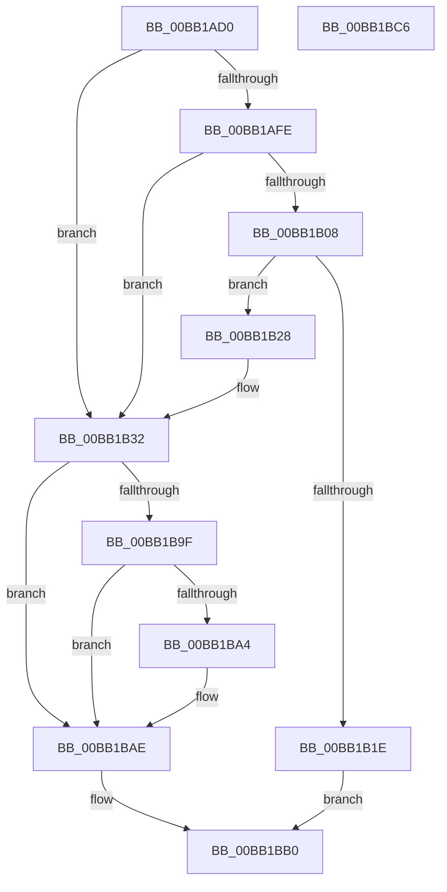

# VerifierIoConnectInterrupt

- RVA: `0x00BB1AD0`–`0x00BB1BC7` (길이 `247` bytes)
- VA: `0x0000000140BB1AD0`
- 실행 섹션: `PAGEVRFY`
- PDB 이름 있음: `예`; PDB Function 태그: `아니요`
- unwind 정보 RVA: `0x000BE9D0`
- 디코드: `63`개 명령, `247/247` bytes 표시
- 미해석 바이트: `0` (있으면 어셈블리에 `.byte`로 보존)

> 이 문서는 커널 이미지의 기계어와 PDB 기호를 분석해 생성했습니다. 4번과 5번은 함수 원형과 자료형을 바이너리 사용 방식에서 추정한 C 해석이며 원본 소스 복구 결과는 아닙니다.

## 1. Dependencies

- 직접 호출 지점: **3**; 고유 호출 대상: **3**
- 직접 호출자로 확인된 함수: **0**
- RIP 상대 이미지 참조: **4**

### Outgoing calls
- `0x00BB1B11` → [ViCtxAllocateIsrContext](ViCtxAllocateIsrContext_function_00BB1E48.md) (function, `0x00BB1E48`)
- `0x00BB1B94` → [guard_dispatch_icall](../../text/6B/guard_dispatch_icall_function_006BAAD0.md) (function, `0x006BAAD0`)
- `0x00BB1BA9` → [ExFreePoolWithTag](../../poolcode/B8/ExFreePoolWithTag_function_00B82870.md) (function, `0x00B82870`)

### Direct callers
- 이 함수 시작 RVA로 연결되는 직접 call은 확인되지 않았습니다. 간접 호출은 완전히 역산할 수 없습니다.

### Static image references
- `0x00BB1AE9` → RVA `0x00E681A0` (`.data`; read)
- `0x00BB1AFE` → RVA `0x00FFDA94` (`PAGEVRFD`; read)
- `0x00BB1B28` → RVA `0x00BB2180` (`ViCtxIsr`; read)
- `0x00BB1B5A` → RVA `0x00FFE590` (`PAGEVRFD`; read)

## 2. Other-region calls and transfers

- 다른 실행 섹션으로 향하는 call: **2**
  - `0x00BB1B94` → [guard_dispatch_icall](../../text/6B/guard_dispatch_icall_function_006BAAD0.md) (`PAGEVRFY` → `.text`)
  - `0x00BB1BA9` → [ExFreePoolWithTag](../../poolcode/B8/ExFreePoolWithTag_function_00B82870.md) (`PAGEVRFY` → `POOLCODE`)
- 별도 외부 분기/꼬리 이동을 확인하지 못했습니다.

## 3. Assembly (complete function range)

```asm
00BB1AD0  48 89 5C 24 08                  mov qword ptr [rsp + 8], rbx
00BB1AD5  48 89 6C 24 10                  mov qword ptr [rsp + 0x10], rbp
00BB1ADA  48 89 74 24 18                  mov qword ptr [rsp + 0x18], rsi
00BB1ADF  57                              push rdi
00BB1AE0  48 83 EC 60                     sub rsp, 0x60
00BB1AE4  33 DB                           xor ebx, ebx
00BB1AE6  49 8B F1                        mov rsi, r9
00BB1AE9  F7 05 AD 66 2B 00 00 08 00 00   test dword ptr [rip + 0x2b66ad], 0x800
00BB1AF3  4D 8B D8                        mov r11, r8
00BB1AF6  48 8B FA                        mov rdi, rdx
00BB1AF9  48 8B E9                        mov rbp, rcx
00BB1AFC  74 34                           je 0x140bb1b32
00BB1AFE  8B 05 90 BF 44 00               mov eax, dword ptr [rip + 0x44bf90]
00BB1B04  85 C0                           test eax, eax
00BB1B06  74 2A                           je 0x140bb1b32
00BB1B08  45 33 C0                        xor r8d, r8d
00BB1B0B  49 8B D3                        mov rdx, r11
00BB1B0E  48 8B CF                        mov rcx, rdi
00BB1B11  E8 32 03 00 00                  call 0x140bb1e48
00BB1B16  48 8B D8                        mov rbx, rax
00BB1B19  48 85 C0                        test rax, rax
00BB1B1C  75 0A                           jne 0x140bb1b28
00BB1B1E  B8 9A 00 00 C0                  mov eax, 0xc000009a
00BB1B23  E9 88 00 00 00                  jmp 0x140bb1bb0
00BB1B28  48 8D 3D 51 06 00 00            lea rdi, [rip + 0x651]
00BB1B2F  4C 8B D8                        mov r11, rax
00BB1B32  8A 8C 24 B0 00 00 00            mov cl, byte ptr [rsp + 0xb0]
00BB1B39  4C 8B CE                        mov r9, rsi
00BB1B3C  8A 84 24 C0 00 00 00            mov al, byte ptr [rsp + 0xc0]
00BB1B43  4D 8B C3                        mov r8, r11
00BB1B46  88 44 24 50                     mov byte ptr [rsp + 0x50], al
00BB1B4A  48 8B D7                        mov rdx, rdi
00BB1B4D  48 8B 84 24 B8 00 00 00         mov rax, qword ptr [rsp + 0xb8]
00BB1B55  48 89 44 24 48                  mov qword ptr [rsp + 0x48], rax
00BB1B5A  48 8B 05 2F CA 44 00            mov rax, qword ptr [rip + 0x44ca2f]
00BB1B61  88 4C 24 40                     mov byte ptr [rsp + 0x40], cl
00BB1B65  8B 8C 24 A8 00 00 00            mov ecx, dword ptr [rsp + 0xa8]
00BB1B6C  89 4C 24 38                     mov dword ptr [rsp + 0x38], ecx
00BB1B70  8A 8C 24 A0 00 00 00            mov cl, byte ptr [rsp + 0xa0]
00BB1B77  88 4C 24 30                     mov byte ptr [rsp + 0x30], cl
00BB1B7B  8A 8C 24 98 00 00 00            mov cl, byte ptr [rsp + 0x98]
00BB1B82  88 4C 24 28                     mov byte ptr [rsp + 0x28], cl
00BB1B86  8B 8C 24 90 00 00 00            mov ecx, dword ptr [rsp + 0x90]
00BB1B8D  89 4C 24 20                     mov dword ptr [rsp + 0x20], ecx
00BB1B91  48 8B CD                        mov rcx, rbp
00BB1B94  E8 37 8F B0 FF                  call 0x1406baad0
00BB1B99  8B F8                           mov edi, eax
00BB1B9B  85 C0                           test eax, eax
00BB1B9D  79 0F                           jns 0x140bb1bae
00BB1B9F  48 85 DB                        test rbx, rbx
00BB1BA2  74 0A                           je 0x140bb1bae
00BB1BA4  33 D2                           xor edx, edx
00BB1BA6  48 8B CB                        mov rcx, rbx
00BB1BA9  E8 C2 0C FD FF                  call 0x140b82870
00BB1BAE  8B C7                           mov eax, edi
00BB1BB0  4C 8D 5C 24 60                  lea r11, [rsp + 0x60]
00BB1BB5  49 8B 5B 10                     mov rbx, qword ptr [r11 + 0x10]
00BB1BB9  49 8B 6B 18                     mov rbp, qword ptr [r11 + 0x18]
00BB1BBD  49 8B 73 20                     mov rsi, qword ptr [r11 + 0x20]
00BB1BC1  49 8B E3                        mov rsp, r11
00BB1BC4  5F                              pop rdi
00BB1BC5  C3                              ret
00BB1BC6  CC                              int3
```

## 4. C-style interpretation (structured pseudocode)

```c
__int64 __fastcall VerifierIoConnectInterrupt(__int64 a1, __int64 a2, __int64 a3, __int64 a4, unsigned int a5, unsigned __int8 a6, unsigned __int8 a7, unsigned int a8, unsigned __int8 a9, __int64 a10, unsigned __int8 a11)
{
    __int64 result;
    __int64 v_rbx;
    __int64 v_rsp;
    unsigned __int8 v_stack_m18;
    unsigned __int64 v_stack_m20;
    unsigned __int8 v_stack_m28;
    unsigned int v_stack_m30;
    unsigned __int8 v_stack_m38;
    unsigned __int8 v_stack_m40;
    unsigned int v_stack_m48;
    unsigned __int64 v_stack_m8;
    unsigned __int64 v_stack_p10;
    unsigned __int64 v_stack_p18;
    unsigned __int64 v_stack_p8;

    v_stack_p8 = v_rbx;
    v_stack_p10 = v_rbp;
    v_stack_p18 = v_rsi;
    v_rsp = (v_rsp) - (96);
    v_rbx = 0;
    if (((*(unsigned int *)(v_rip + 2844333)) & (0x800ULL)) == 0) goto loc_00BB1B32;
    if ((unsigned int)((unsigned int)(*(unsigned int *)(v_rip + 4505488))) == 0) goto loc_00BB1B32;
    a3 = 0;
    result = ViCtxAllocateIsrContext(a2, 0, a3, a4);
    if (result != 0) goto loc_00BB1B28;
    goto loc_00BB1BB0;
loc_00BB1B28:
loc_00BB1B32:
    v_stack_m18 = a11;
    v_stack_m20 = a10;
    v_stack_m28 = a9;
    v_stack_m30 = (unsigned int)((unsigned int)(a8));
    v_stack_m38 = a7;
    v_stack_m40 = a6;
    v_stack_m48 = (unsigned int)((unsigned int)(a5));
    result = guard_dispatch_icall(a1, v_rip + 1617, (unsigned int)(0xC000009AULL), a4);
    if (!sign_flag) goto loc_00BB1BAE;
    if (result != 0) {
        a2 = 0;
        a1 = result;
        result = ExFreePoolWithTag(a1, a2, (unsigned int)(0xC000009AULL), a4);
    }
loc_00BB1BB0:
    return (unsigned int)((unsigned int)((unsigned int)((unsigned int)(result))));
}
```

## 5. (Beta) C Style

```c
int64_t VerifierIoConnectInterrupt(int64_t Arg1, int64_t Arg2, int64_t Arg3, int64_t Arg4, uint32_t Arg5, uint8_t Arg6, uint8_t Arg7, uint32_t Arg8, uint8_t Arg9, int64_t Arg10, uint8_t Arg11)
{
    int64_t result;
    int64_t local_rbx;
    int64_t local_rsp;
    uint8_t v_stack_m18;
    uint64_t v_stack_m20;
    uint8_t v_stack_m28;
    uint32_t v_stack_m30;
    uint8_t v_stack_m38;
    uint8_t v_stack_m40;
    uint32_t v_stack_m48;
    uint64_t v_stack_m8;
    uint64_t v_stack_p10;
    uint64_t v_stack_p18;
    uint64_t v_stack_p8;

    v_stack_p8 = local_rbx;
    v_stack_p10 = local_rbp;
    v_stack_p18 = local_rsi;
    local_rsp = (local_rsp) - (96);
    local_rbx = 0;
    if (((*(uint32_t *)(v_rip + 0x2B66AD)) & (0x800ULL)) == 0) goto loc_00BB1B32;
    if ((uint32_t)((uint32_t)(*(uint32_t *)(v_rip + 0x44BF90))) == 0) goto loc_00BB1B32;
    Arg3 = 0;
    result = ViCtxAllocateIsrContext(Arg2, 0, Arg3, Arg4);
    if (result != 0) goto loc_00BB1B28;
    goto loc_00BB1BB0;
loc_00BB1B28:
loc_00BB1B32:
    v_stack_m18 = Arg11;
    v_stack_m20 = Arg10;
    v_stack_m28 = Arg9;
    v_stack_m30 = (uint32_t)((uint32_t)(Arg8));
    v_stack_m38 = Arg7;
    v_stack_m40 = Arg6;
    v_stack_m48 = (uint32_t)((uint32_t)(Arg5));
    result = guard_dispatch_icall(Arg1, v_rip + 1617, (uint32_t)(0xC000009AULL), Arg4);
    if (!sign_flag) goto loc_00BB1BAE;
    if (result != 0) {
        Arg2 = 0;
        Arg1 = result;
        result = ExFreePoolWithTag(Arg1, Arg2, (uint32_t)(0xC000009AULL), Arg4);
    }
loc_00BB1BB0:
    return (uint32_t)((uint32_t)((uint32_t)((uint32_t)(result))));
}
```

## 6. Execution-region graph

[열기: 2D/3D 그래프와 함수 탐색 컨트롤 패널](../../../control-panel.html?section=pagevrfy&rva=0x00BB1AD0&view=graph)

- 2D 그래프는 위에서 아래로 흐르고, 3D 그래프는 빈 공간을 드래그해 회전합니다. Shift+드래그는 이동, 휠은 확대·축소, 함수 노드 선택은 대상 보고서 이동입니다.

### Static fallback


