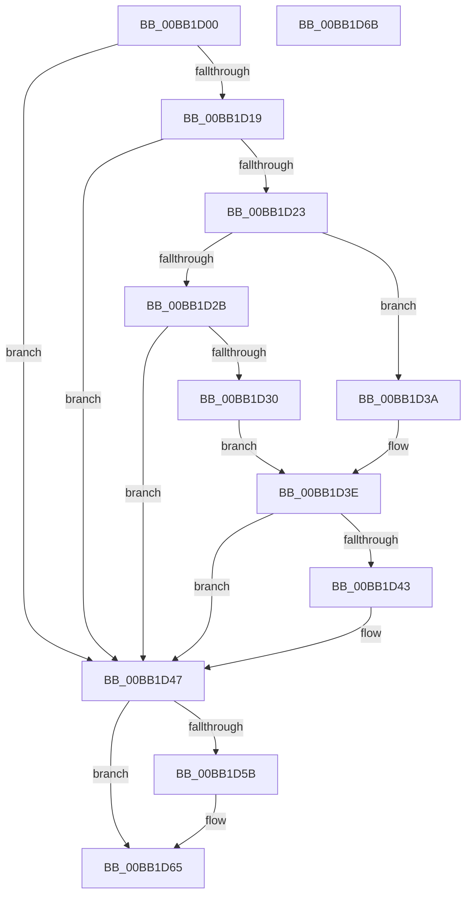

# VerifierIoDisconnectInterruptEx

- RVA: `0x00BB1D00`–`0x00BB1D6C` (길이 `108` bytes)
- VA: `0x0000000140BB1D00`
- 실행 섹션: `PAGEVRFY`
- PDB 이름 있음: `예`; PDB Function 태그: `아니요`
- unwind 정보 RVA: `0x0005CF00`
- 디코드: `34`개 명령, `108/108` bytes 표시
- 미해석 바이트: `0` (있으면 어셈블리에 `.byte`로 보존)

> 이 문서는 커널 이미지의 기계어와 PDB 기호를 분석해 생성했습니다. 4번과 5번은 함수 원형과 자료형을 바이너리 사용 방식에서 추정한 C 해석이며 원본 소스 복구 결과는 아닙니다.

## 1. Dependencies

- 직접 호출 지점: **2**; 고유 호출 대상: **2**
- 직접 호출자로 확인된 함수: **0**
- RIP 상대 이미지 참조: **3**

### Outgoing calls
- `0x00BB1D51` → [guard_dispatch_icall](../../text/6B/guard_dispatch_icall_function_006BAAD0.md) (function, `0x006BAAD0`)
- `0x00BB1D60` → [ExFreePoolWithTag](../../poolcode/B8/ExFreePoolWithTag_function_00B82870.md) (function, `0x00B82870`)

### Direct callers
- 이 함수 시작 RVA로 연결되는 직접 call은 확인되지 않았습니다. 간접 호출은 완전히 역산할 수 없습니다.

### Static image references
- `0x00BB1D0B` → RVA `0x00E681A0` (`.data`; read)
- `0x00BB1D19` → RVA `0x00FFDA94` (`PAGEVRFD`; read)
- `0x00BB1D47` → RVA `0x00FFE5A0` (`PAGEVRFD`; read)

## 2. Other-region calls and transfers

- 다른 실행 섹션으로 향하는 call: **2**
  - `0x00BB1D51` → [guard_dispatch_icall](../../text/6B/guard_dispatch_icall_function_006BAAD0.md) (`PAGEVRFY` → `.text`)
  - `0x00BB1D60` → [ExFreePoolWithTag](../../poolcode/B8/ExFreePoolWithTag_function_00B82870.md) (`PAGEVRFY` → `POOLCODE`)
- 별도 외부 분기/꼬리 이동을 확인하지 못했습니다.

## 3. Assembly (complete function range)

```asm
00BB1D00  40 53                           push rbx
00BB1D02  48 83 EC 20                     sub rsp, 0x20
00BB1D06  33 DB                           xor ebx, ebx
00BB1D08  48 8B D1                        mov rdx, rcx
00BB1D0B  F7 05 8B 64 2B 00 00 08 00 00   test dword ptr [rip + 0x2b648b], 0x800
00BB1D15  8B 09                           mov ecx, dword ptr [rcx]
00BB1D17  74 2E                           je 0x140bb1d47
00BB1D19  8B 05 75 BD 44 00               mov eax, dword ptr [rip + 0x44bd75]
00BB1D1F  85 C0                           test eax, eax
00BB1D21  74 24                           je 0x140bb1d47
00BB1D23  8D 41 FF                        lea eax, [rcx - 1]
00BB1D26  83 F8 01                        cmp eax, 1
00BB1D29  76 0F                           jbe 0x140bb1d3a
00BB1D2B  83 F9 03                        cmp ecx, 3
00BB1D2E  75 17                           jne 0x140bb1d47
00BB1D30  48 8B 42 08                     mov rax, qword ptr [rdx + 8]
00BB1D34  48 8B 48 18                     mov rcx, qword ptr [rax + 0x18]
00BB1D38  EB 04                           jmp 0x140bb1d3e
00BB1D3A  48 8B 4A 08                     mov rcx, qword ptr [rdx + 8]
00BB1D3E  48 85 C9                        test rcx, rcx
00BB1D41  74 04                           je 0x140bb1d47
00BB1D43  48 8B 59 30                     mov rbx, qword ptr [rcx + 0x30]
00BB1D47  48 8B 05 52 C8 44 00            mov rax, qword ptr [rip + 0x44c852]
00BB1D4E  48 8B CA                        mov rcx, rdx
00BB1D51  E8 7A 8D B0 FF                  call 0x1406baad0
00BB1D56  48 85 DB                        test rbx, rbx
00BB1D59  74 0A                           je 0x140bb1d65
00BB1D5B  33 D2                           xor edx, edx
00BB1D5D  48 8B CB                        mov rcx, rbx
00BB1D60  E8 0B 0B FD FF                  call 0x140b82870
00BB1D65  48 83 C4 20                     add rsp, 0x20
00BB1D69  5B                              pop rbx
00BB1D6A  C3                              ret
00BB1D6B  CC                              int3
```

## 4. C-style interpretation (structured pseudocode)

```c
__int64 __fastcall VerifierIoDisconnectInterruptEx(__int64 a1)
{
    __int64 result;
    __int64 v_rbx;
    __int64 v_rsp;

    v_rsp = (v_rsp) - (32);
    v_rbx = 0;
    if (((*(unsigned int *)(v_rip + 2843787)) & (0x800ULL)) == 0) goto loc_00BB1D47;
    if ((unsigned int)((unsigned int)(*(unsigned int *)(v_rip + 4504949))) == 0) goto loc_00BB1D47;
    if (((unsigned int)((unsigned int)(*(unsigned int *)(a1)) - 1)) <= 1) goto loc_00BB1D3A;
    if (((unsigned int)((unsigned int)(*(unsigned int *)(a1)))) != 3) goto loc_00BB1D47;
    goto loc_00BB1D3E;
loc_00BB1D3A:
loc_00BB1D3E:
    if (*(unsigned __int64 *)(a1 + 8) != 0) {
        v_rbx = *(unsigned __int64 *)(*(unsigned __int64 *)(a1 + 8) + 48);
    }
    result = guard_dispatch_icall(a1, a1, a3, a4);
    if (v_rbx != 0) {
        a2 = 0;
        a1 = v_rbx;
        result = ExFreePoolWithTag(a1, a2, a3, a4);
    }
    v_rsp = (v_rsp) + (32);
    return result;
}
```

## 5. (Beta) C Style

```c
int64_t VerifierIoDisconnectInterruptEx(void *Arg1)
{
    uint8_t *arg1 = (uint8_t *)Arg1;

    int64_t result;
    int64_t local_rbx;
    int64_t local_rsp;

    local_rsp = (local_rsp) - (32);
    local_rbx = 0;
    if (((*(uint32_t *)(v_rip + 0x2B648B)) & (0x800ULL)) == 0) goto loc_00BB1D47;
    if ((uint32_t)((uint32_t)(*(uint32_t *)(v_rip + 0x44BD75))) == 0) goto loc_00BB1D47;
    if (((uint32_t)((uint32_t)(*(uint32_t *)(arg1)) - 1)) <= 1) goto loc_00BB1D3A;
    if (((uint32_t)((uint32_t)(*(uint32_t *)(arg1)))) != 3) goto loc_00BB1D47;
    goto loc_00BB1D3E;
loc_00BB1D3A:
loc_00BB1D3E:
    if (*(uint64_t *)(arg1 + 0x8) != 0) {
        local_rbx = *(uint64_t *)(*(uint64_t *)(arg1 + 0x8) + 0x30);
    }
    result = guard_dispatch_icall(Arg1, Arg1, a3, a4);
    if (local_rbx != 0) {
        a2 = 0;
        Arg1 = local_rbx;
        result = ExFreePoolWithTag(Arg1, a2, a3, a4);
    }
    local_rsp = (local_rsp) + (32);
    return result;
}
```

### 관측된 메모리 오프셋

구조체 형식이 확인되지 않은 접근은 인자 기준의 오프셋으로만 기록했습니다.

| 기준 인자 | 오프셋 표현 | 폭 (bit) | 접근 |
|---|---:|---:|---|
| `Arg1` | `+ 0x0` | `32` | `R` |
| `Arg1` | `+ 0x8` | `64` | `R` |

## 6. Execution-region graph

[열기: 2D/3D 그래프와 함수 탐색 컨트롤 패널](../../../control-panel.html?section=pagevrfy&rva=0x00BB1D00&view=graph)

- 2D 그래프는 위에서 아래로 흐르고, 3D 그래프는 빈 공간을 드래그해 회전합니다. Shift+드래그는 이동, 휠은 확대·축소, 함수 노드 선택은 대상 보고서 이동입니다.

### Static fallback


