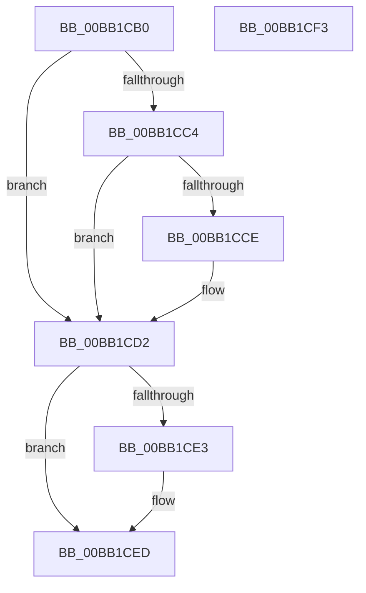

# VerifierIoDisconnectInterrupt

- RVA: `0x00BB1CB0`–`0x00BB1CF4` (길이 `68` bytes)
- VA: `0x0000000140BB1CB0`
- 실행 섹션: `PAGEVRFY`
- PDB 이름 있음: `예`; PDB Function 태그: `아니요`
- unwind 정보 RVA: `0x0005CF00`
- 디코드: `20`개 명령, `68/68` bytes 표시
- 미해석 바이트: `0` (있으면 어셈블리에 `.byte`로 보존)

> 이 문서는 커널 이미지의 기계어와 PDB 기호를 분석해 생성했습니다. 4번과 5번은 함수 원형과 자료형을 바이너리 사용 방식에서 추정한 C 해석이며 원본 소스 복구 결과는 아닙니다.

## 1. Dependencies

- 직접 호출 지점: **2**; 고유 호출 대상: **2**
- 직접 호출자로 확인된 함수: **0**
- RIP 상대 이미지 참조: **3**

### Outgoing calls
- `0x00BB1CD9` → [guard_dispatch_icall](../../text/6B/guard_dispatch_icall_function_006BAAD0.md) (function, `0x006BAAD0`)
- `0x00BB1CE8` → [ExFreePoolWithTag](../../poolcode/B8/ExFreePoolWithTag_function_00B82870.md) (function, `0x00B82870`)

### Direct callers
- 이 함수 시작 RVA로 연결되는 직접 call은 확인되지 않았습니다. 간접 호출은 완전히 역산할 수 없습니다.

### Static image references
- `0x00BB1CB8` → RVA `0x00E681A0` (`.data`; read)
- `0x00BB1CC4` → RVA `0x00FFDA94` (`PAGEVRFD`; read)
- `0x00BB1CD2` → RVA `0x00FFE598` (`PAGEVRFD`; read)

## 2. Other-region calls and transfers

- 다른 실행 섹션으로 향하는 call: **2**
  - `0x00BB1CD9` → [guard_dispatch_icall](../../text/6B/guard_dispatch_icall_function_006BAAD0.md) (`PAGEVRFY` → `.text`)
  - `0x00BB1CE8` → [ExFreePoolWithTag](../../poolcode/B8/ExFreePoolWithTag_function_00B82870.md) (`PAGEVRFY` → `POOLCODE`)
- 별도 외부 분기/꼬리 이동을 확인하지 못했습니다.

## 3. Assembly (complete function range)

```asm
00BB1CB0  40 53                           push rbx
00BB1CB2  48 83 EC 20                     sub rsp, 0x20
00BB1CB6  33 DB                           xor ebx, ebx
00BB1CB8  F7 05 DE 64 2B 00 00 08 00 00   test dword ptr [rip + 0x2b64de], 0x800
00BB1CC2  74 0E                           je 0x140bb1cd2
00BB1CC4  8B 05 CA BD 44 00               mov eax, dword ptr [rip + 0x44bdca]
00BB1CCA  85 C0                           test eax, eax
00BB1CCC  74 04                           je 0x140bb1cd2
00BB1CCE  48 8B 59 30                     mov rbx, qword ptr [rcx + 0x30]
00BB1CD2  48 8B 05 BF C8 44 00            mov rax, qword ptr [rip + 0x44c8bf]
00BB1CD9  E8 F2 8D B0 FF                  call 0x1406baad0
00BB1CDE  48 85 DB                        test rbx, rbx
00BB1CE1  74 0A                           je 0x140bb1ced
00BB1CE3  33 D2                           xor edx, edx
00BB1CE5  48 8B CB                        mov rcx, rbx
00BB1CE8  E8 83 0B FD FF                  call 0x140b82870
00BB1CED  48 83 C4 20                     add rsp, 0x20
00BB1CF1  5B                              pop rbx
00BB1CF2  C3                              ret
00BB1CF3  CC                              int3
```

## 4. C-style interpretation (structured pseudocode)

```c
__int64 __fastcall VerifierIoDisconnectInterrupt(__int64 a1, int a2)
{
    __int64 result;
    __int64 v_rbx;
    __int64 v_rsp;

    v_rsp = (v_rsp) - (32);
    v_rbx = 0;
    if (((*(unsigned int *)(v_rip + 2843870)) & (0x800ULL)) == 0) goto loc_00BB1CD2;
    if ((unsigned int)((unsigned int)(*(unsigned int *)(v_rip + 4505034))) != 0) {
        v_rbx = *(unsigned __int64 *)(a1 + 48);
    }
    result = guard_dispatch_icall(a1, a2, a3, a4);
    if (v_rbx != 0) {
        a2 = 0;
        a1 = v_rbx;
        result = ExFreePoolWithTag(a1, a2, a3, a4);
    }
    v_rsp = (v_rsp) + (32);
    return result;
}
```

## 5. (Beta) C Style

```c
int64_t VerifierIoDisconnectInterrupt(void *Arg1, int32_t Arg2)
{
    uint8_t *arg1 = (uint8_t *)Arg1;

    int64_t result;
    int64_t local_rbx;
    int64_t local_rsp;

    local_rsp = (local_rsp) - (32);
    local_rbx = 0;
    if (((*(uint32_t *)(v_rip + 0x2B64DE)) & (0x800ULL)) == 0) goto loc_00BB1CD2;
    if ((uint32_t)((uint32_t)(*(uint32_t *)(v_rip + 0x44BDCA))) != 0) {
        local_rbx = *(uint64_t *)(arg1 + 0x30);
    }
    result = guard_dispatch_icall(Arg1, Arg2, a3, a4);
    if (local_rbx != 0) {
        Arg2 = 0;
        Arg1 = local_rbx;
        result = ExFreePoolWithTag(Arg1, Arg2, a3, a4);
    }
    local_rsp = (local_rsp) + (32);
    return result;
}
```

### 관측된 메모리 오프셋

구조체 형식이 확인되지 않은 접근은 인자 기준의 오프셋으로만 기록했습니다.

| 기준 인자 | 오프셋 표현 | 폭 (bit) | 접근 |
|---|---:|---:|---|
| `Arg1` | `+ 0x30` | `64` | `R` |

## 6. Execution-region graph

[열기: 2D/3D 그래프와 함수 탐색 컨트롤 패널](../../../control-panel.html?section=pagevrfy&rva=0x00BB1CB0&view=graph)

- 2D 그래프는 위에서 아래로 흐르고, 3D 그래프는 빈 공간을 드래그해 회전합니다. Shift+드래그는 이동, 휠은 확대·축소, 함수 노드 선택은 대상 보고서 이동입니다.

### Static fallback


