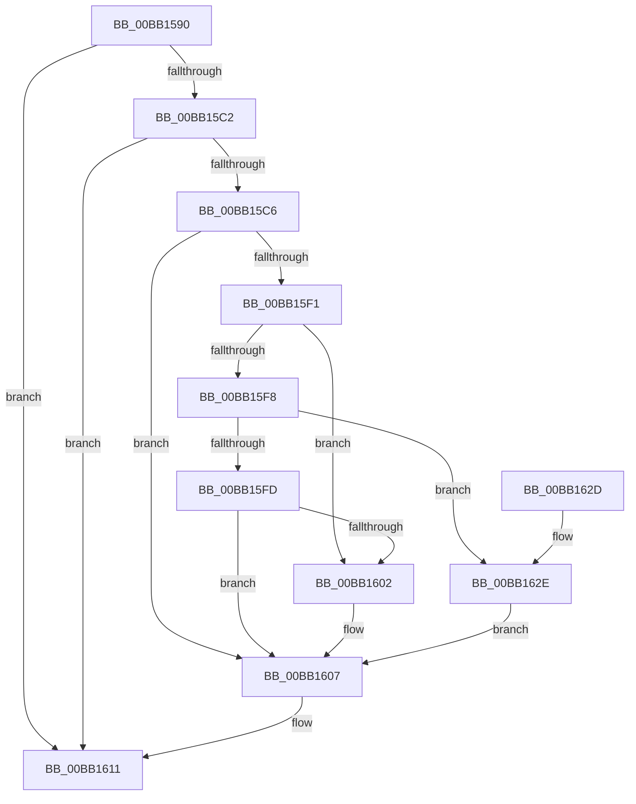

# VerifierIoWMIRegistrationControl

- RVA: `0x00BB1590`–`0x00BB1635` (길이 `165` bytes)
- VA: `0x0000000140BB1590`
- 실행 섹션: `PAGEVRFY`
- PDB 이름 있음: `예`; PDB Function 태그: `아니요`
- unwind 정보 RVA: `0x000A60F8`
- 디코드: `47`개 명령, `165/165` bytes 표시
- 미해석 바이트: `0` (있으면 어셈블리에 `.byte`로 보존)

> 이 문서는 커널 이미지의 기계어와 PDB 기호를 분석해 생성했습니다. 4번과 5번은 함수 원형과 자료형을 바이너리 사용 방식에서 추정한 C 해석이며 원본 소스 복구 결과는 아닙니다.

## 1. Dependencies

- 직접 호출 지점: **5**; 고유 호출 대상: **5**
- 직접 호출자로 확인된 함수: **0**
- RIP 상대 이미지 참조: **3**

### Outgoing calls
- `0x00BB15A4` → [VfTargetWMIRegistrationControl](../B9/VfTargetWMIRegistrationControl_function_00B9B74C.md) (function, `0x00B9B74C`)
- `0x00BB15D0` → [VfAvlInitializeLockContext](../../text/4A/VfAvlInitializeLockContext_function_004A686C.md) (function, `0x004A686C`)
- `0x00BB15E7` → [VfAvlLookupTreeNode](../../text/3E/VfAvlLookupTreeNode_function_003EF1B4.md) (function, `0x003EF1B4`)
- `0x00BB160C` → [VfAvlCleanupLockContext](../../text/3E/VfAvlCleanupLockContext_function_003EF56C.md) (function, `0x003EF56C`)
- `0x00BB161D` → [guard_dispatch_icall](../../text/6B/guard_dispatch_icall_function_006BAAD0.md) (function, `0x006BAAD0`)

### Direct callers
- 이 함수 시작 RVA로 연결되는 직접 call은 확인되지 않았습니다. 간접 호출은 완전히 역산할 수 없습니다.

### Static image references
- `0x00BB15B3` → RVA `0x00F04A20` (`.data`; read)
- `0x00BB15E0` → RVA `0x00FFDCC0` (`PAGEVRFD`; read)
- `0x00BB1611` → RVA `0x00FFE180` (`PAGEVRFD`; read)

## 2. Other-region calls and transfers

- 다른 실행 섹션으로 향하는 call: **4**
  - `0x00BB15D0` → [VfAvlInitializeLockContext](../../text/4A/VfAvlInitializeLockContext_function_004A686C.md) (`PAGEVRFY` → `.text`)
  - `0x00BB15E7` → [VfAvlLookupTreeNode](../../text/3E/VfAvlLookupTreeNode_function_003EF1B4.md) (`PAGEVRFY` → `.text`)
  - `0x00BB160C` → [VfAvlCleanupLockContext](../../text/3E/VfAvlCleanupLockContext_function_003EF56C.md) (`PAGEVRFY` → `.text`)
  - `0x00BB161D` → [guard_dispatch_icall](../../text/6B/guard_dispatch_icall_function_006BAAD0.md) (`PAGEVRFY` → `.text`)
- 별도 외부 분기/꼬리 이동을 확인하지 못했습니다.

## 3. Assembly (complete function range)

```asm
00BB1590  48 89 5C 24 08                  mov qword ptr [rsp + 8], rbx
00BB1595  57                              push rdi
00BB1596  48 83 EC 40                     sub rsp, 0x40
00BB159A  4C 8B 44 24 48                  mov r8, qword ptr [rsp + 0x48]
00BB159F  8B DA                           mov ebx, edx
00BB15A1  48 8B F9                        mov rdi, rcx
00BB15A4  E8 A3 A1 FE FF                  call 0x140b9b74c
00BB15A9  33 C0                           xor eax, eax
00BB15AB  0F 57 C0                        xorps xmm0, xmm0
00BB15AE  48 89 44 24 30                  mov qword ptr [rsp + 0x30], rax
00BB15B3  8B 05 67 34 35 00               mov eax, dword ptr [rip + 0x353467]
00BB15B9  0F 11 44 24 20                  movups xmmword ptr [rsp + 0x20], xmm0
00BB15BE  A8 10                           test al, 0x10
00BB15C0  74 4F                           je 0x140bb1611
00BB15C2  85 DB                           test ebx, ebx
00BB15C4  78 4B                           js 0x140bb1611
00BB15C6  BA 01 00 00 00                  mov edx, 1
00BB15CB  48 8D 4C 24 20                  lea rcx, [rsp + 0x20]
00BB15D0  E8 97 52 8F FF                  call 0x1404a686c
00BB15D5  45 33 C9                        xor r9d, r9d
00BB15D8  48 8D 54 24 20                  lea rdx, [rsp + 0x20]
00BB15DD  4C 8B C7                        mov r8, rdi
00BB15E0  48 8D 0D D9 C6 44 00            lea rcx, [rip + 0x44c6d9]
00BB15E7  E8 C8 DB 83 FF                  call 0x1403ef1b4
00BB15EC  48 85 C0                        test rax, rax
00BB15EF  74 16                           je 0x140bb1607
00BB15F1  8B CB                           mov ecx, ebx
00BB15F3  83 E9 01                        sub ecx, 1
00BB15F6  74 0A                           je 0x140bb1602
00BB15F8  83 E9 01                        sub ecx, 1
00BB15FB  74 31                           je 0x140bb162e
00BB15FD  83 F9 01                        cmp ecx, 1
00BB1600  75 05                           jne 0x140bb1607
00BB1602  F0 83 48 10 01                  lock or dword ptr [rax + 0x10], 1
00BB1607  48 8D 4C 24 20                  lea rcx, [rsp + 0x20]
00BB160C  E8 5B DF 83 FF                  call 0x1403ef56c
00BB1611  48 8B 05 68 CB 44 00            mov rax, qword ptr [rip + 0x44cb68]
00BB1618  8B D3                           mov edx, ebx
00BB161A  48 8B CF                        mov rcx, rdi
00BB161D  E8 AE 94 B0 FF                  call 0x1406baad0
00BB1622  48 8B 5C 24 50                  mov rbx, qword ptr [rsp + 0x50]
00BB1627  48 83 C4 40                     add rsp, 0x40
00BB162B  5F                              pop rdi
00BB162C  C3                              ret
00BB162D  CC                              int3
00BB162E  F0 83 60 10 FE                  lock and dword ptr [rax + 0x10], 0xfffffffe
00BB1633  EB D2                           jmp 0x140bb1607
```

## 4. C-style interpretation (structured pseudocode)

```c
__int64 __fastcall VerifierIoWMIRegistrationControl(__int64 a1, int a2, __int64 a3, int a4)
{
    __int64 result;
    __int64 v_rsp;
    unsigned __int64 v_stack_m18;
    unsigned __int64 v_stack_m28;
    unsigned __int64 v_stack_p0;
    unsigned __int64 v_stack_p8;

    v_stack_p8 = v_rbx;
    v_rsp = (v_rsp) - (64);
    result = VfTargetWMIRegistrationControl(a1, a2, v_stack_p0, a4);
    result = 0;
    v_stack_m18 = 0;
    v_stack_m28 = v_xmm0;
    if ((((unsigned __int8)((unsigned int)(*(unsigned int *)(v_rip + 3486823)))) & (16)) == 0) goto loc_00BB1611;
    if (sign_flag) goto loc_00BB1611;
    result = VfAvlInitializeLockContext(v_stack_m28, 1, v_stack_p0, a4);
    a4 = 0;
    result = VfAvlLookupTreeNode(v_rip + 4507353, v_stack_m28, a1, a4);
    if (result == 0) goto loc_00BB1607;
    a1 = (unsigned int)(((unsigned int)((unsigned int)((unsigned int)(a2)))) - (1));
    if (condition_is_equal) goto loc_00BB1602;
    a1 = (unsigned int)((a1) - (1));
    if (condition_is_equal) goto loc_00BB162E;
    if (((unsigned int)(a1)) == 1) {
    }
    result = VfAvlCleanupLockContext(v_stack_m28, v_stack_m28, a1, a4);
loc_00BB1611:
    result = guard_dispatch_icall(a1, (unsigned int)((unsigned int)((unsigned int)(a2))), a1, a4);
    v_rsp = (v_rsp) + (64);
    return result;
loc_00BB162E:
    goto loc_00BB1607;
}
```

## 5. (Beta) C Style

```c
int64_t VerifierIoWMIRegistrationControl(int64_t Arg1, int32_t Arg2, int64_t Arg3, int32_t Arg4)
{
    int64_t result;
    int64_t local_rsp;
    uint64_t v_stack_m18;
    uint64_t v_stack_m28;
    uint64_t v_stack_p0;
    uint64_t v_stack_p8;

    v_stack_p8 = local_rbx;
    local_rsp = (local_rsp) - (64);
    result = VfTargetWMIRegistrationControl(Arg1, Arg2, v_stack_p0, Arg4);
    result = 0;
    v_stack_m18 = 0;
    v_stack_m28 = v_xmm0;
    if ((((uint8_t)((uint32_t)(*(uint32_t *)(v_rip + 0x353467)))) & (16)) == 0) goto loc_00BB1611;
    if (sign_flag) goto loc_00BB1611;
    result = VfAvlInitializeLockContext(v_stack_m28, 1, v_stack_p0, Arg4);
    Arg4 = 0;
    result = VfAvlLookupTreeNode(v_rip + 4507353, v_stack_m28, Arg1, Arg4);
    if (result == 0) goto loc_00BB1607;
    Arg1 = (uint32_t)(((uint32_t)((uint32_t)((uint32_t)(Arg2)))) - (1));
    if (condition_is_equal) goto loc_00BB1602;
    Arg1 = (uint32_t)((Arg1) - (1));
    if (condition_is_equal) goto loc_00BB162E;
    if (((uint32_t)(Arg1)) == 1) {
    }
    result = VfAvlCleanupLockContext(v_stack_m28, v_stack_m28, Arg1, Arg4);
loc_00BB1611:
    result = guard_dispatch_icall(Arg1, (uint32_t)((uint32_t)((uint32_t)(Arg2))), Arg1, Arg4);
    local_rsp = (local_rsp) + (64);
    return result;
loc_00BB162E:
    goto loc_00BB1607;
}
```

## 6. Execution-region graph

[열기: 2D/3D 그래프와 함수 탐색 컨트롤 패널](../../../control-panel.html?section=pagevrfy&rva=0x00BB1590&view=graph)

- 2D 그래프는 위에서 아래로 흐르고, 3D 그래프는 빈 공간을 드래그해 회전합니다. Shift+드래그는 이동, 휠은 확대·축소, 함수 노드 선택은 대상 보고서 이동입니다.

### Static fallback


