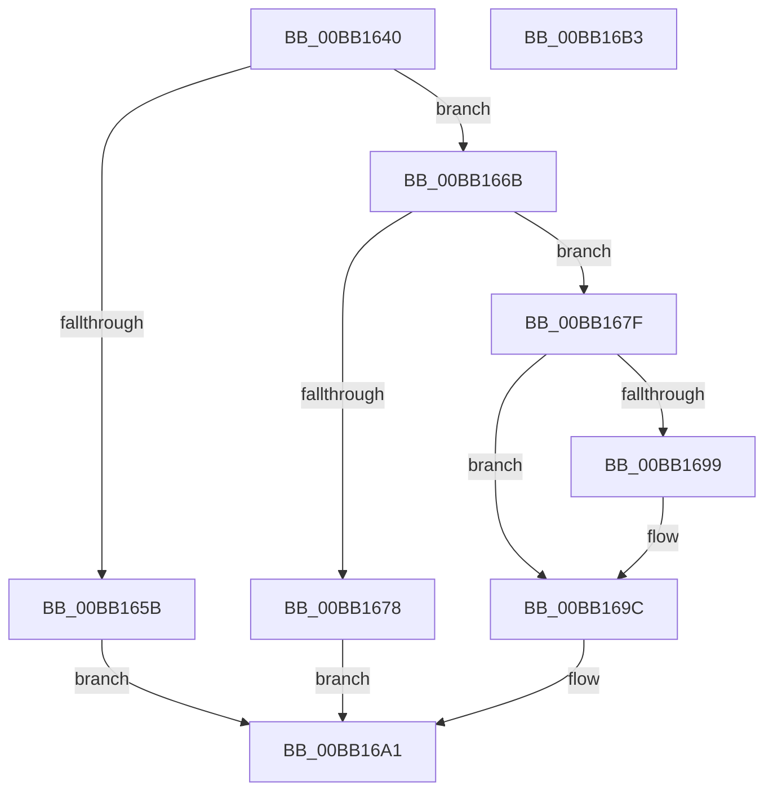

# VerifierIoWMIWriteEvent

- RVA: `0x00BB1640`–`0x00BB16B4` (길이 `116` bytes)
- VA: `0x0000000140BB1640`
- 실행 섹션: `PAGEVRFY`
- PDB 이름 있음: `예`; PDB Function 태그: `아니요`
- unwind 정보 RVA: `0x00060BC4`
- 디코드: `35`개 명령, `116/116` bytes 표시
- 미해석 바이트: `0` (있으면 어셈블리에 `.byte`로 보존)

> 이 문서는 커널 이미지의 기계어와 PDB 기호를 분석해 생성했습니다. 4번과 5번은 함수 원형과 자료형을 바이너리 사용 방식에서 추정한 C 해석이며 원본 소스 복구 결과는 아닙니다.

## 1. Dependencies

- 직접 호출 지점: **5**; 고유 호출 대상: **4**
- 직접 호출자로 확인된 함수: **0**
- RIP 상대 이미지 참조: **1**

### Outgoing calls
- `0x00BB1652` → [WmiVerifierTakeEventOwnership](../../text/64/WmiVerifierTakeEventOwnership_function_0064E4A0.md) (function, `0x0064E4A0`)
- `0x00BB1662` → [guard_dispatch_icall](../../text/6B/guard_dispatch_icall_function_006BAAD0.md) (function, `0x006BAAD0`)
- `0x00BB166B` → [WmiVerifierCopyEvent](../../text/64/WmiVerifierCopyEvent_function_0064E448.md) (function, `0x0064E448`)
- `0x00BB1689` → [guard_dispatch_icall](../../text/6B/guard_dispatch_icall_function_006BAAD0.md) (function, `0x006BAAD0`)
- `0x00BB169C` → [ExFreePoolWithTag](../../poolcode/B8/ExFreePoolWithTag_function_00B82870.md) (function, `0x00B82870`)

### Direct callers
- 이 함수 시작 RVA로 연결되는 직접 call은 확인되지 않았습니다. 간접 호출은 완전히 역산할 수 없습니다.

### Static image references
- `0x00BB165B` → RVA `0x00FFDC28` (`PAGEVRFD`; read)

## 2. Other-region calls and transfers

- 다른 실행 섹션으로 향하는 call: **5**
  - `0x00BB1652` → [WmiVerifierTakeEventOwnership](../../text/64/WmiVerifierTakeEventOwnership_function_0064E4A0.md) (`PAGEVRFY` → `.text`)
  - `0x00BB1662` → [guard_dispatch_icall](../../text/6B/guard_dispatch_icall_function_006BAAD0.md) (`PAGEVRFY` → `.text`)
  - `0x00BB166B` → [WmiVerifierCopyEvent](../../text/64/WmiVerifierCopyEvent_function_0064E448.md) (`PAGEVRFY` → `.text`)
  - `0x00BB1689` → [guard_dispatch_icall](../../text/6B/guard_dispatch_icall_function_006BAAD0.md) (`PAGEVRFY` → `.text`)
  - `0x00BB169C` → [ExFreePoolWithTag](../../poolcode/B8/ExFreePoolWithTag_function_00B82870.md) (`PAGEVRFY` → `POOLCODE`)
- 별도 외부 분기/꼬리 이동을 확인하지 못했습니다.

## 3. Assembly (complete function range)

```asm
00BB1640  48 89 5C 24 08                  mov qword ptr [rsp + 8], rbx
00BB1645  48 89 74 24 10                  mov qword ptr [rsp + 0x10], rsi
00BB164A  57                              push rdi
00BB164B  48 83 EC 20                     sub rsp, 0x20
00BB164F  48 8B F9                        mov rdi, rcx
00BB1652  E8 49 CE A9 FF                  call 0x14064e4a0
00BB1657  84 C0                           test al, al
00BB1659  75 10                           jne 0x140bb166b
00BB165B  48 8B 05 C6 C5 44 00            mov rax, qword ptr [rip + 0x44c5c6]
00BB1662  E8 69 94 B0 FF                  call 0x1406baad0
00BB1667  8B D8                           mov ebx, eax
00BB1669  EB 36                           jmp 0x140bb16a1
00BB166B  E8 D8 CD A9 FF                  call 0x14064e448
00BB1670  48 8B F0                        mov rsi, rax
00BB1673  48 85 C0                        test rax, rax
00BB1676  75 07                           jne 0x140bb167f
00BB1678  BB 9A 00 00 C0                  mov ebx, 0xc000009a
00BB167D  EB 22                           jmp 0x140bb16a1
00BB167F  48 8B 05 A2 C5 44 00            mov rax, qword ptr [rip + 0x44c5a2]
00BB1686  48 8B CE                        mov rcx, rsi
00BB1689  E8 42 94 B0 FF                  call 0x1406baad0
00BB168E  33 D2                           xor edx, edx
00BB1690  8B D8                           mov ebx, eax
00BB1692  48 8B CF                        mov rcx, rdi
00BB1695  85 C0                           test eax, eax
00BB1697  79 03                           jns 0x140bb169c
00BB1699  48 8B CE                        mov rcx, rsi
00BB169C  E8 CF 11 FD FF                  call 0x140b82870
00BB16A1  48 8B 74 24 38                  mov rsi, qword ptr [rsp + 0x38]
00BB16A6  8B C3                           mov eax, ebx
00BB16A8  48 8B 5C 24 30                  mov rbx, qword ptr [rsp + 0x30]
00BB16AD  48 83 C4 20                     add rsp, 0x20
00BB16B1  5F                              pop rdi
00BB16B2  C3                              ret
00BB16B3  CC                              int3
```

## 4. C-style interpretation (structured pseudocode)

```c
__int64 __fastcall VerifierIoWMIWriteEvent(__int64 a1, int a2)
{
    __int64 result;
    __int64 v_rsp;
    unsigned __int64 v_stack_p10;
    unsigned __int64 v_stack_p8;

    v_stack_p8 = v_rbx;
    v_stack_p10 = v_rsi;
    v_rsp = (v_rsp) - (32);
    result = WmiVerifierTakeEventOwnership(a1, a2, a3, a4);
    if ((unsigned __int8)(result) != 0) goto loc_00BB166B;
    result = guard_dispatch_icall(a1, a2, a3, a4);
    goto loc_00BB16A1;
loc_00BB166B:
    result = WmiVerifierCopyEvent(a1, a2, a3, a4);
    if (result != 0) goto loc_00BB167F;
    goto loc_00BB16A1;
loc_00BB167F:
    result = guard_dispatch_icall(result, a2, a3, a4);
    a2 = 0;
    if (sign_flag) {
        a1 = result;
    }
    result = ExFreePoolWithTag(a1, a2, a3, a4);
loc_00BB16A1:
    v_rsp = (v_rsp) + (32);
    return (unsigned int)((unsigned int)((unsigned int)((unsigned int)(result))));
}
```

## 5. (Beta) C Style

```c
int64_t VerifierIoWMIWriteEvent(int64_t Arg1, int32_t Arg2)
{
    int64_t result;
    int64_t local_rsp;
    uint64_t v_stack_p10;
    uint64_t v_stack_p8;

    v_stack_p8 = local_rbx;
    v_stack_p10 = local_rsi;
    local_rsp = (local_rsp) - (32);
    result = WmiVerifierTakeEventOwnership(Arg1, Arg2, a3, a4);
    if ((uint8_t)(result) != 0) goto loc_00BB166B;
    result = guard_dispatch_icall(Arg1, Arg2, a3, a4);
    goto loc_00BB16A1;
loc_00BB166B:
    result = WmiVerifierCopyEvent(Arg1, Arg2, a3, a4);
    if (result != 0) goto loc_00BB167F;
    goto loc_00BB16A1;
loc_00BB167F:
    result = guard_dispatch_icall(result, Arg2, a3, a4);
    Arg2 = 0;
    if (sign_flag) {
        Arg1 = result;
    }
    result = ExFreePoolWithTag(Arg1, Arg2, a3, a4);
loc_00BB16A1:
    local_rsp = (local_rsp) + (32);
    return (uint32_t)((uint32_t)((uint32_t)((uint32_t)(result))));
}
```

## 6. Execution-region graph

[열기: 2D/3D 그래프와 함수 탐색 컨트롤 패널](../../../control-panel.html?section=pagevrfy&rva=0x00BB1640&view=graph)

- 2D 그래프는 위에서 아래로 흐르고, 3D 그래프는 빈 공간을 드래그해 회전합니다. Shift+드래그는 이동, 휠은 확대·축소, 함수 노드 선택은 대상 보고서 이동입니다.

### Static fallback


