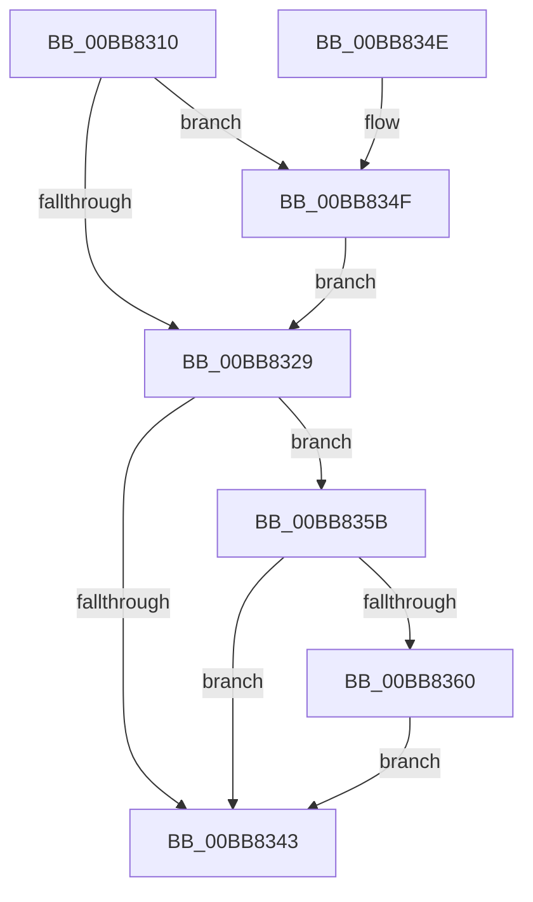

# VerifierKeAcquireSpinLockRaiseToDpc

- RVA: `0x00BB8310`–`0x00BB836E` (길이 `94` bytes)
- VA: `0x0000000140BB8310`
- 실행 섹션: `PAGEVRFY`
- PDB 이름 있음: `예`; PDB Function 태그: `아니요`
- unwind 정보 RVA: `0x000AE450`
- 디코드: `28`개 명령, `94/94` bytes 표시
- 미해석 바이트: `0` (있으면 어셈블리에 `.byte`로 보존)

> 이 문서는 커널 이미지의 기계어와 PDB 기호를 분석해 생성했습니다. 4번과 5번은 함수 원형과 자료형을 바이너리 사용 방식에서 추정한 C 해석이며 원본 소스 복구 결과는 아닙니다.

## 1. Dependencies

- 직접 호출 지점: **2**; 고유 호출 대상: **2**
- 직접 호출자로 확인된 함수: **0**
- RIP 상대 이미지 참조: **2**

### Outgoing calls
- `0x00BB8333` → [guard_dispatch_icall](../../text/6B/guard_dispatch_icall_function_006BAAD0.md) (function, `0x006BAAD0`)
- `0x00BB8351` → [ViKeIrqlLogAndTrimMemory](ViKeIrqlLogAndTrimMemory_function_00BB7F58.md) (function, `0x00BB7F58`)

### Direct callers
- 이 함수 시작 RVA로 연결되는 직접 call은 확인되지 않았습니다. 간접 호출은 완전히 역산할 수 없습니다.

### Static image references
- `0x00BB831A` → RVA `0x00E681A0` (`.data`; read)
- `0x00BB8329` → RVA `0x00FFDBA8` (`PAGEVRFD`; read)

## 2. Other-region calls and transfers

- 다른 실행 섹션으로 향하는 call: **1**
  - `0x00BB8333` → [guard_dispatch_icall](../../text/6B/guard_dispatch_icall_function_006BAAD0.md) (`PAGEVRFY` → `.text`)
- 별도 외부 분기/꼬리 이동을 확인하지 못했습니다.

## 3. Assembly (complete function range)

```asm
00BB8310  48 89 5C 24 08                  mov qword ptr [rsp + 8], rbx
00BB8315  57                              push rdi
00BB8316  48 83 EC 20                     sub rsp, 0x20
00BB831A  8B 05 80 FE 2A 00               mov eax, dword ptr [rip + 0x2afe80]
00BB8320  33 DB                           xor ebx, ebx
00BB8322  48 8B F9                        mov rdi, rcx
00BB8325  A8 02                           test al, 2
00BB8327  75 26                           jne 0x140bb834f
00BB8329  48 8B 05 78 58 44 00            mov rax, qword ptr [rip + 0x445878]
00BB8330  48 8B CF                        mov rcx, rdi
00BB8333  E8 98 27 B0 FF                  call 0x1406baad0
00BB8338  8B 0D 62 FE 2A 00               mov ecx, dword ptr [rip + 0x2afe62]
00BB833E  F6 C1 02                        test cl, 2
00BB8341  75 18                           jne 0x140bb835b
00BB8343  48 8B 5C 24 30                  mov rbx, qword ptr [rsp + 0x30]
00BB8348  48 83 C4 20                     add rsp, 0x20
00BB834C  5F                              pop rdi
00BB834D  C3                              ret
00BB834E  CC                              int3
00BB834F  B1 02                           mov cl, 2
00BB8351  E8 02 FC FF FF                  call 0x140bb7f58
00BB8356  48 8B D8                        mov rbx, rax
00BB8359  EB CE                           jmp 0x140bb8329
00BB835B  48 85 DB                        test rbx, rbx
00BB835E  74 E3                           je 0x140bb8343
00BB8360  65 8B 0C 25 A4 01 00 00         mov ecx, dword ptr gs:[0x1a4]
00BB8368  66 89 4B 0A                     mov word ptr [rbx + 0xa], cx
00BB836C  EB D5                           jmp 0x140bb8343
```

## 4. C-style interpretation (structured pseudocode)

```c
__int64 __fastcall VerifierKeAcquireSpinLockRaiseToDpc(__int64 a1)
{
    __int64 result;
    __int64 v_rbx;
    __int64 v_rsp;
    unsigned __int64 v_stack_p8;

    v_stack_p8 = v_rbx;
    v_rsp = (v_rsp) - (32);
    v_rbx = 0;
    if ((((unsigned __int8)((unsigned int)(*(unsigned int *)(v_rip + 2817664)))) & (2)) != 0) goto loc_00BB834F;
loc_00BB8329:
    result = guard_dispatch_icall(a1, a2, a3, a4);
    if ((((unsigned __int8)((unsigned int)(*(unsigned int *)(v_rip + 2817634)))) & (2)) != 0) goto loc_00BB835B;
loc_00BB8343:
    v_rsp = (v_rsp) + (32);
    return result;
loc_00BB834F:
    result = ViKeIrqlLogAndTrimMemory(2, a2, a3, a4);
    goto loc_00BB8329;
loc_00BB835B:
    if (result == 0) goto loc_00BB8343;
    *(unsigned __int16 *)(result + 10) = (unsigned __int16)((unsigned int)(*(unsigned int *)(gs_base + (0 + 420))));
    goto loc_00BB8343;
}
```

## 5. (Beta) C Style

```c
int64_t VerifierKeAcquireSpinLockRaiseToDpc(int64_t Arg1)
{
    int64_t result;
    int64_t local_rbx;
    int64_t local_rsp;
    uint64_t v_stack_p8;

    v_stack_p8 = local_rbx;
    local_rsp = (local_rsp) - (32);
    local_rbx = 0;
    if ((((uint8_t)((uint32_t)(*(uint32_t *)(v_rip + 0x2AFE80)))) & (2)) != 0) goto loc_00BB834F;
loc_00BB8329:
    result = guard_dispatch_icall(Arg1, a2, a3, a4);
    if ((((uint8_t)((uint32_t)(*(uint32_t *)(v_rip + 0x2AFE62)))) & (2)) != 0) goto loc_00BB835B;
loc_00BB8343:
    local_rsp = (local_rsp) + (32);
    return result;
loc_00BB834F:
    result = ViKeIrqlLogAndTrimMemory(2, a2, a3, a4);
    goto loc_00BB8329;
loc_00BB835B:
    if (result == 0) goto loc_00BB8343;
    *(uint16_t *)(result + 0xA) = (uint16_t)((uint32_t)(*(uint32_t *)(gs_base + (0 + 0x1A4))));
    goto loc_00BB8343;
}
```

## 6. Execution-region graph

[열기: 2D/3D 그래프와 함수 탐색 컨트롤 패널](../../../control-panel.html?section=pagevrfy&rva=0x00BB8310&view=graph)

- 2D 그래프는 위에서 아래로 흐르고, 3D 그래프는 빈 공간을 드래그해 회전합니다. Shift+드래그는 이동, 휠은 확대·축소, 함수 노드 선택은 대상 보고서 이동입니다.

### Static fallback


