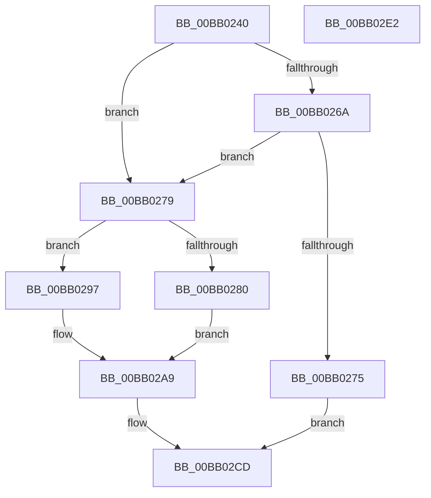

# VerifierMmAllocateContiguousMemorySpecifyCacheNode

- RVA: `0x00BB0240`–`0x00BB02E3` (길이 `163` bytes)
- VA: `0x0000000140BB0240`
- 실행 섹션: `PAGEVRFY`
- PDB 이름 있음: `예`; PDB Function 태그: `아니요`
- unwind 정보 RVA: `0x0007D3C0`
- 디코드: `47`개 명령, `163/163` bytes 표시
- 미해석 바이트: `0` (있으면 어셈블리에 `.byte`로 보존)

> 이 문서는 커널 이미지의 기계어와 PDB 기호를 분석해 생성했습니다. 4번과 5번은 함수 원형과 자료형을 바이너리 사용 방식에서 추정한 C 해석이며 원본 소스 복구 결과는 아닙니다.

## 1. Dependencies

- 직접 호출 지점: **2**; 고유 호출 대상: **2**
- 직접 호출자로 확인된 함수: **0**
- RIP 상대 이미지 참조: **3**

### Outgoing calls
- `0x00BB026C` → [VfFaultsInjectResourceFailure](../BA/VfFaultsInjectResourceFailure_function_00BA6558.md) (function, `0x00BA6558`)
- `0x00BB02C8` → [guard_dispatch_icall](../../text/6B/guard_dispatch_icall_function_006BAAD0.md) (function, `0x006BAAD0`)

### Direct callers
- 이 함수 시작 RVA로 연결되는 직접 call은 확인되지 않았습니다. 간접 호출은 완전히 역산할 수 없습니다.

### Static image references
- `0x00BB0254` → RVA `0x00E681A0` (`.data`; read)
- `0x00BB0280` → RVA `0x00F04A20` (`.data`; read)
- `0x00BB02B0` → RVA `0x00FFDB20` (`PAGEVRFD`; read)

## 2. Other-region calls and transfers

- 다른 실행 섹션으로 향하는 call: **1**
  - `0x00BB02C8` → [guard_dispatch_icall](../../text/6B/guard_dispatch_icall_function_006BAAD0.md) (`PAGEVRFY` → `.text`)
- 별도 외부 분기/꼬리 이동을 확인하지 못했습니다.

## 3. Assembly (complete function range)

```asm
00BB0240  48 89 5C 24 08                  mov qword ptr [rsp + 8], rbx
00BB0245  48 89 6C 24 10                  mov qword ptr [rsp + 0x10], rbp
00BB024A  48 89 74 24 18                  mov qword ptr [rsp + 0x18], rsi
00BB024F  57                              push rdi
00BB0250  48 83 EC 40                     sub rsp, 0x40
00BB0254  8B 05 46 7F 2B 00               mov eax, dword ptr [rip + 0x2b7f46]
00BB025A  49 8B D9                        mov rbx, r9
00BB025D  49 8B F8                        mov rdi, r8
00BB0260  48 8B F2                        mov rsi, rdx
00BB0263  48 8B E9                        mov rbp, rcx
00BB0266  A8 04                           test al, 4
00BB0268  74 0F                           je 0x140bb0279
00BB026A  33 C9                           xor ecx, ecx
00BB026C  E8 E7 62 FF FF                  call 0x140ba6558
00BB0271  85 C0                           test eax, eax
00BB0273  74 04                           je 0x140bb0279
00BB0275  33 C0                           xor eax, eax
00BB0277  EB 54                           jmp 0x140bb02cd
00BB0279  83 7C 24 70 01                  cmp dword ptr [rsp + 0x70], 1
00BB027E  75 17                           jne 0x140bb0297
00BB0280  8B 05 9A 47 35 00               mov eax, dword ptr [rip + 0x35479a]
00BB0286  25 00 00 00 02                  and eax, 0x2000000
00BB028B  F7 D8                           neg eax
00BB028D  1B D2                           sbb edx, edx
00BB028F  83 E2 C4                        and edx, 0xffffffc4
00BB0292  83 C2 40                        add edx, 0x40
00BB0295  EB 12                           jmp 0x140bb02a9
00BB0297  83 7C 24 70 02                  cmp dword ptr [rsp + 0x70], 2
00BB029C  BA 04 02 00 00                  mov edx, 0x204
00BB02A1  B8 04 04 00 00                  mov eax, 0x404
00BB02A6  0F 44 D0                        cmove edx, eax
00BB02A9  8B 4C 24 78                     mov ecx, dword ptr [rsp + 0x78]
00BB02AD  4C 8B CB                        mov r9, rbx
00BB02B0  48 8B 05 69 D8 44 00            mov rax, qword ptr [rip + 0x44d869]
00BB02B7  4C 8B C7                        mov r8, rdi
00BB02BA  89 4C 24 28                     mov dword ptr [rsp + 0x28], ecx
00BB02BE  48 8B CD                        mov rcx, rbp
00BB02C1  89 54 24 20                     mov dword ptr [rsp + 0x20], edx
00BB02C5  48 8B D6                        mov rdx, rsi
00BB02C8  E8 03 A8 B0 FF                  call 0x1406baad0
00BB02CD  48 8B 5C 24 50                  mov rbx, qword ptr [rsp + 0x50]
00BB02D2  48 8B 6C 24 58                  mov rbp, qword ptr [rsp + 0x58]
00BB02D7  48 8B 74 24 60                  mov rsi, qword ptr [rsp + 0x60]
00BB02DC  48 83 C4 40                     add rsp, 0x40
00BB02E0  5F                              pop rdi
00BB02E1  C3                              ret
00BB02E2  CC                              int3
```

## 4. C-style interpretation (structured pseudocode)

```c
__int64 __fastcall VerifierMmAllocateContiguousMemorySpecifyCacheNode(__int64 a1, __int64 a2, __int64 a3, __int64 a4, unsigned int a5, unsigned int a6)
{
    __int64 result;
    __int64 v_rsp;
    unsigned int v_stack_m20;
    unsigned int v_stack_m28;
    unsigned __int64 v_stack_p10;
    unsigned __int64 v_stack_p18;
    unsigned __int64 v_stack_p8;

    v_stack_p8 = v_rbx;
    v_stack_p10 = v_rbp;
    v_stack_p18 = v_rsi;
    v_rsp = (v_rsp) - (64);
    if ((((unsigned __int8)((unsigned int)(*(unsigned int *)(v_rip + 2850630)))) & (4)) == 0) goto loc_00BB0279;
    a1 = 0;
    result = VfFaultsInjectResourceFailure(a1, a2, a3, a4);
    if ((unsigned int)(result) == 0) goto loc_00BB0279;
    result = 0;
    goto loc_00BB02CD;
loc_00BB0279:
    if (a5 != 1) goto loc_00BB0297;
    result = (unsigned int)(((unsigned int)(*(unsigned int *)(v_rip + 3491738))) & (0x2000000ULL));
    result = (unsigned int)(-(result));
    a2 = (unsigned int)((a2) & (0xFFFFFFC4ULL));
    a2 = (unsigned int)((a2) + (64));
    goto loc_00BB02A9;
loc_00BB0297:
    a2 = 516;
    if (a5 == 2) { a2 = (unsigned int)((unsigned int)(0x404ULL)); }
loc_00BB02A9:
    v_stack_m20 = (unsigned int)((unsigned int)(a6));
    v_stack_m28 = (unsigned int)(a2);
    result = guard_dispatch_icall(0, a2, a3, a4);
loc_00BB02CD:
    v_rsp = (v_rsp) + (64);
    return result;
}
```

## 5. (Beta) C Style

```c
int64_t VerifierMmAllocateContiguousMemorySpecifyCacheNode(int64_t Arg1, int64_t Arg2, int64_t Arg3, int64_t Arg4, uint32_t Arg5, uint32_t Arg6)
{
    int64_t result;
    int64_t local_rsp;
    uint32_t v_stack_m20;
    uint32_t v_stack_m28;
    uint64_t v_stack_p10;
    uint64_t v_stack_p18;
    uint64_t v_stack_p8;

    v_stack_p8 = local_rbx;
    v_stack_p10 = local_rbp;
    v_stack_p18 = local_rsi;
    local_rsp = (local_rsp) - (64);
    if ((((uint8_t)((uint32_t)(*(uint32_t *)(v_rip + 0x2B7F46)))) & (4)) == 0) goto loc_00BB0279;
    Arg1 = 0;
    result = VfFaultsInjectResourceFailure(Arg1, Arg2, Arg3, Arg4);
    if ((uint32_t)(result) == 0) goto loc_00BB0279;
    result = 0;
    goto loc_00BB02CD;
loc_00BB0279:
    if (Arg5 != 1) goto loc_00BB0297;
    result = (uint32_t)(((uint32_t)(*(uint32_t *)(v_rip + 0x35479A))) & (0x2000000ULL));
    result = (uint32_t)(-(result));
    Arg2 = (uint32_t)((Arg2) & (0xFFFFFFC4ULL));
    Arg2 = (uint32_t)((Arg2) + (64));
    goto loc_00BB02A9;
loc_00BB0297:
    Arg2 = 516;
    if (Arg5 == 2) { Arg2 = (uint32_t)((uint32_t)(0x404ULL)); }
loc_00BB02A9:
    v_stack_m20 = (uint32_t)((uint32_t)(Arg6));
    v_stack_m28 = (uint32_t)(Arg2);
    result = guard_dispatch_icall(0, Arg2, Arg3, Arg4);
loc_00BB02CD:
    local_rsp = (local_rsp) + (64);
    return result;
}
```

## 6. Execution-region graph

[열기: 2D/3D 그래프와 함수 탐색 컨트롤 패널](../../../control-panel.html?section=pagevrfy&rva=0x00BB0240&view=graph)

- 2D 그래프는 위에서 아래로 흐르고, 3D 그래프는 빈 공간을 드래그해 회전합니다. Shift+드래그는 이동, 휠은 확대·축소, 함수 노드 선택은 대상 보고서 이동입니다.

### Static fallback


