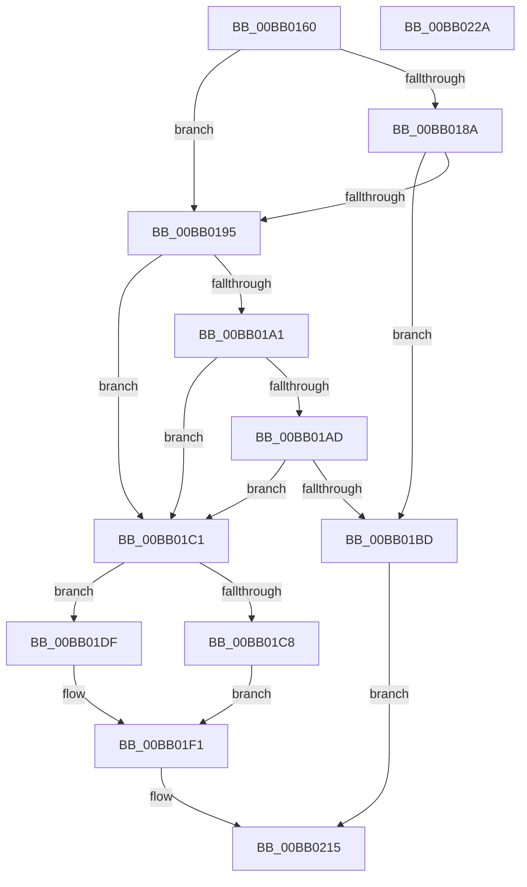

# VerifierMmAllocateContiguousMemorySpecifyCache

- RVA: `0x00BB0160`–`0x00BB022B` (길이 `203` bytes)
- VA: `0x0000000140BB0160`
- 실행 섹션: `PAGEVRFY`
- PDB 이름 있음: `예`; PDB Function 태그: `아니요`
- unwind 정보 RVA: `0x0007D3C0`
- 디코드: `55`개 명령, `203/203` bytes 표시
- 미해석 바이트: `0` (있으면 어셈블리에 `.byte`로 보존)

> 이 문서는 커널 이미지의 기계어와 PDB 기호를 분석해 생성했습니다. 4번과 5번은 함수 원형과 자료형을 바이너리 사용 방식에서 추정한 C 해석이며 원본 소스 복구 결과는 아닙니다.

## 1. Dependencies

- 직접 호출 지점: **3**; 고유 호출 대상: **2**
- 직접 호출자로 확인된 함수: **0**
- RIP 상대 이미지 참조: **5**

### Outgoing calls
- `0x00BB018C` → [VfFaultsInjectResourceFailure](../BA/VfFaultsInjectResourceFailure_function_00BA6558.md) (function, `0x00BA6558`)
- `0x00BB01B4` → [guard_dispatch_icall](../../text/6B/guard_dispatch_icall_function_006BAAD0.md) (function, `0x006BAAD0`)
- `0x00BB0210` → [guard_dispatch_icall](../../text/6B/guard_dispatch_icall_function_006BAAD0.md) (function, `0x006BAAD0`)

### Direct callers
- 이 함수 시작 RVA로 연결되는 직접 call은 확인되지 않았습니다. 간접 호출은 완전히 역산할 수 없습니다.

### Static image references
- `0x00BB0174` → RVA `0x00E681A0` (`.data`; read)
- `0x00BB01A1` → RVA `0x00FFDA10` (`PAGEVRFD`; read)
- `0x00BB01AD` → RVA `0x00BBB840` (` ?? ::JKADOLAD::`string'`; read)
- `0x00BB01C8` → RVA `0x00F04A20` (`.data`; read)
- `0x00BB01F1` → RVA `0x00FFDB20` (`PAGEVRFD`; read)

## 2. Other-region calls and transfers

- 다른 실행 섹션으로 향하는 call: **2**
  - `0x00BB01B4` → [guard_dispatch_icall](../../text/6B/guard_dispatch_icall_function_006BAAD0.md) (`PAGEVRFY` → `.text`)
  - `0x00BB0210` → [guard_dispatch_icall](../../text/6B/guard_dispatch_icall_function_006BAAD0.md) (`PAGEVRFY` → `.text`)
- 별도 외부 분기/꼬리 이동을 확인하지 못했습니다.

## 3. Assembly (complete function range)

```asm
00BB0160  48 89 5C 24 08                  mov qword ptr [rsp + 8], rbx
00BB0165  48 89 6C 24 10                  mov qword ptr [rsp + 0x10], rbp
00BB016A  48 89 74 24 18                  mov qword ptr [rsp + 0x18], rsi
00BB016F  57                              push rdi
00BB0170  48 83 EC 40                     sub rsp, 0x40
00BB0174  8B 05 26 80 2B 00               mov eax, dword ptr [rip + 0x2b8026]
00BB017A  49 8B D9                        mov rbx, r9
00BB017D  49 8B F8                        mov rdi, r8
00BB0180  48 8B F2                        mov rsi, rdx
00BB0183  48 8B E9                        mov rbp, rcx
00BB0186  A8 04                           test al, 4
00BB0188  74 0B                           je 0x140bb0195
00BB018A  33 C9                           xor ecx, ecx
00BB018C  E8 C7 63 FF FF                  call 0x140ba6558
00BB0191  85 C0                           test eax, eax
00BB0193  75 28                           jne 0x140bb01bd
00BB0195  F7 05 01 80 2B 00 00 00 04 00   test dword ptr [rip + 0x2b8001], 0x40000
00BB019F  74 20                           je 0x140bb01c1
00BB01A1  48 8B 05 68 D8 44 00            mov rax, qword ptr [rip + 0x44d868]
00BB01A8  48 85 C0                        test rax, rax
00BB01AB  74 14                           je 0x140bb01c1
00BB01AD  48 8D 0D 8C B6 00 00            lea rcx, [rip + 0xb68c]
00BB01B4  E8 17 A9 B0 FF                  call 0x1406baad0
00BB01B9  84 C0                           test al, al
00BB01BB  74 04                           je 0x140bb01c1
00BB01BD  33 C0                           xor eax, eax
00BB01BF  EB 54                           jmp 0x140bb0215
00BB01C1  83 7C 24 70 01                  cmp dword ptr [rsp + 0x70], 1
00BB01C6  75 17                           jne 0x140bb01df
00BB01C8  8B 05 52 48 35 00               mov eax, dword ptr [rip + 0x354852]
00BB01CE  25 00 00 00 02                  and eax, 0x2000000
00BB01D3  F7 D8                           neg eax
00BB01D5  1B C9                           sbb ecx, ecx
00BB01D7  83 E1 C4                        and ecx, 0xffffffc4
00BB01DA  83 C1 40                        add ecx, 0x40
00BB01DD  EB 12                           jmp 0x140bb01f1
00BB01DF  83 7C 24 70 02                  cmp dword ptr [rsp + 0x70], 2
00BB01E4  B9 04 02 00 00                  mov ecx, 0x204
00BB01E9  B8 04 04 00 00                  mov eax, 0x404
00BB01EE  0F 44 C8                        cmove ecx, eax
00BB01F1  48 8B 05 28 D9 44 00            mov rax, qword ptr [rip + 0x44d928]
00BB01F8  4C 8B CB                        mov r9, rbx
00BB01FB  C7 44 24 28 00 00 00 80         mov dword ptr [rsp + 0x28], 0x80000000
00BB0203  4C 8B C7                        mov r8, rdi
00BB0206  89 4C 24 20                     mov dword ptr [rsp + 0x20], ecx
00BB020A  48 8B D6                        mov rdx, rsi
00BB020D  48 8B CD                        mov rcx, rbp
00BB0210  E8 BB A8 B0 FF                  call 0x1406baad0
00BB0215  48 8B 5C 24 50                  mov rbx, qword ptr [rsp + 0x50]
00BB021A  48 8B 6C 24 58                  mov rbp, qword ptr [rsp + 0x58]
00BB021F  48 8B 74 24 60                  mov rsi, qword ptr [rsp + 0x60]
00BB0224  48 83 C4 40                     add rsp, 0x40
00BB0228  5F                              pop rdi
00BB0229  C3                              ret
00BB022A  CC                              int3
```

## 4. C-style interpretation (structured pseudocode)

```c
__int64 __fastcall VerifierMmAllocateContiguousMemorySpecifyCache(__int64 a1, __int64 a2, __int64 a3, __int64 a4, unsigned int a5)
{
    __int64 result;
    __int64 v_rsp;
    unsigned int v_stack_m20;
    unsigned int v_stack_m28;
    unsigned __int64 v_stack_p10;
    unsigned __int64 v_stack_p18;
    unsigned __int64 v_stack_p8;

    v_stack_p8 = v_rbx;
    v_stack_p10 = v_rbp;
    v_stack_p18 = v_rsi;
    v_rsp = (v_rsp) - (64);
    if ((((unsigned __int8)((unsigned int)(*(unsigned int *)(v_rip + 2850854)))) & (4)) == 0) goto loc_00BB0195;
    a1 = 0;
    result = VfFaultsInjectResourceFailure(a1, a2, a3, a4);
    if ((unsigned int)(result) != 0) goto loc_00BB01BD;
loc_00BB0195:
    if (((*(unsigned int *)(v_rip + 2850817)) & (0x40000ULL)) == 0) goto loc_00BB01C1;
    if (*(unsigned __int64 *)(v_rip + 4511848) == 0) goto loc_00BB01C1;
    result = guard_dispatch_icall(v_rip + 46732, a2, a3, a4);
    if ((unsigned __int8)(result) == 0) goto loc_00BB01C1;
loc_00BB01BD:
    result = 0;
    goto loc_00BB0215;
loc_00BB01C1:
    if (a5 != 1) goto loc_00BB01DF;
    result = (unsigned int)(((unsigned int)(*(unsigned int *)(v_rip + 3491922))) & (0x2000000ULL));
    result = (unsigned int)(-(result));
    a1 = (unsigned int)((v_rip + 46732) & (0xFFFFFFC4ULL));
    a1 = (unsigned int)((a1) + (64));
    goto loc_00BB01F1;
loc_00BB01DF:
    a1 = 516;
    if (a5 == 2) { a1 = (unsigned int)((unsigned int)(0x404ULL)); }
loc_00BB01F1:
    v_stack_m20 = 0x80000000ULL;
    v_stack_m28 = (unsigned int)(a1);
    result = guard_dispatch_icall(a1, a2, a3, a4);
loc_00BB0215:
    v_rsp = (v_rsp) + (64);
    return result;
}
```

## 5. (Beta) C Style

```c
int64_t VerifierMmAllocateContiguousMemorySpecifyCache(int64_t Arg1, int64_t Arg2, int64_t Arg3, int64_t Arg4, uint32_t Arg5)
{
    int64_t result;
    int64_t local_rsp;
    uint32_t v_stack_m20;
    uint32_t v_stack_m28;
    uint64_t v_stack_p10;
    uint64_t v_stack_p18;
    uint64_t v_stack_p8;

    v_stack_p8 = local_rbx;
    v_stack_p10 = local_rbp;
    v_stack_p18 = local_rsi;
    local_rsp = (local_rsp) - (64);
    if ((((uint8_t)((uint32_t)(*(uint32_t *)(v_rip + 0x2B8026)))) & (4)) == 0) goto loc_00BB0195;
    Arg1 = 0;
    result = VfFaultsInjectResourceFailure(Arg1, Arg2, Arg3, Arg4);
    if ((uint32_t)(result) != 0) goto loc_00BB01BD;
loc_00BB0195:
    if (((*(uint32_t *)(v_rip + 0x2B8001)) & (0x40000ULL)) == 0) goto loc_00BB01C1;
    if (*(uint64_t *)(v_rip + 0x44D868) == 0) goto loc_00BB01C1;
    result = guard_dispatch_icall(v_rip + 46732, Arg2, Arg3, Arg4);
    if ((uint8_t)(result) == 0) goto loc_00BB01C1;
loc_00BB01BD:
    result = 0;
    goto loc_00BB0215;
loc_00BB01C1:
    if (Arg5 != 1) goto loc_00BB01DF;
    result = (uint32_t)(((uint32_t)(*(uint32_t *)(v_rip + 0x354852))) & (0x2000000ULL));
    result = (uint32_t)(-(result));
    Arg1 = (uint32_t)((v_rip + 46732) & (0xFFFFFFC4ULL));
    Arg1 = (uint32_t)((Arg1) + (64));
    goto loc_00BB01F1;
loc_00BB01DF:
    Arg1 = 516;
    if (Arg5 == 2) { Arg1 = (uint32_t)((uint32_t)(0x404ULL)); }
loc_00BB01F1:
    v_stack_m20 = 0x80000000ULL;
    v_stack_m28 = (uint32_t)(Arg1);
    result = guard_dispatch_icall(Arg1, Arg2, Arg3, Arg4);
loc_00BB0215:
    local_rsp = (local_rsp) + (64);
    return result;
}
```

## 6. Execution-region graph

[열기: 2D/3D 그래프와 함수 탐색 컨트롤 패널](../../../control-panel.html?section=pagevrfy&rva=0x00BB0160&view=graph)

- 2D 그래프는 위에서 아래로 흐르고, 3D 그래프는 빈 공간을 드래그해 회전합니다. Shift+드래그는 이동, 휠은 확대·축소, 함수 노드 선택은 대상 보고서 이동입니다.

### Static fallback


