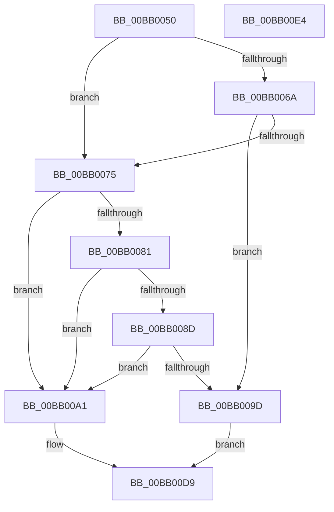

# VerifierMmAllocateContiguousMemory

- RVA: `0x00BB0050`–`0x00BB00E5` (길이 `149` bytes)
- VA: `0x0000000140BB0050`
- 실행 섹션: `PAGEVRFY`
- PDB 이름 있음: `예`; PDB Function 태그: `아니요`
- unwind 정보 RVA: `0x00065960`
- 디코드: `42`개 명령, `149/149` bytes 표시
- 미해석 바이트: `0` (있으면 어셈블리에 `.byte`로 보존)

> 이 문서는 커널 이미지의 기계어와 PDB 기호를 분석해 생성했습니다. 4번과 5번은 함수 원형과 자료형을 바이너리 사용 방식에서 추정한 C 해석이며 원본 소스 복구 결과는 아닙니다.

## 1. Dependencies

- 직접 호출 지점: **3**; 고유 호출 대상: **2**
- 직접 호출자로 확인된 함수: **0**
- RIP 상대 이미지 참조: **5**

### Outgoing calls
- `0x00BB006C` → [VfFaultsInjectResourceFailure](../BA/VfFaultsInjectResourceFailure_function_00BA6558.md) (function, `0x00BA6558`)
- `0x00BB0094` → [guard_dispatch_icall](../../text/6B/guard_dispatch_icall_function_006BAAD0.md) (function, `0x006BAAD0`)
- `0x00BB00D4` → [guard_dispatch_icall](../../text/6B/guard_dispatch_icall_function_006BAAD0.md) (function, `0x006BAAD0`)

### Direct callers
- 이 함수 시작 RVA로 연결되는 직접 call은 확인되지 않았습니다. 간접 호출은 완전히 역산할 수 없습니다.

### Static image references
- `0x00BB005A` → RVA `0x00E681A0` (`.data`; read)
- `0x00BB0081` → RVA `0x00FFDA10` (`PAGEVRFD`; read)
- `0x00BB008D` → RVA `0x00BBB3F0` (` ?? ::JKADOLAD::`string'`; read)
- `0x00BB00A1` → RVA `0x00F04A20` (`.data`; read)
- `0x00BB00B9` → RVA `0x00FFDB20` (`PAGEVRFD`; read)

## 2. Other-region calls and transfers

- 다른 실행 섹션으로 향하는 call: **2**
  - `0x00BB0094` → [guard_dispatch_icall](../../text/6B/guard_dispatch_icall_function_006BAAD0.md) (`PAGEVRFY` → `.text`)
  - `0x00BB00D4` → [guard_dispatch_icall](../../text/6B/guard_dispatch_icall_function_006BAAD0.md) (`PAGEVRFY` → `.text`)
- 별도 외부 분기/꼬리 이동을 확인하지 못했습니다.

## 3. Assembly (complete function range)

```asm
00BB0050  48 89 5C 24 08                  mov qword ptr [rsp + 8], rbx
00BB0055  57                              push rdi
00BB0056  48 83 EC 40                     sub rsp, 0x40
00BB005A  8B 05 40 81 2B 00               mov eax, dword ptr [rip + 0x2b8140]
00BB0060  48 8B DA                        mov rbx, rdx
00BB0063  48 8B F9                        mov rdi, rcx
00BB0066  A8 04                           test al, 4
00BB0068  74 0B                           je 0x140bb0075
00BB006A  33 C9                           xor ecx, ecx
00BB006C  E8 E7 64 FF FF                  call 0x140ba6558
00BB0071  85 C0                           test eax, eax
00BB0073  75 28                           jne 0x140bb009d
00BB0075  F7 05 21 81 2B 00 00 00 04 00   test dword ptr [rip + 0x2b8121], 0x40000
00BB007F  74 20                           je 0x140bb00a1
00BB0081  48 8B 05 88 D9 44 00            mov rax, qword ptr [rip + 0x44d988]
00BB0088  48 85 C0                        test rax, rax
00BB008B  74 14                           je 0x140bb00a1
00BB008D  48 8D 0D 5C B3 00 00            lea rcx, [rip + 0xb35c]
00BB0094  E8 37 AA B0 FF                  call 0x1406baad0
00BB0099  84 C0                           test al, al
00BB009B  74 04                           je 0x140bb00a1
00BB009D  33 C0                           xor eax, eax
00BB009F  EB 38                           jmp 0x140bb00d9
00BB00A1  8B 05 79 49 35 00               mov eax, dword ptr [rip + 0x354979]
00BB00A7  4C 8B C3                        mov r8, rbx
00BB00AA  25 00 00 00 02                  and eax, 0x2000000
00BB00AF  C7 44 24 28 00 00 00 80         mov dword ptr [rsp + 0x28], 0x80000000
00BB00B7  F7 D8                           neg eax
00BB00B9  48 8B 05 60 DA 44 00            mov rax, qword ptr [rip + 0x44da60]
00BB00C0  1B C9                           sbb ecx, ecx
00BB00C2  45 33 C9                        xor r9d, r9d
00BB00C5  83 E1 C4                        and ecx, 0xffffffc4
00BB00C8  33 D2                           xor edx, edx
00BB00CA  83 C1 40                        add ecx, 0x40
00BB00CD  89 4C 24 20                     mov dword ptr [rsp + 0x20], ecx
00BB00D1  48 8B CF                        mov rcx, rdi
00BB00D4  E8 F7 A9 B0 FF                  call 0x1406baad0
00BB00D9  48 8B 5C 24 50                  mov rbx, qword ptr [rsp + 0x50]
00BB00DE  48 83 C4 40                     add rsp, 0x40
00BB00E2  5F                              pop rdi
00BB00E3  C3                              ret
00BB00E4  CC                              int3
```

## 4. C-style interpretation (structured pseudocode)

```c
__int64 __fastcall VerifierMmAllocateContiguousMemory(__int64 a1, __int64 a2, __int64 a3, int a4)
{
    __int64 result;
    __int64 v_rsp;
    unsigned int v_stack_m20;
    unsigned int v_stack_m28;
    unsigned __int64 v_stack_p8;

    v_stack_p8 = v_rbx;
    v_rsp = (v_rsp) - (64);
    if ((((unsigned __int8)((unsigned int)(*(unsigned int *)(v_rip + 2851136)))) & (4)) == 0) goto loc_00BB0075;
    a1 = 0;
    result = VfFaultsInjectResourceFailure(a1, a2, a3, a4);
    if ((unsigned int)(result) != 0) goto loc_00BB009D;
loc_00BB0075:
    if (((*(unsigned int *)(v_rip + 2851105)) & (0x40000ULL)) == 0) goto loc_00BB00A1;
    if (*(unsigned __int64 *)(v_rip + 4512136) == 0) goto loc_00BB00A1;
    result = guard_dispatch_icall(v_rip + 45916, a2, a3, a4);
    if ((unsigned __int8)(result) == 0) goto loc_00BB00A1;
loc_00BB009D:
    result = 0;
    goto loc_00BB00D9;
loc_00BB00A1:
    result = (unsigned int)(((unsigned int)(*(unsigned int *)(v_rip + 3492217))) & (0x2000000ULL));
    v_stack_m20 = 0x80000000ULL;
    result = (unsigned int)(-(result));
    a4 = 0;
    a1 = (unsigned int)((v_rip + 45916) & (0xFFFFFFC4ULL));
    a2 = 0;
    a1 = (unsigned int)((a1) + (64));
    v_stack_m28 = (unsigned int)(a1);
    result = guard_dispatch_icall(a1, a2, a2, a4);
loc_00BB00D9:
    v_rsp = (v_rsp) + (64);
    return result;
}
```

## 5. (Beta) C Style

```c
int64_t VerifierMmAllocateContiguousMemory(int64_t Arg1, int64_t Arg2, int64_t Arg3, int32_t Arg4)
{
    int64_t result;
    int64_t local_rsp;
    uint32_t v_stack_m20;
    uint32_t v_stack_m28;
    uint64_t v_stack_p8;

    v_stack_p8 = local_rbx;
    local_rsp = (local_rsp) - (64);
    if ((((uint8_t)((uint32_t)(*(uint32_t *)(v_rip + 0x2B8140)))) & (4)) == 0) goto loc_00BB0075;
    Arg1 = 0;
    result = VfFaultsInjectResourceFailure(Arg1, Arg2, Arg3, Arg4);
    if ((uint32_t)(result) != 0) goto loc_00BB009D;
loc_00BB0075:
    if (((*(uint32_t *)(v_rip + 0x2B8121)) & (0x40000ULL)) == 0) goto loc_00BB00A1;
    if (*(uint64_t *)(v_rip + 0x44D988) == 0) goto loc_00BB00A1;
    result = guard_dispatch_icall(v_rip + 45916, Arg2, Arg3, Arg4);
    if ((uint8_t)(result) == 0) goto loc_00BB00A1;
loc_00BB009D:
    result = 0;
    goto loc_00BB00D9;
loc_00BB00A1:
    result = (uint32_t)(((uint32_t)(*(uint32_t *)(v_rip + 0x354979))) & (0x2000000ULL));
    v_stack_m20 = 0x80000000ULL;
    result = (uint32_t)(-(result));
    Arg4 = 0;
    Arg1 = (uint32_t)((v_rip + 45916) & (0xFFFFFFC4ULL));
    Arg2 = 0;
    Arg1 = (uint32_t)((Arg1) + (64));
    v_stack_m28 = (uint32_t)(Arg1);
    result = guard_dispatch_icall(Arg1, Arg2, Arg2, Arg4);
loc_00BB00D9:
    local_rsp = (local_rsp) + (64);
    return result;
}
```

## 6. Execution-region graph

[열기: 2D/3D 그래프와 함수 탐색 컨트롤 패널](../../../control-panel.html?section=pagevrfy&rva=0x00BB0050&view=graph)

- 2D 그래프는 위에서 아래로 흐르고, 3D 그래프는 빈 공간을 드래그해 회전합니다. Shift+드래그는 이동, 휠은 확대·축소, 함수 노드 선택은 대상 보고서 이동입니다.

### Static fallback


