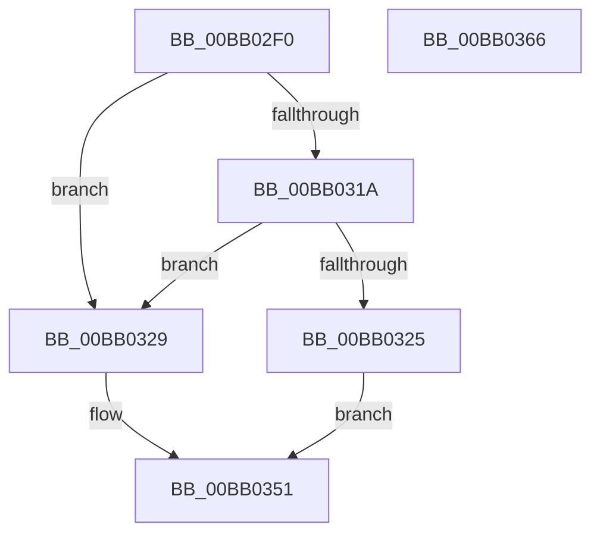

# VerifierMmAllocateContiguousNodeMemory

- RVA: `0x00BB02F0`–`0x00BB0367` (길이 `119` bytes)
- VA: `0x0000000140BB02F0`
- 실행 섹션: `PAGEVRFY`
- PDB 이름 있음: `예`; PDB Function 태그: `아니요`
- unwind 정보 RVA: `0x0007D3C0`
- 디코드: `35`개 명령, `119/119` bytes 표시
- 미해석 바이트: `0` (있으면 어셈블리에 `.byte`로 보존)

> 이 문서는 커널 이미지의 기계어와 PDB 기호를 분석해 생성했습니다. 4번과 5번은 함수 원형과 자료형을 바이너리 사용 방식에서 추정한 C 해석이며 원본 소스 복구 결과는 아닙니다.

## 1. Dependencies

- 직접 호출 지점: **2**; 고유 호출 대상: **2**
- 직접 호출자로 확인된 함수: **0**
- RIP 상대 이미지 참조: **2**

### Outgoing calls
- `0x00BB031C` → [VfFaultsInjectResourceFailure](../BA/VfFaultsInjectResourceFailure_function_00BA6558.md) (function, `0x00BA6558`)
- `0x00BB034C` → [guard_dispatch_icall](../../text/6B/guard_dispatch_icall_function_006BAAD0.md) (function, `0x006BAAD0`)

### Direct callers
- 이 함수 시작 RVA로 연결되는 직접 call은 확인되지 않았습니다. 간접 호출은 완전히 역산할 수 없습니다.

### Static image references
- `0x00BB0304` → RVA `0x00E681A0` (`.data`; read)
- `0x00BB0330` → RVA `0x00FFDB20` (`PAGEVRFD`; read)

## 2. Other-region calls and transfers

- 다른 실행 섹션으로 향하는 call: **1**
  - `0x00BB034C` → [guard_dispatch_icall](../../text/6B/guard_dispatch_icall_function_006BAAD0.md) (`PAGEVRFY` → `.text`)
- 별도 외부 분기/꼬리 이동을 확인하지 못했습니다.

## 3. Assembly (complete function range)

```asm
00BB02F0  48 89 5C 24 08                  mov qword ptr [rsp + 8], rbx
00BB02F5  48 89 6C 24 10                  mov qword ptr [rsp + 0x10], rbp
00BB02FA  48 89 74 24 18                  mov qword ptr [rsp + 0x18], rsi
00BB02FF  57                              push rdi
00BB0300  48 83 EC 40                     sub rsp, 0x40
00BB0304  8B 05 96 7E 2B 00               mov eax, dword ptr [rip + 0x2b7e96]
00BB030A  49 8B D9                        mov rbx, r9
00BB030D  49 8B F8                        mov rdi, r8
00BB0310  48 8B F2                        mov rsi, rdx
00BB0313  48 8B E9                        mov rbp, rcx
00BB0316  A8 04                           test al, 4
00BB0318  74 0F                           je 0x140bb0329
00BB031A  33 C9                           xor ecx, ecx
00BB031C  E8 37 62 FF FF                  call 0x140ba6558
00BB0321  85 C0                           test eax, eax
00BB0323  74 04                           je 0x140bb0329
00BB0325  33 C0                           xor eax, eax
00BB0327  EB 28                           jmp 0x140bb0351
00BB0329  8B 4C 24 78                     mov ecx, dword ptr [rsp + 0x78]
00BB032D  4C 8B CB                        mov r9, rbx
00BB0330  48 8B 05 E9 D7 44 00            mov rax, qword ptr [rip + 0x44d7e9]
00BB0337  4C 8B C7                        mov r8, rdi
00BB033A  89 4C 24 28                     mov dword ptr [rsp + 0x28], ecx
00BB033E  48 8B D6                        mov rdx, rsi
00BB0341  8B 4C 24 70                     mov ecx, dword ptr [rsp + 0x70]
00BB0345  89 4C 24 20                     mov dword ptr [rsp + 0x20], ecx
00BB0349  48 8B CD                        mov rcx, rbp
00BB034C  E8 7F A7 B0 FF                  call 0x1406baad0
00BB0351  48 8B 5C 24 50                  mov rbx, qword ptr [rsp + 0x50]
00BB0356  48 8B 6C 24 58                  mov rbp, qword ptr [rsp + 0x58]
00BB035B  48 8B 74 24 60                  mov rsi, qword ptr [rsp + 0x60]
00BB0360  48 83 C4 40                     add rsp, 0x40
00BB0364  5F                              pop rdi
00BB0365  C3                              ret
00BB0366  CC                              int3
```

## 4. C-style interpretation (structured pseudocode)

```c
__int64 __fastcall VerifierMmAllocateContiguousNodeMemory(__int64 a1, __int64 a2, __int64 a3, __int64 a4, unsigned int a5, unsigned int a6)
{
    __int64 result;
    __int64 v_rsp;
    unsigned int v_stack_m20;
    unsigned int v_stack_m28;
    unsigned __int64 v_stack_p10;
    unsigned __int64 v_stack_p18;
    unsigned __int64 v_stack_p8;

    v_stack_p8 = v_rbx;
    v_stack_p10 = v_rbp;
    v_stack_p18 = v_rsi;
    v_rsp = (v_rsp) - (64);
    if ((((unsigned __int8)((unsigned int)(*(unsigned int *)(v_rip + 2850454)))) & (4)) == 0) goto loc_00BB0329;
    a1 = 0;
    result = VfFaultsInjectResourceFailure(a1, a2, a3, a4);
    if ((unsigned int)(result) == 0) goto loc_00BB0329;
    result = 0;
    goto loc_00BB0351;
loc_00BB0329:
    v_stack_m20 = (unsigned int)((unsigned int)(a6));
    v_stack_m28 = (unsigned int)((unsigned int)(a5));
    result = guard_dispatch_icall(0, a2, a3, a4);
loc_00BB0351:
    v_rsp = (v_rsp) + (64);
    return result;
}
```

## 5. (Beta) C Style

```c
int64_t VerifierMmAllocateContiguousNodeMemory(int64_t Arg1, int64_t Arg2, int64_t Arg3, int64_t Arg4, uint32_t Arg5, uint32_t Arg6)
{
    int64_t result;
    int64_t local_rsp;
    uint32_t v_stack_m20;
    uint32_t v_stack_m28;
    uint64_t v_stack_p10;
    uint64_t v_stack_p18;
    uint64_t v_stack_p8;

    v_stack_p8 = local_rbx;
    v_stack_p10 = local_rbp;
    v_stack_p18 = local_rsi;
    local_rsp = (local_rsp) - (64);
    if ((((uint8_t)((uint32_t)(*(uint32_t *)(v_rip + 0x2B7E96)))) & (4)) == 0) goto loc_00BB0329;
    Arg1 = 0;
    result = VfFaultsInjectResourceFailure(Arg1, Arg2, Arg3, Arg4);
    if ((uint32_t)(result) == 0) goto loc_00BB0329;
    result = 0;
    goto loc_00BB0351;
loc_00BB0329:
    v_stack_m20 = (uint32_t)((uint32_t)(Arg6));
    v_stack_m28 = (uint32_t)((uint32_t)(Arg5));
    result = guard_dispatch_icall(0, Arg2, Arg3, Arg4);
loc_00BB0351:
    local_rsp = (local_rsp) + (64);
    return result;
}
```

## 6. Execution-region graph

[열기: 2D/3D 그래프와 함수 탐색 컨트롤 패널](../../../control-panel.html?section=pagevrfy&rva=0x00BB02F0&view=graph)

- 2D 그래프는 위에서 아래로 흐르고, 3D 그래프는 빈 공간을 드래그해 회전합니다. Shift+드래그는 이동, 휠은 확대·축소, 함수 노드 선택은 대상 보고서 이동입니다.

### Static fallback


