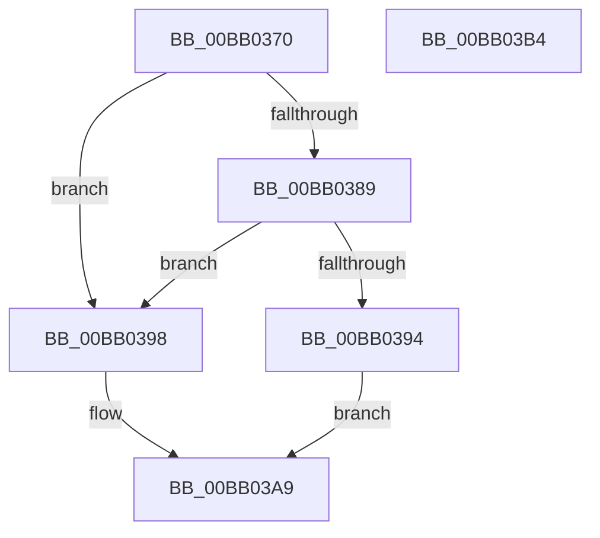

# VerifierMmAllocateMappingAddress

- RVA: `0x00BB0370`–`0x00BB03B5` (길이 `69` bytes)
- VA: `0x0000000140BB0370`
- 실행 섹션: `PAGEVRFY`
- PDB 이름 있음: `예`; PDB Function 태그: `아니요`
- unwind 정보 RVA: `0x0005CAAC`
- 디코드: `23`개 명령, `69/69` bytes 표시
- 미해석 바이트: `0` (있으면 어셈블리에 `.byte`로 보존)

> 이 문서는 커널 이미지의 기계어와 PDB 기호를 분석해 생성했습니다. 4번과 5번은 함수 원형과 자료형을 바이너리 사용 방식에서 추정한 C 해석이며 원본 소스 복구 결과는 아닙니다.

## 1. Dependencies

- 직접 호출 지점: **2**; 고유 호출 대상: **2**
- 직접 호출자로 확인된 함수: **0**
- RIP 상대 이미지 참조: **2**

### Outgoing calls
- `0x00BB038B` → [VfFaultsInjectResourceFailure](../BA/VfFaultsInjectResourceFailure_function_00BA6558.md) (function, `0x00BA6558`)
- `0x00BB03A4` → [guard_dispatch_icall](../../text/6B/guard_dispatch_icall_function_006BAAD0.md) (function, `0x006BAAD0`)

### Direct callers
- 이 함수 시작 RVA로 연결되는 직접 call은 확인되지 않았습니다. 간접 호출은 완전히 역산할 수 없습니다.

### Static image references
- `0x00BB037A` → RVA `0x00E681A0` (`.data`; read)
- `0x00BB0398` → RVA `0x00FFDED0` (`PAGEVRFD`; read)

## 2. Other-region calls and transfers

- 다른 실행 섹션으로 향하는 call: **1**
  - `0x00BB03A4` → [guard_dispatch_icall](../../text/6B/guard_dispatch_icall_function_006BAAD0.md) (`PAGEVRFY` → `.text`)
- 별도 외부 분기/꼬리 이동을 확인하지 못했습니다.

## 3. Assembly (complete function range)

```asm
00BB0370  48 89 5C 24 08                  mov qword ptr [rsp + 8], rbx
00BB0375  57                              push rdi
00BB0376  48 83 EC 20                     sub rsp, 0x20
00BB037A  8B 05 20 7E 2B 00               mov eax, dword ptr [rip + 0x2b7e20]
00BB0380  8B DA                           mov ebx, edx
00BB0382  48 8B F9                        mov rdi, rcx
00BB0385  A8 04                           test al, 4
00BB0387  74 0F                           je 0x140bb0398
00BB0389  33 C9                           xor ecx, ecx
00BB038B  E8 C8 61 FF FF                  call 0x140ba6558
00BB0390  85 C0                           test eax, eax
00BB0392  74 04                           je 0x140bb0398
00BB0394  33 C0                           xor eax, eax
00BB0396  EB 11                           jmp 0x140bb03a9
00BB0398  48 8B 05 31 DB 44 00            mov rax, qword ptr [rip + 0x44db31]
00BB039F  8B D3                           mov edx, ebx
00BB03A1  48 8B CF                        mov rcx, rdi
00BB03A4  E8 27 A7 B0 FF                  call 0x1406baad0
00BB03A9  48 8B 5C 24 30                  mov rbx, qword ptr [rsp + 0x30]
00BB03AE  48 83 C4 20                     add rsp, 0x20
00BB03B2  5F                              pop rdi
00BB03B3  C3                              ret
00BB03B4  CC                              int3
```

## 4. C-style interpretation (structured pseudocode)

```c
__int64 __fastcall VerifierMmAllocateMappingAddress(__int64 a1, int a2)
{
    __int64 result;
    __int64 v_rsp;
    unsigned __int64 v_stack_p8;

    v_stack_p8 = v_rbx;
    v_rsp = (v_rsp) - (32);
    if ((((unsigned __int8)((unsigned int)(*(unsigned int *)(v_rip + 2850336)))) & (4)) == 0) goto loc_00BB0398;
    a1 = 0;
    result = VfFaultsInjectResourceFailure(a1, a2, a3, a4);
    if ((unsigned int)(result) == 0) goto loc_00BB0398;
    result = 0;
    goto loc_00BB03A9;
loc_00BB0398:
    result = guard_dispatch_icall(0, (unsigned int)((unsigned int)((unsigned int)(a2))), a3, a4);
loc_00BB03A9:
    v_rsp = (v_rsp) + (32);
    return result;
}
```

## 5. (Beta) C Style

```c
int64_t VerifierMmAllocateMappingAddress(int64_t Arg1, int32_t Arg2)
{
    int64_t result;
    int64_t local_rsp;
    uint64_t v_stack_p8;

    v_stack_p8 = local_rbx;
    local_rsp = (local_rsp) - (32);
    if ((((uint8_t)((uint32_t)(*(uint32_t *)(v_rip + 0x2B7E20)))) & (4)) == 0) goto loc_00BB0398;
    Arg1 = 0;
    result = VfFaultsInjectResourceFailure(Arg1, Arg2, a3, a4);
    if ((uint32_t)(result) == 0) goto loc_00BB0398;
    result = 0;
    goto loc_00BB03A9;
loc_00BB0398:
    result = guard_dispatch_icall(0, (uint32_t)((uint32_t)((uint32_t)(Arg2))), a3, a4);
loc_00BB03A9:
    local_rsp = (local_rsp) + (32);
    return result;
}
```

## 6. Execution-region graph

[열기: 2D/3D 그래프와 함수 탐색 컨트롤 패널](../../../control-panel.html?section=pagevrfy&rva=0x00BB0370&view=graph)

- 2D 그래프는 위에서 아래로 흐르고, 3D 그래프는 빈 공간을 드래그해 회전합니다. Shift+드래그는 이동, 휠은 확대·축소, 함수 노드 선택은 대상 보고서 이동입니다.

### Static fallback


