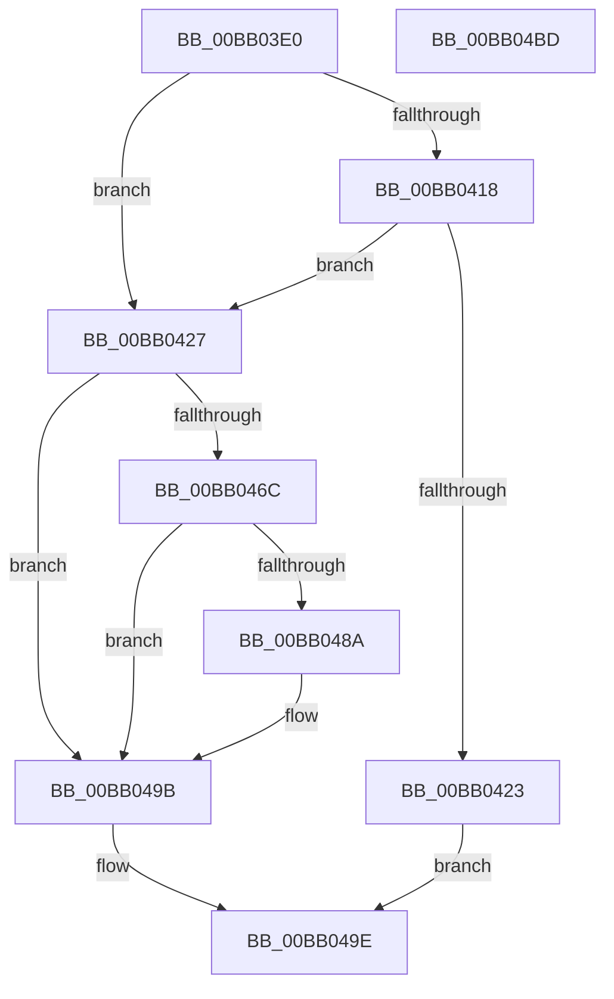

# VerifierMmAllocateNodePagesForMdlEx

- RVA: `0x00BB03E0`–`0x00BB04BE` (길이 `222` bytes)
- VA: `0x0000000140BB03E0`
- 실행 섹션: `PAGEVRFY`
- PDB 이름 있음: `예`; PDB Function 태그: `아니요`
- unwind 정보 RVA: `0x0008A668`
- 디코드: `60`개 명령, `222/222` bytes 표시
- 미해석 바이트: `0` (있으면 어셈블리에 `.byte`로 보존)

> 이 문서는 커널 이미지의 기계어와 PDB 기호를 분석해 생성했습니다. 4번과 5번은 함수 원형과 자료형을 바이너리 사용 방식에서 추정한 C 해석이며 원본 소스 복구 결과는 아닙니다.

## 1. Dependencies

- 직접 호출 지점: **4**; 고유 호출 대상: **4**
- 직접 호출자로 확인된 함수: **0**
- RIP 상대 이미지 참조: **3**

### Outgoing calls
- `0x00BB041A` → [VfFaultsInjectResourceFailure](../BA/VfFaultsInjectResourceFailure_function_00BA6558.md) (function, `0x00BA6558`)
- `0x00BB045F` → [guard_dispatch_icall](../../text/6B/guard_dispatch_icall_function_006BAAD0.md) (function, `0x006BAAD0`)
- `0x00BB0475` → [VfFillAllocatePagesForMdl](VfFillAllocatePagesForMdl_function_00BB1020.md) (function, `0x00BB1020`)
- `0x00BB0496` → [ViTargetAddToCounter](../B9/ViTargetAddToCounter_function_00B9B8E0.md) (function, `0x00B9B8E0`)

### Direct callers
- 이 함수 시작 RVA로 연결되는 직접 call은 확인되지 않았습니다. 간접 호출은 완전히 역산할 수 없습니다.

### Static image references
- `0x00BB03FD` → RVA `0x00E681A0` (`.data`; read)
- `0x00BB043C` → RVA `0x00FFDEB8` (`PAGEVRFD`; read)
- `0x00BB047A` → RVA `0x00F04A20` (`.data`; read)

## 2. Other-region calls and transfers

- 다른 실행 섹션으로 향하는 call: **1**
  - `0x00BB045F` → [guard_dispatch_icall](../../text/6B/guard_dispatch_icall_function_006BAAD0.md) (`PAGEVRFY` → `.text`)
- 별도 외부 분기/꼬리 이동을 확인하지 못했습니다.

## 3. Assembly (complete function range)

```asm
00BB03E0  48 8B C4                        mov rax, rsp
00BB03E3  48 89 58 08                     mov qword ptr [rax + 8], rbx
00BB03E7  48 89 68 10                     mov qword ptr [rax + 0x10], rbp
00BB03EB  48 89 70 18                     mov qword ptr [rax + 0x18], rsi
00BB03EF  48 89 78 20                     mov qword ptr [rax + 0x20], rdi
00BB03F3  41 54                           push r12
00BB03F5  41 56                           push r14
00BB03F7  41 57                           push r15
00BB03F9  48 83 EC 40                     sub rsp, 0x40
00BB03FD  8B 05 9D 7D 2B 00               mov eax, dword ptr [rip + 0x2b7d9d]
00BB0403  4D 8B E1                        mov r12, r9
00BB0406  48 8B 6C 24 58                  mov rbp, qword ptr [rsp + 0x58]
00BB040B  49 8B D8                        mov rbx, r8
00BB040E  48 8B FA                        mov rdi, rdx
00BB0411  48 8B F1                        mov rsi, rcx
00BB0414  A8 04                           test al, 4
00BB0416  74 0F                           je 0x140bb0427
00BB0418  33 C9                           xor ecx, ecx
00BB041A  E8 39 61 FF FF                  call 0x140ba6558
00BB041F  85 C0                           test eax, eax
00BB0421  74 04                           je 0x140bb0427
00BB0423  33 C0                           xor eax, eax
00BB0425  EB 77                           jmp 0x140bb049e
00BB0427  8B 8C 24 88 00 00 00            mov ecx, dword ptr [rsp + 0x88]
00BB042E  4D 8B CC                        mov r9, r12
00BB0431  44 8B B4 24 90 00 00 00         mov r14d, dword ptr [rsp + 0x90]
00BB0439  4C 8B C3                        mov r8, rbx
00BB043C  48 8B 05 75 DA 44 00            mov rax, qword ptr [rip + 0x44da75]
00BB0443  48 8B D7                        mov rdx, rdi
00BB0446  44 8B BC 24 80 00 00 00         mov r15d, dword ptr [rsp + 0x80]
00BB044E  44 89 74 24 30                  mov dword ptr [rsp + 0x30], r14d
00BB0453  89 4C 24 28                     mov dword ptr [rsp + 0x28], ecx
00BB0457  48 8B CE                        mov rcx, rsi
00BB045A  44 89 7C 24 20                  mov dword ptr [rsp + 0x20], r15d
00BB045F  E8 6C A6 B0 FF                  call 0x1406baad0
00BB0464  48 8B D8                        mov rbx, rax
00BB0467  48 85 C0                        test rax, rax
00BB046A  74 2F                           je 0x140bb049b
00BB046C  45 8B C6                        mov r8d, r14d
00BB046F  41 8B D7                        mov edx, r15d
00BB0472  48 8B C8                        mov rcx, rax
00BB0475  E8 A6 0B 00 00                  call 0x140bb1020
00BB047A  F7 05 9C 45 35 00 00 10 00 00   test dword ptr [rip + 0x35459c], 0x1000
00BB0484  44 8B 4B 28                     mov r9d, dword ptr [rbx + 0x28]
00BB0488  74 11                           je 0x140bb049b
00BB048A  BA E8 00 00 00                  mov edx, 0xe8
00BB048F  48 8B CD                        mov rcx, rbp
00BB0492  44 8D 42 08                     lea r8d, [rdx + 8]
00BB0496  E8 45 B4 FE FF                  call 0x140b9b8e0
00BB049B  48 8B C3                        mov rax, rbx
00BB049E  48 8B 5C 24 60                  mov rbx, qword ptr [rsp + 0x60]
00BB04A3  48 8B 6C 24 68                  mov rbp, qword ptr [rsp + 0x68]
00BB04A8  48 8B 74 24 70                  mov rsi, qword ptr [rsp + 0x70]
00BB04AD  48 8B 7C 24 78                  mov rdi, qword ptr [rsp + 0x78]
00BB04B2  48 83 C4 40                     add rsp, 0x40
00BB04B6  41 5F                           pop r15
00BB04B8  41 5E                           pop r14
00BB04BA  41 5C                           pop r12
00BB04BC  C3                              ret
00BB04BD  CC                              int3
```

## 4. C-style interpretation (structured pseudocode)

```c
__int64 __fastcall VerifierMmAllocateNodePagesForMdlEx(__int64 a1, __int64 a2, __int64 a3, __int64 a4, unsigned int a5, unsigned int a6, unsigned int a7)
{
    __int64 result;
    __int64 v_rsp;
    unsigned int v_stack_m28;
    unsigned int v_stack_m30;
    unsigned int v_stack_m38;
    unsigned __int64 v_stack_p0;
    unsigned __int64 v_stack_p10;
    unsigned __int64 v_stack_p18;
    unsigned __int64 v_stack_p20;
    unsigned __int64 v_stack_p8;

    *(unsigned __int64 *)(v_rsp + 8) = v_rbx;
    *(unsigned __int64 *)(v_rsp + 16) = v_rbp;
    *(unsigned __int64 *)(v_rsp + 24) = v_rsi;
    *(unsigned __int64 *)(v_rsp + 32) = v_rdi;
    v_rsp = (v_rsp) - (64);
    if ((((unsigned __int8)((unsigned int)(*(unsigned int *)(v_rip + 2850205)))) & (4)) == 0) goto loc_00BB0427;
    a1 = 0;
    result = VfFaultsInjectResourceFailure(a1, a2, a3, a4);
    if ((unsigned int)(result) == 0) goto loc_00BB0427;
    result = 0;
    goto loc_00BB049E;
loc_00BB0427:
    v_stack_m28 = (unsigned int)((unsigned int)(a7));
    v_stack_m30 = (unsigned int)((unsigned int)(a6));
    v_stack_m38 = (unsigned int)((unsigned int)(a5));
    result = guard_dispatch_icall(0, a2, a3, a4);
    if (result == 0) goto loc_00BB049B;
    result = VfFillAllocatePagesForMdl(result, (unsigned int)((unsigned int)((unsigned int)(a5))), (unsigned int)((unsigned int)((unsigned int)(a7))), a4);
    if (((*(unsigned int *)(v_rip + 3491228)) & (0x1000ULL)) != 0) {
        a2 = 232;
        a1 = v_stack_p0;
        a3 = a2 + 8;
        result = ViTargetAddToCounter(a1, a2, a3, (unsigned int)(*(unsigned int *)(result + 40)));
    }
loc_00BB049E:
    v_rsp = (v_rsp) + (64);
    return result;
}
```

## 5. (Beta) C Style

```c
int64_t VerifierMmAllocateNodePagesForMdlEx(int64_t Arg1, int64_t Arg2, int64_t Arg3, int64_t Arg4, uint32_t Arg5, uint32_t Arg6, uint32_t Arg7)
{
    int64_t result;
    int64_t local_rsp;
    uint32_t v_stack_m28;
    uint32_t v_stack_m30;
    uint32_t v_stack_m38;
    uint64_t v_stack_p0;
    uint64_t v_stack_p10;
    uint64_t v_stack_p18;
    uint64_t v_stack_p20;
    uint64_t v_stack_p8;

    *(uint64_t *)(local_rsp + 0x8) = local_rbx;
    *(uint64_t *)(local_rsp + 0x10) = local_rbp;
    *(uint64_t *)(local_rsp + 0x18) = local_rsi;
    *(uint64_t *)(local_rsp + 0x20) = local_rdi;
    local_rsp = (local_rsp) - (64);
    if ((((uint8_t)((uint32_t)(*(uint32_t *)(v_rip + 0x2B7D9D)))) & (4)) == 0) goto loc_00BB0427;
    Arg1 = 0;
    result = VfFaultsInjectResourceFailure(Arg1, Arg2, Arg3, Arg4);
    if ((uint32_t)(result) == 0) goto loc_00BB0427;
    result = 0;
    goto loc_00BB049E;
loc_00BB0427:
    v_stack_m28 = (uint32_t)((uint32_t)(Arg7));
    v_stack_m30 = (uint32_t)((uint32_t)(Arg6));
    v_stack_m38 = (uint32_t)((uint32_t)(Arg5));
    result = guard_dispatch_icall(0, Arg2, Arg3, Arg4);
    if (result == 0) goto loc_00BB049B;
    result = VfFillAllocatePagesForMdl(result, (uint32_t)((uint32_t)((uint32_t)(Arg5))), (uint32_t)((uint32_t)((uint32_t)(Arg7))), Arg4);
    if (((*(uint32_t *)(v_rip + 0x35459C)) & (0x1000ULL)) != 0) {
        Arg2 = 232;
        Arg1 = v_stack_p0;
        Arg3 = Arg2 + 8;
        result = ViTargetAddToCounter(Arg1, Arg2, Arg3, (uint32_t)(*(uint32_t *)(result + 0x28)));
    }
loc_00BB049E:
    local_rsp = (local_rsp) + (64);
    return result;
}
```

## 6. Execution-region graph

[열기: 2D/3D 그래프와 함수 탐색 컨트롤 패널](../../../control-panel.html?section=pagevrfy&rva=0x00BB03E0&view=graph)

- 2D 그래프는 위에서 아래로 흐르고, 3D 그래프는 빈 공간을 드래그해 회전합니다. Shift+드래그는 이동, 휠은 확대·축소, 함수 노드 선택은 대상 보고서 이동입니다.

### Static fallback


