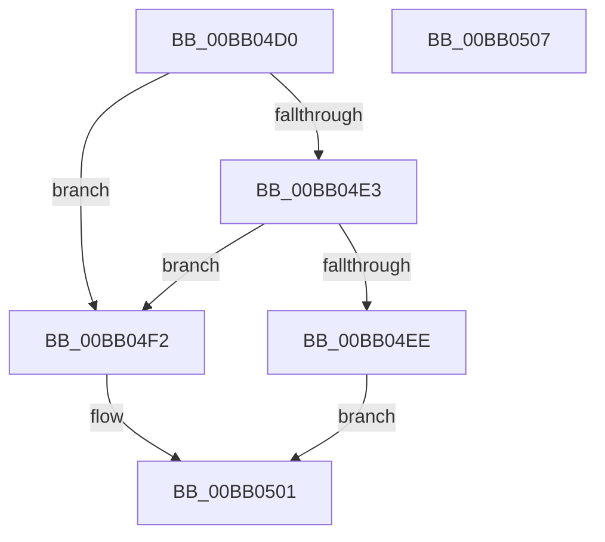

# VerifierMmAllocateNonCachedMemory

- RVA: `0x00BB04D0`–`0x00BB0508` (길이 `56` bytes)
- VA: `0x0000000140BB04D0`
- 실행 섹션: `PAGEVRFY`
- PDB 이름 있음: `예`; PDB Function 태그: `아니요`
- unwind 정보 RVA: `0x0005CF00`
- 디코드: `19`개 명령, `56/56` bytes 표시
- 미해석 바이트: `0` (있으면 어셈블리에 `.byte`로 보존)

> 이 문서는 커널 이미지의 기계어와 PDB 기호를 분석해 생성했습니다. 4번과 5번은 함수 원형과 자료형을 바이너리 사용 방식에서 추정한 C 해석이며 원본 소스 복구 결과는 아닙니다.

## 1. Dependencies

- 직접 호출 지점: **2**; 고유 호출 대상: **2**
- 직접 호출자로 확인된 함수: **0**
- RIP 상대 이미지 참조: **2**

### Outgoing calls
- `0x00BB04E5` → [VfFaultsInjectResourceFailure](../BA/VfFaultsInjectResourceFailure_function_00BA6558.md) (function, `0x00BA6558`)
- `0x00BB04FC` → [guard_dispatch_icall](../../text/6B/guard_dispatch_icall_function_006BAAD0.md) (function, `0x006BAAD0`)

### Direct callers
- 이 함수 시작 RVA로 연결되는 직접 call은 확인되지 않았습니다. 간접 호출은 완전히 역산할 수 없습니다.

### Static image references
- `0x00BB04D6` → RVA `0x00E681A0` (`.data`; read)
- `0x00BB04F2` → RVA `0x00FFDF38` (`PAGEVRFD`; read)

## 2. Other-region calls and transfers

- 다른 실행 섹션으로 향하는 call: **1**
  - `0x00BB04FC` → [guard_dispatch_icall](../../text/6B/guard_dispatch_icall_function_006BAAD0.md) (`PAGEVRFY` → `.text`)
- 별도 외부 분기/꼬리 이동을 확인하지 못했습니다.

## 3. Assembly (complete function range)

```asm
00BB04D0  40 53                           push rbx
00BB04D2  48 83 EC 20                     sub rsp, 0x20
00BB04D6  8B 05 C4 7C 2B 00               mov eax, dword ptr [rip + 0x2b7cc4]
00BB04DC  48 8B D9                        mov rbx, rcx
00BB04DF  A8 04                           test al, 4
00BB04E1  74 0F                           je 0x140bb04f2
00BB04E3  33 C9                           xor ecx, ecx
00BB04E5  E8 6E 60 FF FF                  call 0x140ba6558
00BB04EA  85 C0                           test eax, eax
00BB04EC  74 04                           je 0x140bb04f2
00BB04EE  33 C0                           xor eax, eax
00BB04F0  EB 0F                           jmp 0x140bb0501
00BB04F2  48 8B 05 3F DA 44 00            mov rax, qword ptr [rip + 0x44da3f]
00BB04F9  48 8B CB                        mov rcx, rbx
00BB04FC  E8 CF A5 B0 FF                  call 0x1406baad0
00BB0501  48 83 C4 20                     add rsp, 0x20
00BB0505  5B                              pop rbx
00BB0506  C3                              ret
00BB0507  CC                              int3
```

## 4. C-style interpretation (structured pseudocode)

```c
__int64 __fastcall VerifierMmAllocateNonCachedMemory(__int64 a1)
{
    __int64 result;
    __int64 v_rsp;

    v_rsp = (v_rsp) - (32);
    if ((((unsigned __int8)((unsigned int)(*(unsigned int *)(v_rip + 2849988)))) & (4)) == 0) goto loc_00BB04F2;
    a1 = 0;
    result = VfFaultsInjectResourceFailure(a1, a2, a3, a4);
    if ((unsigned int)(result) == 0) goto loc_00BB04F2;
    result = 0;
    goto loc_00BB0501;
loc_00BB04F2:
    result = guard_dispatch_icall(0, a2, a3, a4);
loc_00BB0501:
    v_rsp = (v_rsp) + (32);
    return result;
}
```

## 5. (Beta) C Style

```c
int64_t VerifierMmAllocateNonCachedMemory(int64_t Arg1)
{
    int64_t result;
    int64_t local_rsp;

    local_rsp = (local_rsp) - (32);
    if ((((uint8_t)((uint32_t)(*(uint32_t *)(v_rip + 0x2B7CC4)))) & (4)) == 0) goto loc_00BB04F2;
    Arg1 = 0;
    result = VfFaultsInjectResourceFailure(Arg1, a2, a3, a4);
    if ((uint32_t)(result) == 0) goto loc_00BB04F2;
    result = 0;
    goto loc_00BB0501;
loc_00BB04F2:
    result = guard_dispatch_icall(0, a2, a3, a4);
loc_00BB0501:
    local_rsp = (local_rsp) + (32);
    return result;
}
```

## 6. Execution-region graph

[열기: 2D/3D 그래프와 함수 탐색 컨트롤 패널](../../../control-panel.html?section=pagevrfy&rva=0x00BB04D0&view=graph)

- 2D 그래프는 위에서 아래로 흐르고, 3D 그래프는 빈 공간을 드래그해 회전합니다. Shift+드래그는 이동, 휠은 확대·축소, 함수 노드 선택은 대상 보고서 이동입니다.

### Static fallback


