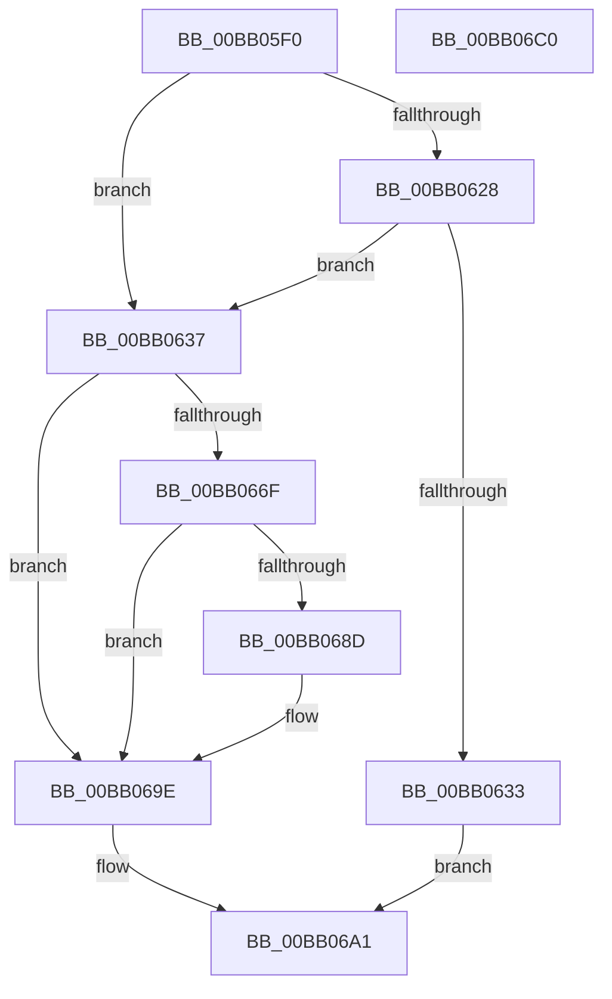

# VerifierMmAllocatePagesForMdlEx

- RVA: `0x00BB05F0`–`0x00BB06C1` (길이 `209` bytes)
- VA: `0x0000000140BB05F0`
- 실행 섹션: `PAGEVRFY`
- PDB 이름 있음: `예`; PDB Function 태그: `아니요`
- unwind 정보 RVA: `0x0008A668`
- 디코드: `58`개 명령, `209/209` bytes 표시
- 미해석 바이트: `0` (있으면 어셈블리에 `.byte`로 보존)

> 이 문서는 커널 이미지의 기계어와 PDB 기호를 분석해 생성했습니다. 4번과 5번은 함수 원형과 자료형을 바이너리 사용 방식에서 추정한 C 해석이며 원본 소스 복구 결과는 아닙니다.

## 1. Dependencies

- 직접 호출 지점: **4**; 고유 호출 대상: **4**
- 직접 호출자로 확인된 함수: **0**
- RIP 상대 이미지 참조: **3**

### Outgoing calls
- `0x00BB062A` → [VfFaultsInjectResourceFailure](../BA/VfFaultsInjectResourceFailure_function_00BA6558.md) (function, `0x00BA6558`)
- `0x00BB0662` → [guard_dispatch_icall](../../text/6B/guard_dispatch_icall_function_006BAAD0.md) (function, `0x006BAAD0`)
- `0x00BB0678` → [VfFillAllocatePagesForMdl](VfFillAllocatePagesForMdl_function_00BB1020.md) (function, `0x00BB1020`)
- `0x00BB0699` → [ViTargetAddToCounter](../B9/ViTargetAddToCounter_function_00B9B8E0.md) (function, `0x00B9B8E0`)

### Direct callers
- 이 함수 시작 RVA로 연결되는 직접 call은 확인되지 않았습니다. 간접 호출은 완전히 역산할 수 없습니다.

### Static image references
- `0x00BB060D` → RVA `0x00E681A0` (`.data`; read)
- `0x00BB0641` → RVA `0x00FFDF50` (`PAGEVRFD`; read)
- `0x00BB067D` → RVA `0x00F04A20` (`.data`; read)

## 2. Other-region calls and transfers

- 다른 실행 섹션으로 향하는 call: **1**
  - `0x00BB0662` → [guard_dispatch_icall](../../text/6B/guard_dispatch_icall_function_006BAAD0.md) (`PAGEVRFY` → `.text`)
- 별도 외부 분기/꼬리 이동을 확인하지 못했습니다.

## 3. Assembly (complete function range)

```asm
00BB05F0  48 8B C4                        mov rax, rsp
00BB05F3  48 89 58 08                     mov qword ptr [rax + 8], rbx
00BB05F7  48 89 68 10                     mov qword ptr [rax + 0x10], rbp
00BB05FB  48 89 70 18                     mov qword ptr [rax + 0x18], rsi
00BB05FF  48 89 78 20                     mov qword ptr [rax + 0x20], rdi
00BB0603  41 54                           push r12
00BB0605  41 56                           push r14
00BB0607  41 57                           push r15
00BB0609  48 83 EC 40                     sub rsp, 0x40
00BB060D  8B 05 8D 7B 2B 00               mov eax, dword ptr [rip + 0x2b7b8d]
00BB0613  4D 8B E1                        mov r12, r9
00BB0616  4C 8B 7C 24 58                  mov r15, qword ptr [rsp + 0x58]
00BB061B  49 8B D8                        mov rbx, r8
00BB061E  48 8B FA                        mov rdi, rdx
00BB0621  48 8B F1                        mov rsi, rcx
00BB0624  A8 04                           test al, 4
00BB0626  74 0F                           je 0x140bb0637
00BB0628  33 C9                           xor ecx, ecx
00BB062A  E8 29 5F FF FF                  call 0x140ba6558
00BB062F  85 C0                           test eax, eax
00BB0631  74 04                           je 0x140bb0637
00BB0633  33 C0                           xor eax, eax
00BB0635  EB 6A                           jmp 0x140bb06a1
00BB0637  8B AC 24 88 00 00 00            mov ebp, dword ptr [rsp + 0x88]
00BB063E  4D 8B CC                        mov r9, r12
00BB0641  48 8B 05 08 D9 44 00            mov rax, qword ptr [rip + 0x44d908]
00BB0648  4C 8B C3                        mov r8, rbx
00BB064B  44 8B B4 24 80 00 00 00         mov r14d, dword ptr [rsp + 0x80]
00BB0653  48 8B D7                        mov rdx, rdi
00BB0656  89 6C 24 28                     mov dword ptr [rsp + 0x28], ebp
00BB065A  48 8B CE                        mov rcx, rsi
00BB065D  44 89 74 24 20                  mov dword ptr [rsp + 0x20], r14d
00BB0662  E8 69 A4 B0 FF                  call 0x1406baad0
00BB0667  48 8B D8                        mov rbx, rax
00BB066A  48 85 C0                        test rax, rax
00BB066D  74 2F                           je 0x140bb069e
00BB066F  44 8B C5                        mov r8d, ebp
00BB0672  41 8B D6                        mov edx, r14d
00BB0675  48 8B C8                        mov rcx, rax
00BB0678  E8 A3 09 00 00                  call 0x140bb1020
00BB067D  F7 05 99 43 35 00 00 10 00 00   test dword ptr [rip + 0x354399], 0x1000
00BB0687  44 8B 4B 28                     mov r9d, dword ptr [rbx + 0x28]
00BB068B  74 11                           je 0x140bb069e
00BB068D  BA E8 00 00 00                  mov edx, 0xe8
00BB0692  49 8B CF                        mov rcx, r15
00BB0695  44 8D 42 08                     lea r8d, [rdx + 8]
00BB0699  E8 42 B2 FE FF                  call 0x140b9b8e0
00BB069E  48 8B C3                        mov rax, rbx
00BB06A1  48 8B 5C 24 60                  mov rbx, qword ptr [rsp + 0x60]
00BB06A6  48 8B 6C 24 68                  mov rbp, qword ptr [rsp + 0x68]
00BB06AB  48 8B 74 24 70                  mov rsi, qword ptr [rsp + 0x70]
00BB06B0  48 8B 7C 24 78                  mov rdi, qword ptr [rsp + 0x78]
00BB06B5  48 83 C4 40                     add rsp, 0x40
00BB06B9  41 5F                           pop r15
00BB06BB  41 5E                           pop r14
00BB06BD  41 5C                           pop r12
00BB06BF  C3                              ret
00BB06C0  CC                              int3
```

## 4. C-style interpretation (structured pseudocode)

```c
__int64 __fastcall VerifierMmAllocatePagesForMdlEx(__int64 a1, __int64 a2, __int64 a3, __int64 a4, unsigned int a5, unsigned int a6)
{
    __int64 result;
    __int64 v_rsp;
    unsigned int v_stack_m30;
    unsigned int v_stack_m38;
    unsigned __int64 v_stack_p0;
    unsigned __int64 v_stack_p10;
    unsigned __int64 v_stack_p18;
    unsigned __int64 v_stack_p20;
    unsigned __int64 v_stack_p8;

    *(unsigned __int64 *)(v_rsp + 8) = v_rbx;
    *(unsigned __int64 *)(v_rsp + 16) = v_rbp;
    *(unsigned __int64 *)(v_rsp + 24) = v_rsi;
    *(unsigned __int64 *)(v_rsp + 32) = v_rdi;
    v_rsp = (v_rsp) - (64);
    if ((((unsigned __int8)((unsigned int)(*(unsigned int *)(v_rip + 2849677)))) & (4)) == 0) goto loc_00BB0637;
    a1 = 0;
    result = VfFaultsInjectResourceFailure(a1, a2, a3, a4);
    if ((unsigned int)(result) == 0) goto loc_00BB0637;
    result = 0;
    goto loc_00BB06A1;
loc_00BB0637:
    v_stack_m30 = (unsigned int)((unsigned int)(a6));
    v_stack_m38 = (unsigned int)((unsigned int)(a5));
    result = guard_dispatch_icall(0, a2, a3, a4);
    if (result == 0) goto loc_00BB069E;
    result = VfFillAllocatePagesForMdl(result, (unsigned int)((unsigned int)((unsigned int)(a5))), (unsigned int)((unsigned int)((unsigned int)(a6))), a4);
    if (((*(unsigned int *)(v_rip + 3490713)) & (0x1000ULL)) != 0) {
        a2 = 232;
        a1 = v_stack_p0;
        a3 = a2 + 8;
        result = ViTargetAddToCounter(a1, a2, a3, (unsigned int)(*(unsigned int *)(result + 40)));
    }
loc_00BB06A1:
    v_rsp = (v_rsp) + (64);
    return result;
}
```

## 5. (Beta) C Style

```c
int64_t VerifierMmAllocatePagesForMdlEx(int64_t Arg1, int64_t Arg2, int64_t Arg3, int64_t Arg4, uint32_t Arg5, uint32_t Arg6)
{
    int64_t result;
    int64_t local_rsp;
    uint32_t v_stack_m30;
    uint32_t v_stack_m38;
    uint64_t v_stack_p0;
    uint64_t v_stack_p10;
    uint64_t v_stack_p18;
    uint64_t v_stack_p20;
    uint64_t v_stack_p8;

    *(uint64_t *)(local_rsp + 0x8) = local_rbx;
    *(uint64_t *)(local_rsp + 0x10) = local_rbp;
    *(uint64_t *)(local_rsp + 0x18) = local_rsi;
    *(uint64_t *)(local_rsp + 0x20) = local_rdi;
    local_rsp = (local_rsp) - (64);
    if ((((uint8_t)((uint32_t)(*(uint32_t *)(v_rip + 0x2B7B8D)))) & (4)) == 0) goto loc_00BB0637;
    Arg1 = 0;
    result = VfFaultsInjectResourceFailure(Arg1, Arg2, Arg3, Arg4);
    if ((uint32_t)(result) == 0) goto loc_00BB0637;
    result = 0;
    goto loc_00BB06A1;
loc_00BB0637:
    v_stack_m30 = (uint32_t)((uint32_t)(Arg6));
    v_stack_m38 = (uint32_t)((uint32_t)(Arg5));
    result = guard_dispatch_icall(0, Arg2, Arg3, Arg4);
    if (result == 0) goto loc_00BB069E;
    result = VfFillAllocatePagesForMdl(result, (uint32_t)((uint32_t)((uint32_t)(Arg5))), (uint32_t)((uint32_t)((uint32_t)(Arg6))), Arg4);
    if (((*(uint32_t *)(v_rip + 0x354399)) & (0x1000ULL)) != 0) {
        Arg2 = 232;
        Arg1 = v_stack_p0;
        Arg3 = Arg2 + 8;
        result = ViTargetAddToCounter(Arg1, Arg2, Arg3, (uint32_t)(*(uint32_t *)(result + 0x28)));
    }
loc_00BB06A1:
    local_rsp = (local_rsp) + (64);
    return result;
}
```

## 6. Execution-region graph

[열기: 2D/3D 그래프와 함수 탐색 컨트롤 패널](../../../control-panel.html?section=pagevrfy&rva=0x00BB05F0&view=graph)

- 2D 그래프는 위에서 아래로 흐르고, 3D 그래프는 빈 공간을 드래그해 회전합니다. Shift+드래그는 이동, 휠은 확대·축소, 함수 노드 선택은 대상 보고서 이동입니다.

### Static fallback


