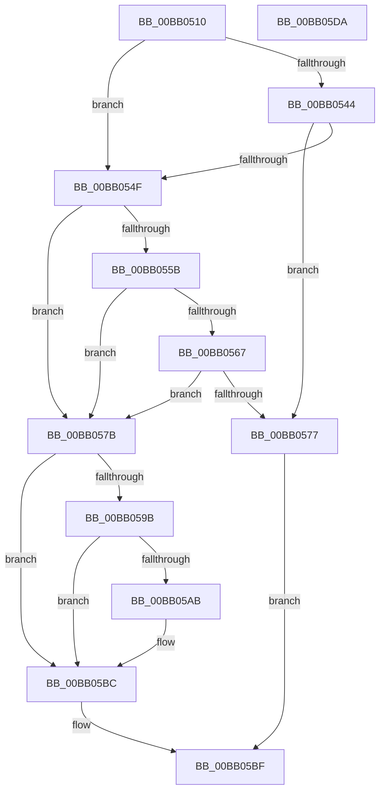

# VerifierMmAllocatePagesForMdl

- RVA: `0x00BB0510`–`0x00BB05DB` (길이 `203` bytes)
- VA: `0x0000000140BB0510`
- 실행 섹션: `PAGEVRFY`
- PDB 이름 있음: `예`; PDB Function 태그: `아니요`
- unwind 정보 RVA: `0x0005D7BC`
- 디코드: `55`개 명령, `203/203` bytes 표시
- 미해석 바이트: `0` (있으면 어셈블리에 `.byte`로 보존)

> 이 문서는 커널 이미지의 기계어와 PDB 기호를 분석해 생성했습니다. 4번과 5번은 함수 원형과 자료형을 바이너리 사용 방식에서 추정한 C 해석이며 원본 소스 복구 결과는 아닙니다.

## 1. Dependencies

- 직접 호출 지점: **4**; 고유 호출 대상: **3**
- 직접 호출자로 확인된 함수: **0**
- RIP 상대 이미지 참조: **5**

### Outgoing calls
- `0x00BB0546` → [VfFaultsInjectResourceFailure](../BA/VfFaultsInjectResourceFailure_function_00BA6558.md) (function, `0x00BA6558`)
- `0x00BB056E` → [guard_dispatch_icall](../../text/6B/guard_dispatch_icall_function_006BAAD0.md) (function, `0x006BAAD0`)
- `0x00BB058E` → [guard_dispatch_icall](../../text/6B/guard_dispatch_icall_function_006BAAD0.md) (function, `0x006BAAD0`)
- `0x00BB05B7` → [ViTargetAddToCounter](../B9/ViTargetAddToCounter_function_00B9B8E0.md) (function, `0x00B9B8E0`)

### Direct callers
- 이 함수 시작 RVA로 연결되는 직접 call은 확인되지 않았습니다. 간접 호출은 완전히 역산할 수 없습니다.

### Static image references
- `0x00BB0529` → RVA `0x00E681A0` (`.data`; read)
- `0x00BB055B` → RVA `0x00FFDA10` (`PAGEVRFD`; read)
- `0x00BB0567` → RVA `0x00BBB800` (` ?? ::JKADOLAD::`string'`; read)
- `0x00BB057B` → RVA `0x00FFDF48` (`PAGEVRFD`; read)
- `0x00BB059B` → RVA `0x00F04A20` (`.data`; read)

## 2. Other-region calls and transfers

- 다른 실행 섹션으로 향하는 call: **2**
  - `0x00BB056E` → [guard_dispatch_icall](../../text/6B/guard_dispatch_icall_function_006BAAD0.md) (`PAGEVRFY` → `.text`)
  - `0x00BB058E` → [guard_dispatch_icall](../../text/6B/guard_dispatch_icall_function_006BAAD0.md) (`PAGEVRFY` → `.text`)
- 별도 외부 분기/꼬리 이동을 확인하지 못했습니다.

## 3. Assembly (complete function range)

```asm
00BB0510  48 8B C4                        mov rax, rsp
00BB0513  48 89 58 08                     mov qword ptr [rax + 8], rbx
00BB0517  48 89 68 10                     mov qword ptr [rax + 0x10], rbp
00BB051B  48 89 70 18                     mov qword ptr [rax + 0x18], rsi
00BB051F  48 89 78 20                     mov qword ptr [rax + 0x20], rdi
00BB0523  41 56                           push r14
00BB0525  48 83 EC 30                     sub rsp, 0x30
00BB0529  8B 05 71 7C 2B 00               mov eax, dword ptr [rip + 0x2b7c71]
00BB052F  4D 8B F1                        mov r14, r9
00BB0532  48 8B 6C 24 38                  mov rbp, qword ptr [rsp + 0x38]
00BB0537  49 8B D8                        mov rbx, r8
00BB053A  48 8B FA                        mov rdi, rdx
00BB053D  48 8B F1                        mov rsi, rcx
00BB0540  A8 04                           test al, 4
00BB0542  74 0B                           je 0x140bb054f
00BB0544  33 C9                           xor ecx, ecx
00BB0546  E8 0D 60 FF FF                  call 0x140ba6558
00BB054B  85 C0                           test eax, eax
00BB054D  75 28                           jne 0x140bb0577
00BB054F  F7 05 47 7C 2B 00 00 00 04 00   test dword ptr [rip + 0x2b7c47], 0x40000
00BB0559  74 20                           je 0x140bb057b
00BB055B  48 8B 05 AE D4 44 00            mov rax, qword ptr [rip + 0x44d4ae]
00BB0562  48 85 C0                        test rax, rax
00BB0565  74 14                           je 0x140bb057b
00BB0567  48 8D 0D 92 B2 00 00            lea rcx, [rip + 0xb292]
00BB056E  E8 5D A5 B0 FF                  call 0x1406baad0
00BB0573  84 C0                           test al, al
00BB0575  74 04                           je 0x140bb057b
00BB0577  33 C0                           xor eax, eax
00BB0579  EB 44                           jmp 0x140bb05bf
00BB057B  48 8B 05 C6 D9 44 00            mov rax, qword ptr [rip + 0x44d9c6]
00BB0582  4D 8B CE                        mov r9, r14
00BB0585  4C 8B C3                        mov r8, rbx
00BB0588  48 8B D7                        mov rdx, rdi
00BB058B  48 8B CE                        mov rcx, rsi
00BB058E  E8 3D A5 B0 FF                  call 0x1406baad0
00BB0593  48 8B D8                        mov rbx, rax
00BB0596  48 85 C0                        test rax, rax
00BB0599  74 21                           je 0x140bb05bc
00BB059B  F7 05 7B 44 35 00 00 10 00 00   test dword ptr [rip + 0x35447b], 0x1000
00BB05A5  44 8B 48 28                     mov r9d, dword ptr [rax + 0x28]
00BB05A9  74 11                           je 0x140bb05bc
00BB05AB  BA E8 00 00 00                  mov edx, 0xe8
00BB05B0  48 8B CD                        mov rcx, rbp
00BB05B3  44 8D 42 08                     lea r8d, [rdx + 8]
00BB05B7  E8 24 B3 FE FF                  call 0x140b9b8e0
00BB05BC  48 8B C3                        mov rax, rbx
00BB05BF  48 8B 5C 24 40                  mov rbx, qword ptr [rsp + 0x40]
00BB05C4  48 8B 6C 24 48                  mov rbp, qword ptr [rsp + 0x48]
00BB05C9  48 8B 74 24 50                  mov rsi, qword ptr [rsp + 0x50]
00BB05CE  48 8B 7C 24 58                  mov rdi, qword ptr [rsp + 0x58]
00BB05D3  48 83 C4 30                     add rsp, 0x30
00BB05D7  41 5E                           pop r14
00BB05D9  C3                              ret
00BB05DA  CC                              int3
```

## 4. C-style interpretation (structured pseudocode)

```c
__int64 __fastcall VerifierMmAllocatePagesForMdl(__int64 a1, __int64 a2, __int64 a3, __int64 a4)
{
    __int64 result;
    __int64 v_rsp;
    unsigned __int64 v_stack_p0;
    unsigned __int64 v_stack_p10;
    unsigned __int64 v_stack_p18;
    unsigned __int64 v_stack_p20;
    unsigned __int64 v_stack_p8;

    *(unsigned __int64 *)(v_rsp + 8) = v_rbx;
    *(unsigned __int64 *)(v_rsp + 16) = v_rbp;
    *(unsigned __int64 *)(v_rsp + 24) = v_rsi;
    *(unsigned __int64 *)(v_rsp + 32) = v_rdi;
    v_rsp = (v_rsp) - (48);
    if ((((unsigned __int8)((unsigned int)(*(unsigned int *)(v_rip + 2849905)))) & (4)) == 0) goto loc_00BB054F;
    a1 = 0;
    result = VfFaultsInjectResourceFailure(a1, a2, a3, a4);
    if ((unsigned int)(result) != 0) goto loc_00BB0577;
loc_00BB054F:
    if (((*(unsigned int *)(v_rip + 2849863)) & (0x40000ULL)) == 0) goto loc_00BB057B;
    if (*(unsigned __int64 *)(v_rip + 4510894) == 0) goto loc_00BB057B;
    result = guard_dispatch_icall(v_rip + 45714, a2, a3, a4);
    if ((unsigned __int8)(result) == 0) goto loc_00BB057B;
loc_00BB0577:
    result = 0;
    goto loc_00BB05BF;
loc_00BB057B:
    result = guard_dispatch_icall(0, a2, a3, a4);
    if (result == 0) goto loc_00BB05BC;
    if (((*(unsigned int *)(v_rip + 3490939)) & (0x1000ULL)) != 0) {
        a2 = 232;
        a1 = v_stack_p0;
        a3 = a2 + 8;
        result = ViTargetAddToCounter(a1, a2, a3, (unsigned int)(*(unsigned int *)(result + 40)));
    }
loc_00BB05BF:
    v_rsp = (v_rsp) + (48);
    return result;
}
```

## 5. (Beta) C Style

```c
int64_t VerifierMmAllocatePagesForMdl(int64_t Arg1, int64_t Arg2, int64_t Arg3, int64_t Arg4)
{
    int64_t result;
    int64_t local_rsp;
    uint64_t v_stack_p0;
    uint64_t v_stack_p10;
    uint64_t v_stack_p18;
    uint64_t v_stack_p20;
    uint64_t v_stack_p8;

    *(uint64_t *)(local_rsp + 0x8) = local_rbx;
    *(uint64_t *)(local_rsp + 0x10) = local_rbp;
    *(uint64_t *)(local_rsp + 0x18) = local_rsi;
    *(uint64_t *)(local_rsp + 0x20) = local_rdi;
    local_rsp = (local_rsp) - (48);
    if ((((uint8_t)((uint32_t)(*(uint32_t *)(v_rip + 0x2B7C71)))) & (4)) == 0) goto loc_00BB054F;
    Arg1 = 0;
    result = VfFaultsInjectResourceFailure(Arg1, Arg2, Arg3, Arg4);
    if ((uint32_t)(result) != 0) goto loc_00BB0577;
loc_00BB054F:
    if (((*(uint32_t *)(v_rip + 0x2B7C47)) & (0x40000ULL)) == 0) goto loc_00BB057B;
    if (*(uint64_t *)(v_rip + 0x44D4AE) == 0) goto loc_00BB057B;
    result = guard_dispatch_icall(v_rip + 45714, Arg2, Arg3, Arg4);
    if ((uint8_t)(result) == 0) goto loc_00BB057B;
loc_00BB0577:
    result = 0;
    goto loc_00BB05BF;
loc_00BB057B:
    result = guard_dispatch_icall(0, Arg2, Arg3, Arg4);
    if (result == 0) goto loc_00BB05BC;
    if (((*(uint32_t *)(v_rip + 0x35447B)) & (0x1000ULL)) != 0) {
        Arg2 = 232;
        Arg1 = v_stack_p0;
        Arg3 = Arg2 + 8;
        result = ViTargetAddToCounter(Arg1, Arg2, Arg3, (uint32_t)(*(uint32_t *)(result + 0x28)));
    }
loc_00BB05BF:
    local_rsp = (local_rsp) + (48);
    return result;
}
```

## 6. Execution-region graph

[열기: 2D/3D 그래프와 함수 탐색 컨트롤 패널](../../../control-panel.html?section=pagevrfy&rva=0x00BB0510&view=graph)

- 2D 그래프는 위에서 아래로 흐르고, 3D 그래프는 빈 공간을 드래그해 회전합니다. Shift+드래그는 이동, 휠은 확대·축소, 함수 노드 선택은 대상 보고서 이동입니다.

### Static fallback


