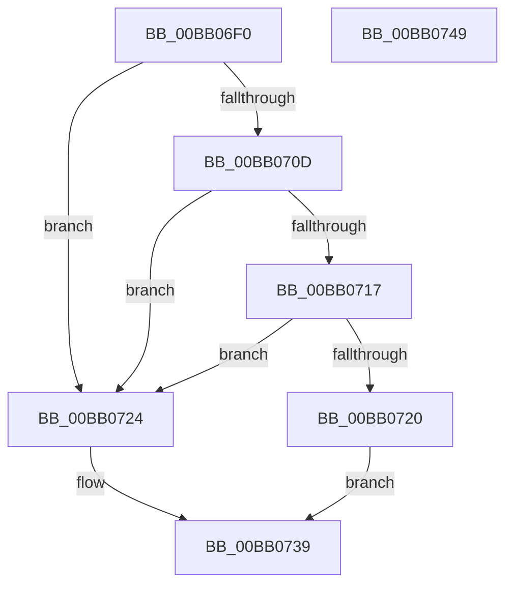

# VerifierMmCreateMdl

- RVA: `0x00BB06F0`–`0x00BB074A` (길이 `90` bytes)
- VA: `0x0000000140BB06F0`
- 실행 섹션: `PAGEVRFY`
- PDB 이름 있음: `예`; PDB Function 태그: `아니요`
- unwind 정보 RVA: `0x00060BC4`
- 디코드: `28`개 명령, `90/90` bytes 표시
- 미해석 바이트: `0` (있으면 어셈블리에 `.byte`로 보존)

> 이 문서는 커널 이미지의 기계어와 PDB 기호를 분석해 생성했습니다. 4번과 5번은 함수 원형과 자료형을 바이너리 사용 방식에서 추정한 C 해석이며 원본 소스 복구 결과는 아닙니다.

## 1. Dependencies

- 직접 호출 지점: **2**; 고유 호출 대상: **2**
- 직접 호출자로 확인된 함수: **0**
- RIP 상대 이미지 참조: **2**

### Outgoing calls
- `0x00BB0717` → [VfFaultsInjectResourceFailure](../BA/VfFaultsInjectResourceFailure_function_00BA6558.md) (function, `0x00BA6558`)
- `0x00BB0734` → [guard_dispatch_icall](../../text/6B/guard_dispatch_icall_function_006BAAD0.md) (function, `0x006BAAD0`)

### Direct callers
- 이 함수 시작 RVA로 연결되는 직접 call은 확인되지 않았습니다. 간접 호출은 완전히 역산할 수 없습니다.

### Static image references
- `0x00BB070D` → RVA `0x00E681A0` (`.data`; read)
- `0x00BB0724` → RVA `0x00FFDEC8` (`PAGEVRFD`; read)

## 2. Other-region calls and transfers

- 다른 실행 섹션으로 향하는 call: **1**
  - `0x00BB0734` → [guard_dispatch_icall](../../text/6B/guard_dispatch_icall_function_006BAAD0.md) (`PAGEVRFY` → `.text`)
- 별도 외부 분기/꼬리 이동을 확인하지 못했습니다.

## 3. Assembly (complete function range)

```asm
00BB06F0  48 89 5C 24 08                  mov qword ptr [rsp + 8], rbx
00BB06F5  48 89 74 24 10                  mov qword ptr [rsp + 0x10], rsi
00BB06FA  57                              push rdi
00BB06FB  48 83 EC 20                     sub rsp, 0x20
00BB06FF  49 8B F8                        mov rdi, r8
00BB0702  48 8B F2                        mov rsi, rdx
00BB0705  48 8B D9                        mov rbx, rcx
00BB0708  48 85 C9                        test rcx, rcx
00BB070B  75 17                           jne 0x140bb0724
00BB070D  8B 05 8D 7A 2B 00               mov eax, dword ptr [rip + 0x2b7a8d]
00BB0713  A8 04                           test al, 4
00BB0715  74 0D                           je 0x140bb0724
00BB0717  E8 3C 5E FF FF                  call 0x140ba6558
00BB071C  85 C0                           test eax, eax
00BB071E  74 04                           je 0x140bb0724
00BB0720  33 C0                           xor eax, eax
00BB0722  EB 15                           jmp 0x140bb0739
00BB0724  48 8B 05 9D D7 44 00            mov rax, qword ptr [rip + 0x44d79d]
00BB072B  4C 8B C7                        mov r8, rdi
00BB072E  48 8B D6                        mov rdx, rsi
00BB0731  48 8B CB                        mov rcx, rbx
00BB0734  E8 97 A3 B0 FF                  call 0x1406baad0
00BB0739  48 8B 5C 24 30                  mov rbx, qword ptr [rsp + 0x30]
00BB073E  48 8B 74 24 38                  mov rsi, qword ptr [rsp + 0x38]
00BB0743  48 83 C4 20                     add rsp, 0x20
00BB0747  5F                              pop rdi
00BB0748  C3                              ret
00BB0749  CC                              int3
```

## 4. C-style interpretation (structured pseudocode)

```c
__int64 __fastcall VerifierMmCreateMdl(__int64 a1, __int64 a2, __int64 a3)
{
    __int64 result;
    __int64 v_rsp;
    unsigned __int64 v_stack_p10;
    unsigned __int64 v_stack_p8;

    v_stack_p8 = v_rbx;
    v_stack_p10 = v_rsi;
    v_rsp = (v_rsp) - (32);
    if (a1 != 0) goto loc_00BB0724;
    if ((((unsigned __int8)((unsigned int)(*(unsigned int *)(v_rip + 2849421)))) & (4)) == 0) goto loc_00BB0724;
    result = VfFaultsInjectResourceFailure(a1, a2, a3, a4);
    if ((unsigned int)(result) == 0) goto loc_00BB0724;
    result = 0;
    goto loc_00BB0739;
loc_00BB0724:
    result = guard_dispatch_icall(a1, a2, a3, a4);
loc_00BB0739:
    v_rsp = (v_rsp) + (32);
    return result;
}
```

## 5. (Beta) C Style

```c
int64_t VerifierMmCreateMdl(int64_t Arg1, int64_t Arg2, int64_t Arg3)
{
    int64_t result;
    int64_t local_rsp;
    uint64_t v_stack_p10;
    uint64_t v_stack_p8;

    v_stack_p8 = local_rbx;
    v_stack_p10 = local_rsi;
    local_rsp = (local_rsp) - (32);
    if (Arg1 != 0) goto loc_00BB0724;
    if ((((uint8_t)((uint32_t)(*(uint32_t *)(v_rip + 0x2B7A8D)))) & (4)) == 0) goto loc_00BB0724;
    result = VfFaultsInjectResourceFailure(Arg1, Arg2, Arg3, a4);
    if ((uint32_t)(result) == 0) goto loc_00BB0724;
    result = 0;
    goto loc_00BB0739;
loc_00BB0724:
    result = guard_dispatch_icall(Arg1, Arg2, Arg3, a4);
loc_00BB0739:
    local_rsp = (local_rsp) + (32);
    return result;
}
```

## 6. Execution-region graph

[열기: 2D/3D 그래프와 함수 탐색 컨트롤 패널](../../../control-panel.html?section=pagevrfy&rva=0x00BB06F0&view=graph)

- 2D 그래프는 위에서 아래로 흐르고, 3D 그래프는 빈 공간을 드래그해 회전합니다. Shift+드래그는 이동, 휠은 확대·축소, 함수 노드 선택은 대상 보고서 이동입니다.

### Static fallback


