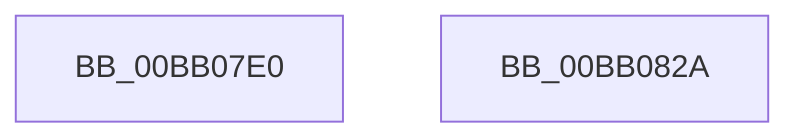

# VerifierMmFreeContiguousMemorySpecifyCache

- RVA: `0x00BB07E0`–`0x00BB082B` (길이 `75` bytes)
- VA: `0x0000000140BB07E0`
- 실행 섹션: `PAGEVRFY`
- PDB 이름 있음: `예`; PDB Function 태그: `아니요`
- unwind 정보 RVA: `0x00060BC4`
- 디코드: `21`개 명령, `75/75` bytes 표시
- 미해석 바이트: `0` (있으면 어셈블리에 `.byte`로 보존)

> 이 문서는 커널 이미지의 기계어와 PDB 기호를 분석해 생성했습니다. 4번과 5번은 함수 원형과 자료형을 바이너리 사용 방식에서 추정한 C 해석이며 원본 소스 복구 결과는 아닙니다.

## 1. Dependencies

- 직접 호출 지점: **2**; 고유 호출 대상: **2**
- 직접 호출자로 확인된 함수: **0**
- RIP 상대 이미지 참조: **1**

### Outgoing calls
- `0x00BB0800` → [VfTargetFreeContiguousMemory](../B9/VfTargetFreeContiguousMemory_function_00B9B6BC.md) (function, `0x00B9B6BC`)
- `0x00BB0815` → [guard_dispatch_icall](../../text/6B/guard_dispatch_icall_function_006BAAD0.md) (function, `0x006BAAD0`)

### Direct callers
- 이 함수 시작 RVA로 연결되는 직접 call은 확인되지 않았습니다. 간접 호출은 완전히 역산할 수 없습니다.

### Static image references
- `0x00BB0805` → RVA `0x00FFDF60` (`PAGEVRFD`; read)

## 2. Other-region calls and transfers

- 다른 실행 섹션으로 향하는 call: **1**
  - `0x00BB0815` → [guard_dispatch_icall](../../text/6B/guard_dispatch_icall_function_006BAAD0.md) (`PAGEVRFY` → `.text`)
- 별도 외부 분기/꼬리 이동을 확인하지 못했습니다.

## 3. Assembly (complete function range)

```asm
00BB07E0  48 89 5C 24 08                  mov qword ptr [rsp + 8], rbx
00BB07E5  48 89 74 24 10                  mov qword ptr [rsp + 0x10], rsi
00BB07EA  57                              push rdi
00BB07EB  48 83 EC 20                     sub rsp, 0x20
00BB07EF  48 8B F1                        mov rsi, rcx
00BB07F2  48 8B FA                        mov rdi, rdx
00BB07F5  48 8B 4C 24 28                  mov rcx, qword ptr [rsp + 0x28]
00BB07FA  48 8B D6                        mov rdx, rsi
00BB07FD  41 8B D8                        mov ebx, r8d
00BB0800  E8 B7 AE FE FF                  call 0x140b9b6bc
00BB0805  48 8B 05 54 D7 44 00            mov rax, qword ptr [rip + 0x44d754]
00BB080C  44 8B C3                        mov r8d, ebx
00BB080F  48 8B D7                        mov rdx, rdi
00BB0812  48 8B CE                        mov rcx, rsi
00BB0815  E8 B6 A2 B0 FF                  call 0x1406baad0
00BB081A  48 8B 5C 24 30                  mov rbx, qword ptr [rsp + 0x30]
00BB081F  48 8B 74 24 38                  mov rsi, qword ptr [rsp + 0x38]
00BB0824  48 83 C4 20                     add rsp, 0x20
00BB0828  5F                              pop rdi
00BB0829  C3                              ret
00BB082A  CC                              int3
```

## 4. C-style interpretation (structured pseudocode)

```c
__int64 __fastcall VerifierMmFreeContiguousMemorySpecifyCache(__int64 a1, __int64 a2, int a3)
{
    __int64 result;
    __int64 v_rsp;
    unsigned __int64 v_stack_p0;
    unsigned __int64 v_stack_p10;
    unsigned __int64 v_stack_p8;

    v_stack_p8 = v_rbx;
    v_stack_p10 = v_rsi;
    v_rsp = (v_rsp) - (32);
    result = VfTargetFreeContiguousMemory(v_stack_p0, a1, a3, a4);
    result = guard_dispatch_icall(a1, a2, (unsigned int)((unsigned int)((unsigned int)(a3))), a4);
    v_rsp = (v_rsp) + (32);
    return result;
}
```

## 5. (Beta) C Style

```c
int64_t VerifierMmFreeContiguousMemorySpecifyCache(int64_t Arg1, int64_t Arg2, int32_t Arg3)
{
    int64_t result;
    int64_t local_rsp;
    uint64_t v_stack_p0;
    uint64_t v_stack_p10;
    uint64_t v_stack_p8;

    v_stack_p8 = local_rbx;
    v_stack_p10 = local_rsi;
    local_rsp = (local_rsp) - (32);
    result = VfTargetFreeContiguousMemory(v_stack_p0, Arg1, Arg3, a4);
    result = guard_dispatch_icall(Arg1, Arg2, (uint32_t)((uint32_t)((uint32_t)(Arg3))), a4);
    local_rsp = (local_rsp) + (32);
    return result;
}
```

## 6. Execution-region graph

[열기: 2D/3D 그래프와 함수 탐색 컨트롤 패널](../../../control-panel.html?section=pagevrfy&rva=0x00BB07E0&view=graph)

- 2D 그래프는 위에서 아래로 흐르고, 3D 그래프는 빈 공간을 드래그해 회전합니다. Shift+드래그는 이동, 휠은 확대·축소, 함수 노드 선택은 대상 보고서 이동입니다.

### Static fallback


