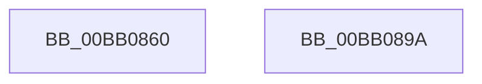

# VerifierMmFreeNonCachedMemory

- RVA: `0x00BB0860`–`0x00BB089B` (길이 `59` bytes)
- VA: `0x0000000140BB0860`
- 실행 섹션: `PAGEVRFY`
- PDB 이름 있음: `예`; PDB Function 태그: `아니요`
- unwind 정보 RVA: `0x0005CAAC`
- 디코드: `17`개 명령, `59/59` bytes 표시
- 미해석 바이트: `0` (있으면 어셈블리에 `.byte`로 보존)

> 이 문서는 커널 이미지의 기계어와 PDB 기호를 분석해 생성했습니다. 4번과 5번은 함수 원형과 자료형을 바이너리 사용 방식에서 추정한 C 해석이며 원본 소스 복구 결과는 아닙니다.

## 1. Dependencies

- 직접 호출 지점: **2**; 고유 호출 대상: **2**
- 직접 호출자로 확인된 함수: **0**
- RIP 상대 이미지 참조: **1**

### Outgoing calls
- `0x00BB0878` → [VfTargetFreeContiguousMemory](../B9/VfTargetFreeContiguousMemory_function_00B9B6BC.md) (function, `0x00B9B6BC`)
- `0x00BB088A` → [guard_dispatch_icall](../../text/6B/guard_dispatch_icall_function_006BAAD0.md) (function, `0x006BAAD0`)

### Direct callers
- 이 함수 시작 RVA로 연결되는 직접 call은 확인되지 않았습니다. 간접 호출은 완전히 역산할 수 없습니다.

### Static image references
- `0x00BB087D` → RVA `0x00FFDF40` (`PAGEVRFD`; read)

## 2. Other-region calls and transfers

- 다른 실행 섹션으로 향하는 call: **1**
  - `0x00BB088A` → [guard_dispatch_icall](../../text/6B/guard_dispatch_icall_function_006BAAD0.md) (`PAGEVRFY` → `.text`)
- 별도 외부 분기/꼬리 이동을 확인하지 못했습니다.

## 3. Assembly (complete function range)

```asm
00BB0860  48 89 5C 24 08                  mov qword ptr [rsp + 8], rbx
00BB0865  57                              push rdi
00BB0866  48 83 EC 20                     sub rsp, 0x20
00BB086A  48 8B F9                        mov rdi, rcx
00BB086D  48 8B DA                        mov rbx, rdx
00BB0870  48 8B 4C 24 28                  mov rcx, qword ptr [rsp + 0x28]
00BB0875  48 8B D7                        mov rdx, rdi
00BB0878  E8 3F AE FE FF                  call 0x140b9b6bc
00BB087D  48 8B 05 BC D6 44 00            mov rax, qword ptr [rip + 0x44d6bc]
00BB0884  48 8B D3                        mov rdx, rbx
00BB0887  48 8B CF                        mov rcx, rdi
00BB088A  E8 41 A2 B0 FF                  call 0x1406baad0
00BB088F  48 8B 5C 24 30                  mov rbx, qword ptr [rsp + 0x30]
00BB0894  48 83 C4 20                     add rsp, 0x20
00BB0898  5F                              pop rdi
00BB0899  C3                              ret
00BB089A  CC                              int3
```

## 4. C-style interpretation (structured pseudocode)

```c
__int64 __fastcall VerifierMmFreeNonCachedMemory(__int64 a1, __int64 a2)
{
    __int64 result;
    __int64 v_rsp;
    unsigned __int64 v_stack_p0;
    unsigned __int64 v_stack_p8;

    v_stack_p8 = v_rbx;
    v_rsp = (v_rsp) - (32);
    result = VfTargetFreeContiguousMemory(v_stack_p0, a1, a3, a4);
    result = guard_dispatch_icall(a1, a2, a3, a4);
    v_rsp = (v_rsp) + (32);
    return result;
}
```

## 5. (Beta) C Style

```c
int64_t VerifierMmFreeNonCachedMemory(int64_t Arg1, int64_t Arg2)
{
    int64_t result;
    int64_t local_rsp;
    uint64_t v_stack_p0;
    uint64_t v_stack_p8;

    v_stack_p8 = local_rbx;
    local_rsp = (local_rsp) - (32);
    result = VfTargetFreeContiguousMemory(v_stack_p0, Arg1, a3, a4);
    result = guard_dispatch_icall(Arg1, Arg2, a3, a4);
    local_rsp = (local_rsp) + (32);
    return result;
}
```

## 6. Execution-region graph

[열기: 2D/3D 그래프와 함수 탐색 컨트롤 패널](../../../control-panel.html?section=pagevrfy&rva=0x00BB0860&view=graph)

- 2D 그래프는 위에서 아래로 흐르고, 3D 그래프는 빈 공간을 드래그해 회전합니다. Shift+드래그는 이동, 휠은 확대·축소, 함수 노드 선택은 대상 보고서 이동입니다.

### Static fallback


