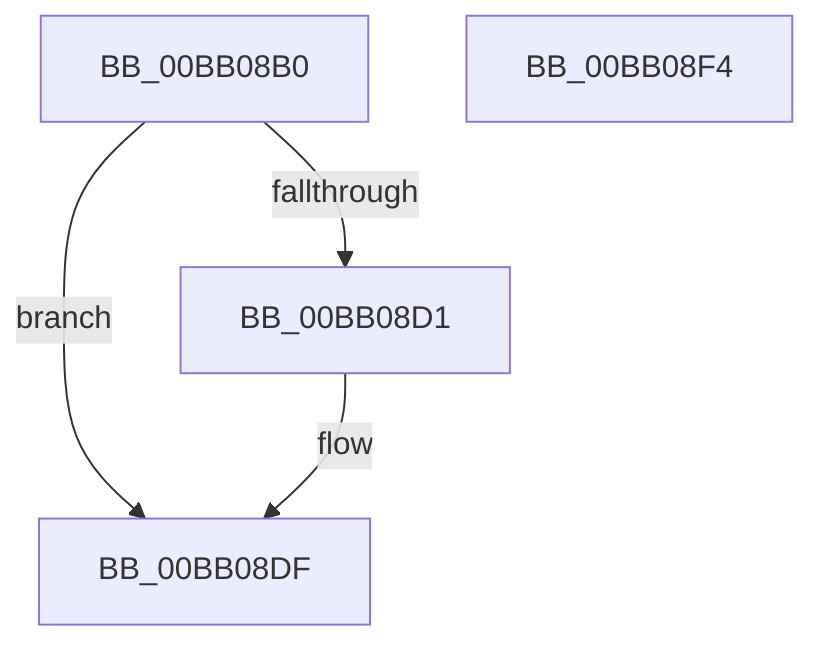

# VerifierMmFreePagesFromMdl

- RVA: `0x00BB08B0`–`0x00BB08F5` (길이 `69` bytes)
- VA: `0x0000000140BB08B0`
- 실행 섹션: `PAGEVRFY`
- PDB 이름 있음: `예`; PDB Function 태그: `아니요`
- unwind 정보 RVA: `0x0005CF00`
- 디코드: `18`개 명령, `69/69` bytes 표시
- 미해석 바이트: `0` (있으면 어셈블리에 `.byte`로 보존)

> 이 문서는 커널 이미지의 기계어와 PDB 기호를 분석해 생성했습니다. 4번과 5번은 함수 원형과 자료형을 바이너리 사용 방식에서 추정한 C 해석이며 원본 소스 복구 결과는 아닙니다.

## 1. Dependencies

- 직접 호출 지점: **2**; 고유 호출 대상: **2**
- 직접 호출자로 확인된 함수: **0**
- RIP 상대 이미지 참조: **2**

### Outgoing calls
- `0x00BB08DA` → [ViTargetAddToCounter](../B9/ViTargetAddToCounter_function_00B9B8E0.md) (function, `0x00B9B8E0`)
- `0x00BB08E9` → [guard_dispatch_icall](../../text/6B/guard_dispatch_icall_function_006BAAD0.md) (function, `0x006BAAD0`)

### Direct callers
- 이 함수 시작 RVA로 연결되는 직접 call은 확인되지 않았습니다. 간접 호출은 완전히 역산할 수 없습니다.

### Static image references
- `0x00BB08C5` → RVA `0x00F04A20` (`.data`; read)
- `0x00BB08DF` → RVA `0x00FFDEC0` (`PAGEVRFD`; read)

## 2. Other-region calls and transfers

- 다른 실행 섹션으로 향하는 call: **1**
  - `0x00BB08E9` → [guard_dispatch_icall](../../text/6B/guard_dispatch_icall_function_006BAAD0.md) (`PAGEVRFY` → `.text`)
- 별도 외부 분기/꼬리 이동을 확인하지 못했습니다.

## 3. Assembly (complete function range)

```asm
00BB08B0  40 53                           push rbx
00BB08B2  48 83 EC 20                     sub rsp, 0x20
00BB08B6  44 8B 49 28                     mov r9d, dword ptr [rcx + 0x28]
00BB08BA  48 8B D9                        mov rbx, rcx
00BB08BD  48 8B 4C 24 28                  mov rcx, qword ptr [rsp + 0x28]
00BB08C2  49 F7 D9                        neg r9
00BB08C5  F7 05 51 41 35 00 00 10 00 00   test dword ptr [rip + 0x354151], 0x1000
00BB08CF  74 0E                           je 0x140bb08df
00BB08D1  BA E8 00 00 00                  mov edx, 0xe8
00BB08D6  44 8D 42 08                     lea r8d, [rdx + 8]
00BB08DA  E8 01 B0 FE FF                  call 0x140b9b8e0
00BB08DF  48 8B 05 DA D5 44 00            mov rax, qword ptr [rip + 0x44d5da]
00BB08E6  48 8B CB                        mov rcx, rbx
00BB08E9  E8 E2 A1 B0 FF                  call 0x1406baad0
00BB08EE  48 83 C4 20                     add rsp, 0x20
00BB08F2  5B                              pop rbx
00BB08F3  C3                              ret
00BB08F4  CC                              int3
```

## 4. C-style interpretation (structured pseudocode)

```c
__int64 __fastcall VerifierMmFreePagesFromMdl(__int64 a1)
{
    __int64 result;
    __int64 v_rsp;
    unsigned __int64 v_stack_p0;

    v_rsp = (v_rsp) - (32);
    a4 = -((unsigned int)(*(unsigned int *)(a1 + 40)));
    if (((*(unsigned int *)(v_rip + 3490129)) & (0x1000ULL)) != 0) {
        a2 = 232;
        a3 = a2 + 8;
        result = ViTargetAddToCounter(v_stack_p0, a2, a3, a4);
    }
    result = guard_dispatch_icall(a1, a2, a3, a4);
    v_rsp = (v_rsp) + (32);
    return result;
}
```

## 5. (Beta) C Style

```c
int64_t VerifierMmFreePagesFromMdl(void *Arg1)
{
    uint8_t *arg1 = (uint8_t *)Arg1;

    int64_t result;
    int64_t local_rsp;
    uint64_t v_stack_p0;

    local_rsp = (local_rsp) - (32);
    a4 = -((uint32_t)(*(uint32_t *)(arg1 + 0x28)));
    if (((*(uint32_t *)(v_rip + 0x354151)) & (0x1000ULL)) != 0) {
        a2 = 232;
        a3 = a2 + 8;
        result = ViTargetAddToCounter(v_stack_p0, a2, a3, a4);
    }
    result = guard_dispatch_icall(Arg1, a2, a3, a4);
    local_rsp = (local_rsp) + (32);
    return result;
}
```

### 관측된 메모리 오프셋

구조체 형식이 확인되지 않은 접근은 인자 기준의 오프셋으로만 기록했습니다.

| 기준 인자 | 오프셋 표현 | 폭 (bit) | 접근 |
|---|---:|---:|---|
| `Arg1` | `+ 0x28` | `32` | `R` |

## 6. Execution-region graph

[열기: 2D/3D 그래프와 함수 탐색 컨트롤 패널](../../../control-panel.html?section=pagevrfy&rva=0x00BB08B0&view=graph)

- 2D 그래프는 위에서 아래로 흐르고, 3D 그래프는 빈 공간을 드래그해 회전합니다. Shift+드래그는 이동, 휠은 확대·축소, 함수 노드 선택은 대상 보고서 이동입니다.

### Static fallback


