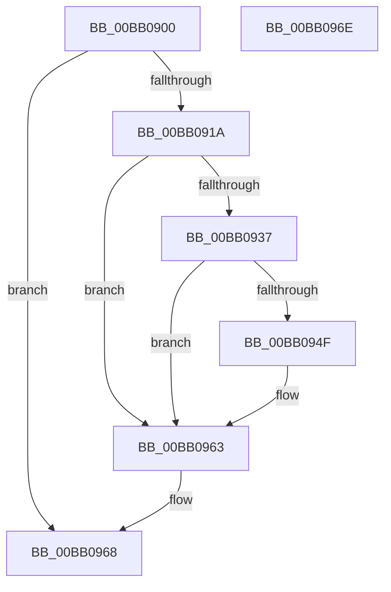

# VerifierMmGetSystemRoutineAddress

- RVA: `0x00BB0900`–`0x00BB096F` (길이 `111` bytes)
- VA: `0x0000000140BB0900`
- 실행 섹션: `PAGEVRFY`
- PDB 이름 있음: `예`; PDB Function 태그: `아니요`
- unwind 정보 RVA: `0x0005CF00`
- 디코드: `29`개 명령, `111/111` bytes 표시
- 미해석 바이트: `0` (있으면 어셈블리에 `.byte`로 보존)

> 이 문서는 커널 이미지의 기계어와 PDB 기호를 분석해 생성했습니다. 4번과 5번은 함수 원형과 자료형을 바이너리 사용 방식에서 추정한 C 해석이며 원본 소스 복구 결과는 아닙니다.

## 1. Dependencies

- 직접 호출 지점: **4**; 고유 호출 대상: **2**
- 직접 호출자로 확인된 함수: **0**
- RIP 상대 이미지 참조: **4**

### Outgoing calls
- `0x00BB0910` → [guard_dispatch_icall](../../text/6B/guard_dispatch_icall_function_006BAAD0.md) (function, `0x006BAAD0`)
- `0x00BB092E` → [ViThunkHookExportAddress](../BA/ViThunkHookExportAddress_function_00BA78E8.md) (function, `0x00BA78E8`)
- `0x00BB0946` → [ViThunkHookExportAddress](../BA/ViThunkHookExportAddress_function_00BA78E8.md) (function, `0x00BA78E8`)
- `0x00BB095E` → [ViThunkHookExportAddress](../BA/ViThunkHookExportAddress_function_00BA78E8.md) (function, `0x00BA78E8`)

### Direct callers
- 이 함수 시작 RVA로 연결되는 직접 call은 확인되지 않았습니다. 간접 호출은 완전히 역산할 수 없습니다.

### Static image references
- `0x00BB0906` → RVA `0x00FFDEF0` (`PAGEVRFD`; read)
- `0x00BB091A` → RVA `0x00FF51B0` (`PAGEVRFD`; read)
- `0x00BB0937` → RVA `0x00FF4A40` (`PAGEVRFD`; read)
- `0x00BB094F` → RVA `0x00FF5F20` (`PAGEVRFD`; read)

## 2. Other-region calls and transfers

- 다른 실행 섹션으로 향하는 call: **1**
  - `0x00BB0910` → [guard_dispatch_icall](../../text/6B/guard_dispatch_icall_function_006BAAD0.md) (`PAGEVRFY` → `.text`)
- 별도 외부 분기/꼬리 이동을 확인하지 못했습니다.

## 3. Assembly (complete function range)

```asm
00BB0900  40 53                           push rbx
00BB0902  48 83 EC 20                     sub rsp, 0x20
00BB0906  48 8B 05 E3 D5 44 00            mov rax, qword ptr [rip + 0x44d5e3]
00BB090D  48 8B D9                        mov rbx, rcx
00BB0910  E8 BB A1 B0 FF                  call 0x1406baad0
00BB0915  48 85 C0                        test rax, rax
00BB0918  74 4E                           je 0x140bb0968
00BB091A  4C 8D 05 8F 48 44 00            lea r8, [rip + 0x44488f]
00BB0921  48 89 44 24 38                  mov qword ptr [rsp + 0x38], rax
00BB0926  48 8B D3                        mov rdx, rbx
00BB0929  48 8D 4C 24 38                  lea rcx, [rsp + 0x38]
00BB092E  E8 B5 6F FF FF                  call 0x140ba78e8
00BB0933  85 C0                           test eax, eax
00BB0935  75 2C                           jne 0x140bb0963
00BB0937  4C 8D 05 02 41 44 00            lea r8, [rip + 0x444102]
00BB093E  48 8B D3                        mov rdx, rbx
00BB0941  48 8D 4C 24 38                  lea rcx, [rsp + 0x38]
00BB0946  E8 9D 6F FF FF                  call 0x140ba78e8
00BB094B  85 C0                           test eax, eax
00BB094D  75 14                           jne 0x140bb0963
00BB094F  4C 8D 05 CA 55 44 00            lea r8, [rip + 0x4455ca]
00BB0956  48 8B D3                        mov rdx, rbx
00BB0959  48 8D 4C 24 38                  lea rcx, [rsp + 0x38]
00BB095E  E8 85 6F FF FF                  call 0x140ba78e8
00BB0963  48 8B 44 24 38                  mov rax, qword ptr [rsp + 0x38]
00BB0968  48 83 C4 20                     add rsp, 0x20
00BB096C  5B                              pop rbx
00BB096D  C3                              ret
00BB096E  CC                              int3
```

## 4. C-style interpretation (structured pseudocode)

```c
__int64 __fastcall VerifierMmGetSystemRoutineAddress(__int64 a1)
{
    __int64 result;
    __int64 v_rsp;
    unsigned __int64 v_stack_p10;

    v_rsp = (v_rsp) - (32);
    result = guard_dispatch_icall(a1, a2, a3, a4);
    if (result == 0) goto loc_00BB0968;
    v_stack_p10 = result;
    result = ViThunkHookExportAddress(v_stack_p10, a1, v_rip + 4475023, a4);
    if ((unsigned int)(result) != 0) goto loc_00BB0963;
    result = ViThunkHookExportAddress(v_stack_p10, a1, v_rip + 4473090, a4);
    if ((unsigned int)(result) == 0) {
        a3 = v_rip + 4478410;
        a2 = a1;
        a1 = v_stack_p10;
        result = ViThunkHookExportAddress(a1, a2, a3, a4);
    }
loc_00BB0968:
    v_rsp = (v_rsp) + (32);
    return v_stack_p10;
}
```

## 5. (Beta) C Style

```c
int64_t VerifierMmGetSystemRoutineAddress(int64_t Arg1)
{
    int64_t result;
    int64_t local_rsp;
    uint64_t v_stack_p10;

    local_rsp = (local_rsp) - (32);
    result = guard_dispatch_icall(Arg1, a2, a3, a4);
    if (result == 0) goto loc_00BB0968;
    v_stack_p10 = result;
    result = ViThunkHookExportAddress(v_stack_p10, Arg1, v_rip + 4475023, a4);
    if ((uint32_t)(result) != 0) goto loc_00BB0963;
    result = ViThunkHookExportAddress(v_stack_p10, Arg1, v_rip + 4473090, a4);
    if ((uint32_t)(result) == 0) {
        a3 = v_rip + 4478410;
        a2 = Arg1;
        Arg1 = v_stack_p10;
        result = ViThunkHookExportAddress(Arg1, a2, a3, a4);
    }
loc_00BB0968:
    local_rsp = (local_rsp) + (32);
    return v_stack_p10;
}
```

## 6. Execution-region graph

[열기: 2D/3D 그래프와 함수 탐색 컨트롤 패널](../../../control-panel.html?section=pagevrfy&rva=0x00BB0900&view=graph)

- 2D 그래프는 위에서 아래로 흐르고, 3D 그래프는 빈 공간을 드래그해 회전합니다. Shift+드래그는 이동, 휠은 확대·축소, 함수 노드 선택은 대상 보고서 이동입니다.

### Static fallback


