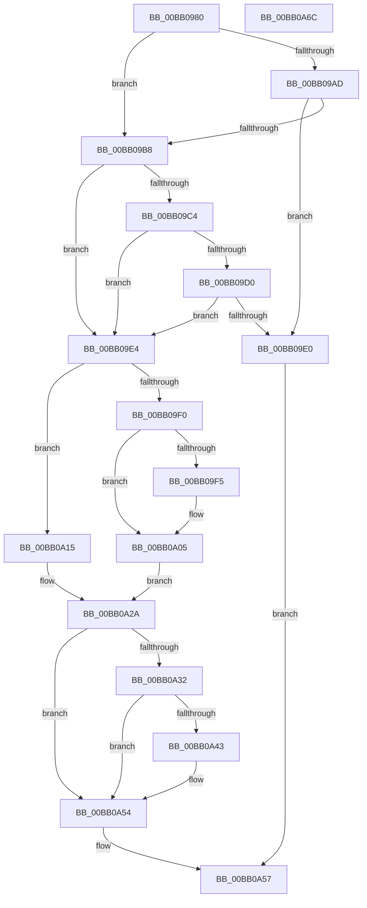

# VerifierMmMapIoSpace

- RVA: `0x00BB0980`–`0x00BB0A6D` (길이 `237` bytes)
- VA: `0x0000000140BB0980`
- 실행 섹션: `PAGEVRFY`
- PDB 이름 있음: `예`; PDB Function 태그: `아니요`
- unwind 정보 RVA: `0x0005C954`
- 디코드: `63`개 명령, `237/237` bytes 표시
- 미해석 바이트: `0` (있으면 어셈블리에 `.byte`로 보존)

> 이 문서는 커널 이미지의 기계어와 PDB 기호를 분석해 생성했습니다. 4번과 5번은 함수 원형과 자료형을 바이너리 사용 방식에서 추정한 C 해석이며 원본 소스 복구 결과는 아닙니다.

## 1. Dependencies

- 직접 호출 지점: **5**; 고유 호출 대상: **4**
- 직접 호출자로 확인된 함수: **0**
- RIP 상대 이미지 참조: **5**

### Outgoing calls
- `0x00BB09AF` → [VfFaultsInjectResourceFailure](../BA/VfFaultsInjectResourceFailure_function_00BA6558.md) (function, `0x00BA6558`)
- `0x00BB09D7` → [guard_dispatch_icall](../../text/6B/guard_dispatch_icall_function_006BAAD0.md) (function, `0x006BAAD0`)
- `0x00BB0A0E` → [MmMapIoSpaceEx](../../text/32/MmMapIoSpaceEx_function_00327830.md) (function, `0x00327830`)
- `0x00BB0A25` → [guard_dispatch_icall](../../text/6B/guard_dispatch_icall_function_006BAAD0.md) (function, `0x006BAAD0`)
- `0x00BB0A4F` → [ViTargetAddToCounter](../B9/ViTargetAddToCounter_function_00B9B8E0.md) (function, `0x00B9B8E0`)

### Direct callers
- 이 함수 시작 RVA로 연결되는 직접 call은 확인되지 않았습니다. 간접 호출은 완전히 역산할 수 없습니다.

### Static image references
- `0x00BB0994` → RVA `0x00E681A0` (`.data`; read)
- `0x00BB09C4` → RVA `0x00FFDA10` (`PAGEVRFD`; read)
- `0x00BB09D0` → RVA `0x00BBB870` (` ?? ::JKADOLAD::`string'`; read)
- `0x00BB09E4` → RVA `0x00F04A20` (`.data`; read)
- `0x00BB0A15` → RVA `0x00FFDFA8` (`PAGEVRFD`; read)

## 2. Other-region calls and transfers

- 다른 실행 섹션으로 향하는 call: **3**
  - `0x00BB09D7` → [guard_dispatch_icall](../../text/6B/guard_dispatch_icall_function_006BAAD0.md) (`PAGEVRFY` → `.text`)
  - `0x00BB0A0E` → [MmMapIoSpaceEx](../../text/32/MmMapIoSpaceEx_function_00327830.md) (`PAGEVRFY` → `.text`)
  - `0x00BB0A25` → [guard_dispatch_icall](../../text/6B/guard_dispatch_icall_function_006BAAD0.md) (`PAGEVRFY` → `.text`)
- 별도 외부 분기/꼬리 이동을 확인하지 못했습니다.

## 3. Assembly (complete function range)

```asm
00BB0980  48 89 5C 24 08                  mov qword ptr [rsp + 8], rbx
00BB0985  48 89 6C 24 10                  mov qword ptr [rsp + 0x10], rbp
00BB098A  48 89 74 24 18                  mov qword ptr [rsp + 0x18], rsi
00BB098F  57                              push rdi
00BB0990  48 83 EC 20                     sub rsp, 0x20
00BB0994  8B 05 06 78 2B 00               mov eax, dword ptr [rip + 0x2b7806]
00BB099A  BF 04 00 00 00                  mov edi, 4
00BB099F  41 8B F0                        mov esi, r8d
00BB09A2  48 8B EA                        mov rbp, rdx
00BB09A5  48 8B D9                        mov rbx, rcx
00BB09A8  40 84 C7                        test dil, al
00BB09AB  74 0B                           je 0x140bb09b8
00BB09AD  33 C9                           xor ecx, ecx
00BB09AF  E8 A4 5B FF FF                  call 0x140ba6558
00BB09B4  85 C0                           test eax, eax
00BB09B6  75 28                           jne 0x140bb09e0
00BB09B8  F7 05 DE 77 2B 00 00 00 04 00   test dword ptr [rip + 0x2b77de], 0x40000
00BB09C2  74 20                           je 0x140bb09e4
00BB09C4  48 8B 05 45 D0 44 00            mov rax, qword ptr [rip + 0x44d045]
00BB09CB  48 85 C0                        test rax, rax
00BB09CE  74 14                           je 0x140bb09e4
00BB09D0  48 8D 0D 99 AE 00 00            lea rcx, [rip + 0xae99]
00BB09D7  E8 F4 A0 B0 FF                  call 0x1406baad0
00BB09DC  84 C0                           test al, al
00BB09DE  74 04                           je 0x140bb09e4
00BB09E0  33 C0                           xor eax, eax
00BB09E2  EB 73                           jmp 0x140bb0a57
00BB09E4  F7 05 32 40 35 00 00 00 00 02   test dword ptr [rip + 0x354032], 0x2000000
00BB09EE  74 25                           je 0x140bb0a15
00BB09F0  83 FE 01                        cmp esi, 1
00BB09F3  74 10                           je 0x140bb0a05
00BB09F5  83 FE 02                        cmp esi, 2
00BB09F8  BF 04 02 00 00                  mov edi, 0x204
00BB09FD  B8 04 04 00 00                  mov eax, 0x404
00BB0A02  0F 44 F8                        cmove edi, eax
00BB0A05  44 8B C7                        mov r8d, edi
00BB0A08  48 8B D5                        mov rdx, rbp
00BB0A0B  48 8B CB                        mov rcx, rbx
00BB0A0E  E8 1D 6E 77 FF                  call 0x140327830
00BB0A13  EB 15                           jmp 0x140bb0a2a
00BB0A15  48 8B 05 8C D5 44 00            mov rax, qword ptr [rip + 0x44d58c]
00BB0A1C  44 8B C6                        mov r8d, esi
00BB0A1F  48 8B D5                        mov rdx, rbp
00BB0A22  48 8B CB                        mov rcx, rbx
00BB0A25  E8 A6 A0 B0 FF                  call 0x1406baad0
00BB0A2A  48 8B D8                        mov rbx, rax
00BB0A2D  48 85 C0                        test rax, rax
00BB0A30  74 22                           je 0x140bb0a54
00BB0A32  F7 05 E4 3F 35 00 00 10 00 00   test dword ptr [rip + 0x353fe4], 0x1000
00BB0A3C  48 8B 4C 24 28                  mov rcx, qword ptr [rsp + 0x28]
00BB0A41  74 11                           je 0x140bb0a54
00BB0A43  BA D8 00 00 00                  mov edx, 0xd8
00BB0A48  4C 8B CD                        mov r9, rbp
00BB0A4B  44 8D 42 08                     lea r8d, [rdx + 8]
00BB0A4F  E8 8C AE FE FF                  call 0x140b9b8e0
00BB0A54  48 8B C3                        mov rax, rbx
00BB0A57  48 8B 5C 24 30                  mov rbx, qword ptr [rsp + 0x30]
00BB0A5C  48 8B 6C 24 38                  mov rbp, qword ptr [rsp + 0x38]
00BB0A61  48 8B 74 24 40                  mov rsi, qword ptr [rsp + 0x40]
00BB0A66  48 83 C4 20                     add rsp, 0x20
00BB0A6A  5F                              pop rdi
00BB0A6B  C3                              ret
00BB0A6C  CC                              int3
```

## 4. C-style interpretation (structured pseudocode)

```c
__int64 __fastcall VerifierMmMapIoSpace(__int64 a1, __int64 a2, int a3)
{
    __int64 result;
    __int64 v_rdi;
    __int64 v_rsp;
    unsigned __int64 v_stack_p0;
    unsigned __int64 v_stack_p10;
    unsigned __int64 v_stack_p18;
    unsigned __int64 v_stack_p8;

    v_stack_p8 = v_rbx;
    v_stack_p10 = v_rbp;
    v_stack_p18 = v_rsi;
    v_rsp = (v_rsp) - (32);
    if (((4) & ((unsigned __int8)((unsigned int)(*(unsigned int *)(v_rip + 2848774))))) == 0) goto loc_00BB09B8;
    a1 = 0;
    result = VfFaultsInjectResourceFailure(a1, a2, a3, a4);
    if ((unsigned int)(result) != 0) goto loc_00BB09E0;
loc_00BB09B8:
    if (((*(unsigned int *)(v_rip + 2848734)) & (0x40000ULL)) == 0) goto loc_00BB09E4;
    if (*(unsigned __int64 *)(v_rip + 4509765) == 0) goto loc_00BB09E4;
    result = guard_dispatch_icall(v_rip + 44697, a2, a3, a4);
    if ((unsigned __int8)(result) == 0) goto loc_00BB09E4;
loc_00BB09E0:
    result = 0;
    goto loc_00BB0A57;
loc_00BB09E4:
    if (((*(unsigned int *)(v_rip + 3489842)) & (0x2000000ULL)) == 0) goto loc_00BB0A15;
    v_rdi = 4;
    if (((unsigned int)((unsigned int)(a3))) != 1) {
        v_rdi = 516;
        result = 0x404ULL;
        if (((unsigned int)((unsigned int)(a3))) == 2) { v_rdi = (unsigned int)(result); }
    }
    result = MmMapIoSpaceEx(0, a2, (unsigned int)((unsigned int)(v_rdi)), a4);
    goto loc_00BB0A2A;
loc_00BB0A15:
    result = guard_dispatch_icall(0, a2, (unsigned int)((unsigned int)((unsigned int)(a3))), a4);
loc_00BB0A2A:
    if (result == 0) goto loc_00BB0A54;
    if (((*(unsigned int *)(v_rip + 3489764)) & (0x1000ULL)) != 0) {
        a2 = 216;
        a4 = a2;
        a3 = a2 + 8;
        result = ViTargetAddToCounter(v_stack_p0, a2, a3, a4);
    }
loc_00BB0A57:
    v_rsp = (v_rsp) + (32);
    return result;
}
```

## 5. (Beta) C Style

```c
int64_t VerifierMmMapIoSpace(int64_t Arg1, int64_t Arg2, int32_t Arg3)
{
    int64_t result;
    int64_t local_rdi;
    int64_t local_rsp;
    uint64_t v_stack_p0;
    uint64_t v_stack_p10;
    uint64_t v_stack_p18;
    uint64_t v_stack_p8;

    v_stack_p8 = local_rbx;
    v_stack_p10 = local_rbp;
    v_stack_p18 = local_rsi;
    local_rsp = (local_rsp) - (32);
    if (((4) & ((uint8_t)((uint32_t)(*(uint32_t *)(v_rip + 0x2B7806))))) == 0) goto loc_00BB09B8;
    Arg1 = 0;
    result = VfFaultsInjectResourceFailure(Arg1, Arg2, Arg3, a4);
    if ((uint32_t)(result) != 0) goto loc_00BB09E0;
loc_00BB09B8:
    if (((*(uint32_t *)(v_rip + 0x2B77DE)) & (0x40000ULL)) == 0) goto loc_00BB09E4;
    if (*(uint64_t *)(v_rip + 0x44D045) == 0) goto loc_00BB09E4;
    result = guard_dispatch_icall(v_rip + 44697, Arg2, Arg3, a4);
    if ((uint8_t)(result) == 0) goto loc_00BB09E4;
loc_00BB09E0:
    result = 0;
    goto loc_00BB0A57;
loc_00BB09E4:
    if (((*(uint32_t *)(v_rip + 0x354032)) & (0x2000000ULL)) == 0) goto loc_00BB0A15;
    local_rdi = 4;
    if (((uint32_t)((uint32_t)(Arg3))) != 1) {
        local_rdi = 516;
        result = 0x404ULL;
        if (((uint32_t)((uint32_t)(Arg3))) == 2) { local_rdi = (uint32_t)(result); }
    }
    result = MmMapIoSpaceEx(0, Arg2, (uint32_t)((uint32_t)(local_rdi)), a4);
    goto loc_00BB0A2A;
loc_00BB0A15:
    result = guard_dispatch_icall(0, Arg2, (uint32_t)((uint32_t)((uint32_t)(Arg3))), a4);
loc_00BB0A2A:
    if (result == 0) goto loc_00BB0A54;
    if (((*(uint32_t *)(v_rip + 0x353FE4)) & (0x1000ULL)) != 0) {
        Arg2 = 216;
        a4 = Arg2;
        Arg3 = Arg2 + 8;
        result = ViTargetAddToCounter(v_stack_p0, Arg2, Arg3, a4);
    }
loc_00BB0A57:
    local_rsp = (local_rsp) + (32);
    return result;
}
```

## 6. Execution-region graph

[열기: 2D/3D 그래프와 함수 탐색 컨트롤 패널](../../../control-panel.html?section=pagevrfy&rva=0x00BB0980&view=graph)

- 2D 그래프는 위에서 아래로 흐르고, 3D 그래프는 빈 공간을 드래그해 회전합니다. Shift+드래그는 이동, 휠은 확대·축소, 함수 노드 선택은 대상 보고서 이동입니다.

### Static fallback


