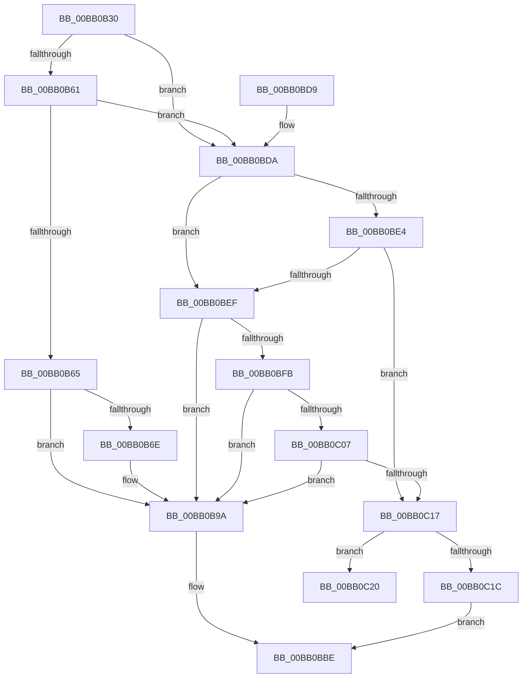

# VerifierMmMapLockedPagesSpecifyCache

- RVA: `0x00BB0B30`–`0x00BB0C2B` (길이 `251` bytes)
- VA: `0x0000000140BB0B30`
- 실행 섹션: `PAGEVRFY`
- PDB 이름 있음: `예`; PDB Function 태그: `아니요`
- unwind 정보 RVA: `0x000D294C`
- 디코드: `68`개 명령, `251/251` bytes 표시
- 미해석 바이트: `0` (있으면 어셈블리에 `.byte`로 보존)

> 이 문서는 커널 이미지의 기계어와 PDB 기호를 분석해 생성했습니다. 4번과 5번은 함수 원형과 자료형을 바이너리 사용 방식에서 추정한 C 해석이며 원본 소스 복구 결과는 아닙니다.

## 1. Dependencies

- 직접 호출 지점: **6**; 고유 호출 대상: **5**
- 직접 호출자로 확인된 함수: **0**
- RIP 상대 이미지 참조: **4**

### Outgoing calls
- `0x00BB0B65` → [VfFaultsIsSystemSufficientlyBooted](../BA/VfFaultsIsSystemSufficientlyBooted_function_00BA664C.md) (function, `0x00BA664C`)
- `0x00BB0B95` → [CarReportRuleViolationFromNt](../B9/CarReportRuleViolationFromNt_function_00B9D904.md) (function, `0x00B9D904`)
- `0x00BB0BB9` → [guard_dispatch_icall](../../text/6B/guard_dispatch_icall_function_006BAAD0.md) (function, `0x006BAAD0`)
- `0x00BB0BE6` → [VfFaultsInjectResourceFailure](../BA/VfFaultsInjectResourceFailure_function_00BA6558.md) (function, `0x00BA6558`)
- `0x00BB0C0E` → [guard_dispatch_icall](../../text/6B/guard_dispatch_icall_function_006BAAD0.md) (function, `0x006BAAD0`)
- `0x00BB0C25` → [RtlRaiseStatus](../../text/2F/RtlRaiseStatus_function_002F6A50.md) (function, `0x002F6A50`)

### Direct callers
- 이 함수 시작 RVA로 연결되는 직접 call은 확인되지 않았습니다. 간접 호출은 완전히 역산할 수 없습니다.

### Static image references
- `0x00BB0BA1` → RVA `0x00FFDC00` (`PAGEVRFD`; read)
- `0x00BB0BDA` → RVA `0x00E681A0` (`.data`; read)
- `0x00BB0BFB` → RVA `0x00FFDA10` (`PAGEVRFD`; read)
- `0x00BB0C07` → RVA `0x00BBB820` (` ?? ::JKADOLAD::`string'`; read)

## 2. Other-region calls and transfers

- 다른 실행 섹션으로 향하는 call: **3**
  - `0x00BB0BB9` → [guard_dispatch_icall](../../text/6B/guard_dispatch_icall_function_006BAAD0.md) (`PAGEVRFY` → `.text`)
  - `0x00BB0C0E` → [guard_dispatch_icall](../../text/6B/guard_dispatch_icall_function_006BAAD0.md) (`PAGEVRFY` → `.text`)
  - `0x00BB0C25` → [RtlRaiseStatus](../../text/2F/RtlRaiseStatus_function_002F6A50.md) (`PAGEVRFY` → `.text`)
- 별도 외부 분기/꼬리 이동을 확인하지 못했습니다.

## 3. Assembly (complete function range)

```asm
00BB0B30  48 8B C4                        mov rax, rsp
00BB0B33  48 89 58 08                     mov qword ptr [rax + 8], rbx
00BB0B37  48 89 68 10                     mov qword ptr [rax + 0x10], rbp
00BB0B3B  48 89 70 18                     mov qword ptr [rax + 0x18], rsi
00BB0B3F  48 89 78 20                     mov qword ptr [rax + 0x20], rdi
00BB0B43  41 56                           push r14
00BB0B45  48 83 EC 40                     sub rsp, 0x40
00BB0B49  66 0F BA 61 0A 0D               bt word ptr [rcx + 0xa], 0xd
00BB0B4F  8B 5C 24 70                     mov ebx, dword ptr [rsp + 0x70]
00BB0B53  49 8B E9                        mov rbp, r9
00BB0B56  45 8B F0                        mov r14d, r8d
00BB0B59  40 8A F2                        mov sil, dl
00BB0B5C  48 8B F9                        mov rdi, rcx
00BB0B5F  72 79                           jb 0x140bb0bda
00BB0B61  85 DB                           test ebx, ebx
00BB0B63  74 75                           je 0x140bb0bda
00BB0B65  E8 E2 5A FF FF                  call 0x140ba664c
00BB0B6A  85 C0                           test eax, eax
00BB0B6C  74 2C                           je 0x140bb0b9a
00BB0B6E  48 8B 44 24 48                  mov rax, qword ptr [rsp + 0x48]
00BB0B73  BA 82 00 00 00                  mov edx, 0x82
00BB0B78  4C 0F BF 4F 0A                  movsx r9, word ptr [rdi + 0xa]
00BB0B7D  4C 8B C7                        mov r8, rdi
00BB0B80  48 89 44 24 30                  mov qword ptr [rsp + 0x30], rax
00BB0B85  C7 44 24 28 0B 00 00 00         mov dword ptr [rsp + 0x28], 0xb
00BB0B8D  8D 4A 42                        lea ecx, [rdx + 0x42]
00BB0B90  48 89 5C 24 20                  mov qword ptr [rsp + 0x20], rbx
00BB0B95  E8 6A CD FE FF                  call 0x140b9d904
00BB0B9A  8B 4C 24 78                     mov ecx, dword ptr [rsp + 0x78]
00BB0B9E  4C 8B CD                        mov r9, rbp
00BB0BA1  48 8B 05 58 D0 44 00            mov rax, qword ptr [rip + 0x44d058]
00BB0BA8  45 8B C6                        mov r8d, r14d
00BB0BAB  89 4C 24 28                     mov dword ptr [rsp + 0x28], ecx
00BB0BAF  40 8A D6                        mov dl, sil
00BB0BB2  48 8B CF                        mov rcx, rdi
00BB0BB5  89 5C 24 20                     mov dword ptr [rsp + 0x20], ebx
00BB0BB9  E8 12 9F B0 FF                  call 0x1406baad0
00BB0BBE  48 8B 5C 24 50                  mov rbx, qword ptr [rsp + 0x50]
00BB0BC3  48 8B 6C 24 58                  mov rbp, qword ptr [rsp + 0x58]
00BB0BC8  48 8B 74 24 60                  mov rsi, qword ptr [rsp + 0x60]
00BB0BCD  48 8B 7C 24 68                  mov rdi, qword ptr [rsp + 0x68]
00BB0BD2  48 83 C4 40                     add rsp, 0x40
00BB0BD6  41 5E                           pop r14
00BB0BD8  C3                              ret
00BB0BD9  CC                              int3
00BB0BDA  8B 05 C0 75 2B 00               mov eax, dword ptr [rip + 0x2b75c0]
00BB0BE0  A8 04                           test al, 4
00BB0BE2  74 0B                           je 0x140bb0bef
00BB0BE4  33 C9                           xor ecx, ecx
00BB0BE6  E8 6D 59 FF FF                  call 0x140ba6558
00BB0BEB  85 C0                           test eax, eax
00BB0BED  75 28                           jne 0x140bb0c17
00BB0BEF  F7 05 A7 75 2B 00 00 00 04 00   test dword ptr [rip + 0x2b75a7], 0x40000
00BB0BF9  74 9F                           je 0x140bb0b9a
00BB0BFB  48 8B 05 0E CE 44 00            mov rax, qword ptr [rip + 0x44ce0e]
00BB0C02  48 85 C0                        test rax, rax
00BB0C05  74 93                           je 0x140bb0b9a
00BB0C07  48 8D 0D 12 AC 00 00            lea rcx, [rip + 0xac12]
00BB0C0E  E8 BD 9E B0 FF                  call 0x1406baad0
00BB0C13  84 C0                           test al, al
00BB0C15  74 83                           je 0x140bb0b9a
00BB0C17  40 84 F6                        test sil, sil
00BB0C1A  75 04                           jne 0x140bb0c20
00BB0C1C  33 C0                           xor eax, eax
00BB0C1E  EB 9E                           jmp 0x140bb0bbe
00BB0C20  B9 9A 00 00 C0                  mov ecx, 0xc000009a
00BB0C25  E8 26 5E 74 FF                  call 0x1402f6a50
00BB0C2A  CC                              int3
```

## 4. C-style interpretation (structured pseudocode)

```c
__int64 __fastcall VerifierMmMapLockedPagesSpecifyCache(__int64 a1, unsigned __int8 a2, int a3, __int64 a4, unsigned int a5, unsigned int a6)
{
    __int64 result;
    __int64 v_rsp;
    unsigned __int64 v_stack_m18;
    unsigned int v_stack_m20;
    unsigned __int64 v_stack_m28;
    unsigned __int64 v_stack_p0;
    unsigned __int64 v_stack_p10;
    unsigned __int64 v_stack_p18;
    unsigned __int64 v_stack_p20;
    unsigned __int64 v_stack_p8;

    *(unsigned __int64 *)(v_rsp + 8) = v_rbx;
    *(unsigned __int64 *)(v_rsp + 16) = v_rbp;
    *(unsigned __int64 *)(v_rsp + 24) = v_rsi;
    *(unsigned __int64 *)(v_rsp + 32) = v_rdi;
    v_rsp = (v_rsp) - (64);
    if (condition_is_below) goto loc_00BB0BDA;
    if ((unsigned int)((unsigned int)(a5)) == 0) goto loc_00BB0BDA;
    result = VfFaultsIsSystemSufficientlyBooted(a1, a2, a3, a4);
    if ((unsigned int)(result) != 0) {
        result = v_stack_p0;
        a2 = 130;
        a4 = (__int16)(*(unsigned __int16 *)(a1 + 10));
        a3 = a1;
        v_stack_m18 = result;
        v_stack_m20 = 11;
        a1 = a2 + 66;
        v_stack_m28 = (unsigned int)(a5);
        result = CarReportRuleViolationFromNt(a1, a2, a3, a4);
    }
    v_stack_m20 = (unsigned int)((unsigned int)(a6));
    v_stack_m28 = (unsigned int)((unsigned int)(a5));
    result = guard_dispatch_icall(a1, a2, (unsigned int)((unsigned int)((unsigned int)(a3))), a4);
loc_00BB0BBE:
    v_rsp = (v_rsp) + (64);
    return result;
loc_00BB0BDA:
    if ((((unsigned __int8)((unsigned int)(*(unsigned int *)(v_rip + 2848192)))) & (4)) == 0) goto loc_00BB0BEF;
    a1 = 0;
    result = VfFaultsInjectResourceFailure(a1, a2, (unsigned int)((unsigned int)((unsigned int)(a3))), a4);
    if ((unsigned int)(result) != 0) goto loc_00BB0C17;
loc_00BB0BEF:
    if (((*(unsigned int *)(v_rip + 2848167)) & (0x40000ULL)) == 0) goto loc_00BB0B9A;
    if (*(unsigned __int64 *)(v_rip + 4509198) == 0) goto loc_00BB0B9A;
    result = guard_dispatch_icall(v_rip + 44050, a2, (unsigned int)((unsigned int)((unsigned int)(a3))), a4);
    if ((unsigned __int8)(result) == 0) goto loc_00BB0B9A;
loc_00BB0C17:
    if ((unsigned __int8)(v_stack_p18) != 0) goto loc_00BB0C20;
    result = 0;
    goto loc_00BB0BBE;
loc_00BB0C20:
    result = RtlRaiseStatus((unsigned int)(0xC000009AULL), a2, (unsigned int)((unsigned int)((unsigned int)(a3))), a4);
    return result;
}
```

## 5. (Beta) C Style

```c
int64_t VerifierMmMapLockedPagesSpecifyCache(void *Arg1, uint8_t Arg2, int32_t Arg3, int64_t Arg4, uint32_t Arg5, uint32_t Arg6)
{
    uint8_t *arg1 = (uint8_t *)Arg1;

    int64_t result;
    int64_t local_rsp;
    uint64_t v_stack_m18;
    uint32_t v_stack_m20;
    uint64_t v_stack_m28;
    uint64_t v_stack_p0;
    uint64_t v_stack_p10;
    uint64_t v_stack_p18;
    uint64_t v_stack_p20;
    uint64_t v_stack_p8;

    *(uint64_t *)(local_rsp + 0x8) = local_rbx;
    *(uint64_t *)(local_rsp + 0x10) = local_rbp;
    *(uint64_t *)(local_rsp + 0x18) = local_rsi;
    *(uint64_t *)(local_rsp + 0x20) = local_rdi;
    local_rsp = (local_rsp) - (64);
    if (condition_is_below) goto loc_00BB0BDA;
    if ((uint32_t)((uint32_t)(Arg5)) == 0) goto loc_00BB0BDA;
    result = VfFaultsIsSystemSufficientlyBooted(Arg1, Arg2, Arg3, Arg4);
    if ((uint32_t)(result) != 0) {
        result = v_stack_p0;
        Arg2 = 130;
        Arg4 = (int16_t)(*(uint16_t *)(arg1 + 0xA));
        Arg3 = Arg1;
        v_stack_m18 = result;
        v_stack_m20 = 11;
        Arg1 = Arg2 + 66;
        v_stack_m28 = (uint32_t)(Arg5);
        result = CarReportRuleViolationFromNt(Arg1, Arg2, Arg3, Arg4);
    }
    v_stack_m20 = (uint32_t)((uint32_t)(Arg6));
    v_stack_m28 = (uint32_t)((uint32_t)(Arg5));
    result = guard_dispatch_icall(Arg1, Arg2, (uint32_t)((uint32_t)((uint32_t)(Arg3))), Arg4);
loc_00BB0BBE:
    local_rsp = (local_rsp) + (64);
    return result;
loc_00BB0BDA:
    if ((((uint8_t)((uint32_t)(*(uint32_t *)(v_rip + 0x2B75C0)))) & (4)) == 0) goto loc_00BB0BEF;
    Arg1 = 0;
    result = VfFaultsInjectResourceFailure(Arg1, Arg2, (uint32_t)((uint32_t)((uint32_t)(Arg3))), Arg4);
    if ((uint32_t)(result) != 0) goto loc_00BB0C17;
loc_00BB0BEF:
    if (((*(uint32_t *)(v_rip + 0x2B75A7)) & (0x40000ULL)) == 0) goto loc_00BB0B9A;
    if (*(uint64_t *)(v_rip + 0x44CE0E) == 0) goto loc_00BB0B9A;
    result = guard_dispatch_icall(v_rip + 44050, Arg2, (uint32_t)((uint32_t)((uint32_t)(Arg3))), Arg4);
    if ((uint8_t)(result) == 0) goto loc_00BB0B9A;
loc_00BB0C17:
    if ((uint8_t)(v_stack_p18) != 0) goto loc_00BB0C20;
    result = 0;
    goto loc_00BB0BBE;
loc_00BB0C20:
    result = RtlRaiseStatus((uint32_t)(0xC000009AULL), Arg2, (uint32_t)((uint32_t)((uint32_t)(Arg3))), Arg4);
    return result;
}
```

### 관측된 메모리 오프셋

구조체 형식이 확인되지 않은 접근은 인자 기준의 오프셋으로만 기록했습니다.

| 기준 인자 | 오프셋 표현 | 폭 (bit) | 접근 |
|---|---:|---:|---|
| `Arg1` | `+ 0xA` | `16` | `R` |

## 6. Execution-region graph

[열기: 2D/3D 그래프와 함수 탐색 컨트롤 패널](../../../control-panel.html?section=pagevrfy&rva=0x00BB0B30&view=graph)

- 2D 그래프는 위에서 아래로 흐르고, 3D 그래프는 빈 공간을 드래그해 회전합니다. Shift+드래그는 이동, 휠은 확대·축소, 함수 노드 선택은 대상 보고서 이동입니다.

### Static fallback


