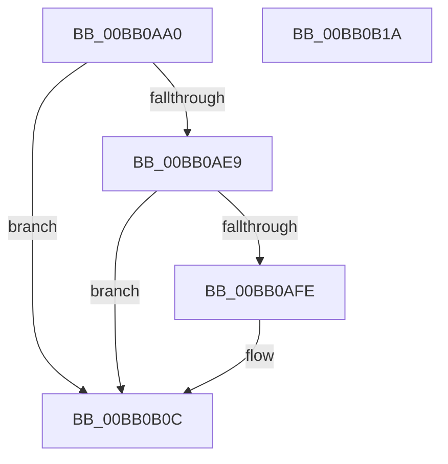

# VerifierMmMapLockedPages

- RVA: `0x00BB0AA0`–`0x00BB0B1B` (길이 `123` bytes)
- VA: `0x0000000140BB0AA0`
- 실행 섹션: `PAGEVRFY`
- PDB 이름 있음: `예`; PDB Function 태그: `아니요`
- unwind 정보 RVA: `0x00065960`
- 디코드: `30`개 명령, `123/123` bytes 표시
- 미해석 바이트: `0` (있으면 어셈블리에 `.byte`로 보존)

> 이 문서는 커널 이미지의 기계어와 PDB 기호를 분석해 생성했습니다. 4번과 5번은 함수 원형과 자료형을 바이너리 사용 방식에서 추정한 C 해석이며 원본 소스 복구 결과는 아닙니다.

## 1. Dependencies

- 직접 호출 지점: **2**; 고유 호출 대상: **2**
- 직접 호출자로 확인된 함수: **0**
- RIP 상대 이미지 참조: **2**

### Outgoing calls
- `0x00BB0ADC` → [guard_dispatch_icall](../../text/6B/guard_dispatch_icall_function_006BAAD0.md) (function, `0x006BAAD0`)
- `0x00BB0B07` → [ViTargetAddToCounter](../B9/ViTargetAddToCounter_function_00B9B8E0.md) (function, `0x00B9B8E0`)

### Direct callers
- 이 함수 시작 RVA로 연결되는 직접 call은 확인되지 않았습니다. 간접 호출은 완전히 역산할 수 없습니다.

### Static image references
- `0x00BB0AAA` → RVA `0x00F04A20` (`.data`; read)
- `0x00BB0AB7` → RVA `0x00FFDC00` (`PAGEVRFD`; read)

## 2. Other-region calls and transfers

- 다른 실행 섹션으로 향하는 call: **1**
  - `0x00BB0ADC` → [guard_dispatch_icall](../../text/6B/guard_dispatch_icall_function_006BAAD0.md) (`PAGEVRFY` → `.text`)
- 별도 외부 분기/꼬리 이동을 확인하지 못했습니다.

## 3. Assembly (complete function range)

```asm
00BB0AA0  48 89 5C 24 08                  mov qword ptr [rsp + 8], rbx
00BB0AA5  57                              push rdi
00BB0AA6  48 83 EC 40                     sub rsp, 0x40
00BB0AAA  44 8B 0D 6F 3F 35 00            mov r9d, dword ptr [rip + 0x353f6f]
00BB0AB1  41 B8 01 00 00 00               mov r8d, 1
00BB0AB7  48 8B 05 42 D1 44 00            mov rax, qword ptr [rip + 0x44d142]
00BB0ABE  41 81 E1 00 00 00 02            and r9d, 0x2000000
00BB0AC5  45 0B C8                        or r9d, r8d
00BB0AC8  48 8B F9                        mov rdi, rcx
00BB0ACB  41 C1 E1 05                     shl r9d, 5
00BB0ACF  44 89 4C 24 28                  mov dword ptr [rsp + 0x28], r9d
00BB0AD4  45 33 C9                        xor r9d, r9d
00BB0AD7  44 89 44 24 20                  mov dword ptr [rsp + 0x20], r8d
00BB0ADC  E8 EF 9F B0 FF                  call 0x1406baad0
00BB0AE1  48 8B D8                        mov rbx, rax
00BB0AE4  48 85 C0                        test rax, rax
00BB0AE7  74 23                           je 0x140bb0b0c
00BB0AE9  F7 05 2D 3F 35 00 00 10 00 00   test dword ptr [rip + 0x353f2d], 0x1000
00BB0AF3  44 8B 4F 28                     mov r9d, dword ptr [rdi + 0x28]
00BB0AF7  48 8B 4C 24 48                  mov rcx, qword ptr [rsp + 0x48]
00BB0AFC  74 0E                           je 0x140bb0b0c
00BB0AFE  BA C8 00 00 00                  mov edx, 0xc8
00BB0B03  44 8D 42 08                     lea r8d, [rdx + 8]
00BB0B07  E8 D4 AD FE FF                  call 0x140b9b8e0
00BB0B0C  48 8B C3                        mov rax, rbx
00BB0B0F  48 8B 5C 24 50                  mov rbx, qword ptr [rsp + 0x50]
00BB0B14  48 83 C4 40                     add rsp, 0x40
00BB0B18  5F                              pop rdi
00BB0B19  C3                              ret
00BB0B1A  CC                              int3
```

## 4. C-style interpretation (structured pseudocode)

```c
__int64 __fastcall VerifierMmMapLockedPages(__int64 a1)
{
    __int64 result;
    __int64 v_rsp;
    unsigned int v_stack_m20;
    unsigned int v_stack_m28;
    unsigned __int64 v_stack_p0;
    unsigned __int64 v_stack_p8;

    v_stack_p8 = v_rbx;
    v_rsp = (v_rsp) - (64);
    a4 = (unsigned int)(((unsigned int)(*(unsigned int *)(v_rip + 3489647))) & (0x2000000ULL));
    a4 = (unsigned int)((a4) | (1));
    a4 = (unsigned int)((a4) << (5));
    v_stack_m20 = (unsigned int)(a4);
    a4 = 0;
    v_stack_m28 = 1;
    result = guard_dispatch_icall(a1, a2, 1, a4);
    if (result == 0) goto loc_00BB0B0C;
    if (((*(unsigned int *)(v_rip + 3489581)) & (0x1000ULL)) != 0) {
        a2 = 200;
        a3 = a2 + 8;
        result = ViTargetAddToCounter(v_stack_p0, a2, a3, (unsigned int)(*(unsigned int *)(a1 + 40)));
    }
    v_rsp = (v_rsp) + (64);
    return result;
}
```

## 5. (Beta) C Style

```c
int64_t VerifierMmMapLockedPages(void *Arg1)
{
    uint8_t *arg1 = (uint8_t *)Arg1;

    int64_t result;
    int64_t local_rsp;
    uint32_t v_stack_m20;
    uint32_t v_stack_m28;
    uint64_t v_stack_p0;
    uint64_t v_stack_p8;

    v_stack_p8 = local_rbx;
    local_rsp = (local_rsp) - (64);
    a4 = (uint32_t)(((uint32_t)(*(uint32_t *)(v_rip + 0x353F6F))) & (0x2000000ULL));
    a4 = (uint32_t)((a4) | (1));
    a4 = (uint32_t)((a4) << (5));
    v_stack_m20 = (uint32_t)(a4);
    a4 = 0;
    v_stack_m28 = 1;
    result = guard_dispatch_icall(Arg1, a2, 1, a4);
    if (result == 0) goto loc_00BB0B0C;
    if (((*(uint32_t *)(v_rip + 0x353F2D)) & (0x1000ULL)) != 0) {
        a2 = 200;
        a3 = a2 + 8;
        result = ViTargetAddToCounter(v_stack_p0, a2, a3, (uint32_t)(*(uint32_t *)(arg1 + 0x28)));
    }
    local_rsp = (local_rsp) + (64);
    return result;
}
```

### 관측된 메모리 오프셋

구조체 형식이 확인되지 않은 접근은 인자 기준의 오프셋으로만 기록했습니다.

| 기준 인자 | 오프셋 표현 | 폭 (bit) | 접근 |
|---|---:|---:|---|
| `Arg1` | `+ 0x28` | `32` | `R` |

## 6. Execution-region graph

[열기: 2D/3D 그래프와 함수 탐색 컨트롤 패널](../../../control-panel.html?section=pagevrfy&rva=0x00BB0AA0&view=graph)

- 2D 그래프는 위에서 아래로 흐르고, 3D 그래프는 빈 공간을 드래그해 회전합니다. Shift+드래그는 이동, 휠은 확대·축소, 함수 노드 선택은 대상 보고서 이동입니다.

### Static fallback


