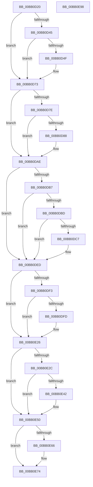

# VerifierMmUnlockPages

- RVA: `0x00BB0D20`–`0x00BB0E99` (길이 `377` bytes)
- VA: `0x0000000140BB0D20`
- 실행 섹션: `PAGEVRFY`
- PDB 이름 있음: `예`; PDB Function 태그: `아니요`
- unwind 정보 RVA: `0x0007D3C0`
- 디코드: `88`개 명령, `377/377` bytes 표시
- 미해석 바이트: `0` (있으면 어셈블리에 `.byte`로 보존)

> 이 문서는 커널 이미지의 기계어와 PDB 기호를 분석해 생성했습니다. 4번과 5번은 함수 원형과 자료형을 바이너리 사용 방식에서 추정한 C 해석이며 원본 소스 복구 결과는 아닙니다.

## 1. Dependencies

- 직접 호출 지점: **7**; 고유 호출 대상: **3**
- 직접 호출자로 확인된 함수: **0**
- RIP 상대 이미지 참조: **3**

### Outgoing calls
- `0x00BB0D6E` → [CarReportRuleViolationFromNt](../B9/CarReportRuleViolationFromNt_function_00B9D904.md) (function, `0x00B9D904`)
- `0x00BB0DA9` → [CarReportRuleViolationFromNt](../B9/CarReportRuleViolationFromNt_function_00B9D904.md) (function, `0x00B9D904`)
- `0x00BB0DE8` → [CarReportRuleViolationFromNt](../B9/CarReportRuleViolationFromNt_function_00B9D904.md) (function, `0x00B9D904`)
- `0x00BB0E21` → [CarReportRuleViolationFromNt](../B9/CarReportRuleViolationFromNt_function_00B9D904.md) (function, `0x00B9D904`)
- `0x00BB0E4B` → [ViTargetAddToCounter](../B9/ViTargetAddToCounter_function_00B9B8E0.md) (function, `0x00B9B8E0`)
- `0x00BB0E6F` → [ViTargetAddToCounter](../B9/ViTargetAddToCounter_function_00B9B8E0.md) (function, `0x00B9B8E0`)
- `0x00BB0E7E` → [guard_dispatch_icall](../../text/6B/guard_dispatch_icall_function_006BAAD0.md) (function, `0x006BAAD0`)

### Direct callers
- 이 함수 시작 RVA로 연결되는 직접 call은 확인되지 않았습니다. 간접 호출은 완전히 역산할 수 없습니다.

### Static image references
- `0x00BB0D45` → RVA `0x00F04A20` (`.data`; read)
- `0x00BB0DAE` → RVA `0x00E0E944` (`.data`; read)
- `0x00BB0E74` → RVA `0x00FFDF30` (`PAGEVRFD`; read)

## 2. Other-region calls and transfers

- 다른 실행 섹션으로 향하는 call: **1**
  - `0x00BB0E7E` → [guard_dispatch_icall](../../text/6B/guard_dispatch_icall_function_006BAAD0.md) (`PAGEVRFY` → `.text`)
- 별도 외부 분기/꼬리 이동을 확인하지 못했습니다.

## 3. Assembly (complete function range)

```asm
00BB0D20  48 8B C4                        mov rax, rsp
00BB0D23  48 89 58 08                     mov qword ptr [rax + 8], rbx
00BB0D27  48 89 68 10                     mov qword ptr [rax + 0x10], rbp
00BB0D2B  48 89 70 18                     mov qword ptr [rax + 0x18], rsi
00BB0D2F  57                              push rdi
00BB0D30  48 83 EC 40                     sub rsp, 0x40
00BB0D34  48 8B 74 24 48                  mov rsi, qword ptr [rsp + 0x48]
00BB0D39  48 8B D9                        mov rbx, rcx
00BB0D3C  44 0F 20 C1                     mov rcx, cr8
00BB0D40  80 F9 02                        cmp cl, 2
00BB0D43  76 2E                           jbe 0x140bb0d73
00BB0D45  0F BA 25 D3 3C 35 00 0B         bt dword ptr [rip + 0x353cd3], 0xb
00BB0D4D  73 24                           jae 0x140bb0d73
00BB0D4F  48 89 70 E8                     mov qword ptr [rax - 0x18], rsi
00BB0D53  BA 78 00 00 00                  mov edx, 0x78
00BB0D58  44 0F B6 C1                     movzx r8d, cl
00BB0D5C  4C 8B CB                        mov r9, rbx
00BB0D5F  C7 40 E0 0B 00 00 00            mov dword ptr [rax - 0x20], 0xb
00BB0D66  48 83 60 D8 00                  and qword ptr [rax - 0x28], 0
00BB0D6B  8D 4A 4C                        lea ecx, [rdx + 0x4c]
00BB0D6E  E8 91 CB FE FF                  call 0x140b9d904
00BB0D73  48 0F BF 7B 0A                  movsx rdi, word ptr [rbx + 0xa]
00BB0D78  40 F6 C7 02                     test dil, 2
00BB0D7C  75 30                           jne 0x140bb0dae
00BB0D7E  0F BA 25 9A 3C 35 00 0B         bt dword ptr [rip + 0x353c9a], 0xb
00BB0D86  73 26                           jae 0x140bb0dae
00BB0D88  BA 7C 00 00 00                  mov edx, 0x7c
00BB0D8D  48 89 74 24 30                  mov qword ptr [rsp + 0x30], rsi
00BB0D92  C7 44 24 28 0B 00 00 00         mov dword ptr [rsp + 0x28], 0xb
00BB0D9A  4C 8B CF                        mov r9, rdi
00BB0D9D  48 83 64 24 20 00               and qword ptr [rsp + 0x20], 0
00BB0DA3  4C 8B C3                        mov r8, rbx
00BB0DA6  8D 4A 48                        lea ecx, [rdx + 0x48]
00BB0DA9  E8 56 CB FE FF                  call 0x140b9d904
00BB0DAE  83 3D 8F DB 25 00 03            cmp dword ptr [rip + 0x25db8f], 3
00BB0DB5  72 36                           jb 0x140bb0ded
00BB0DB7  40 F6 C7 04                     test dil, 4
00BB0DBB  74 30                           je 0x140bb0ded
00BB0DBD  0F BA 25 5B 3C 35 00 0B         bt dword ptr [rip + 0x353c5b], 0xb
00BB0DC5  73 26                           jae 0x140bb0ded
00BB0DC7  BA 7D 00 00 00                  mov edx, 0x7d
00BB0DCC  48 89 74 24 30                  mov qword ptr [rsp + 0x30], rsi
00BB0DD1  C7 44 24 28 0B 00 00 00         mov dword ptr [rsp + 0x28], 0xb
00BB0DD9  4C 8B CF                        mov r9, rdi
00BB0DDC  48 83 64 24 20 00               and qword ptr [rsp + 0x20], 0
00BB0DE2  4C 8B C3                        mov r8, rbx
00BB0DE5  8D 4A 47                        lea ecx, [rdx + 0x47]
00BB0DE8  E8 17 CB FE FF                  call 0x140b9d904
00BB0DED  40 F6 C7 10                     test dil, 0x10
00BB0DF1  74 33                           je 0x140bb0e26
00BB0DF3  0F BA 25 25 3C 35 00 0B         bt dword ptr [rip + 0x353c25], 0xb
00BB0DFB  73 29                           jae 0x140bb0e26
00BB0DFD  BA B4 00 00 00                  mov edx, 0xb4
00BB0E02  48 89 74 24 30                  mov qword ptr [rsp + 0x30], rsi
00BB0E07  4C 8B CF                        mov r9, rdi
00BB0E0A  C7 44 24 28 0B 00 00 00         mov dword ptr [rsp + 0x28], 0xb
00BB0E12  4C 8B C3                        mov r8, rbx
00BB0E15  48 C7 44 24 20 10 00 00 00      mov qword ptr [rsp + 0x20], 0x10
00BB0E1E  8D 4A 10                        lea ecx, [rdx + 0x10]
00BB0E21  E8 DE CA FE FF                  call 0x140b9d904
00BB0E26  40 F6 C7 01                     test dil, 1
00BB0E2A  74 24                           je 0x140bb0e50
00BB0E2C  44 8B 4B 28                     mov r9d, dword ptr [rbx + 0x28]
00BB0E30  48 8B 4C 24 48                  mov rcx, qword ptr [rsp + 0x48]
00BB0E35  49 F7 D9                        neg r9
00BB0E38  0F BA 25 E0 3B 35 00 0C         bt dword ptr [rip + 0x353be0], 0xc
00BB0E40  73 0E                           jae 0x140bb0e50
00BB0E42  BA C8 00 00 00                  mov edx, 0xc8
00BB0E47  44 8D 42 08                     lea r8d, [rdx + 8]
00BB0E4B  E8 90 AA FE FF                  call 0x140b9b8e0
00BB0E50  44 8B 4B 28                     mov r9d, dword ptr [rbx + 0x28]
00BB0E54  48 8B 4C 24 48                  mov rcx, qword ptr [rsp + 0x48]
00BB0E59  49 F7 D9                        neg r9
00BB0E5C  0F BA 25 BC 3B 35 00 0C         bt dword ptr [rip + 0x353bbc], 0xc
00BB0E64  73 0E                           jae 0x140bb0e74
00BB0E66  BA B8 00 00 00                  mov edx, 0xb8
00BB0E6B  44 8D 42 08                     lea r8d, [rdx + 8]
00BB0E6F  E8 6C AA FE FF                  call 0x140b9b8e0
00BB0E74  48 8B 05 B5 D0 44 00            mov rax, qword ptr [rip + 0x44d0b5]
00BB0E7B  48 8B CB                        mov rcx, rbx
00BB0E7E  E8 4D 9C B0 FF                  call 0x1406baad0
00BB0E83  48 8B 5C 24 50                  mov rbx, qword ptr [rsp + 0x50]
00BB0E88  48 8B 6C 24 58                  mov rbp, qword ptr [rsp + 0x58]
00BB0E8D  48 8B 74 24 60                  mov rsi, qword ptr [rsp + 0x60]
00BB0E92  48 83 C4 40                     add rsp, 0x40
00BB0E96  5F                              pop rdi
00BB0E97  C3                              ret
00BB0E98  CC                              int3
```

## 4. C-style interpretation (structured pseudocode)

```c
__int64 __fastcall VerifierMmUnlockPages(__int64 a1)
{
    __int64 result;
    __int64 v_rsp;
    unsigned __int64 v_stack_m18;
    unsigned int v_stack_m20;
    unsigned __int64 v_stack_m28;
    unsigned __int64 v_stack_p0;
    unsigned __int64 v_stack_p10;
    unsigned __int64 v_stack_p18;
    unsigned __int64 v_stack_p8;

    *(unsigned __int64 *)(v_rsp + 8) = v_rbx;
    *(unsigned __int64 *)(v_rsp + 16) = v_rbp;
    *(unsigned __int64 *)(v_rsp + 24) = v_rsi;
    v_rsp = (v_rsp) - (64);
    if (((unsigned __int8)(v_cr8)) <= 2) goto loc_00BB0D73;
    result = v_rsp;
    if (((unsigned __int8)(v_cr8)) < 2) {
        *(unsigned __int64 *)(v_rsp - 24) = v_stack_p0;
        a2 = 120;
        a3 = (unsigned __int8)(v_cr8);
        a4 = a1;
        *(unsigned int *)(v_rsp - 32) = 11;
        a1 = a2 + 76;
        result = CarReportRuleViolationFromNt(a1, a2, a3, a4);
    }
    if ((((unsigned __int8)((__int16)(*(unsigned __int16 *)(a1 + 10)))) & (2)) != 0) goto loc_00BB0DAE;
    if (!(condition_is_above_or_equal)) {
        a2 = 124;
        v_stack_m18 = v_stack_p0;
        v_stack_m20 = 11;
        a4 = (__int16)(*(unsigned __int16 *)(a1 + 10));
        a3 = a1;
        a1 = a2 + 72;
        result = CarReportRuleViolationFromNt(a1, a2, a3, a4);
    }
    if ((*(unsigned int *)(v_rip + 2481039)) < 3) goto loc_00BB0DED;
    if ((((unsigned __int8)((__int16)(*(unsigned __int16 *)(a1 + 10)))) & (4)) == 0) goto loc_00BB0DED;
    if (!(condition_is_above_or_equal)) {
        a2 = 125;
        v_stack_m18 = v_stack_p0;
        v_stack_m20 = 11;
        a4 = (__int16)(*(unsigned __int16 *)(a1 + 10));
        a3 = a1;
        a1 = a2 + 71;
        result = CarReportRuleViolationFromNt(a1, a2, a3, a4);
    }
    if ((((unsigned __int8)((__int16)(*(unsigned __int16 *)(a1 + 10)))) & (16)) == 0) goto loc_00BB0E26;
    if (!(condition_is_above_or_equal)) {
        a2 = 180;
        v_stack_m18 = v_stack_p0;
        a4 = (__int16)(*(unsigned __int16 *)(a1 + 10));
        v_stack_m20 = 11;
        a3 = a1;
        v_stack_m28 = 16;
        a1 = a2 + 16;
        result = CarReportRuleViolationFromNt(a1, a2, a3, a4);
    }
    if ((((unsigned __int8)((__int16)(*(unsigned __int16 *)(a1 + 10)))) & (1)) == 0) goto loc_00BB0E50;
    a4 = -((unsigned int)(*(unsigned int *)(a1 + 40)));
    if (!(condition_is_above_or_equal)) {
        a2 = 200;
        a3 = a2 + 8;
        result = ViTargetAddToCounter(v_stack_p0, a2, a3, a4);
    }
    a4 = -((unsigned int)(*(unsigned int *)(a1 + 40)));
    if (!(condition_is_above_or_equal)) {
        a2 = 184;
        a3 = a2 + 8;
        result = ViTargetAddToCounter(v_stack_p0, a2, a3, a4);
    }
    result = guard_dispatch_icall(a1, a2, a3, a4);
    v_rsp = (v_rsp) + (64);
    return result;
}
```

## 5. (Beta) C Style

```c
int64_t VerifierMmUnlockPages(void *Arg1)
{
    uint8_t *arg1 = (uint8_t *)Arg1;

    int64_t result;
    int64_t local_rsp;
    uint64_t v_stack_m18;
    uint32_t v_stack_m20;
    uint64_t v_stack_m28;
    uint64_t v_stack_p0;
    uint64_t v_stack_p10;
    uint64_t v_stack_p18;
    uint64_t v_stack_p8;

    *(uint64_t *)(local_rsp + 0x8) = local_rbx;
    *(uint64_t *)(local_rsp + 0x10) = local_rbp;
    *(uint64_t *)(local_rsp + 0x18) = local_rsi;
    local_rsp = (local_rsp) - (64);
    if (((uint8_t)(v_cr8)) <= 2) goto loc_00BB0D73;
    result = local_rsp;
    if (((uint8_t)(v_cr8)) < 2) {
        *(uint64_t *)(local_rsp - 0x18) = v_stack_p0;
        a2 = 120;
        a3 = (uint8_t)(v_cr8);
        a4 = Arg1;
        *(uint32_t *)(local_rsp - 0x20) = 11;
        Arg1 = a2 + 76;
        result = CarReportRuleViolationFromNt(Arg1, a2, a3, a4);
    }
    if ((((uint8_t)((int16_t)(*(uint16_t *)(arg1 + 0xA)))) & (2)) != 0) goto loc_00BB0DAE;
    if (!(condition_is_above_or_equal)) {
        a2 = 124;
        v_stack_m18 = v_stack_p0;
        v_stack_m20 = 11;
        a4 = (int16_t)(*(uint16_t *)(arg1 + 0xA));
        a3 = Arg1;
        Arg1 = a2 + 72;
        result = CarReportRuleViolationFromNt(Arg1, a2, a3, a4);
    }
    if ((*(uint32_t *)(v_rip + 0x25DB8F)) < 3) goto loc_00BB0DED;
    if ((((uint8_t)((int16_t)(*(uint16_t *)(arg1 + 0xA)))) & (4)) == 0) goto loc_00BB0DED;
    if (!(condition_is_above_or_equal)) {
        a2 = 125;
        v_stack_m18 = v_stack_p0;
        v_stack_m20 = 11;
        a4 = (int16_t)(*(uint16_t *)(arg1 + 0xA));
        a3 = Arg1;
        Arg1 = a2 + 71;
        result = CarReportRuleViolationFromNt(Arg1, a2, a3, a4);
    }
    if ((((uint8_t)((int16_t)(*(uint16_t *)(arg1 + 0xA)))) & (16)) == 0) goto loc_00BB0E26;
    if (!(condition_is_above_or_equal)) {
        a2 = 180;
        v_stack_m18 = v_stack_p0;
        a4 = (int16_t)(*(uint16_t *)(arg1 + 0xA));
        v_stack_m20 = 11;
        a3 = Arg1;
        v_stack_m28 = 16;
        Arg1 = a2 + 16;
        result = CarReportRuleViolationFromNt(Arg1, a2, a3, a4);
    }
    if ((((uint8_t)((int16_t)(*(uint16_t *)(arg1 + 0xA)))) & (1)) == 0) goto loc_00BB0E50;
    a4 = -((uint32_t)(*(uint32_t *)(arg1 + 0x28)));
    if (!(condition_is_above_or_equal)) {
        a2 = 200;
        a3 = a2 + 8;
        result = ViTargetAddToCounter(v_stack_p0, a2, a3, a4);
    }
    a4 = -((uint32_t)(*(uint32_t *)(arg1 + 0x28)));
    if (!(condition_is_above_or_equal)) {
        a2 = 184;
        a3 = a2 + 8;
        result = ViTargetAddToCounter(v_stack_p0, a2, a3, a4);
    }
    result = guard_dispatch_icall(Arg1, a2, a3, a4);
    local_rsp = (local_rsp) + (64);
    return result;
}
```

### 관측된 메모리 오프셋

구조체 형식이 확인되지 않은 접근은 인자 기준의 오프셋으로만 기록했습니다.

| 기준 인자 | 오프셋 표현 | 폭 (bit) | 접근 |
|---|---:|---:|---|
| `Arg1` | `+ 0xA` | `16` | `R` |
| `Arg1` | `+ 0x28` | `32` | `R` |

## 6. Execution-region graph

[열기: 2D/3D 그래프와 함수 탐색 컨트롤 패널](../../../control-panel.html?section=pagevrfy&rva=0x00BB0D20&view=graph)

- 2D 그래프는 위에서 아래로 흐르고, 3D 그래프는 빈 공간을 드래그해 회전합니다. Shift+드래그는 이동, 휠은 확대·축소, 함수 노드 선택은 대상 보고서 이동입니다.

### Static fallback


