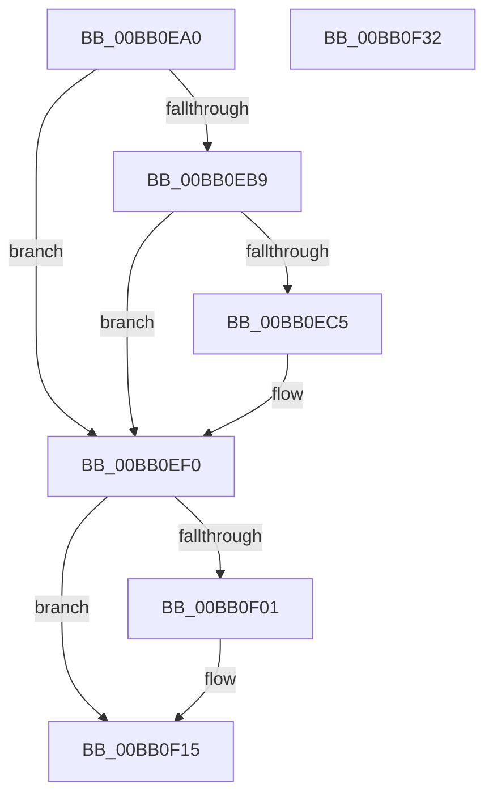

# VerifierMmUnmapIoSpace

- RVA: `0x00BB0EA0`–`0x00BB0F33` (길이 `147` bytes)
- VA: `0x0000000140BB0EA0`
- 실행 섹션: `PAGEVRFY`
- PDB 이름 있음: `예`; PDB Function 태그: `아니요`
- unwind 정보 RVA: `0x00065960`
- 디코드: `36`개 명령, `147/147` bytes 표시
- 미해석 바이트: `0` (있으면 어셈블리에 `.byte`로 보존)

> 이 문서는 커널 이미지의 기계어와 PDB 기호를 분석해 생성했습니다. 4번과 5번은 함수 원형과 자료형을 바이너리 사용 방식에서 추정한 C 해석이며 원본 소스 복구 결과는 아닙니다.

## 1. Dependencies

- 직접 호출 지점: **3**; 고유 호출 대상: **3**
- 직접 호출자로 확인된 함수: **0**
- RIP 상대 이미지 참조: **2**

### Outgoing calls
- `0x00BB0EEB` → [CarReportRuleViolationFromNt](../B9/CarReportRuleViolationFromNt_function_00B9D904.md) (function, `0x00B9D904`)
- `0x00BB0F10` → [ViTargetAddToCounter](../B9/ViTargetAddToCounter_function_00B9B8E0.md) (function, `0x00B9B8E0`)
- `0x00BB0F22` → [guard_dispatch_icall](../../text/6B/guard_dispatch_icall_function_006BAAD0.md) (function, `0x006BAAD0`)

### Direct callers
- 이 함수 시작 RVA로 연결되는 직접 call은 확인되지 않았습니다. 간접 호출은 완전히 역산할 수 없습니다.

### Static image references
- `0x00BB0EB9` → RVA `0x00F04A20` (`.data`; read)
- `0x00BB0F15` → RVA `0x00FFDFB0` (`PAGEVRFD`; read)

## 2. Other-region calls and transfers

- 다른 실행 섹션으로 향하는 call: **1**
  - `0x00BB0F22` → [guard_dispatch_icall](../../text/6B/guard_dispatch_icall_function_006BAAD0.md) (`PAGEVRFY` → `.text`)
- 별도 외부 분기/꼬리 이동을 확인하지 못했습니다.

## 3. Assembly (complete function range)

```asm
00BB0EA0  48 89 5C 24 08                  mov qword ptr [rsp + 8], rbx
00BB0EA5  57                              push rdi
00BB0EA6  48 83 EC 40                     sub rsp, 0x40
00BB0EAA  48 8B DA                        mov rbx, rdx
00BB0EAD  48 8B F9                        mov rdi, rcx
00BB0EB0  44 0F 20 C2                     mov rdx, cr8
00BB0EB4  80 FA 02                        cmp dl, 2
00BB0EB7  76 37                           jbe 0x140bb0ef0
00BB0EB9  F7 05 5D 3B 35 00 00 08 00 00   test dword ptr [rip + 0x353b5d], 0x800
00BB0EC3  74 2B                           je 0x140bb0ef0
00BB0EC5  48 8B 44 24 48                  mov rax, qword ptr [rsp + 0x48]
00BB0ECA  4C 8B C9                        mov r9, rcx
00BB0ECD  48 89 44 24 30                  mov qword ptr [rsp + 0x30], rax
00BB0ED2  44 0F B6 C2                     movzx r8d, dl
00BB0ED6  BA 7B 00 00 00                  mov edx, 0x7b
00BB0EDB  C7 44 24 28 0B 00 00 00         mov dword ptr [rsp + 0x28], 0xb
00BB0EE3  48 89 5C 24 20                  mov qword ptr [rsp + 0x20], rbx
00BB0EE8  8D 4A 49                        lea ecx, [rdx + 0x49]
00BB0EEB  E8 14 CA FE FF                  call 0x140b9d904
00BB0EF0  F7 05 26 3B 35 00 00 10 00 00   test dword ptr [rip + 0x353b26], 0x1000
00BB0EFA  48 8B 4C 24 48                  mov rcx, qword ptr [rsp + 0x48]
00BB0EFF  74 14                           je 0x140bb0f15
00BB0F01  BA D8 00 00 00                  mov edx, 0xd8
00BB0F06  4C 8B CB                        mov r9, rbx
00BB0F09  49 F7 D9                        neg r9
00BB0F0C  44 8D 42 08                     lea r8d, [rdx + 8]
00BB0F10  E8 CB A9 FE FF                  call 0x140b9b8e0
00BB0F15  48 8B 05 94 D0 44 00            mov rax, qword ptr [rip + 0x44d094]
00BB0F1C  48 8B D3                        mov rdx, rbx
00BB0F1F  48 8B CF                        mov rcx, rdi
00BB0F22  E8 A9 9B B0 FF                  call 0x1406baad0
00BB0F27  48 8B 5C 24 50                  mov rbx, qword ptr [rsp + 0x50]
00BB0F2C  48 83 C4 40                     add rsp, 0x40
00BB0F30  5F                              pop rdi
00BB0F31  C3                              ret
00BB0F32  CC                              int3
```

## 4. C-style interpretation (structured pseudocode)

```c
__int64 __fastcall VerifierMmUnmapIoSpace(__int64 a1, __int64 a2)
{
    __int64 result;
    __int64 v_rsp;
    unsigned __int64 v_stack_m18;
    unsigned int v_stack_m20;
    unsigned __int64 v_stack_m28;
    unsigned __int64 v_stack_p0;
    unsigned __int64 v_stack_p8;

    v_stack_p8 = v_rbx;
    v_rsp = (v_rsp) - (64);
    if (((unsigned __int8)(v_cr8)) <= 2) goto loc_00BB0EF0;
    if (((*(unsigned int *)(v_rip + 3488605)) & (0x800ULL)) != 0) {
        result = v_stack_p0;
        a4 = a1;
        v_stack_m18 = result;
        a3 = (unsigned __int8)(v_cr8);
        a2 = 123;
        v_stack_m20 = 11;
        v_stack_m28 = a2;
        a1 = a2 + 73;
        result = CarReportRuleViolationFromNt(a1, a2, a3, a4);
    }
    if (((*(unsigned int *)(v_rip + 3488550)) & (0x1000ULL)) != 0) {
        a2 = 216;
        a4 = a2;
        a4 = -(a4);
        a3 = a2 + 8;
        result = ViTargetAddToCounter(v_stack_p0, a2, a3, a4);
    }
    result = guard_dispatch_icall(a1, a2, a3, a4);
    v_rsp = (v_rsp) + (64);
    return result;
}
```

## 5. (Beta) C Style

```c
int64_t VerifierMmUnmapIoSpace(int64_t Arg1, int64_t Arg2)
{
    int64_t result;
    int64_t local_rsp;
    uint64_t v_stack_m18;
    uint32_t v_stack_m20;
    uint64_t v_stack_m28;
    uint64_t v_stack_p0;
    uint64_t v_stack_p8;

    v_stack_p8 = local_rbx;
    local_rsp = (local_rsp) - (64);
    if (((uint8_t)(v_cr8)) <= 2) goto loc_00BB0EF0;
    if (((*(uint32_t *)(v_rip + 0x353B5D)) & (0x800ULL)) != 0) {
        result = v_stack_p0;
        a4 = Arg1;
        v_stack_m18 = result;
        a3 = (uint8_t)(v_cr8);
        Arg2 = 123;
        v_stack_m20 = 11;
        v_stack_m28 = Arg2;
        Arg1 = Arg2 + 73;
        result = CarReportRuleViolationFromNt(Arg1, Arg2, a3, a4);
    }
    if (((*(uint32_t *)(v_rip + 0x353B26)) & (0x1000ULL)) != 0) {
        Arg2 = 216;
        a4 = Arg2;
        a4 = -(a4);
        a3 = Arg2 + 8;
        result = ViTargetAddToCounter(v_stack_p0, Arg2, a3, a4);
    }
    result = guard_dispatch_icall(Arg1, Arg2, a3, a4);
    local_rsp = (local_rsp) + (64);
    return result;
}
```

## 6. Execution-region graph

[열기: 2D/3D 그래프와 함수 탐색 컨트롤 패널](../../../control-panel.html?section=pagevrfy&rva=0x00BB0EA0&view=graph)

- 2D 그래프는 위에서 아래로 흐르고, 3D 그래프는 빈 공간을 드래그해 회전합니다. Shift+드래그는 이동, 휠은 확대·축소, 함수 노드 선택은 대상 보고서 이동입니다.

### Static fallback


