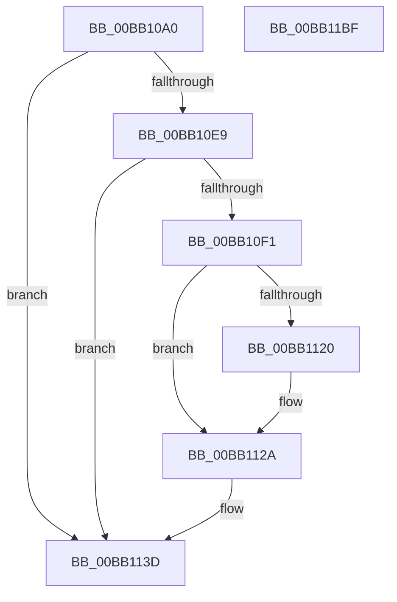

# VerifierNtCreateFile

- RVA: `0x00BB10A0`–`0x00BB11C0` (길이 `288` bytes)
- VA: `0x0000000140BB10A0`
- 실행 섹션: `PAGEVRFY`
- PDB 이름 있음: `예`; PDB Function 태그: `아니요`
- unwind 정보 RVA: `0x000D2968`
- 디코드: `71`개 명령, `288/288` bytes 표시
- 미해석 바이트: `0` (있으면 어셈블리에 `.byte`로 보존)

> 이 문서는 커널 이미지의 기계어와 PDB 기호를 분석해 생성했습니다. 4번과 5번은 함수 원형과 자료형을 바이너리 사용 방식에서 추정한 C 해석이며 원본 소스 복구 결과는 아닙니다.

## 1. Dependencies

- 직접 호출 지점: **6**; 고유 호출 대상: **6**
- 직접 호출자로 확인된 함수: **0**
- RIP 상대 이미지 참조: **4**

### Outgoing calls
- `0x00BB10FE` → [ViErrorDisplayDescription](../BA/ViErrorDisplayDescription_function_00BA361C.md) (function, `0x00BA361C`)
- `0x00BB1117` → [RtlStringCbPrintfA](../../text/53/RtlStringCbPrintfA_function_0053BC0C.md) (function, `0x0053BC0C`)
- `0x00BB1125` → [VfUtilDbgPrint](../../text/61/VfUtilDbgPrint_function_006122AC.md) (function, `0x006122AC`)
- `0x00BB1138` → [ViErrorFinishReport](../BA/ViErrorFinishReport_function_00BA366C.md) (function, `0x00BA366C`)
- `0x00BB1198` → [guard_dispatch_icall](../../text/6B/guard_dispatch_icall_function_006BAAD0.md) (function, `0x006BAAD0`)
- `0x00BB11A8` → [_security_check_cookie](../../text/6A/_security_check_cookie_function_006AC640.md) (function, `0x006AC640`)

### Direct callers
- 이 함수 시작 RVA로 연결되는 직접 call은 확인되지 않았습니다. 간접 호출은 완전히 역산할 수 없습니다.

### Static image references
- `0x00BB10B2` → RVA `0x00E0A740` (`.data`; read)
- `0x00BB10C4` → RVA `0x00F04A20` (`.data`; read)
- `0x00BB1106` → RVA `0x006CE600` (` ?? ::FNODOBFM::`string'`; read)
- `0x00BB1158` → RVA `0x00FFDE50` (`PAGEVRFD`; read)

## 2. Other-region calls and transfers

- 다른 실행 섹션으로 향하는 call: **4**
  - `0x00BB1117` → [RtlStringCbPrintfA](../../text/53/RtlStringCbPrintfA_function_0053BC0C.md) (`PAGEVRFY` → `.text`)
  - `0x00BB1125` → [VfUtilDbgPrint](../../text/61/VfUtilDbgPrint_function_006122AC.md) (`PAGEVRFY` → `.text`)
  - `0x00BB1198` → [guard_dispatch_icall](../../text/6B/guard_dispatch_icall_function_006BAAD0.md) (`PAGEVRFY` → `.text`)
  - `0x00BB11A8` → [_security_check_cookie](../../text/6A/_security_check_cookie_function_006AC640.md) (`PAGEVRFY` → `.text`)
- 별도 외부 분기/꼬리 이동을 확인하지 못했습니다.

## 3. Assembly (complete function range)

```asm
00BB10A0  40 53                           push rbx
00BB10A2  55                              push rbp
00BB10A3  56                              push rsi
00BB10A4  57                              push rdi
00BB10A5  41 54                           push r12
00BB10A7  41 56                           push r14
00BB10A9  41 57                           push r15
00BB10AB  48 81 EC 90 00 00 00            sub rsp, 0x90
00BB10B2  48 8B 05 87 96 25 00            mov rax, qword ptr [rip + 0x259687]
00BB10B9  48 33 C4                        xor rax, rsp
00BB10BC  48 89 84 24 88 00 00 00         mov qword ptr [rsp + 0x88], rax
00BB10C4  8B 05 56 39 35 00               mov eax, dword ptr [rip + 0x353956]
00BB10CA  4D 8B F1                        mov r14, r9
00BB10CD  4C 8B BC 24 F0 00 00 00         mov r15, qword ptr [rsp + 0xf0]
00BB10D5  49 8B E8                        mov rbp, r8
00BB10D8  4C 8B A4 24 18 01 00 00         mov r12, qword ptr [rsp + 0x118]
00BB10E0  8B F2                           mov esi, edx
00BB10E2  48 8B F9                        mov rdi, rcx
00BB10E5  A8 10                           test al, 0x10
00BB10E7  74 54                           je 0x140bb113d
00BB10E9  44 0F 20 C0                     mov rax, cr8
00BB10ED  84 C0                           test al, al
00BB10EF  74 4C                           je 0x140bb113d
00BB10F1  48 8B 9C 24 C8 00 00 00         mov rbx, qword ptr [rsp + 0xc8]
00BB10F9  B9 4A 02 00 00                  mov ecx, 0x24a
00BB10FE  E8 19 25 FF FF                  call 0x140ba361c
00BB1103  4C 8B CB                        mov r9, rbx
00BB1106  4C 8D 05 F3 D4 B1 FF            lea r8, [rip - 0x4e2b0d]
00BB110D  BA 26 00 00 00                  mov edx, 0x26
00BB1112  48 8D 4C 24 60                  lea rcx, [rsp + 0x60]
00BB1117  E8 F0 AA 98 FF                  call 0x14053bc0c
00BB111C  85 C0                           test eax, eax
00BB111E  78 0A                           js 0x140bb112a
00BB1120  48 8D 4C 24 60                  lea rcx, [rsp + 0x60]
00BB1125  E8 82 11 A6 FF                  call 0x1406122ac
00BB112A  45 33 C9                        xor r9d, r9d
00BB112D  45 33 C0                        xor r8d, r8d
00BB1130  48 8B D3                        mov rdx, rbx
00BB1133  B9 4A 02 00 00                  mov ecx, 0x24a
00BB1138  E8 2F 25 FF FF                  call 0x140ba366c
00BB113D  44 8B 94 24 10 01 00 00         mov r10d, dword ptr [rsp + 0x110]
00BB1145  4D 8B CE                        mov r9, r14
00BB1148  8B 84 24 20 01 00 00            mov eax, dword ptr [rsp + 0x120]
00BB114F  4C 8B C5                        mov r8, rbp
00BB1152  89 44 24 50                     mov dword ptr [rsp + 0x50], eax
00BB1156  8B D6                           mov edx, esi
00BB1158  48 8B 05 F1 CC 44 00            mov rax, qword ptr [rip + 0x44ccf1]
00BB115F  48 8B CF                        mov rcx, rdi
00BB1162  4C 89 64 24 48                  mov qword ptr [rsp + 0x48], r12
00BB1167  44 89 54 24 40                  mov dword ptr [rsp + 0x40], r10d
00BB116C  44 8B 94 24 08 01 00 00         mov r10d, dword ptr [rsp + 0x108]
00BB1174  44 89 54 24 38                  mov dword ptr [rsp + 0x38], r10d
00BB1179  44 8B 94 24 00 01 00 00         mov r10d, dword ptr [rsp + 0x100]
00BB1181  44 89 54 24 30                  mov dword ptr [rsp + 0x30], r10d
00BB1186  44 8B 94 24 F8 00 00 00         mov r10d, dword ptr [rsp + 0xf8]
00BB118E  44 89 54 24 28                  mov dword ptr [rsp + 0x28], r10d
00BB1193  4C 89 7C 24 20                  mov qword ptr [rsp + 0x20], r15
00BB1198  E8 33 99 B0 FF                  call 0x1406baad0
00BB119D  48 8B 8C 24 88 00 00 00         mov rcx, qword ptr [rsp + 0x88]
00BB11A5  48 33 CC                        xor rcx, rsp
00BB11A8  E8 93 B4 AF FF                  call 0x1406ac640
00BB11AD  48 81 C4 90 00 00 00            add rsp, 0x90
00BB11B4  41 5F                           pop r15
00BB11B6  41 5E                           pop r14
00BB11B8  41 5C                           pop r12
00BB11BA  5F                              pop rdi
00BB11BB  5E                              pop rsi
00BB11BC  5D                              pop rbp
00BB11BD  5B                              pop rbx
00BB11BE  C3                              ret
00BB11BF  CC                              int3
```

## 4. C-style interpretation (structured pseudocode)

```c
__int64 __fastcall VerifierNtCreateFile(__int64 a1, int a2, __int64 a3, __int64 a4, __int64 a5, unsigned int a6, unsigned int a7, unsigned int a8, unsigned int a9, __int64 a10, unsigned int a11)
{
    __int64 result;
    __int64 v_rsp;
    unsigned __int64 v_stack_m40;
    unsigned __int64 v_stack_m68;
    unsigned int v_stack_m78;
    unsigned __int64 v_stack_m80;
    unsigned int v_stack_m88;
    unsigned int v_stack_m90;
    unsigned int v_stack_m98;
    unsigned int v_stack_mA0;
    unsigned __int64 v_stack_mA8;
    unsigned __int64 v_stack_p0;

    v_rsp = (v_rsp) - (144);
    result = (*(unsigned __int64 *)(v_rip + 2463367)) ^ (v_rsp);
    v_stack_m40 = result;
    if ((((unsigned __int8)((unsigned int)(*(unsigned int *)(v_rip + 3488086)))) & (16)) == 0) goto loc_00BB113D;
    if ((unsigned __int8)(v_cr8) == 0) goto loc_00BB113D;
    result = ViErrorDisplayDescription(586, a2, a3, a4);
    result = RtlStringCbPrintfA(v_stack_m68, 38, v_rip - 5122829, v_stack_p0);
    if (!(sign_flag)) {
        a1 = v_stack_m68;
        result = VfUtilDbgPrint(a1, 38, v_rip - 5122829, v_stack_p0);
    }
    a4 = 0;
    a3 = 0;
    result = ViErrorFinishReport(586, v_stack_p0, a3, a4);
loc_00BB113D:
    v_stack_m78 = (unsigned int)((unsigned int)(a11));
    v_stack_m80 = a10;
    v_stack_m88 = (unsigned int)((unsigned int)(a9));
    v_stack_m90 = (unsigned int)((unsigned int)(a8));
    v_stack_m98 = (unsigned int)((unsigned int)(a7));
    v_stack_mA0 = (unsigned int)((unsigned int)(a6));
    v_stack_mA8 = a5;
    result = guard_dispatch_icall(a1, (unsigned int)((unsigned int)((unsigned int)(a2))), 0, 0);
    a1 = (v_stack_m40) ^ (v_rsp);
    result = _security_check_cookie(a1, (unsigned int)((unsigned int)((unsigned int)(a2))), 0, 0);
    v_rsp = (v_rsp) + (144);
    return result;
}
```

## 5. (Beta) C Style

```c
int64_t VerifierNtCreateFile(int64_t Arg1, int32_t Arg2, int64_t Arg3, int64_t Arg4, int64_t Arg5, uint32_t Arg6, uint32_t Arg7, uint32_t Arg8, uint32_t Arg9, int64_t Arg10, uint32_t Arg11)
{
    int64_t result;
    int64_t local_rsp;
    uint64_t v_stack_m40;
    uint64_t v_stack_m68;
    uint32_t v_stack_m78;
    uint64_t v_stack_m80;
    uint32_t v_stack_m88;
    uint32_t v_stack_m90;
    uint32_t v_stack_m98;
    uint32_t v_stack_mA0;
    uint64_t v_stack_mA8;
    uint64_t v_stack_p0;

    local_rsp = (local_rsp) - (144);
    result = (*(uint64_t *)(v_rip + 0x259687)) ^ (local_rsp);
    v_stack_m40 = result;
    if ((((uint8_t)((uint32_t)(*(uint32_t *)(v_rip + 0x353956)))) & (16)) == 0) goto loc_00BB113D;
    if ((uint8_t)(v_cr8) == 0) goto loc_00BB113D;
    result = ViErrorDisplayDescription(586, Arg2, Arg3, Arg4);
    result = RtlStringCbPrintfA(v_stack_m68, 38, v_rip - 5122829, v_stack_p0);
    if (!(sign_flag)) {
        Arg1 = v_stack_m68;
        result = VfUtilDbgPrint(Arg1, 38, v_rip - 5122829, v_stack_p0);
    }
    Arg4 = 0;
    Arg3 = 0;
    result = ViErrorFinishReport(586, v_stack_p0, Arg3, Arg4);
loc_00BB113D:
    v_stack_m78 = (uint32_t)((uint32_t)(Arg11));
    v_stack_m80 = Arg10;
    v_stack_m88 = (uint32_t)((uint32_t)(Arg9));
    v_stack_m90 = (uint32_t)((uint32_t)(Arg8));
    v_stack_m98 = (uint32_t)((uint32_t)(Arg7));
    v_stack_mA0 = (uint32_t)((uint32_t)(Arg6));
    v_stack_mA8 = Arg5;
    result = guard_dispatch_icall(Arg1, (uint32_t)((uint32_t)((uint32_t)(Arg2))), 0, 0);
    Arg1 = (v_stack_m40) ^ (local_rsp);
    result = _security_check_cookie(Arg1, (uint32_t)((uint32_t)((uint32_t)(Arg2))), 0, 0);
    local_rsp = (local_rsp) + (144);
    return result;
}
```

## 6. Execution-region graph

[열기: 2D/3D 그래프와 함수 탐색 컨트롤 패널](../../../control-panel.html?section=pagevrfy&rva=0x00BB10A0&view=graph)

- 2D 그래프는 위에서 아래로 흐르고, 3D 그래프는 빈 공간을 드래그해 회전합니다. Shift+드래그는 이동, 휠은 확대·축소, 함수 노드 선택은 대상 보고서 이동입니다.

### Static fallback


