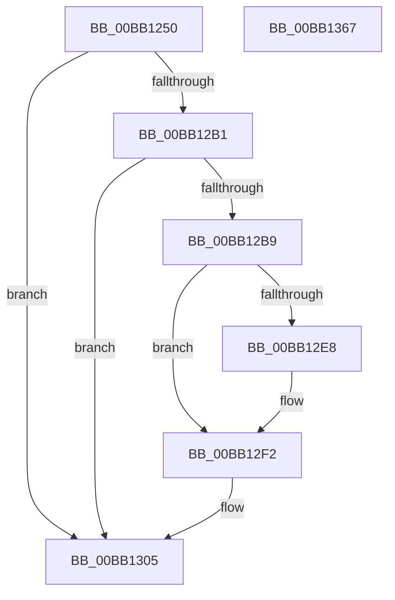

# VerifierNtReadFile

- RVA: `0x00BB1250`–`0x00BB1368` (길이 `280` bytes)
- VA: `0x0000000140BB1250`
- 실행 섹션: `PAGEVRFY`
- PDB 이름 있음: `예`; PDB Function 태그: `아니요`
- unwind 정보 RVA: `0x000D298C`
- 디코드: `71`개 명령, `280/280` bytes 표시
- 미해석 바이트: `0` (있으면 어셈블리에 `.byte`로 보존)

> 이 문서는 커널 이미지의 기계어와 PDB 기호를 분석해 생성했습니다. 4번과 5번은 함수 원형과 자료형을 바이너리 사용 방식에서 추정한 C 해석이며 원본 소스 복구 결과는 아닙니다.

## 1. Dependencies

- 직접 호출 지점: **6**; 고유 호출 대상: **6**
- 직접 호출자로 확인된 함수: **0**
- RIP 상대 이미지 참조: **4**

### Outgoing calls
- `0x00BB12C6` → [ViErrorDisplayDescription](../BA/ViErrorDisplayDescription_function_00BA361C.md) (function, `0x00BA361C`)
- `0x00BB12DF` → [RtlStringCbPrintfA](../../text/53/RtlStringCbPrintfA_function_0053BC0C.md) (function, `0x0053BC0C`)
- `0x00BB12ED` → [VfUtilDbgPrint](../../text/61/VfUtilDbgPrint_function_006122AC.md) (function, `0x006122AC`)
- `0x00BB1300` → [ViErrorFinishReport](../BA/ViErrorFinishReport_function_00BA366C.md) (function, `0x00BA366C`)
- `0x00BB133E` → [guard_dispatch_icall](../../text/6B/guard_dispatch_icall_function_006BAAD0.md) (function, `0x006BAAD0`)
- `0x00BB134E` → [_security_check_cookie](../../text/6A/_security_check_cookie_function_006AC640.md) (function, `0x006AC640`)

### Direct callers
- 이 함수 시작 RVA로 연결되는 직접 call은 확인되지 않았습니다. 간접 호출은 완전히 역산할 수 없습니다.

### Static image references
- `0x00BB1264` → RVA `0x00E0A740` (`.data`; read)
- `0x00BB12A7` → RVA `0x00F04A20` (`.data`; read)
- `0x00BB12CE` → RVA `0x006CE600` (` ?? ::FNODOBFM::`string'`; read)
- `0x00BB1318` → RVA `0x00FFDE20` (`PAGEVRFD`; read)

## 2. Other-region calls and transfers

- 다른 실행 섹션으로 향하는 call: **4**
  - `0x00BB12DF` → [RtlStringCbPrintfA](../../text/53/RtlStringCbPrintfA_function_0053BC0C.md) (`PAGEVRFY` → `.text`)
  - `0x00BB12ED` → [VfUtilDbgPrint](../../text/61/VfUtilDbgPrint_function_006122AC.md) (`PAGEVRFY` → `.text`)
  - `0x00BB133E` → [guard_dispatch_icall](../../text/6B/guard_dispatch_icall_function_006BAAD0.md) (`PAGEVRFY` → `.text`)
  - `0x00BB134E` → [_security_check_cookie](../../text/6A/_security_check_cookie_function_006AC640.md) (`PAGEVRFY` → `.text`)
- 별도 외부 분기/꼬리 이동을 확인하지 못했습니다.

## 3. Assembly (complete function range)

```asm
00BB1250  40 53                           push rbx
00BB1252  55                              push rbp
00BB1253  56                              push rsi
00BB1254  57                              push rdi
00BB1255  41 54                           push r12
00BB1257  41 55                           push r13
00BB1259  41 56                           push r14
00BB125B  41 57                           push r15
00BB125D  48 81 EC 98 00 00 00            sub rsp, 0x98
00BB1264  48 8B 05 D5 94 25 00            mov rax, qword ptr [rip + 0x2594d5]
00BB126B  48 33 C4                        xor rax, rsp
00BB126E  48 89 84 24 80 00 00 00         mov qword ptr [rsp + 0x80], rax
00BB1276  48 8B 84 24 20 01 00 00         mov rax, qword ptr [rsp + 0x120]
00BB127E  4D 8B F1                        mov r14, r9
00BB1281  4C 8B BC 24 00 01 00 00         mov r15, qword ptr [rsp + 0x100]
00BB1289  49 8B E8                        mov rbp, r8
00BB128C  4C 8B A4 24 08 01 00 00         mov r12, qword ptr [rsp + 0x108]
00BB1294  48 8B F2                        mov rsi, rdx
00BB1297  4C 8B AC 24 18 01 00 00         mov r13, qword ptr [rsp + 0x118]
00BB129F  48 8B F9                        mov rdi, rcx
00BB12A2  48 89 44 24 50                  mov qword ptr [rsp + 0x50], rax
00BB12A7  8B 05 73 37 35 00               mov eax, dword ptr [rip + 0x353773]
00BB12AD  A8 10                           test al, 0x10
00BB12AF  74 54                           je 0x140bb1305
00BB12B1  44 0F 20 C0                     mov rax, cr8
00BB12B5  84 C0                           test al, al
00BB12B7  74 4C                           je 0x140bb1305
00BB12B9  48 8B 9C 24 D8 00 00 00         mov rbx, qword ptr [rsp + 0xd8]
00BB12C1  B9 4A 02 00 00                  mov ecx, 0x24a
00BB12C6  E8 51 23 FF FF                  call 0x140ba361c
00BB12CB  4C 8B CB                        mov r9, rbx
00BB12CE  4C 8D 05 2B D3 B1 FF            lea r8, [rip - 0x4e2cd5]
00BB12D5  BA 26 00 00 00                  mov edx, 0x26
00BB12DA  48 8D 4C 24 58                  lea rcx, [rsp + 0x58]
00BB12DF  E8 28 A9 98 FF                  call 0x14053bc0c
00BB12E4  85 C0                           test eax, eax
00BB12E6  78 0A                           js 0x140bb12f2
00BB12E8  48 8D 4C 24 58                  lea rcx, [rsp + 0x58]
00BB12ED  E8 BA 0F A6 FF                  call 0x1406122ac
00BB12F2  45 33 C9                        xor r9d, r9d
00BB12F5  45 33 C0                        xor r8d, r8d
00BB12F8  48 8B D3                        mov rdx, rbx
00BB12FB  B9 4A 02 00 00                  mov ecx, 0x24a
00BB1300  E8 67 23 FF FF                  call 0x140ba366c
00BB1305  48 8B 54 24 50                  mov rdx, qword ptr [rsp + 0x50]
00BB130A  4D 8B CE                        mov r9, r14
00BB130D  44 8B 94 24 10 01 00 00         mov r10d, dword ptr [rsp + 0x110]
00BB1315  4C 8B C5                        mov r8, rbp
00BB1318  48 8B 05 01 CB 44 00            mov rax, qword ptr [rip + 0x44cb01]
00BB131F  48 8B CF                        mov rcx, rdi
00BB1322  48 89 54 24 40                  mov qword ptr [rsp + 0x40], rdx
00BB1327  48 8B D6                        mov rdx, rsi
00BB132A  4C 89 6C 24 38                  mov qword ptr [rsp + 0x38], r13
00BB132F  44 89 54 24 30                  mov dword ptr [rsp + 0x30], r10d
00BB1334  4C 89 64 24 28                  mov qword ptr [rsp + 0x28], r12
00BB1339  4C 89 7C 24 20                  mov qword ptr [rsp + 0x20], r15
00BB133E  E8 8D 97 B0 FF                  call 0x1406baad0
00BB1343  48 8B 8C 24 80 00 00 00         mov rcx, qword ptr [rsp + 0x80]
00BB134B  48 33 CC                        xor rcx, rsp
00BB134E  E8 ED B2 AF FF                  call 0x1406ac640
00BB1353  48 81 C4 98 00 00 00            add rsp, 0x98
00BB135A  41 5F                           pop r15
00BB135C  41 5E                           pop r14
00BB135E  41 5D                           pop r13
00BB1360  41 5C                           pop r12
00BB1362  5F                              pop rdi
00BB1363  5E                              pop rsi
00BB1364  5D                              pop rbp
00BB1365  5B                              pop rbx
00BB1366  C3                              ret
00BB1367  CC                              int3
```

## 4. C-style interpretation (structured pseudocode)

```c
__int64 __fastcall VerifierNtReadFile(__int64 a1, __int64 a2, __int64 a3, __int64 a4, __int64 a5, __int64 a6, unsigned int a7, __int64 a8, __int64 a9)
{
    __int64 result;
    __int64 v_rsp;
    unsigned __int64 v_stack_m58;
    unsigned __int64 v_stack_m80;
    unsigned __int64 v_stack_m88;
    unsigned __int64 v_stack_m98;
    unsigned __int64 v_stack_mA0;
    unsigned int v_stack_mA8;
    unsigned __int64 v_stack_mB0;
    unsigned __int64 v_stack_mB8;
    unsigned __int64 v_stack_p0;

    v_rsp = (v_rsp) - (152);
    result = (*(unsigned __int64 *)(v_rip + 2462933)) ^ (v_rsp);
    v_stack_m58 = result;
    v_stack_m88 = a9;
    if ((((unsigned __int8)((unsigned int)(*(unsigned int *)(v_rip + 3487603)))) & (16)) == 0) goto loc_00BB1305;
    if ((unsigned __int8)(v_cr8) == 0) goto loc_00BB1305;
    result = ViErrorDisplayDescription(586, a2, a3, a4);
    result = RtlStringCbPrintfA(v_stack_m80, 38, v_rip - 5123285, v_stack_p0);
    if (!(sign_flag)) {
        a1 = v_stack_m80;
        result = VfUtilDbgPrint(a1, 38, v_rip - 5123285, v_stack_p0);
    }
    a4 = 0;
    a3 = 0;
    result = ViErrorFinishReport(586, v_stack_p0, a3, a4);
loc_00BB1305:
    v_stack_m98 = v_stack_m88;
    v_stack_mA0 = a8;
    v_stack_mA8 = (unsigned int)((unsigned int)(a7));
    v_stack_mB0 = a6;
    v_stack_mB8 = a5;
    result = guard_dispatch_icall(a1, a2, 0, 0);
    a1 = (v_stack_m58) ^ (v_rsp);
    result = _security_check_cookie(a1, a2, 0, 0);
    v_rsp = (v_rsp) + (152);
    return result;
}
```

## 5. (Beta) C Style

```c
int64_t VerifierNtReadFile(int64_t Arg1, int64_t Arg2, int64_t Arg3, int64_t Arg4, int64_t Arg5, int64_t Arg6, uint32_t Arg7, int64_t Arg8, int64_t Arg9)
{
    int64_t result;
    int64_t local_rsp;
    uint64_t v_stack_m58;
    uint64_t v_stack_m80;
    uint64_t v_stack_m88;
    uint64_t v_stack_m98;
    uint64_t v_stack_mA0;
    uint32_t v_stack_mA8;
    uint64_t v_stack_mB0;
    uint64_t v_stack_mB8;
    uint64_t v_stack_p0;

    local_rsp = (local_rsp) - (152);
    result = (*(uint64_t *)(v_rip + 0x2594D5)) ^ (local_rsp);
    v_stack_m58 = result;
    v_stack_m88 = Arg9;
    if ((((uint8_t)((uint32_t)(*(uint32_t *)(v_rip + 0x353773)))) & (16)) == 0) goto loc_00BB1305;
    if ((uint8_t)(v_cr8) == 0) goto loc_00BB1305;
    result = ViErrorDisplayDescription(586, Arg2, Arg3, Arg4);
    result = RtlStringCbPrintfA(v_stack_m80, 38, v_rip - 5123285, v_stack_p0);
    if (!(sign_flag)) {
        Arg1 = v_stack_m80;
        result = VfUtilDbgPrint(Arg1, 38, v_rip - 5123285, v_stack_p0);
    }
    Arg4 = 0;
    Arg3 = 0;
    result = ViErrorFinishReport(586, v_stack_p0, Arg3, Arg4);
loc_00BB1305:
    v_stack_m98 = v_stack_m88;
    v_stack_mA0 = Arg8;
    v_stack_mA8 = (uint32_t)((uint32_t)(Arg7));
    v_stack_mB0 = Arg6;
    v_stack_mB8 = Arg5;
    result = guard_dispatch_icall(Arg1, Arg2, 0, 0);
    Arg1 = (v_stack_m58) ^ (local_rsp);
    result = _security_check_cookie(Arg1, Arg2, 0, 0);
    local_rsp = (local_rsp) + (152);
    return result;
}
```

## 6. Execution-region graph

[열기: 2D/3D 그래프와 함수 탐색 컨트롤 패널](../../../control-panel.html?section=pagevrfy&rva=0x00BB1250&view=graph)

- 2D 그래프는 위에서 아래로 흐르고, 3D 그래프는 빈 공간을 드래그해 회전합니다. Shift+드래그는 이동, 휠은 확대·축소, 함수 노드 선택은 대상 보고서 이동입니다.

### Static fallback


