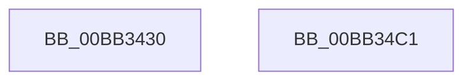

# VerifierZwQueryDirectoryFile

- RVA: `0x00BB3430`–`0x00BB34C2` (길이 `146` bytes)
- VA: `0x0000000140BB3430`
- 실행 섹션: `PAGEVRFY`
- PDB 이름 있음: `예`; PDB Function 태그: `아니요`
- unwind 정보 RVA: `0x0007AFEC`
- 디코드: `33`개 명령, `146/146` bytes 표시
- 미해석 바이트: `0` (있으면 어셈블리에 `.byte`로 보존)

> 이 문서는 커널 이미지의 기계어와 PDB 기호를 분석해 생성했습니다. 4번과 5번은 함수 원형과 자료형을 바이너리 사용 방식에서 추정한 C 해석이며 원본 소스 복구 결과는 아닙니다.

## 1. Dependencies

- 직접 호출 지점: **1**; 고유 호출 대상: **1**
- 직접 호출자로 확인된 함수: **0**
- RIP 상대 이미지 참조: **1**

### Outgoing calls
- `0x00BB34AC` → [guard_dispatch_icall](../../text/6B/guard_dispatch_icall_function_006BAAD0.md) (function, `0x006BAAD0`)

### Direct callers
- 이 함수 시작 RVA로 연결되는 직접 call은 확인되지 않았습니다. 간접 호출은 완전히 역산할 수 없습니다.

### Static image references
- `0x00BB3480` → RVA `0x00FFE240` (`PAGEVRFD`; read)

## 2. Other-region calls and transfers

- 다른 실행 섹션으로 향하는 call: **1**
  - `0x00BB34AC` → [guard_dispatch_icall](../../text/6B/guard_dispatch_icall_function_006BAAD0.md) (`PAGEVRFY` → `.text`)
- 별도 외부 분기/꼬리 이동을 확인하지 못했습니다.

## 3. Assembly (complete function range)

```asm
00BB3430  4C 8B DC                        mov r11, rsp
00BB3433  49 89 5B 08                     mov qword ptr [r11 + 8], rbx
00BB3437  49 89 73 10                     mov qword ptr [r11 + 0x10], rsi
00BB343B  57                              push rdi
00BB343C  48 83 EC 60                     sub rsp, 0x60
00BB3440  44 8A 94 24 B0 00 00 00         mov r10b, byte ptr [rsp + 0xb0]
00BB3448  49 8B D9                        mov rbx, r9
00BB344B  8A 84 24 C0 00 00 00            mov al, byte ptr [rsp + 0xc0]
00BB3452  48 8B FA                        mov rdi, rdx
00BB3455  44 8B 8C 24 A0 00 00 00         mov r9d, dword ptr [rsp + 0xa0]
00BB345D  48 8B F1                        mov rsi, rcx
00BB3460  48 8B 94 24 98 00 00 00         mov rdx, qword ptr [rsp + 0x98]
00BB3468  48 8B 8C 24 90 00 00 00         mov rcx, qword ptr [rsp + 0x90]
00BB3470  88 44 24 50                     mov byte ptr [rsp + 0x50], al
00BB3474  48 8B 84 24 B8 00 00 00         mov rax, qword ptr [rsp + 0xb8]
00BB347C  49 89 43 E0                     mov qword ptr [r11 - 0x20], rax
00BB3480  48 8B 05 B9 AD 44 00            mov rax, qword ptr [rip + 0x44adb9]
00BB3487  45 88 53 D8                     mov byte ptr [r11 - 0x28], r10b
00BB348B  44 8B 94 24 A8 00 00 00         mov r10d, dword ptr [rsp + 0xa8]
00BB3493  45 89 53 D0                     mov dword ptr [r11 - 0x30], r10d
00BB3497  45 89 4B C8                     mov dword ptr [r11 - 0x38], r9d
00BB349B  4C 8B CB                        mov r9, rbx
00BB349E  49 89 53 C0                     mov qword ptr [r11 - 0x40], rdx
00BB34A2  48 8B D7                        mov rdx, rdi
00BB34A5  49 89 4B B8                     mov qword ptr [r11 - 0x48], rcx
00BB34A9  48 8B CE                        mov rcx, rsi
00BB34AC  E8 1F 76 B0 FF                  call 0x1406baad0
00BB34B1  48 8B 5C 24 70                  mov rbx, qword ptr [rsp + 0x70]
00BB34B6  48 8B 74 24 78                  mov rsi, qword ptr [rsp + 0x78]
00BB34BB  48 83 C4 60                     add rsp, 0x60
00BB34BF  5F                              pop rdi
00BB34C0  C3                              ret
00BB34C1  CC                              int3
```

## 4. C-style interpretation (structured pseudocode)

```c
__int64 __fastcall VerifierZwQueryDirectoryFile(__int64 a1, __int64 a2, __int64 a3, __int64 a4, __int64 a5, __int64 a6, unsigned int a7, unsigned int a8, unsigned __int8 a9, __int64 a10, unsigned __int8 a11)
{
    __int64 result;
    __int64 v_rsp;
    unsigned __int8 v_stack_m18;
    unsigned __int64 v_stack_p10;
    unsigned __int64 v_stack_p8;

    *(unsigned __int64 *)(v_rsp + 8) = v_rbx;
    *(unsigned __int64 *)(v_rsp + 16) = v_rsi;
    v_rsp = (v_rsp) - (96);
    v_stack_m18 = a11;
    *(unsigned __int64 *)(v_rsp - 32) = a10;
    *(unsigned __int8 *)(v_rsp - 40) = a9;
    *(unsigned int *)(v_rsp - 48) = (unsigned int)((unsigned int)(a8));
    *(unsigned int *)(v_rsp - 56) = (unsigned int)((unsigned int)(a7));
    *(unsigned __int64 *)(v_rsp - 64) = a6;
    *(unsigned __int64 *)(v_rsp - 72) = a5;
    result = guard_dispatch_icall(a1, a2, a3, a4);
    v_rsp = (v_rsp) + (96);
    return result;
}
```

## 5. (Beta) C Style

```c
int64_t VerifierZwQueryDirectoryFile(int64_t Arg1, int64_t Arg2, int64_t Arg3, int64_t Arg4, int64_t Arg5, int64_t Arg6, uint32_t Arg7, uint32_t Arg8, uint8_t Arg9, int64_t Arg10, uint8_t Arg11)
{
    int64_t result;
    int64_t local_rsp;
    uint8_t v_stack_m18;
    uint64_t v_stack_p10;
    uint64_t v_stack_p8;

    *(uint64_t *)(local_rsp + 0x8) = local_rbx;
    *(uint64_t *)(local_rsp + 0x10) = local_rsi;
    local_rsp = (local_rsp) - (96);
    v_stack_m18 = Arg11;
    *(uint64_t *)(local_rsp - 0x20) = Arg10;
    *(uint8_t *)(local_rsp - 0x28) = Arg9;
    *(uint32_t *)(local_rsp - 0x30) = (uint32_t)((uint32_t)(Arg8));
    *(uint32_t *)(local_rsp - 0x38) = (uint32_t)((uint32_t)(Arg7));
    *(uint64_t *)(local_rsp - 0x40) = Arg6;
    *(uint64_t *)(local_rsp - 0x48) = Arg5;
    result = guard_dispatch_icall(Arg1, Arg2, Arg3, Arg4);
    local_rsp = (local_rsp) + (96);
    return result;
}
```

## 6. Execution-region graph

[열기: 2D/3D 그래프와 함수 탐색 컨트롤 패널](../../../control-panel.html?section=pagevrfy&rva=0x00BB3430&view=graph)

- 2D 그래프는 위에서 아래로 흐르고, 3D 그래프는 빈 공간을 드래그해 회전합니다. Shift+드래그는 이동, 휠은 확대·축소, 함수 노드 선택은 대상 보고서 이동입니다.

### Static fallback


