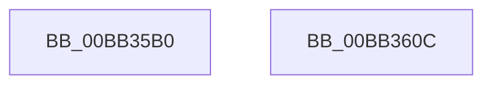

# VerifierZwQueryEaFile

- RVA: `0x00BB35B0`–`0x00BB360D` (길이 `93` bytes)
- VA: `0x0000000140BB35B0`
- 실행 섹션: `PAGEVRFY`
- PDB 이름 있음: `예`; PDB Function 태그: `아니요`
- unwind 정보 RVA: `0x0006C2A4`
- 디코드: `18`개 명령, `93/93` bytes 표시
- 미해석 바이트: `0` (있으면 어셈블리에 `.byte`로 보존)

> 이 문서는 커널 이미지의 기계어와 PDB 기호를 분석해 생성했습니다. 4번과 5번은 함수 원형과 자료형을 바이너리 사용 방식에서 추정한 C 해석이며 원본 소스 복구 결과는 아닙니다.

## 1. Dependencies

- 직접 호출 지점: **1**; 고유 호출 대상: **1**
- 직접 호출자로 확인된 함수: **0**
- RIP 상대 이미지 참조: **1**

### Outgoing calls
- `0x00BB3602` → [guard_dispatch_icall](../../text/6B/guard_dispatch_icall_function_006BAAD0.md) (function, `0x006BAAD0`)

### Direct callers
- 이 함수 시작 RVA로 연결되는 직접 call은 확인되지 않았습니다. 간접 호출은 완전히 역산할 수 없습니다.

### Static image references
- `0x00BB35C7` → RVA `0x00FFE218` (`PAGEVRFD`; read)

## 2. Other-region calls and transfers

- 다른 실행 섹션으로 향하는 call: **1**
  - `0x00BB3602` → [guard_dispatch_icall](../../text/6B/guard_dispatch_icall_function_006BAAD0.md) (`PAGEVRFY` → `.text`)
- 별도 외부 분기/꼬리 이동을 확인하지 못했습니다.

## 3. Assembly (complete function range)

```asm
00BB35B0  48 83 EC 58                     sub rsp, 0x58
00BB35B4  44 8A 94 24 A0 00 00 00         mov r10b, byte ptr [rsp + 0xa0]
00BB35BC  45 8B D9                        mov r11d, r9d
00BB35BF  44 8A 8C 24 80 00 00 00         mov r9b, byte ptr [rsp + 0x80]
00BB35C7  48 8B 05 4A AC 44 00            mov rax, qword ptr [rip + 0x44ac4a]
00BB35CE  44 88 54 24 40                  mov byte ptr [rsp + 0x40], r10b
00BB35D3  4C 8B 94 24 98 00 00 00         mov r10, qword ptr [rsp + 0x98]
00BB35DB  4C 89 54 24 38                  mov qword ptr [rsp + 0x38], r10
00BB35E0  44 8B 94 24 90 00 00 00         mov r10d, dword ptr [rsp + 0x90]
00BB35E8  44 89 54 24 30                  mov dword ptr [rsp + 0x30], r10d
00BB35ED  4C 8B 94 24 88 00 00 00         mov r10, qword ptr [rsp + 0x88]
00BB35F5  4C 89 54 24 28                  mov qword ptr [rsp + 0x28], r10
00BB35FA  44 88 4C 24 20                  mov byte ptr [rsp + 0x20], r9b
00BB35FF  45 8B CB                        mov r9d, r11d
00BB3602  E8 C9 74 B0 FF                  call 0x1406baad0
00BB3607  48 83 C4 58                     add rsp, 0x58
00BB360B  C3                              ret
00BB360C  CC                              int3
```

## 4. C-style interpretation (structured pseudocode)

```c
__int64 __fastcall VerifierZwQueryEaFile(__int64 a1, __int64 a2, __int64 a3, int a4, unsigned __int8 a5, __int64 a6, unsigned int a7, __int64 a8, unsigned __int8 a9)
{
    __int64 result;
    __int64 v_rsp;
    unsigned __int8 v_stack_m18;
    unsigned __int64 v_stack_m20;
    unsigned int v_stack_m28;
    unsigned __int64 v_stack_m30;
    unsigned __int8 v_stack_m38;

    v_rsp = (v_rsp) - (88);
    v_stack_m18 = a9;
    v_stack_m20 = a8;
    v_stack_m28 = (unsigned int)((unsigned int)(a7));
    v_stack_m30 = a6;
    v_stack_m38 = a5;
    result = guard_dispatch_icall(a1, a2, a3, (unsigned int)((unsigned int)((unsigned int)(a4))));
    v_rsp = (v_rsp) + (88);
    return result;
}
```

## 5. (Beta) C Style

```c
int64_t VerifierZwQueryEaFile(int64_t Arg1, int64_t Arg2, int64_t Arg3, int32_t Arg4, uint8_t Arg5, int64_t Arg6, uint32_t Arg7, int64_t Arg8, uint8_t Arg9)
{
    int64_t result;
    int64_t local_rsp;
    uint8_t v_stack_m18;
    uint64_t v_stack_m20;
    uint32_t v_stack_m28;
    uint64_t v_stack_m30;
    uint8_t v_stack_m38;

    local_rsp = (local_rsp) - (88);
    v_stack_m18 = Arg9;
    v_stack_m20 = Arg8;
    v_stack_m28 = (uint32_t)((uint32_t)(Arg7));
    v_stack_m30 = Arg6;
    v_stack_m38 = Arg5;
    result = guard_dispatch_icall(Arg1, Arg2, Arg3, (uint32_t)((uint32_t)((uint32_t)(Arg4))));
    local_rsp = (local_rsp) + (88);
    return result;
}
```

## 6. Execution-region graph

[열기: 2D/3D 그래프와 함수 탐색 컨트롤 패널](../../../control-panel.html?section=pagevrfy&rva=0x00BB35B0&view=graph)

- 2D 그래프는 위에서 아래로 흐르고, 3D 그래프는 빈 공간을 드래그해 회전합니다. Shift+드래그는 이동, 휠은 확대·축소, 함수 노드 선택은 대상 보고서 이동입니다.

### Static fallback


