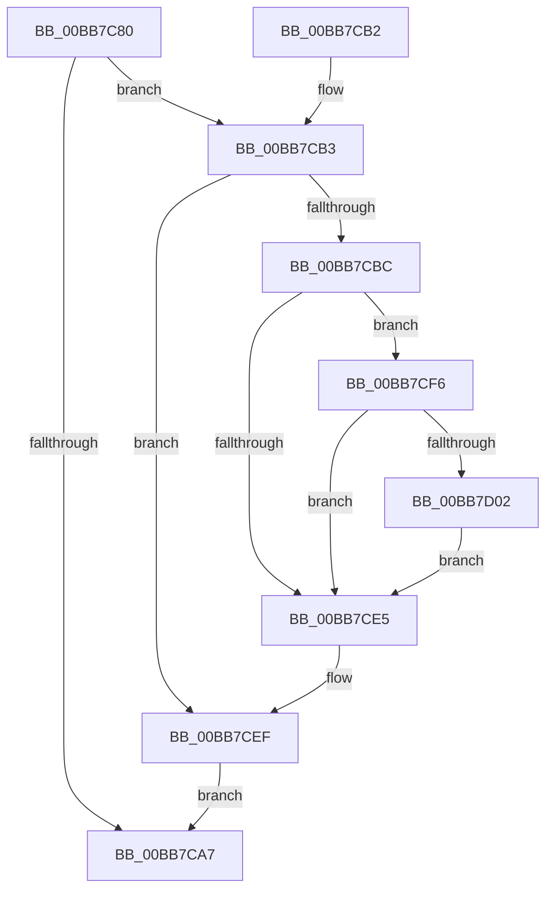

# VfCheckForLookaside

- RVA: `0x00BB7C80`–`0x00BB7D29` (길이 `169` bytes)
- VA: `0x0000000140BB7C80`
- 실행 섹션: `PAGEVRFY`
- PDB 이름 있음: `예`; PDB Function 태그: `아니요`
- unwind 정보 RVA: `0x000B67B8`
- 디코드: `44`개 명령, `169/169` bytes 표시
- 미해석 바이트: `0` (있으면 어셈블리에 `.byte`로 보존)

> 이 문서는 커널 이미지의 기계어와 PDB 기호를 분석해 생성했습니다. 4번과 5번은 함수 원형과 자료형을 바이너리 사용 방식에서 추정한 C 해석이며 원본 소스 복구 결과는 아닙니다.

## 1. Dependencies

- 직접 호출 지점: **5**; 고유 호출 대상: **5**
- 직접 호출자로 확인된 함수: **1**
- RIP 상대 이미지 참조: **3**

### Outgoing calls
- `0x00BB7CB3` → [VfPoolIsInternalFree](../../text/49/VfPoolIsInternalFree_function_00498850.md) (function, `0x00498850`)
- `0x00BB7CC4` → [VfAvlInitializeLockContext](../../text/4A/VfAvlInitializeLockContext_function_004A686C.md) (function, `0x004A686C`)
- `0x00BB7CDB` → [VfAvlLookupTreeNode](../../text/3E/VfAvlLookupTreeNode_function_003EF1B4.md) (function, `0x003EF1B4`)
- `0x00BB7CEA` → [VfAvlCleanupLockContext](../../text/3E/VfAvlCleanupLockContext_function_003EF56C.md) (function, `0x003EF56C`)
- `0x00BB7D22` → [CarReportRuleViolationFromNt](../B9/CarReportRuleViolationFromNt_function_00B9D904.md) (function, `0x00B9D904`)

### Direct callers
- [ExpCheckForLookaside](../../text/4A/ExpCheckForLookaside_function_004A52DC.md) at `0x004A52F8`

### Static image references
- `0x00BB7C8F` → RVA `0x00FFDA84` (`PAGEVRFD`; read)
- `0x00BB7CD4` → RVA `0x00FFDCA0` (`PAGEVRFD`; read)
- `0x00BB7CF6` → RVA `0x00F04A20` (`.data`; read)

## 2. Other-region calls and transfers

- 다른 실행 섹션으로 향하는 call: **4**
  - `0x00BB7CB3` → [VfPoolIsInternalFree](../../text/49/VfPoolIsInternalFree_function_00498850.md) (`PAGEVRFY` → `.text`)
  - `0x00BB7CC4` → [VfAvlInitializeLockContext](../../text/4A/VfAvlInitializeLockContext_function_004A686C.md) (`PAGEVRFY` → `.text`)
  - `0x00BB7CDB` → [VfAvlLookupTreeNode](../../text/3E/VfAvlLookupTreeNode_function_003EF1B4.md) (`PAGEVRFY` → `.text`)
  - `0x00BB7CEA` → [VfAvlCleanupLockContext](../../text/3E/VfAvlCleanupLockContext_function_003EF56C.md) (`PAGEVRFY` → `.text`)
- 별도 외부 분기/꼬리 이동을 확인하지 못했습니다.

## 3. Assembly (complete function range)

```asm
00BB7C80  48 89 5C 24 08                  mov qword ptr [rsp + 8], rbx
00BB7C85  57                              push rdi
00BB7C86  48 83 EC 60                     sub rsp, 0x60
00BB7C8A  33 C0                           xor eax, eax
00BB7C8C  0F 57 C0                        xorps xmm0, xmm0
00BB7C8F  39 05 EF 5D 44 00               cmp dword ptr [rip + 0x445def], eax
00BB7C95  48 8B DA                        mov rbx, rdx
00BB7C98  48 8B F9                        mov rdi, rcx
00BB7C9B  48 89 44 24 50                  mov qword ptr [rsp + 0x50], rax
00BB7CA0  0F 11 44 24 40                  movups xmmword ptr [rsp + 0x40], xmm0
00BB7CA5  75 0C                           jne 0x140bb7cb3
00BB7CA7  48 8B 5C 24 70                  mov rbx, qword ptr [rsp + 0x70]
00BB7CAC  48 83 C4 60                     add rsp, 0x60
00BB7CB0  5F                              pop rdi
00BB7CB1  C3                              ret
00BB7CB2  CC                              int3
00BB7CB3  E8 98 0B 8E FF                  call 0x140498850
00BB7CB8  85 C0                           test eax, eax
00BB7CBA  75 33                           jne 0x140bb7cef
00BB7CBC  8D 50 01                        lea edx, [rax + 1]
00BB7CBF  48 8D 4C 24 40                  lea rcx, [rsp + 0x40]
00BB7CC4  E8 A3 EB 8E FF                  call 0x1404a686c
00BB7CC9  4C 8B CB                        mov r9, rbx
00BB7CCC  48 8D 54 24 40                  lea rdx, [rsp + 0x40]
00BB7CD1  4C 8B C7                        mov r8, rdi
00BB7CD4  48 8D 0D C5 5F 44 00            lea rcx, [rip + 0x445fc5]
00BB7CDB  E8 D4 74 83 FF                  call 0x1403ef1b4
00BB7CE0  48 85 C0                        test rax, rax
00BB7CE3  75 11                           jne 0x140bb7cf6
00BB7CE5  48 8D 4C 24 40                  lea rcx, [rsp + 0x40]
00BB7CEA  E8 7D 78 83 FF                  call 0x1403ef56c
00BB7CEF  B8 01 00 00 00                  mov eax, 1
00BB7CF4  EB B1                           jmp 0x140bb7ca7
00BB7CF6  F7 05 20 CD 34 00 00 08 00 00   test dword ptr [rip + 0x34cd20], 0x800
00BB7D00  74 E3                           je 0x140bb7ce5
00BB7D02  4C 8B 00                        mov r8, qword ptr [rax]
00BB7D05  BA CC 00 00 00                  mov edx, 0xcc
00BB7D0A  4C 89 44 24 30                  mov qword ptr [rsp + 0x30], r8
00BB7D0F  4C 8B CF                        mov r9, rdi
00BB7D12  C7 44 24 28 0B 00 00 00         mov dword ptr [rsp + 0x28], 0xb
00BB7D1A  48 89 5C 24 20                  mov qword ptr [rsp + 0x20], rbx
00BB7D1F  8D 4A F8                        lea ecx, [rdx - 8]
00BB7D22  E8 DD 5B FE FF                  call 0x140b9d904
00BB7D27  EB BC                           jmp 0x140bb7ce5
```

## 4. C-style interpretation (structured pseudocode)

```c
__int64 __fastcall VfCheckForLookaside(__int64 a1, __int64 a2)
{
    __int64 result;
    __int64 v_rsp;
    unsigned __int64 v_stack_m18;
    unsigned __int64 v_stack_m28;
    unsigned __int64 v_stack_p20;
    unsigned int v_stack_p28;
    unsigned __int64 v_stack_p30;
    unsigned __int64 v_stack_p40;
    unsigned __int64 v_stack_p8;

    v_stack_p8 = v_rbx;
    v_rsp = (v_rsp) - (96);
    result = 0;
    v_stack_m18 = 0;
    v_stack_m28 = v_xmm0;
    if ((*(unsigned int *)(v_rip + 4480495)) != 0) goto loc_00BB7CB3;
loc_00BB7CA7:
    v_rsp = (v_rsp) + (96);
    return result;
loc_00BB7CB3:
    result = VfPoolIsInternalFree(a1, a2, a3, a4);
    if ((unsigned int)(result) != 0) goto loc_00BB7CEF;
    result = VfAvlInitializeLockContext(v_stack_p40, result + 1, a3, a4);
    result = VfAvlLookupTreeNode(v_rip + 4480965, v_stack_p40, a1, v_stack_p8);
    if (result != 0) goto loc_00BB7CF6;
loc_00BB7CE5:
    result = VfAvlCleanupLockContext(v_stack_p40, v_stack_p40, a1, v_stack_p8);
loc_00BB7CEF:
    goto loc_00BB7CA7;
loc_00BB7CF6:
    if (((*(unsigned int *)(v_rip + 3460384)) & (0x800ULL)) == 0) goto loc_00BB7CE5;
    v_stack_p30 = *(unsigned __int64 *)(1);
    v_stack_p28 = 11;
    v_stack_p20 = v_stack_p8;
    result = CarReportRuleViolationFromNt(204 - 8, 204, *(unsigned __int64 *)(1), a1);
    goto loc_00BB7CE5;
}
```

## 5. (Beta) C Style

```c
int64_t VfCheckForLookaside(int64_t Arg1, int64_t Arg2)
{
    int64_t result;
    int64_t local_rsp;
    uint64_t v_stack_m18;
    uint64_t v_stack_m28;
    uint64_t v_stack_p20;
    uint32_t v_stack_p28;
    uint64_t v_stack_p30;
    uint64_t v_stack_p40;
    uint64_t v_stack_p8;

    v_stack_p8 = local_rbx;
    local_rsp = (local_rsp) - (96);
    result = 0;
    v_stack_m18 = 0;
    v_stack_m28 = v_xmm0;
    if ((*(uint32_t *)(v_rip + 0x445DEF)) != 0) goto loc_00BB7CB3;
loc_00BB7CA7:
    local_rsp = (local_rsp) + (96);
    return result;
loc_00BB7CB3:
    result = VfPoolIsInternalFree(Arg1, Arg2, a3, a4);
    if ((uint32_t)(result) != 0) goto loc_00BB7CEF;
    result = VfAvlInitializeLockContext(v_stack_p40, result + 1, a3, a4);
    result = VfAvlLookupTreeNode(v_rip + 4480965, v_stack_p40, Arg1, v_stack_p8);
    if (result != 0) goto loc_00BB7CF6;
loc_00BB7CE5:
    result = VfAvlCleanupLockContext(v_stack_p40, v_stack_p40, Arg1, v_stack_p8);
loc_00BB7CEF:
    goto loc_00BB7CA7;
loc_00BB7CF6:
    if (((*(uint32_t *)(v_rip + 0x34CD20)) & (0x800ULL)) == 0) goto loc_00BB7CE5;
    v_stack_p30 = *(uint64_t *)(1);
    v_stack_p28 = 11;
    v_stack_p20 = v_stack_p8;
    result = CarReportRuleViolationFromNt(204 - 8, 204, *(uint64_t *)(1), Arg1);
    goto loc_00BB7CE5;
}
```

## 6. Execution-region graph

[열기: 2D/3D 그래프와 함수 탐색 컨트롤 패널](../../../control-panel.html?section=pagevrfy&rva=0x00BB7C80&view=graph)

- 2D 그래프는 위에서 아래로 흐르고, 3D 그래프는 빈 공간을 드래그해 회전합니다. Shift+드래그는 이동, 휠은 확대·축소, 함수 노드 선택은 대상 보고서 이동입니다.

### Static fallback


