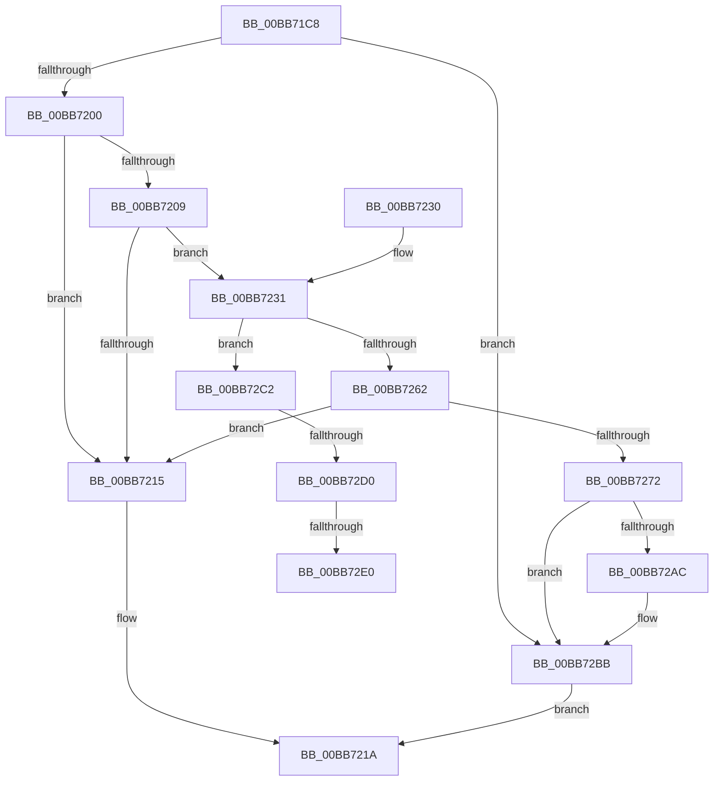

# VfCheckForResource

- RVA: `0x00BB71C8`–`0x00BB730C` (길이 `324` bytes)
- VA: `0x0000000140BB71C8`
- 실행 섹션: `PAGEVRFY`
- PDB 이름 있음: `예`; PDB Function 태그: `예`
- unwind 정보 RVA: `0x000B37BC`
- 디코드: `80`개 명령, `324/324` bytes 표시
- 미해석 바이트: `0` (있으면 어셈블리에 `.byte`로 보존)

> 이 문서는 커널 이미지의 기계어와 PDB 기호를 분석해 생성했습니다. 4번과 5번은 함수 원형과 자료형을 바이너리 사용 방식에서 추정한 C 해석이며 원본 소스 복구 결과는 아닙니다.

## 1. Dependencies

- 직접 호출 지점: **9**; 고유 호출 대상: **7**
- 직접 호출자로 확인된 함수: **1**
- RIP 상대 이미지 참조: **6**

### Outgoing calls
- `0x00BB7200` → [VfPoolIsInternalFree](../../text/49/VfPoolIsInternalFree_function_00498850.md) (function, `0x00498850`)
- `0x00BB723F` → [VfAvlInitializeLockContext](../../text/4A/VfAvlInitializeLockContext_function_004A686C.md) (function, `0x004A686C`)
- `0x00BB7255` → [VfAvlLookupTreeNode](../../text/3E/VfAvlLookupTreeNode_function_003EF1B4.md) (function, `0x003EF1B4`)
- `0x00BB7266` → [VfAvlCleanupLockContext](../../text/3E/VfAvlCleanupLockContext_function_003EF56C.md) (function, `0x003EF56C`)
- `0x00BB727F` → [VfAvlInitializeLockContext](../../text/4A/VfAvlInitializeLockContext_function_004A686C.md) (function, `0x004A686C`)
- `0x00BB7296` → [VfAvlDeleteTreeNode](../../text/3E/VfAvlDeleteTreeNode_function_003EE240.md) (function, `0x003EE240`)
- `0x00BB72A2` → [VfAvlCleanupLockContext](../../text/3E/VfAvlCleanupLockContext_function_003EF56C.md) (function, `0x003EF56C`)
- `0x00BB72B6` → [VfAvlFreeNodeNoLock](../../text/61/VfAvlFreeNodeNoLock_function_006126D8.md) (function, `0x006126D8`)
- `0x00BB7301` → [CarReportRuleViolationFromNt](../B9/CarReportRuleViolationFromNt_function_00B9D904.md) (function, `0x00B9D904`)

### Direct callers
- [ExpCheckForResource](../../text/49/ExpCheckForResource_function_0049CA24.md) at `0x0049CA5A`

### Static image references
- `0x00BB71EB` → RVA `0x00FFDA80` (`PAGEVRFD`; read)
- `0x00BB7209` → RVA `0x00FFDBC8` (`PAGEVRFD`; read)
- `0x00BB724E` → RVA `0x00FFDBC0` (`PAGEVRFD`; read)
- `0x00BB7272` → RVA `0x00FFDB94` (`PAGEVRFD`; read/write)
- `0x00BB72C2` → RVA `0x00FFDA9C` (`PAGEVRFD`; read)
- `0x00BB72D0` → RVA `0x00F04A20` (`.data`; read)

## 2. Other-region calls and transfers

- 다른 실행 섹션으로 향하는 call: **8**
  - `0x00BB7200` → [VfPoolIsInternalFree](../../text/49/VfPoolIsInternalFree_function_00498850.md) (`PAGEVRFY` → `.text`)
  - `0x00BB723F` → [VfAvlInitializeLockContext](../../text/4A/VfAvlInitializeLockContext_function_004A686C.md) (`PAGEVRFY` → `.text`)
  - `0x00BB7255` → [VfAvlLookupTreeNode](../../text/3E/VfAvlLookupTreeNode_function_003EF1B4.md) (`PAGEVRFY` → `.text`)
  - `0x00BB7266` → [VfAvlCleanupLockContext](../../text/3E/VfAvlCleanupLockContext_function_003EF56C.md) (`PAGEVRFY` → `.text`)
  - `0x00BB727F` → [VfAvlInitializeLockContext](../../text/4A/VfAvlInitializeLockContext_function_004A686C.md) (`PAGEVRFY` → `.text`)
  - `0x00BB7296` → [VfAvlDeleteTreeNode](../../text/3E/VfAvlDeleteTreeNode_function_003EE240.md) (`PAGEVRFY` → `.text`)
  - `0x00BB72A2` → [VfAvlCleanupLockContext](../../text/3E/VfAvlCleanupLockContext_function_003EF56C.md) (`PAGEVRFY` → `.text`)
  - `0x00BB72B6` → [VfAvlFreeNodeNoLock](../../text/61/VfAvlFreeNodeNoLock_function_006126D8.md) (`PAGEVRFY` → `.text`)
- call이 아닌 외부 분기/꼬리 이동: **3**
  - `0x00BB72CA` → [sub_00BBC2EC](Unknown_function_00BBC2EC.md) (`tail-transfer`)
  - `0x00BB72DA` → [sub_00BBC2EC](Unknown_function_00BBC2EC.md) (`tail-transfer`)
  - `0x00BB7307` → [sub_00BBC2EC](Unknown_function_00BBC2EC.md) (`tail-transfer`)

## 3. Assembly (complete function range)

```asm
00BB71C8  48 89 5C 24 08                  mov qword ptr [rsp + 8], rbx
00BB71CD  48 89 74 24 10                  mov qword ptr [rsp + 0x10], rsi
00BB71D2  48 89 7C 24 20                  mov qword ptr [rsp + 0x20], rdi
00BB71D7  55                              push rbp
00BB71D8  48 8B EC                        mov rbp, rsp
00BB71DB  48 83 EC 60                     sub rsp, 0x60
00BB71DF  33 C0                           xor eax, eax
00BB71E1  0F 57 C0                        xorps xmm0, xmm0
00BB71E4  48 89 45 F0                     mov qword ptr [rbp - 0x10], rax
00BB71E8  48 8B FA                        mov rdi, rdx
00BB71EB  8B 05 8F 68 44 00               mov eax, dword ptr [rip + 0x44688f]
00BB71F1  48 8B F1                        mov rsi, rcx
00BB71F4  0F 11 45 E0                     movups xmmword ptr [rbp - 0x20], xmm0
00BB71F8  85 C0                           test eax, eax
00BB71FA  0F 84 BB 00 00 00               je 0x140bb72bb
00BB7200  E8 4B 16 8E FF                  call 0x140498850
00BB7205  85 C0                           test eax, eax
00BB7207  75 0C                           jne 0x140bb7215
00BB7209  48 8B 05 B8 69 44 00            mov rax, qword ptr [rip + 0x4469b8]
00BB7210  48 85 C0                        test rax, rax
00BB7213  75 1C                           jne 0x140bb7231
00BB7215  B8 01 00 00 00                  mov eax, 1
00BB721A  4C 8D 5C 24 60                  lea r11, [rsp + 0x60]
00BB721F  49 8B 5B 10                     mov rbx, qword ptr [r11 + 0x10]
00BB7223  49 8B 73 18                     mov rsi, qword ptr [r11 + 0x18]
00BB7227  49 8B 7B 28                     mov rdi, qword ptr [r11 + 0x28]
00BB722B  49 8B E3                        mov rsp, r11
00BB722E  5D                              pop rbp
00BB722F  C3                              ret
00BB7230  CC                              int3
00BB7231  48 83 65 20 00                  and qword ptr [rbp + 0x20], 0
00BB7236  48 8D 4D E0                     lea rcx, [rbp - 0x20]
00BB723A  BA 01 00 00 00                  mov edx, 1
00BB723F  E8 28 F6 8E FF                  call 0x1404a686c
00BB7244  4C 8B CF                        mov r9, rdi
00BB7247  48 8D 55 E0                     lea rdx, [rbp - 0x20]
00BB724B  4C 8B C6                        mov r8, rsi
00BB724E  48 8D 0D 6B 69 44 00            lea rcx, [rip + 0x44696b]
00BB7255  E8 5A 7F 83 FF                  call 0x1403ef1b4
00BB725A  48 8B D8                        mov rbx, rax
00BB725D  48 85 C0                        test rax, rax
00BB7260  75 60                           jne 0x140bb72c2
00BB7262  48 8D 4D E0                     lea rcx, [rbp - 0x20]
00BB7266  E8 01 83 83 FF                  call 0x1403ef56c
00BB726B  48 83 7D 20 00                  cmp qword ptr [rbp + 0x20], 0
00BB7270  74 A3                           je 0x140bb7215
00BB7272  F0 FF 05 1B 69 44 00            lock inc dword ptr [rip + 0x44691b]
00BB7279  33 D2                           xor edx, edx
00BB727B  48 8D 4D E0                     lea rcx, [rbp - 0x20]
00BB727F  E8 E8 F5 8E FF                  call 0x1404a686c
00BB7284  45 33 C9                        xor r9d, r9d
00BB7287  4C 8D 45 20                     lea r8, [rbp + 0x20]
00BB728B  48 8D 55 E0                     lea rdx, [rbp - 0x20]
00BB728F  48 8D 0D 2A 69 44 00            lea rcx, [rip + 0x44692a]
00BB7296  E8 A5 6F 83 FF                  call 0x1403ee240
00BB729B  48 8D 4D E0                     lea rcx, [rbp - 0x20]
00BB729F  48 8B D8                        mov rbx, rax
00BB72A2  E8 C5 82 83 FF                  call 0x1403ef56c
00BB72A7  48 85 DB                        test rbx, rbx
00BB72AA  74 0F                           je 0x140bb72bb
00BB72AC  48 8B D3                        mov rdx, rbx
00BB72AF  48 8D 0D 0A 69 44 00            lea rcx, [rip + 0x44690a]
00BB72B6  E8 1D B4 A5 FF                  call 0x1406126d8
00BB72BB  33 C0                           xor eax, eax
00BB72BD  E9 58 FF FF FF                  jmp 0x140bb721a
00BB72C2  8B 0D D4 67 44 00               mov ecx, dword ptr [rip + 0x4467d4]
00BB72C8  85 C9                           test ecx, ecx
00BB72CA  0F 85 1C 50 00 00               jne 0x140bbc2ec
00BB72D0  F7 05 46 D7 34 00 00 08 00 00   test dword ptr [rip + 0x34d746], 0x800
00BB72DA  0F 84 0C 50 00 00               je 0x140bbc2ec
00BB72E0  48 83 64 24 30 00               and qword ptr [rsp + 0x30], 0
00BB72E6  BA D2 00 00 00                  mov edx, 0xd2
00BB72EB  4C 8B 00                        mov r8, qword ptr [rax]
00BB72EE  4C 8B CE                        mov r9, rsi
00BB72F1  C7 44 24 28 0B 00 00 00         mov dword ptr [rsp + 0x28], 0xb
00BB72F9  48 89 7C 24 20                  mov qword ptr [rsp + 0x20], rdi
00BB72FE  8D 4A F2                        lea ecx, [rdx - 0xe]
00BB7301  E8 FE 65 FE FF                  call 0x140b9d904
00BB7306  90                              nop
00BB7307  E9 E0 4F 00 00                  jmp 0x140bbc2ec
```

## 4. C-style interpretation (structured pseudocode)

```c
__int64 __fastcall VfCheckForResource(__int64 a1, __int64 a2)
{
    __int64 result;
    __int64 v_rsp;
    unsigned __int64 v_stack_m18;
    unsigned __int64 v_stack_m28;
    unsigned __int64 v_stack_m30;
    unsigned int v_stack_m38;
    unsigned __int64 v_stack_m40;
    unsigned __int64 v_stack_m8;
    unsigned __int64 v_stack_p10;
    unsigned __int64 v_stack_p18;
    unsigned __int64 v_stack_p20;
    unsigned __int64 v_stack_p8;

    v_stack_p8 = v_rbx;
    v_stack_p10 = v_rsi;
    v_stack_p20 = v_rdi;
    v_rsp = (v_rsp) - (96);
    result = 0;
    v_stack_m18 = 0;
    v_stack_m28 = v_xmm0;
    if ((unsigned int)((unsigned int)(*(unsigned int *)(v_rip + 4483215))) == 0) goto loc_00BB72BB;
    result = VfPoolIsInternalFree(a1, a2, a3, a4);
    if ((unsigned int)(result) != 0) goto loc_00BB7215;
    if (*(unsigned __int64 *)(v_rip + 4483512) != 0) goto loc_00BB7231;
loc_00BB7215:
loc_00BB721A:
    return 1;
loc_00BB7231:
    result = VfAvlInitializeLockContext(v_stack_m28, 1, a3, a4);
    result = VfAvlLookupTreeNode(v_rip + 4483435, v_stack_m28, *(unsigned __int64 *)(v_stack_m8 + 24), *(unsigned __int64 *)(v_stack_m8 + 40));
    if (result != 0) goto loc_00BB72C2;
    result = VfAvlCleanupLockContext(v_stack_m28, v_stack_m28, *(unsigned __int64 *)(v_stack_m8 + 24), *(unsigned __int64 *)(v_stack_m8 + 40));
    if (v_stack_p18 == 0) goto loc_00BB7215;
    a2 = 0;
    result = VfAvlInitializeLockContext(v_stack_m28, a2, *(unsigned __int64 *)(v_stack_m8 + 24), *(unsigned __int64 *)(v_stack_m8 + 40));
    a4 = 0;
    result = VfAvlDeleteTreeNode(v_rip + 4483370, v_stack_m28, v_stack_p18, a4);
    result = VfAvlCleanupLockContext(v_stack_m28, v_stack_m28, v_stack_p18, a4);
    if (result != 0) {
        a2 = result;
        a1 = v_rip + 4483338;
        result = VfAvlFreeNodeNoLock(a1, a2, v_stack_p18, a4);
    }
    result = 0;
    goto loc_00BB721A;
loc_00BB72C2:
    v_stack_m38 = 11;
    v_stack_m40 = *(unsigned __int64 *)(v_stack_m8 + 40);
    result = CarReportRuleViolationFromNt(210 - 14, 210, *(unsigned __int64 *)(result), *(unsigned __int64 *)(v_stack_m8 + 24));
}
```

## 5. (Beta) C Style

```c
int64_t VfCheckForResource(int64_t Arg1, int64_t Arg2)
{
    int64_t result;
    int64_t local_rsp;
    uint64_t v_stack_m18;
    uint64_t v_stack_m28;
    uint64_t v_stack_m30;
    uint32_t v_stack_m38;
    uint64_t v_stack_m40;
    uint64_t v_stack_m8;
    uint64_t v_stack_p10;
    uint64_t v_stack_p18;
    uint64_t v_stack_p20;
    uint64_t v_stack_p8;

    v_stack_p8 = local_rbx;
    v_stack_p10 = local_rsi;
    v_stack_p20 = local_rdi;
    local_rsp = (local_rsp) - (96);
    result = 0;
    v_stack_m18 = 0;
    v_stack_m28 = v_xmm0;
    if ((uint32_t)((uint32_t)(*(uint32_t *)(v_rip + 0x44688F))) == 0) goto loc_00BB72BB;
    result = VfPoolIsInternalFree(Arg1, Arg2, a3, a4);
    if ((uint32_t)(result) != 0) goto loc_00BB7215;
    if (*(uint64_t *)(v_rip + 0x4469B8) != 0) goto loc_00BB7231;
loc_00BB7215:
loc_00BB721A:
    return 1;
loc_00BB7231:
    result = VfAvlInitializeLockContext(v_stack_m28, 1, a3, a4);
    result = VfAvlLookupTreeNode(v_rip + 4483435, v_stack_m28, *(uint64_t *)(v_stack_m8 + 0x18), *(uint64_t *)(v_stack_m8 + 0x28));
    if (result != 0) goto loc_00BB72C2;
    result = VfAvlCleanupLockContext(v_stack_m28, v_stack_m28, *(uint64_t *)(v_stack_m8 + 0x18), *(uint64_t *)(v_stack_m8 + 0x28));
    if (v_stack_p18 == 0) goto loc_00BB7215;
    Arg2 = 0;
    result = VfAvlInitializeLockContext(v_stack_m28, Arg2, *(uint64_t *)(v_stack_m8 + 0x18), *(uint64_t *)(v_stack_m8 + 0x28));
    a4 = 0;
    result = VfAvlDeleteTreeNode(v_rip + 4483370, v_stack_m28, v_stack_p18, a4);
    result = VfAvlCleanupLockContext(v_stack_m28, v_stack_m28, v_stack_p18, a4);
    if (result != 0) {
        Arg2 = result;
        Arg1 = v_rip + 4483338;
        result = VfAvlFreeNodeNoLock(Arg1, Arg2, v_stack_p18, a4);
    }
    result = 0;
    goto loc_00BB721A;
loc_00BB72C2:
    v_stack_m38 = 11;
    v_stack_m40 = *(uint64_t *)(v_stack_m8 + 0x28);
    result = CarReportRuleViolationFromNt(210 - 14, 210, *(uint64_t *)(result), *(uint64_t *)(v_stack_m8 + 0x18));
}
```

## 6. Execution-region graph

[열기: 2D/3D 그래프와 함수 탐색 컨트롤 패널](../../../control-panel.html?section=pagevrfy&rva=0x00BB71C8&view=graph)

- 2D 그래프는 위에서 아래로 흐르고, 3D 그래프는 빈 공간을 드래그해 회전합니다. Shift+드래그는 이동, 휠은 확대·축소, 함수 노드 선택은 대상 보고서 이동입니다.

### Static fallback


