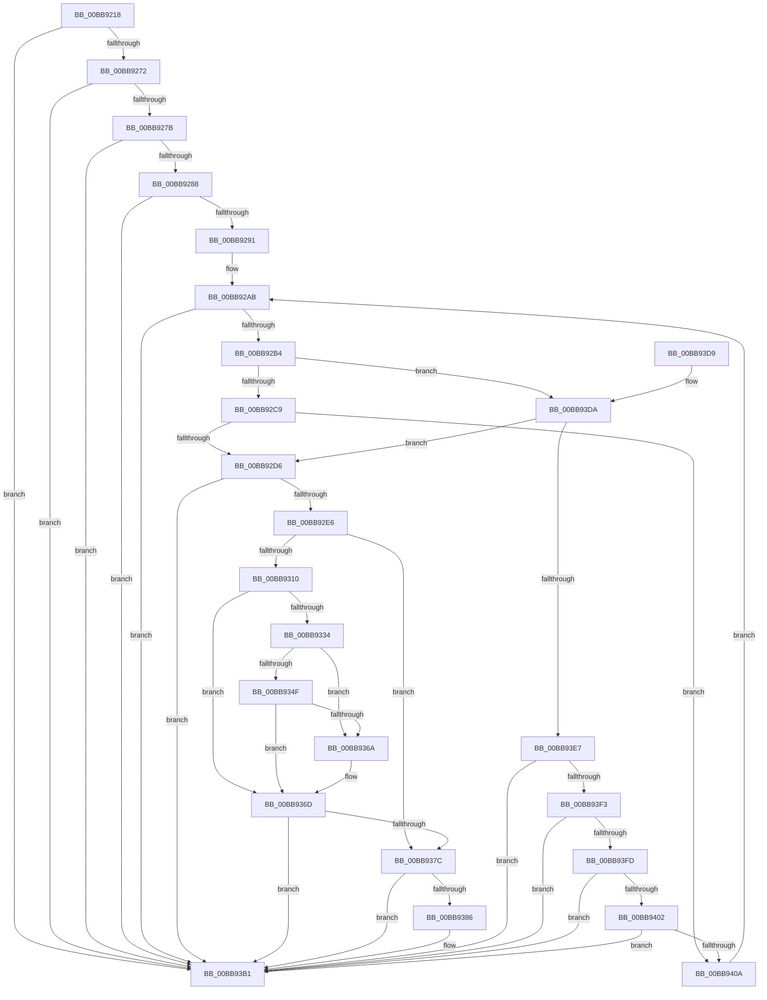

# VfCheckUserHandle

- RVA: `0x00BB9218`–`0x00BB9411` (길이 `505` bytes)
- VA: `0x0000000140BB9218`
- 실행 섹션: `PAGEVRFY`
- PDB 이름 있음: `예`; PDB Function 태그: `아니요`
- unwind 정보 RVA: `0x000BE180`
- 디코드: `121`개 명령, `505/505` bytes 표시
- 미해석 바이트: `0` (있으면 어셈블리에 `.byte`로 보존)

> 이 문서는 커널 이미지의 기계어와 PDB 기호를 분석해 생성했습니다. 4번과 5번은 함수 원형과 자료형을 바이너리 사용 방식에서 추정한 C 해석이며 원본 소스 복구 결과는 아닙니다.

## 1. Dependencies

- 직접 호출 지점: **12**; 고유 호출 대상: **11**
- 직접 호출자로 확인된 함수: **3**
- RIP 상대 이미지 참조: **9**

### Outgoing calls
- `0x00BB924D` → [memset](../../text/6C/memset_function_006C6C40.md) (function, `0x006C6C40`)
- `0x00BB92A0` → [RtlCaptureStackBackTrace](../../text/2F/RtlCaptureStackBackTrace_function_002F9FF0.md) (function, `0x002F9FF0`)
- `0x00BB92BC` → [VfDriverIsKernelImageAddress](VfDriverIsKernelImageAddress_function_00BB7EBC.md) (function, `0x00BB7EBC`)
- `0x00BB92D9` → [VfUtilIsLocalSystem](../B9/VfUtilIsLocalSystem_function_00B933F4.md) (function, `0x00B933F4`)
- `0x00BB9307` → [ObReferenceObjectByHandle](../../page/86/ObReferenceObjectByHandle_function_00868DB0.md) (function, `0x00868DB0`)
- `0x00BB932B` → [ObQueryTypeName](../../page/92/ObQueryTypeName_function_009204B8.md) (function, `0x009204B8`)
- `0x00BB9346` → [RtlEqualUnicodeString](../../page/93/RtlEqualUnicodeString_function_00932A20.md) (function, `0x00932A20`)
- `0x00BB9361` → [RtlEqualUnicodeString](../../page/93/RtlEqualUnicodeString_function_00932A20.md) (function, `0x00932A20`)
- `0x00BB9372` → [ObfDereferenceObject](../../text/2F/ObfDereferenceObject_function_002F9350.md) (function, `0x002F9350`)
- `0x00BB93AC` → [CarReportRuleViolationFromNt](../B9/CarReportRuleViolationFromNt_function_00B9D904.md) (function, `0x00B9D904`)
- `0x00BB93BC` → [_security_check_cookie](../../text/6A/_security_check_cookie_function_006AC640.md) (function, `0x006AC640`)
- `0x00BB93DA` → [VfTargetDriversIsEnabled](VfTargetDriversIsEnabled_function_00BB7F20.md) (function, `0x00BB7F20`)

### Direct callers
- [NtClose](../../page/86/NtClose_function_00868870.md) at `0x00868AC4`
- [ObpReferenceObjectByHandleWithTag](../../page/86/ObpReferenceObjectByHandleWithTag_function_00869650.md) at `0x00869D0F`
- [ObCloseHandle](../../page/8A/ObCloseHandle_function_008A1870.md) at `0x008A18B3`

### Static image references
- `0x00BB922D` → RVA `0x00E0A740` (`.data`; read)
- `0x00BB9262` → RVA `0x00FC6AB0` (`ALMOSTRO`; read)
- `0x00BB927B` → RVA `0x00FC6B70` (`ALMOSTRO`; read)
- `0x00BB92C9` → RVA `0x00F04ABC` (`.data`; read)
- `0x00BB9337` → RVA `0x00B8B150` (`ViDesktopTypeName`; read)
- `0x00BB9352` → RVA `0x00B8B140` (`ViWindowStationTypeName`; read)
- `0x00BB937C` → RVA `0x00FF4090` (`PAGEVRFD`; read)
- `0x00BB93E7` → RVA `0x00F04370` (`.data`; read)
- `0x00BB93F3` → RVA `0x00F04378` (`.data`; read)

## 2. Other-region calls and transfers

- 다른 실행 섹션으로 향하는 call: **8**
  - `0x00BB924D` → [memset](../../text/6C/memset_function_006C6C40.md) (`PAGEVRFY` → `.text`)
  - `0x00BB92A0` → [RtlCaptureStackBackTrace](../../text/2F/RtlCaptureStackBackTrace_function_002F9FF0.md) (`PAGEVRFY` → `.text`)
  - `0x00BB9307` → [ObReferenceObjectByHandle](../../page/86/ObReferenceObjectByHandle_function_00868DB0.md) (`PAGEVRFY` → `PAGE`)
  - `0x00BB932B` → [ObQueryTypeName](../../page/92/ObQueryTypeName_function_009204B8.md) (`PAGEVRFY` → `PAGE`)
  - `0x00BB9346` → [RtlEqualUnicodeString](../../page/93/RtlEqualUnicodeString_function_00932A20.md) (`PAGEVRFY` → `PAGE`)
  - `0x00BB9361` → [RtlEqualUnicodeString](../../page/93/RtlEqualUnicodeString_function_00932A20.md) (`PAGEVRFY` → `PAGE`)
  - `0x00BB9372` → [ObfDereferenceObject](../../text/2F/ObfDereferenceObject_function_002F9350.md) (`PAGEVRFY` → `.text`)
  - `0x00BB93BC` → [_security_check_cookie](../../text/6A/_security_check_cookie_function_006AC640.md) (`PAGEVRFY` → `.text`)
- 별도 외부 분기/꼬리 이동을 확인하지 못했습니다.

## 3. Assembly (complete function range)

```asm
00BB9218  48 89 5C 24 10                  mov qword ptr [rsp + 0x10], rbx
00BB921D  48 89 6C 24 18                  mov qword ptr [rsp + 0x18], rbp
00BB9222  56                              push rsi
00BB9223  57                              push rdi
00BB9224  41 56                           push r14
00BB9226  48 81 EC E0 00 00 00            sub rsp, 0xe0
00BB922D  48 8B 05 0C 15 25 00            mov rax, qword ptr [rip + 0x25150c]
00BB9234  48 33 C4                        xor rax, rsp
00BB9237  48 89 84 24 D0 00 00 00         mov qword ptr [rsp + 0xd0], rax
00BB923F  33 D2                           xor edx, edx
00BB9241  48 8B E9                        mov rbp, rcx
00BB9244  48 8D 4C 24 50                  lea rcx, [rsp + 0x50]
00BB9249  44 8D 42 40                     lea r8d, [rdx + 0x40]
00BB924D  E8 EE D9 B0 FF                  call 0x1406c6c40
00BB9252  65 48 8B 04 25 88 01 00 00      mov rax, qword ptr gs:[0x188]
00BB925B  48 8B B0 B8 00 00 00            mov rsi, qword ptr [rax + 0xb8]
00BB9262  48 8B 05 47 D8 40 00            mov rax, qword ptr [rip + 0x40d847]
00BB9269  48 85 C0                        test rax, rax
00BB926C  0F 84 3F 01 00 00               je 0x140bb93b1
00BB9272  48 3B F0                        cmp rsi, rax
00BB9275  0F 84 36 01 00 00               je 0x140bb93b1
00BB927B  48 3B 35 EE D8 40 00            cmp rsi, qword ptr [rip + 0x40d8ee]
00BB9282  0F 84 29 01 00 00               je 0x140bb93b1
00BB9288  48 85 ED                        test rbp, rbp
00BB928B  0F 84 20 01 00 00               je 0x140bb93b1
00BB9291  45 33 C9                        xor r9d, r9d
00BB9294  4C 8D 44 24 50                  lea r8, [rsp + 0x50]
00BB9299  41 8D 51 08                     lea edx, [r9 + 8]
00BB929D  8D 4A FA                        lea ecx, [rdx - 6]
00BB92A0  E8 4B 0D 74 FF                  call 0x1402f9ff0
00BB92A5  44 0F B7 F0                     movzx r14d, ax
00BB92A9  33 DB                           xor ebx, ebx
00BB92AB  41 3B DE                        cmp ebx, r14d
00BB92AE  0F 83 FD 00 00 00               jae 0x140bb93b1
00BB92B4  48 8B 7C DC 50                  mov rdi, qword ptr [rsp + rbx*8 + 0x50]
00BB92B9  48 8B CF                        mov rcx, rdi
00BB92BC  E8 FB EB FF FF                  call 0x140bb7ebc
00BB92C1  85 C0                           test eax, eax
00BB92C3  0F 84 11 01 00 00               je 0x140bb93da
00BB92C9  83 3D EC B7 34 00 00            cmp dword ptr [rip + 0x34b7ec], 0
00BB92D0  0F 84 34 01 00 00               je 0x140bb940a
00BB92D6  48 8B CE                        mov rcx, rsi
00BB92D9  E8 16 A1 FD FF                  call 0x140b933f4
00BB92DE  85 C0                           test eax, eax
00BB92E0  0F 85 CB 00 00 00               jne 0x140bb93b1
00BB92E6  48 83 64 24 28 00               and qword ptr [rsp + 0x28], 0
00BB92EC  48 8D 44 24 40                  lea rax, [rsp + 0x40]
00BB92F1  48 83 64 24 40 00               and qword ptr [rsp + 0x40], 0
00BB92F7  41 B1 01                        mov r9b, 1
00BB92FA  45 33 C0                        xor r8d, r8d
00BB92FD  48 89 44 24 20                  mov qword ptr [rsp + 0x20], rax
00BB9302  33 D2                           xor edx, edx
00BB9304  48 8B CD                        mov rcx, rbp
00BB9307  E8 A4 FA CA FF                  call 0x140868db0
00BB930C  85 C0                           test eax, eax
00BB930E  78 6C                           js 0x140bb937c
00BB9310  48 8B 4C 24 40                  mov rcx, qword ptr [rsp + 0x40]
00BB9315  4C 8D 4C 24 48                  lea r9, [rsp + 0x48]
00BB931A  41 B8 40 00 00 00               mov r8d, 0x40
00BB9320  48 8D 94 24 90 00 00 00         lea rdx, [rsp + 0x90]
00BB9328  40 32 FF                        xor dil, dil
00BB932B  E8 88 71 D6 FF                  call 0x1409204b8
00BB9330  85 C0                           test eax, eax
00BB9332  78 39                           js 0x140bb936d
00BB9334  45 33 C0                        xor r8d, r8d
00BB9337  48 8D 15 12 1E FD FF            lea rdx, [rip - 0x2e1ee]
00BB933E  48 8D 8C 24 90 00 00 00         lea rcx, [rsp + 0x90]
00BB9346  E8 D5 96 D7 FF                  call 0x140932a20
00BB934B  84 C0                           test al, al
00BB934D  75 1B                           jne 0x140bb936a
00BB934F  45 33 C0                        xor r8d, r8d
00BB9352  48 8D 15 E7 1D FD FF            lea rdx, [rip - 0x2e219]
00BB9359  48 8D 8C 24 90 00 00 00         lea rcx, [rsp + 0x90]
00BB9361  E8 BA 96 D7 FF                  call 0x140932a20
00BB9366  84 C0                           test al, al
00BB9368  74 03                           je 0x140bb936d
00BB936A  40 B7 01                        mov dil, 1
00BB936D  48 8B 4C 24 40                  mov rcx, qword ptr [rsp + 0x40]
00BB9372  E8 D9 FF 73 FF                  call 0x1402f9350
00BB9377  40 84 FF                        test dil, dil
00BB937A  75 35                           jne 0x140bb93b1
00BB937C  8B 05 0E AD 43 00               mov eax, dword ptr [rip + 0x43ad0e]
00BB9382  85 C0                           test eax, eax
00BB9384  74 2B                           je 0x140bb93b1
00BB9386  48 83 64 24 30 00               and qword ptr [rsp + 0x30], 0
00BB938C  BA F6 00 00 00                  mov edx, 0xf6
00BB9391  48 8B 44 DC 50                  mov rax, qword ptr [rsp + rbx*8 + 0x50]
00BB9396  4C 8B CE                        mov r9, rsi
00BB9399  C7 44 24 28 08 00 00 00         mov dword ptr [rsp + 0x28], 8
00BB93A1  4C 8B C5                        mov r8, rbp
00BB93A4  48 89 44 24 20                  mov qword ptr [rsp + 0x20], rax
00BB93A9  8D 4A CE                        lea ecx, [rdx - 0x32]
00BB93AC  E8 53 45 FE FF                  call 0x140b9d904
00BB93B1  48 8B 8C 24 D0 00 00 00         mov rcx, qword ptr [rsp + 0xd0]
00BB93B9  48 33 CC                        xor rcx, rsp
00BB93BC  E8 7F 32 AF FF                  call 0x1406ac640
00BB93C1  4C 8D 9C 24 E0 00 00 00         lea r11, [rsp + 0xe0]
00BB93C9  49 8B 5B 28                     mov rbx, qword ptr [r11 + 0x28]
00BB93CD  49 8B 6B 30                     mov rbp, qword ptr [r11 + 0x30]
00BB93D1  49 8B E3                        mov rsp, r11
00BB93D4  41 5E                           pop r14
00BB93D6  5F                              pop rdi
00BB93D7  5E                              pop rsi
00BB93D8  C3                              ret
00BB93D9  CC                              int3
00BB93DA  E8 41 EB FF FF                  call 0x140bb7f20
00BB93DF  85 C0                           test eax, eax
00BB93E1  0F 85 EF FE FF FF               jne 0x140bb92d6
00BB93E7  48 8B 0D 82 AF 34 00            mov rcx, qword ptr [rip + 0x34af82]
00BB93EE  48 85 C9                        test rcx, rcx
00BB93F1  74 BE                           je 0x140bb93b1
00BB93F3  8B 05 7F AF 34 00               mov eax, dword ptr [rip + 0x34af7f]
00BB93F9  85 C0                           test eax, eax
00BB93FB  74 B4                           je 0x140bb93b1
00BB93FD  48 3B F9                        cmp rdi, rcx
00BB9400  72 AF                           jb 0x140bb93b1
00BB9402  48 03 C1                        add rax, rcx
00BB9405  48 3B F8                        cmp rdi, rax
00BB9408  73 A7                           jae 0x140bb93b1
00BB940A  FF C3                           inc ebx
00BB940C  E9 9A FE FF FF                  jmp 0x140bb92ab
```

## 4. C-style interpretation (structured pseudocode)

```c
__int64 __fastcall VfCheckUserHandle(__int64 a1, int a2, __int64 a3, int a4)
{
    __int64 result;
    __int64 v_rbx;
    __int64 v_rdi;
    __int64 v_rsp;
    unsigned __int64 v_stack_m18;
    unsigned __int64 v_stack_m28;
    unsigned __int64 v_stack_m68;
    unsigned __int64 v_stack_mA8;
    unsigned __int64 v_stack_mB0;
    unsigned __int64 v_stack_mB8;
    unsigned __int64 v_stack_mC8;
    unsigned __int64 v_stack_mD0;
    unsigned __int64 v_stack_mD8;
    unsigned __int64 v_stack_p10;
    unsigned __int64 v_stack_p18;

    v_stack_p10 = v_rbx;
    v_stack_p18 = v_rbp;
    v_rsp = (v_rsp) - (224);
    result = (*(unsigned __int64 *)(v_rip + 2430220)) ^ (v_rsp);
    v_stack_m28 = result;
    a2 = 0;
    result = memset(v_stack_mA8, a2, a2 + 64, a4);
    if (*(unsigned __int64 *)(v_rip + 4249671) == 0) goto loc_00BB93B1;
    if ((*(unsigned __int64 *)(*(unsigned __int64 *)(gs_base + (0 + 392)) + 184)) == (*(unsigned __int64 *)(v_rip + 4249671))) goto loc_00BB93B1;
    if ((*(unsigned __int64 *)(*(unsigned __int64 *)(gs_base + (0 + 392)) + 184)) == (*(unsigned __int64 *)(v_rip + 4249838))) goto loc_00BB93B1;
    if (a1 == 0) goto loc_00BB93B1;
    a4 = 0;
    result = RtlCaptureStackBackTrace(a4 + 8 - 6, a4 + 8, v_stack_mA8, a4);
    v_rbx = 0;
loc_00BB92AB:
    if (0 >= ((unsigned int)((unsigned __int16)(result)))) goto loc_00BB93B1;
    result = VfDriverIsKernelImageAddress(*(unsigned __int64 *)(v_rsp + v_rbx * 8 + 80), a4 + 8, v_stack_mA8, a4);
    if ((unsigned int)(result) == 0) goto loc_00BB93DA;
    if ((*(unsigned int *)(v_rip + 3454956)) == 0) goto loc_00BB940A;
loc_00BB92D6:
    result = VfUtilIsLocalSystem(*(unsigned __int64 *)(*(unsigned __int64 *)(gs_base + (0 + 392)) + 184), a4 + 8, v_stack_mA8, a4);
    if ((unsigned int)(result) != 0) goto loc_00BB93B1;
    a3 = 0;
    v_stack_mD8 = v_stack_mB8;
    a2 = 0;
    result = ObReferenceObjectByHandle(a1, a2, a3, 1);
    if (sign_flag) goto loc_00BB937C;
    v_rdi = 0;
    result = ObQueryTypeName(v_stack_mB8, v_stack_m68, 64, v_stack_mB0);
    if (sign_flag) goto loc_00BB936D;
    a3 = 0;
    result = RtlEqualUnicodeString(v_stack_m68, v_rip - 188910, a3, v_stack_mB0);
    if ((unsigned __int8)(result) != 0) goto loc_00BB936A;
    a3 = 0;
    result = RtlEqualUnicodeString(v_stack_m68, v_rip - 188953, a3, v_stack_mB0);
    if ((unsigned __int8)(result) != 0) {
        v_rdi = 1;
    }
    result = ObfDereferenceObject(v_stack_mB8, v_rip - 188953, a3, v_stack_mB0);
    if ((unsigned __int8)(v_rdi) != 0) goto loc_00BB93B1;
loc_00BB937C:
    result = (unsigned int)(*(unsigned int *)(v_rip + 4435214));
    if ((unsigned int)((unsigned int)(*(unsigned int *)(v_rip + 4435214))) != 0) {
        a2 = 246;
        result = *(unsigned __int64 *)(v_rsp + v_rbx * 8 + 80);
        a4 = *(unsigned __int64 *)(*(unsigned __int64 *)(gs_base + (0 + 392)) + 184);
        v_stack_mD0 = 8;
        a3 = a1;
        v_stack_mD8 = result;
        a1 = a2 - 50;
        result = CarReportRuleViolationFromNt(a1, a2, a3, a4);
    }
    a1 = (v_stack_m28) ^ (v_rsp);
    result = _security_check_cookie(a1, a2, a3, a4);
    return result;
loc_00BB93DA:
    result = VfTargetDriversIsEnabled(a1, a2, a3, a4);
    if ((unsigned int)(result) != 0) goto loc_00BB92D6;
    if (*(unsigned __int64 *)(v_rip + 3452802) == 0) goto loc_00BB93B1;
    if ((unsigned int)((unsigned int)(*(unsigned int *)(v_rip + 3452799))) == 0) goto loc_00BB93B1;
    if (v_rdi < (*(unsigned __int64 *)(v_rip + 3452802))) goto loc_00BB93B1;
    result = ((unsigned int)(*(unsigned int *)(v_rip + 3452799))) + (*(unsigned __int64 *)(v_rip + 3452802));
    if (v_rdi >= result) goto loc_00BB93B1;
loc_00BB940A:
    v_rbx = (unsigned int)((*(unsigned __int64 *)(v_stack_m18 + 40)) + 1);
    goto loc_00BB92AB;
}
```

## 5. (Beta) C Style

```c
int64_t VfCheckUserHandle(int64_t Arg1, int32_t Arg2, int64_t Arg3, int32_t Arg4)
{
    int64_t result;
    int64_t local_rbx;
    int64_t local_rdi;
    int64_t local_rsp;
    uint64_t v_stack_m18;
    uint64_t v_stack_m28;
    uint64_t v_stack_m68;
    uint64_t v_stack_mA8;
    uint64_t v_stack_mB0;
    uint64_t v_stack_mB8;
    uint64_t v_stack_mC8;
    uint64_t v_stack_mD0;
    uint64_t v_stack_mD8;
    uint64_t v_stack_p10;
    uint64_t v_stack_p18;

    v_stack_p10 = local_rbx;
    v_stack_p18 = local_rbp;
    local_rsp = (local_rsp) - (224);
    result = (*(uint64_t *)(v_rip + 0x25150C)) ^ (local_rsp);
    v_stack_m28 = result;
    Arg2 = 0;
    result = memset(v_stack_mA8, Arg2, Arg2 + 64, Arg4);
    if (*(uint64_t *)(v_rip + 0x40D847) == 0) goto loc_00BB93B1;
    if ((*(uint64_t *)(*(uint64_t *)(gs_base + (0 + 0x188)) + 0xB8)) == (*(uint64_t *)(v_rip + 0x40D847))) goto loc_00BB93B1;
    if ((*(uint64_t *)(*(uint64_t *)(gs_base + (0 + 0x188)) + 0xB8)) == (*(uint64_t *)(v_rip + 0x40D8EE))) goto loc_00BB93B1;
    if (Arg1 == 0) goto loc_00BB93B1;
    Arg4 = 0;
    result = RtlCaptureStackBackTrace(Arg4 + 8 - 6, Arg4 + 8, v_stack_mA8, Arg4);
    local_rbx = 0;
loc_00BB92AB:
    if (0 >= ((uint32_t)((uint16_t)(result)))) goto loc_00BB93B1;
    result = VfDriverIsKernelImageAddress(*(uint64_t *)(local_rsp + local_rbx * 8 + 0x50), Arg4 + 8, v_stack_mA8, Arg4);
    if ((uint32_t)(result) == 0) goto loc_00BB93DA;
    if ((*(uint32_t *)(v_rip + 0x34B7EC)) == 0) goto loc_00BB940A;
loc_00BB92D6:
    result = VfUtilIsLocalSystem(*(uint64_t *)(*(uint64_t *)(gs_base + (0 + 0x188)) + 0xB8), Arg4 + 8, v_stack_mA8, Arg4);
    if ((uint32_t)(result) != 0) goto loc_00BB93B1;
    Arg3 = 0;
    v_stack_mD8 = v_stack_mB8;
    Arg2 = 0;
    result = ObReferenceObjectByHandle(Arg1, Arg2, Arg3, 1);
    if (sign_flag) goto loc_00BB937C;
    local_rdi = 0;
    result = ObQueryTypeName(v_stack_mB8, v_stack_m68, 64, v_stack_mB0);
    if (sign_flag) goto loc_00BB936D;
    Arg3 = 0;
    result = RtlEqualUnicodeString(v_stack_m68, v_rip - 188910, Arg3, v_stack_mB0);
    if ((uint8_t)(result) != 0) goto loc_00BB936A;
    Arg3 = 0;
    result = RtlEqualUnicodeString(v_stack_m68, v_rip - 188953, Arg3, v_stack_mB0);
    if ((uint8_t)(result) != 0) {
        local_rdi = 1;
    }
    result = ObfDereferenceObject(v_stack_mB8, v_rip - 188953, Arg3, v_stack_mB0);
    if ((uint8_t)(local_rdi) != 0) goto loc_00BB93B1;
loc_00BB937C:
    result = (uint32_t)(*(uint32_t *)(v_rip + 0x43AD0E));
    if ((uint32_t)((uint32_t)(*(uint32_t *)(v_rip + 0x43AD0E))) != 0) {
        Arg2 = 246;
        result = *(uint64_t *)(local_rsp + local_rbx * 8 + 0x50);
        Arg4 = *(uint64_t *)(*(uint64_t *)(gs_base + (0 + 0x188)) + 0xB8);
        v_stack_mD0 = 8;
        Arg3 = Arg1;
        v_stack_mD8 = result;
        Arg1 = Arg2 - 50;
        result = CarReportRuleViolationFromNt(Arg1, Arg2, Arg3, Arg4);
    }
    Arg1 = (v_stack_m28) ^ (local_rsp);
    result = _security_check_cookie(Arg1, Arg2, Arg3, Arg4);
    return result;
loc_00BB93DA:
    result = VfTargetDriversIsEnabled(Arg1, Arg2, Arg3, Arg4);
    if ((uint32_t)(result) != 0) goto loc_00BB92D6;
    if (*(uint64_t *)(v_rip + 0x34AF82) == 0) goto loc_00BB93B1;
    if ((uint32_t)((uint32_t)(*(uint32_t *)(v_rip + 0x34AF7F))) == 0) goto loc_00BB93B1;
    if (local_rdi < (*(uint64_t *)(v_rip + 0x34AF82))) goto loc_00BB93B1;
    result = ((uint32_t)(*(uint32_t *)(v_rip + 0x34AF7F))) + (*(uint64_t *)(v_rip + 0x34AF82));
    if (local_rdi >= result) goto loc_00BB93B1;
loc_00BB940A:
    local_rbx = (uint32_t)((*(uint64_t *)(v_stack_m18 + 0x28)) + 1);
    goto loc_00BB92AB;
}
```

## 6. Execution-region graph

[열기: 2D/3D 그래프와 함수 탐색 컨트롤 패널](../../../control-panel.html?section=pagevrfy&rva=0x00BB9218&view=graph)

- 2D 그래프는 위에서 아래로 흐르고, 3D 그래프는 빈 공간을 드래그해 회전합니다. Shift+드래그는 이동, 휠은 확대·축소, 함수 노드 선택은 대상 보고서 이동입니다.

### Static fallback


