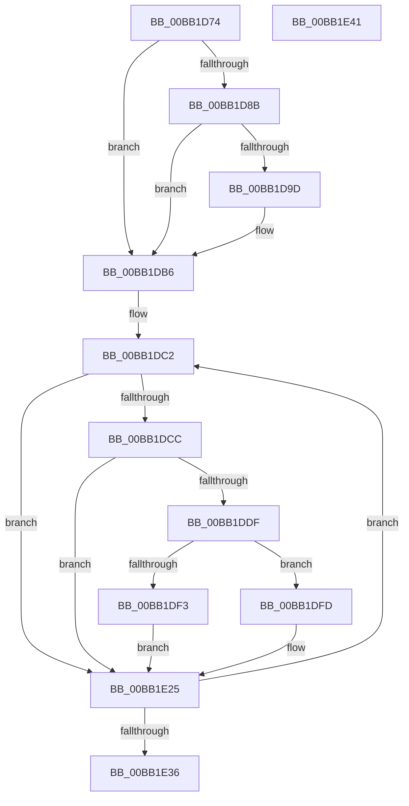

# VfCtxInit

- RVA: `0x00BB1D74`–`0x00BB1E42` (길이 `206` bytes)
- VA: `0x0000000140BB1D74`
- 실행 섹션: `PAGEVRFY`
- PDB 이름 있음: `예`; PDB Function 태그: `아니요`
- unwind 정보 RVA: `0x0005CAAC`
- 디코드: `48`개 명령, `206/206` bytes 표시
- 미해석 바이트: `0` (있으면 어셈블리에 `.byte`로 보존)

> 이 문서는 커널 이미지의 기계어와 PDB 기호를 분석해 생성했습니다. 4번과 5번은 함수 원형과 자료형을 바이너리 사용 방식에서 추정한 C 해석이며 원본 소스 복구 결과는 아닙니다.

## 1. Dependencies

- 직접 호출 지점: **5**; 고유 호출 대상: **3**
- 직접 호출자로 확인된 함수: **1**
- RIP 상대 이미지 참조: **7**

### Outgoing calls
- `0x00BB1DD6` → [KeAllocateXStateContext](../../text/3D/KeAllocateXStateContext_function_003D9D60.md) (function, `0x003D9D60`)
- `0x00BB1DEA` → [KeAllocateXStateContext](../../text/3D/KeAllocateXStateContext_function_003D9D60.md) (function, `0x003D9D60`)
- `0x00BB1DF6` → [KeFreeXStateContext](../../text/3D/KeFreeXStateContext_function_003D6324.md) (function, `0x003D6324`)
- `0x00BB1E0A` → [memset](../../text/6C/memset_function_006C6C40.md) (function, `0x006C6C40`)
- `0x00BB1E1C` → [memset](../../text/6C/memset_function_006C6C40.md) (function, `0x006C6C40`)

### Direct callers
- [VfMiscPluginEntry](../BA/VfMiscPluginEntry_function_00BAE660.md) at `0x00BAF2F5`

### Static image references
- `0x00BB1D7E` → RVA `0x00FC6B30` (`ALMOSTRO`; read)
- `0x00BB1D9D` → RVA `0x00FFDB50` (`PAGEVRFD`; write)
- `0x00BB1DB0` → RVA `0x00FFDA90` (`PAGEVRFD`; write)
- `0x00BB1DB6` → RVA `0x01000760` (`PAGEVRFD`; read)
- `0x00BB1DC2` → RVA `0x00FFDB50` (`PAGEVRFD`; read)
- `0x00BB1DCC` → RVA `0x00FFDA90` (`PAGEVRFD`; read)
- `0x00BB1E25` → RVA `0x00FFDA94` (`PAGEVRFD`; read/write)

## 2. Other-region calls and transfers

- 다른 실행 섹션으로 향하는 call: **5**
  - `0x00BB1DD6` → [KeAllocateXStateContext](../../text/3D/KeAllocateXStateContext_function_003D9D60.md) (`PAGEVRFY` → `.text`)
  - `0x00BB1DEA` → [KeAllocateXStateContext](../../text/3D/KeAllocateXStateContext_function_003D9D60.md) (`PAGEVRFY` → `.text`)
  - `0x00BB1DF6` → [KeFreeXStateContext](../../text/3D/KeFreeXStateContext_function_003D6324.md) (`PAGEVRFY` → `.text`)
  - `0x00BB1E0A` → [memset](../../text/6C/memset_function_006C6C40.md) (`PAGEVRFY` → `.text`)
  - `0x00BB1E1C` → [memset](../../text/6C/memset_function_006C6C40.md) (`PAGEVRFY` → `.text`)
- 별도 외부 분기/꼬리 이동을 확인하지 못했습니다.

## 3. Assembly (complete function range)

```asm
00BB1D74  48 89 5C 24 08                  mov qword ptr [rsp + 8], rbx
00BB1D79  57                              push rdi
00BB1D7A  48 83 EC 20                     sub rsp, 0x20
00BB1D7E  48 F7 05 A7 4D 41 00 00 00 80 00  test qword ptr [rip + 0x414da7], 0x800000
00BB1D89  74 2B                           je 0x140bb1db6
00BB1D8B  48 B8 D8 03 00 00 80 F7 FF FF   movabs rax, 0xfffff780000003d8
00BB1D95  48 8B 00                        mov rax, qword ptr [rax]
00BB1D98  48 85 C0                        test rax, rax
00BB1D9B  74 19                           je 0x140bb1db6
00BB1D9D  48 89 05 AC BD 44 00            mov qword ptr [rip + 0x44bdac], rax
00BB1DA4  48 B8 E8 03 00 00 80 F7 FF FF   movabs rax, 0xfffff780000003e8
00BB1DAE  8B 00                           mov eax, dword ptr [rax]
00BB1DB0  89 05 DA BC 44 00               mov dword ptr [rip + 0x44bcda], eax
00BB1DB6  48 8D 1D A3 E9 44 00            lea rbx, [rip + 0x44e9a3]
00BB1DBD  BF 10 00 00 00                  mov edi, 0x10
00BB1DC2  48 83 3D 86 BD 44 00 00         cmp qword ptr [rip + 0x44bd86], 0
00BB1DCA  74 59                           je 0x140bb1e25
00BB1DCC  44 8B 05 BD BC 44 00            mov r8d, dword ptr [rip + 0x44bcbd]
00BB1DD3  48 8B CB                        mov rcx, rbx
00BB1DD6  E8 85 7F 82 FF                  call 0x1403d9d60
00BB1DDB  85 C0                           test eax, eax
00BB1DDD  78 46                           js 0x140bb1e25
00BB1DDF  44 8B 05 AA BC 44 00            mov r8d, dword ptr [rip + 0x44bcaa]
00BB1DE6  48 8D 4B 20                     lea rcx, [rbx + 0x20]
00BB1DEA  E8 71 7F 82 FF                  call 0x1403d9d60
00BB1DEF  85 C0                           test eax, eax
00BB1DF1  79 0A                           jns 0x140bb1dfd
00BB1DF3  48 8B CB                        mov rcx, rbx
00BB1DF6  E8 29 45 82 FF                  call 0x1403d6324
00BB1DFB  EB 28                           jmp 0x140bb1e25
00BB1DFD  44 8B 05 8C BC 44 00            mov r8d, dword ptr [rip + 0x44bc8c]
00BB1E04  33 D2                           xor edx, edx
00BB1E06  48 8B 4B 10                     mov rcx, qword ptr [rbx + 0x10]
00BB1E0A  E8 31 4E B1 FF                  call 0x1406c6c40
00BB1E0F  44 8B 05 7A BC 44 00            mov r8d, dword ptr [rip + 0x44bc7a]
00BB1E16  33 D2                           xor edx, edx
00BB1E18  48 8B 4B 30                     mov rcx, qword ptr [rbx + 0x30]
00BB1E1C  E8 1F 4E B1 FF                  call 0x1406c6c40
00BB1E21  83 4B F4 01                     or dword ptr [rbx - 0xc], 1
00BB1E25  F0 FF 05 68 BC 44 00            lock inc dword ptr [rip + 0x44bc68]
00BB1E2C  48 83 C3 50                     add rbx, 0x50
00BB1E30  48 83 EF 01                     sub rdi, 1
00BB1E34  75 8C                           jne 0x140bb1dc2
00BB1E36  48 8B 5C 24 30                  mov rbx, qword ptr [rsp + 0x30]
00BB1E3B  48 83 C4 20                     add rsp, 0x20
00BB1E3F  5F                              pop rdi
00BB1E40  C3                              ret
00BB1E41  CC                              int3
```

## 4. C-style interpretation (structured pseudocode)

```c
__int64 __fastcall VfCtxInit(__int64 a1, int a2)
{
    __int64 result;
    __int64 v_rbx;
    __int64 v_rdi;
    __int64 v_rsp;
    unsigned __int64 v_stack_p8;

    v_stack_p8 = v_rbx;
    v_rsp = (v_rsp) - (32);
    if (((*(unsigned __int64 *)(v_rip + 4279719)) & (0x800000ULL)) == 0) goto loc_00BB1DB6;
    result = *(unsigned __int64 *)(result);
    if (*(unsigned __int64 *)(result) != 0) {
        *(unsigned __int64 *)(v_rip + 4505004) = *(unsigned __int64 *)(result);
        result = *(unsigned int *)(*(unsigned __int64 *)(result));
        *(unsigned int *)(v_rip + 4504794) = (unsigned int)(result);
    }
loc_00BB1DC2:
    if ((*(unsigned __int64 *)(v_rip + 4504966)) == 0) goto loc_00BB1E25;
    result = KeAllocateXStateContext(v_rip + 4516259, a2, (unsigned int)(*(unsigned int *)(v_rip + 4504765)), a4);
    if (sign_flag) goto loc_00BB1E25;
    result = KeAllocateXStateContext(v_rip + 4516259 + 32, a2, (unsigned int)(*(unsigned int *)(v_rip + 4504746)), a4);
    if (!sign_flag) goto loc_00BB1DFD;
    result = KeFreeXStateContext(v_rip + 4516259, a2, (unsigned int)(*(unsigned int *)(v_rip + 4504746)), a4);
    goto loc_00BB1E25;
loc_00BB1DFD:
    a2 = 0;
    result = memset(*(unsigned __int64 *)(v_rip + 4516259 + 16), a2, (unsigned int)(*(unsigned int *)(v_rip + 4504716)), a4);
    a2 = 0;
    result = memset(*(unsigned __int64 *)(v_rip + 4516259 + 48), a2, (unsigned int)(*(unsigned int *)(v_rip + 4504698)), a4);
loc_00BB1E25:
    v_rbx = (v_rip + 4516259) + (80);
    v_rdi = (16) - (1);
    if (condition_is_not_equal) goto loc_00BB1DC2;
    v_rsp = (v_rsp) + (32);
    return result;
}
```

## 5. (Beta) C Style

```c
int64_t VfCtxInit(int64_t Arg1, int32_t Arg2)
{
    int64_t result;
    int64_t local_rbx;
    int64_t local_rdi;
    int64_t local_rsp;
    uint64_t v_stack_p8;

    v_stack_p8 = local_rbx;
    local_rsp = (local_rsp) - (32);
    if (((*(uint64_t *)(v_rip + 0x414DA7)) & (0x800000ULL)) == 0) goto loc_00BB1DB6;
    result = *(uint64_t *)(result);
    if (*(uint64_t *)(result) != 0) {
        *(uint64_t *)(v_rip + 0x44BDAC) = *(uint64_t *)(result);
        result = *(uint32_t *)(*(uint64_t *)(result));
        *(uint32_t *)(v_rip + 0x44BCDA) = (uint32_t)(result);
    }
loc_00BB1DC2:
    if ((*(uint64_t *)(v_rip + 0x44BD86)) == 0) goto loc_00BB1E25;
    result = KeAllocateXStateContext(v_rip + 4516259, Arg2, (uint32_t)(*(uint32_t *)(v_rip + 0x44BCBD)), a4);
    if (sign_flag) goto loc_00BB1E25;
    result = KeAllocateXStateContext(v_rip + 4516259 + 32, Arg2, (uint32_t)(*(uint32_t *)(v_rip + 0x44BCAA)), a4);
    if (!sign_flag) goto loc_00BB1DFD;
    result = KeFreeXStateContext(v_rip + 4516259, Arg2, (uint32_t)(*(uint32_t *)(v_rip + 0x44BCAA)), a4);
    goto loc_00BB1E25;
loc_00BB1DFD:
    Arg2 = 0;
    result = memset(*(uint64_t *)(v_rip + 0x44E9A3 + 0x10), Arg2, (uint32_t)(*(uint32_t *)(v_rip + 0x44BC8C)), a4);
    Arg2 = 0;
    result = memset(*(uint64_t *)(v_rip + 0x44E9A3 + 0x30), Arg2, (uint32_t)(*(uint32_t *)(v_rip + 0x44BC7A)), a4);
loc_00BB1E25:
    local_rbx = (v_rip + 4516259) + (80);
    local_rdi = (16) - (1);
    if (condition_is_not_equal) goto loc_00BB1DC2;
    local_rsp = (local_rsp) + (32);
    return result;
}
```

## 6. Execution-region graph

[열기: 2D/3D 그래프와 함수 탐색 컨트롤 패널](../../../control-panel.html?section=pagevrfy&rva=0x00BB1D74&view=graph)

- 2D 그래프는 위에서 아래로 흐르고, 3D 그래프는 빈 공간을 드래그해 회전합니다. Shift+드래그는 이동, 휠은 확대·축소, 함수 노드 선택은 대상 보고서 이동입니다.

### Static fallback


