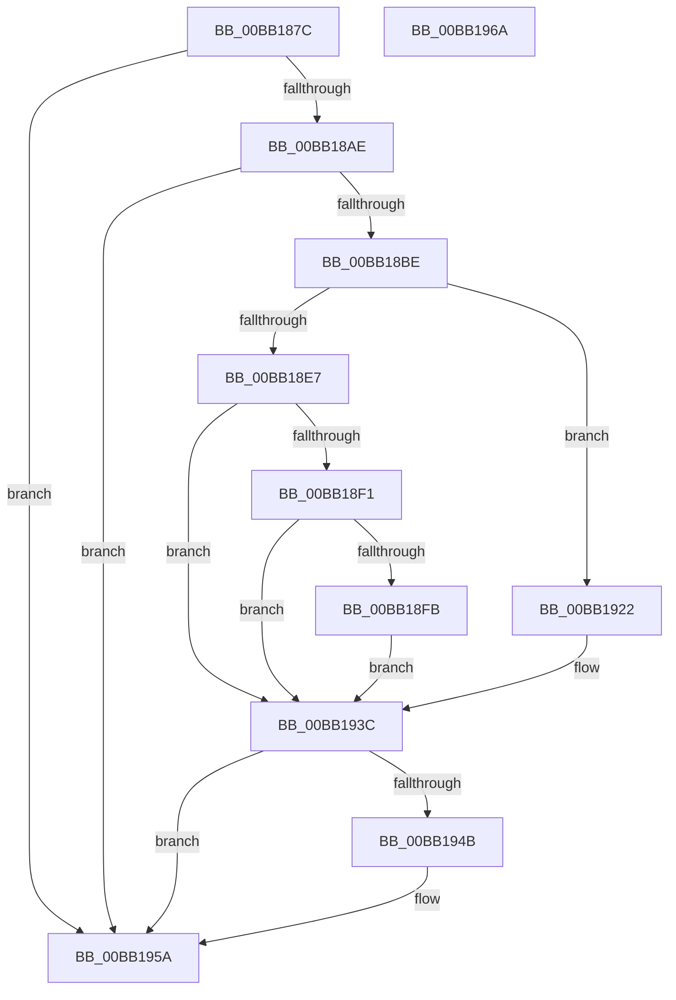

# VfDeleteResource

- RVA: `0x00BB187C`–`0x00BB196B` (길이 `239` bytes)
- VA: `0x0000000140BB187C`
- 실행 섹션: `PAGEVRFY`
- PDB 이름 있음: `예`; PDB Function 태그: `아니요`
- unwind 정보 RVA: `0x0007AFEC`
- 디코드: `62`개 명령, `239/239` bytes 표시
- 미해석 바이트: `0` (있으면 어셈블리에 `.byte`로 보존)

> 이 문서는 커널 이미지의 기계어와 PDB 기호를 분석해 생성했습니다. 4번과 5번은 함수 원형과 자료형을 바이너리 사용 방식에서 추정한 C 해석이며 원본 소스 복구 결과는 아닙니다.

## 1. Dependencies

- 직접 호출 지점: **6**; 고유 호출 대상: **6**
- 직접 호출자로 확인된 함수: **1**
- RIP 상대 이미지 참조: **5**

### Outgoing calls
- `0x00BB18C6` → [VfAvlInitializeLockContext](../../text/4A/VfAvlInitializeLockContext_function_004A686C.md) (function, `0x004A686C`)
- `0x00BB18DD` → [VfAvlLookupTreeNode](../../text/3E/VfAvlLookupTreeNode_function_003EF1B4.md) (function, `0x003EF1B4`)
- `0x00BB191B` → [CarReportRuleViolationFromNt](../B9/CarReportRuleViolationFromNt_function_00B9D904.md) (function, `0x00B9D904`)
- `0x00BB1934` → [VfAvlDeleteTreeNode](../../text/3E/VfAvlDeleteTreeNode_function_003EE240.md) (function, `0x003EE240`)
- `0x00BB1941` → [VfAvlCleanupLockContext](../../text/3E/VfAvlCleanupLockContext_function_003EF56C.md) (function, `0x003EF56C`)
- `0x00BB1955` → [VfAvlFreeNodeNoLock](../../text/61/VfAvlFreeNodeNoLock_function_006126D8.md) (function, `0x006126D8`)

### Direct callers
- [VfMiscExDeleteResourceLite_Entry](../BA/VfMiscExDeleteResourceLite_Entry_function_00BAD840.md) at `0x00BAD84B`

### Static image references
- `0x00BB189D` → RVA `0x00FFDA80` (`PAGEVRFD`; read)
- `0x00BB18AE` → RVA `0x00FFDBC8` (`PAGEVRFD`; read)
- `0x00BB18D6` → RVA `0x00FFDBC0` (`PAGEVRFD`; read)
- `0x00BB18E7` → RVA `0x00FFDAAC` (`PAGEVRFD`; read)
- `0x00BB18F1` → RVA `0x00FFDA9C` (`PAGEVRFD`; read)

## 2. Other-region calls and transfers

- 다른 실행 섹션으로 향하는 call: **5**
  - `0x00BB18C6` → [VfAvlInitializeLockContext](../../text/4A/VfAvlInitializeLockContext_function_004A686C.md) (`PAGEVRFY` → `.text`)
  - `0x00BB18DD` → [VfAvlLookupTreeNode](../../text/3E/VfAvlLookupTreeNode_function_003EF1B4.md) (`PAGEVRFY` → `.text`)
  - `0x00BB1934` → [VfAvlDeleteTreeNode](../../text/3E/VfAvlDeleteTreeNode_function_003EE240.md) (`PAGEVRFY` → `.text`)
  - `0x00BB1941` → [VfAvlCleanupLockContext](../../text/3E/VfAvlCleanupLockContext_function_003EF56C.md) (`PAGEVRFY` → `.text`)
  - `0x00BB1955` → [VfAvlFreeNodeNoLock](../../text/61/VfAvlFreeNodeNoLock_function_006126D8.md) (`PAGEVRFY` → `.text`)
- 별도 외부 분기/꼬리 이동을 확인하지 못했습니다.

## 3. Assembly (complete function range)

```asm
00BB187C  4C 8B DC                        mov r11, rsp
00BB187F  49 89 5B 08                     mov qword ptr [r11 + 8], rbx
00BB1883  49 89 73 10                     mov qword ptr [r11 + 0x10], rsi
00BB1887  57                              push rdi
00BB1888  48 83 EC 60                     sub rsp, 0x60
00BB188C  33 C0                           xor eax, eax
00BB188E  0F 57 C0                        xorps xmm0, xmm0
00BB1891  0F 11 44 24 40                  movups xmmword ptr [rsp + 0x40], xmm0
00BB1896  49 89 43 E8                     mov qword ptr [r11 - 0x18], rax
00BB189A  48 8B F2                        mov rsi, rdx
00BB189D  8B 05 DD C1 44 00               mov eax, dword ptr [rip + 0x44c1dd]
00BB18A3  48 8B F9                        mov rdi, rcx
00BB18A6  85 C0                           test eax, eax
00BB18A8  0F 84 AC 00 00 00               je 0x140bb195a
00BB18AE  48 8B 05 13 C3 44 00            mov rax, qword ptr [rip + 0x44c313]
00BB18B5  48 85 C0                        test rax, rax
00BB18B8  0F 84 9C 00 00 00               je 0x140bb195a
00BB18BE  33 D2                           xor edx, edx
00BB18C0  49 8D 4B D8                     lea rcx, [r11 - 0x28]
00BB18C4  33 DB                           xor ebx, ebx
00BB18C6  E8 A1 4F 8F FF                  call 0x1404a686c
00BB18CB  45 33 C9                        xor r9d, r9d
00BB18CE  48 8D 54 24 40                  lea rdx, [rsp + 0x40]
00BB18D3  4C 8B C7                        mov r8, rdi
00BB18D6  48 8D 0D E3 C2 44 00            lea rcx, [rip + 0x44c2e3]
00BB18DD  E8 D2 D8 83 FF                  call 0x1403ef1b4
00BB18E2  48 85 C0                        test rax, rax
00BB18E5  75 3B                           jne 0x140bb1922
00BB18E7  8B 05 BF C1 44 00               mov eax, dword ptr [rip + 0x44c1bf]
00BB18ED  85 C0                           test eax, eax
00BB18EF  75 4B                           jne 0x140bb193c
00BB18F1  8B 05 A5 C1 44 00               mov eax, dword ptr [rip + 0x44c1a5]
00BB18F7  85 C0                           test eax, eax
00BB18F9  75 41                           jne 0x140bb193c
00BB18FB  BA D1 00 00 00                  mov edx, 0xd1
00BB1900  48 89 74 24 30                  mov qword ptr [rsp + 0x30], rsi
00BB1905  C7 44 24 28 0B 00 00 00         mov dword ptr [rsp + 0x28], 0xb
00BB190D  45 33 C9                        xor r9d, r9d
00BB1910  48 21 5C 24 20                  and qword ptr [rsp + 0x20], rbx
00BB1915  4C 8B C7                        mov r8, rdi
00BB1918  8D 4A F3                        lea ecx, [rdx - 0xd]
00BB191B  E8 E4 BF FE FF                  call 0x140b9d904
00BB1920  EB 1A                           jmp 0x140bb193c
00BB1922  45 33 C9                        xor r9d, r9d
00BB1925  48 8D 54 24 40                  lea rdx, [rsp + 0x40]
00BB192A  4C 8B C7                        mov r8, rdi
00BB192D  48 8D 0D 8C C2 44 00            lea rcx, [rip + 0x44c28c]
00BB1934  E8 07 C9 83 FF                  call 0x1403ee240
00BB1939  48 8B D8                        mov rbx, rax
00BB193C  48 8D 4C 24 40                  lea rcx, [rsp + 0x40]
00BB1941  E8 26 DC 83 FF                  call 0x1403ef56c
00BB1946  48 85 DB                        test rbx, rbx
00BB1949  74 0F                           je 0x140bb195a
00BB194B  48 8B D3                        mov rdx, rbx
00BB194E  48 8D 0D 6B C2 44 00            lea rcx, [rip + 0x44c26b]
00BB1955  E8 7E 0D A6 FF                  call 0x1406126d8
00BB195A  48 8B 5C 24 70                  mov rbx, qword ptr [rsp + 0x70]
00BB195F  48 8B 74 24 78                  mov rsi, qword ptr [rsp + 0x78]
00BB1964  48 83 C4 60                     add rsp, 0x60
00BB1968  5F                              pop rdi
00BB1969  C3                              ret
00BB196A  CC                              int3
```

## 4. C-style interpretation (structured pseudocode)

```c
__int64 __fastcall VfDeleteResource(__int64 a1, __int64 a2, __int64 a3, int a4)
{
    __int64 result;
    __int64 v_rbx;
    __int64 v_rsp;
    unsigned __int64 v_stack_m28;
    unsigned __int64 v_stack_m38;
    unsigned int v_stack_m40;
    unsigned __int64 v_stack_m48;
    unsigned __int64 v_stack_p10;
    unsigned __int64 v_stack_p8;

    *(unsigned __int64 *)(v_rsp + 8) = v_rbx;
    *(unsigned __int64 *)(v_rsp + 16) = v_rsi;
    v_rsp = (v_rsp) - (96);
    result = 0;
    v_stack_m28 = v_xmm0;
    *(unsigned __int64 *)(v_rsp - 24) = 0;
    if ((unsigned int)((unsigned int)(*(unsigned int *)(v_rip + 4506077))) == 0) goto loc_00BB195A;
    if (*(unsigned __int64 *)(v_rip + 4506387) == 0) goto loc_00BB195A;
    a2 = 0;
    v_rbx = 0;
    result = VfAvlInitializeLockContext(v_rsp - 40, a2, a3, a4);
    a4 = 0;
    result = VfAvlLookupTreeNode(v_rip + 4506339, v_stack_m28, a1, a4);
    if (result != 0) goto loc_00BB1922;
    if ((unsigned int)((unsigned int)(*(unsigned int *)(v_rip + 4506047))) != 0) goto loc_00BB193C;
    if ((unsigned int)((unsigned int)(*(unsigned int *)(v_rip + 4506021))) != 0) goto loc_00BB193C;
    v_stack_m38 = 0;
    v_stack_m40 = 11;
    a4 = 0;
    result = CarReportRuleViolationFromNt(209 - 13, 209, a1, a4);
    goto loc_00BB193C;
loc_00BB1922:
    a4 = 0;
    result = VfAvlDeleteTreeNode(v_rip + 4506252, v_stack_m28, a1, a4);
loc_00BB193C:
    result = VfAvlCleanupLockContext(v_stack_m28, v_stack_m28, a1, a4);
    if (result != 0) {
        a2 = result;
        a1 = v_rip + 4506219;
        result = VfAvlFreeNodeNoLock(a1, a2, a1, a4);
    }
    v_rsp = (v_rsp) + (96);
    return result;
}
```

## 5. (Beta) C Style

```c
int64_t VfDeleteResource(int64_t Arg1, int64_t Arg2, int64_t Arg3, int32_t Arg4)
{
    int64_t result;
    int64_t local_rbx;
    int64_t local_rsp;
    uint64_t v_stack_m28;
    uint64_t v_stack_m38;
    uint32_t v_stack_m40;
    uint64_t v_stack_m48;
    uint64_t v_stack_p10;
    uint64_t v_stack_p8;

    *(uint64_t *)(local_rsp + 0x8) = local_rbx;
    *(uint64_t *)(local_rsp + 0x10) = local_rsi;
    local_rsp = (local_rsp) - (96);
    result = 0;
    v_stack_m28 = v_xmm0;
    *(uint64_t *)(local_rsp - 0x18) = 0;
    if ((uint32_t)((uint32_t)(*(uint32_t *)(v_rip + 0x44C1DD))) == 0) goto loc_00BB195A;
    if (*(uint64_t *)(v_rip + 0x44C313) == 0) goto loc_00BB195A;
    Arg2 = 0;
    local_rbx = 0;
    result = VfAvlInitializeLockContext(local_rsp - 40, Arg2, Arg3, Arg4);
    Arg4 = 0;
    result = VfAvlLookupTreeNode(v_rip + 4506339, v_stack_m28, Arg1, Arg4);
    if (result != 0) goto loc_00BB1922;
    if ((uint32_t)((uint32_t)(*(uint32_t *)(v_rip + 0x44C1BF))) != 0) goto loc_00BB193C;
    if ((uint32_t)((uint32_t)(*(uint32_t *)(v_rip + 0x44C1A5))) != 0) goto loc_00BB193C;
    v_stack_m38 = 0;
    v_stack_m40 = 11;
    Arg4 = 0;
    result = CarReportRuleViolationFromNt(209 - 13, 209, Arg1, Arg4);
    goto loc_00BB193C;
loc_00BB1922:
    Arg4 = 0;
    result = VfAvlDeleteTreeNode(v_rip + 4506252, v_stack_m28, Arg1, Arg4);
loc_00BB193C:
    result = VfAvlCleanupLockContext(v_stack_m28, v_stack_m28, Arg1, Arg4);
    if (result != 0) {
        Arg2 = result;
        Arg1 = v_rip + 4506219;
        result = VfAvlFreeNodeNoLock(Arg1, Arg2, Arg1, Arg4);
    }
    local_rsp = (local_rsp) + (96);
    return result;
}
```

## 6. Execution-region graph

[열기: 2D/3D 그래프와 함수 탐색 컨트롤 패널](../../../control-panel.html?section=pagevrfy&rva=0x00BB187C&view=graph)

- 2D 그래프는 위에서 아래로 흐르고, 3D 그래프는 빈 공간을 드래그해 회전합니다. Shift+드래그는 이동, 휠은 확대·축소, 함수 노드 선택은 대상 보고서 이동입니다.

### Static fallback


