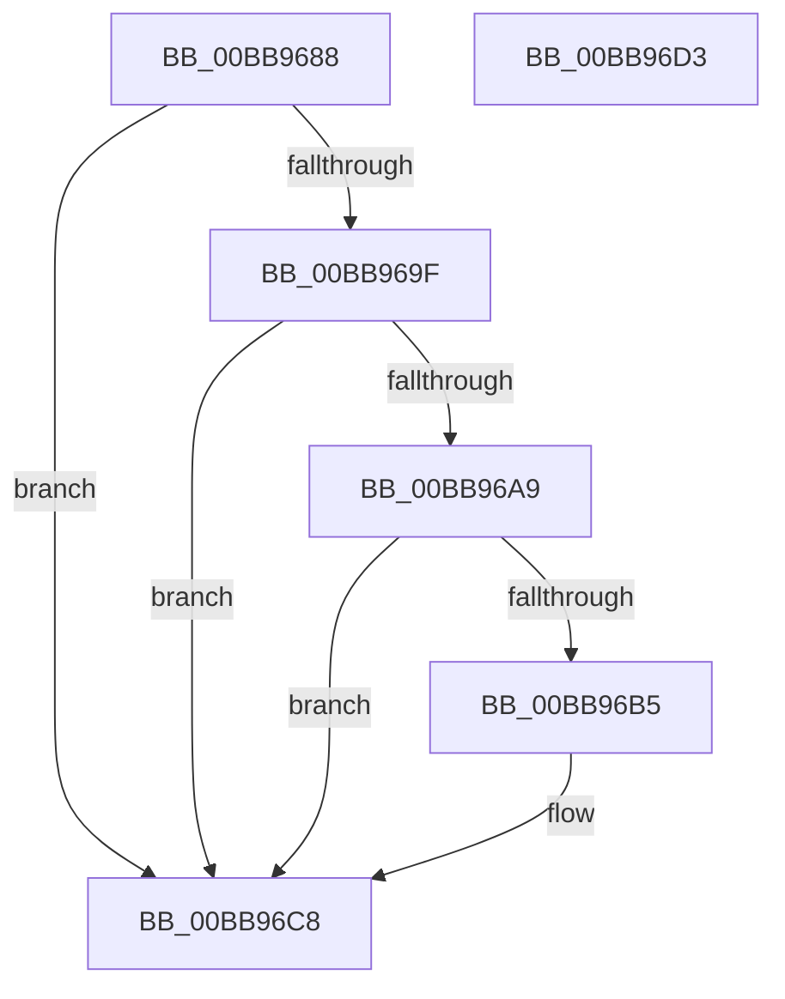

# VfDevObjPostAddDevice

- RVA: `0x00BB9688`–`0x00BB96D4` (길이 `76` bytes)
- VA: `0x0000000140BB9688`
- 실행 섹션: `PAGEVRFY`
- PDB 이름 있음: `예`; PDB Function 태그: `아니요`
- unwind 정보 RVA: `0x0005CAAC`
- 디코드: `24`개 명령, `76/76` bytes 표시
- 미해석 바이트: `0` (있으면 어셈블리에 `.byte`로 보존)

> 이 문서는 커널 이미지의 기계어와 PDB 기호를 분석해 생성했습니다. 4번과 5번은 함수 원형과 자료형을 바이너리 사용 방식에서 추정한 C 해석이며 원본 소스 복구 결과는 아닙니다.

## 1. Dependencies

- 직접 호출 지점: **2**; 고유 호출 대상: **2**
- 직접 호출자로 확인된 함수: **1**
- RIP 상대 이미지 참조: **1**

### Outgoing calls
- `0x00BB96AC` → [MmIsDriverVerifying](../../text/4A/MmIsDriverVerifying_function_004A8770.md) (function, `0x004A8770`)
- `0x00BB96C3` → [VfFilterAttach](../BA/VfFilterAttach_function_00BACD80.md) (function, `0x00BACD80`)

### Direct callers
- [PpvUtilCallAddDevice](../../text/4B/PpvUtilCallAddDevice_function_004B3B40.md) at `0x004B3BAF`

### Static image references
- `0x00BB969F` → RVA `0x00F04A20` (`.data`; read)

## 2. Other-region calls and transfers

- 다른 실행 섹션으로 향하는 call: **1**
  - `0x00BB96AC` → [MmIsDriverVerifying](../../text/4A/MmIsDriverVerifying_function_004A8770.md) (`PAGEVRFY` → `.text`)
- 별도 외부 분기/꼬리 이동을 확인하지 못했습니다.

## 3. Assembly (complete function range)

```asm
00BB9688  48 89 5C 24 08                  mov qword ptr [rsp + 8], rbx
00BB968D  57                              push rdi
00BB968E  48 83 EC 20                     sub rsp, 0x20
00BB9692  83 7C 24 50 00                  cmp dword ptr [rsp + 0x50], 0
00BB9697  41 8B D9                        mov ebx, r9d
00BB969A  48 8B F9                        mov rdi, rcx
00BB969D  7C 29                           jl 0x140bb96c8
00BB969F  8B 05 7B B3 34 00               mov eax, dword ptr [rip + 0x34b37b]
00BB96A5  A8 10                           test al, 0x10
00BB96A7  74 1F                           je 0x140bb96c8
00BB96A9  48 8B CA                        mov rcx, rdx
00BB96AC  E8 BF F0 8E FF                  call 0x1404a8770
00BB96B1  85 C0                           test eax, eax
00BB96B3  74 13                           je 0x140bb96c8
00BB96B5  83 FB 04                        cmp ebx, 4
00BB96B8  BA 05 00 00 00                  mov edx, 5
00BB96BD  48 8B CF                        mov rcx, rdi
00BB96C0  0F 45 D3                        cmovne edx, ebx
00BB96C3  E8 B8 36 FF FF                  call 0x140bacd80
00BB96C8  48 8B 5C 24 30                  mov rbx, qword ptr [rsp + 0x30]
00BB96CD  48 83 C4 20                     add rsp, 0x20
00BB96D1  5F                              pop rdi
00BB96D2  C3                              ret
00BB96D3  CC                              int3
```

## 4. C-style interpretation (structured pseudocode)

```c
__int64 __fastcall VfDevObjPostAddDevice(__int64 a1, __int64 a2, __int64 a3, int a4, unsigned int a5)
{
    __int64 result;
    __int64 v_rsp;
    unsigned __int64 v_stack_p8;

    v_stack_p8 = v_rbx;
    v_rsp = (v_rsp) - (32);
    if (a5 < 0) goto loc_00BB96C8;
    if ((((unsigned __int8)((unsigned int)(*(unsigned int *)(v_rip + 3453819)))) & (16)) == 0) goto loc_00BB96C8;
    result = MmIsDriverVerifying(a2, a2, a3, a4);
    if ((unsigned int)(result) != 0) {
        a2 = 5;
        a1 = a1;
        if (((unsigned int)((unsigned int)(a4))) != 4) { a2 = (unsigned int)((unsigned int)(a4)); }
        result = VfFilterAttach(a1, a2, a3, a4);
    }
    v_rsp = (v_rsp) + (32);
    return result;
}
```

## 5. (Beta) C Style

```c
int64_t VfDevObjPostAddDevice(int64_t Arg1, int64_t Arg2, int64_t Arg3, int32_t Arg4, uint32_t Arg5)
{
    int64_t result;
    int64_t local_rsp;
    uint64_t v_stack_p8;

    v_stack_p8 = local_rbx;
    local_rsp = (local_rsp) - (32);
    if (Arg5 < 0) goto loc_00BB96C8;
    if ((((uint8_t)((uint32_t)(*(uint32_t *)(v_rip + 0x34B37B)))) & (16)) == 0) goto loc_00BB96C8;
    result = MmIsDriverVerifying(Arg2, Arg2, Arg3, Arg4);
    if ((uint32_t)(result) != 0) {
        Arg2 = 5;
        Arg1 = Arg1;
        if (((uint32_t)((uint32_t)(Arg4))) != 4) { Arg2 = (uint32_t)((uint32_t)(Arg4)); }
        result = VfFilterAttach(Arg1, Arg2, Arg3, Arg4);
    }
    local_rsp = (local_rsp) + (32);
    return result;
}
```

## 6. Execution-region graph

[열기: 2D/3D 그래프와 함수 탐색 컨트롤 패널](../../../control-panel.html?section=pagevrfy&rva=0x00BB9688&view=graph)

- 2D 그래프는 위에서 아래로 흐르고, 3D 그래프는 빈 공간을 드래그해 회전합니다. Shift+드래그는 이동, 휠은 확대·축소, 함수 노드 선택은 대상 보고서 이동입니다.

### Static fallback


