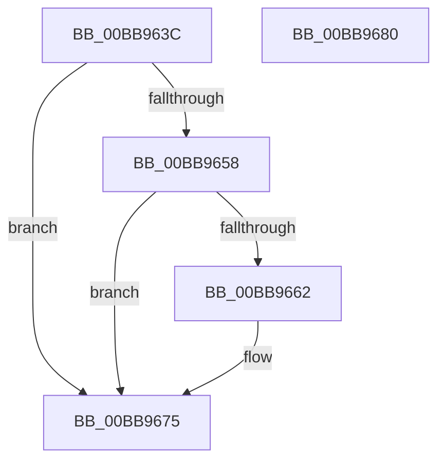

# VfDevObjPreAddDevice

- RVA: `0x00BB963C`–`0x00BB9681` (길이 `69` bytes)
- VA: `0x0000000140BB963C`
- 실행 섹션: `PAGEVRFY`
- PDB 이름 있음: `예`; PDB Function 태그: `아니요`
- unwind 정보 RVA: `0x0005CAAC`
- 디코드: `22`개 명령, `69/69` bytes 표시
- 미해석 바이트: `0` (있으면 어셈블리에 `.byte`로 보존)

> 이 문서는 커널 이미지의 기계어와 PDB 기호를 분석해 생성했습니다. 4번과 5번은 함수 원형과 자료형을 바이너리 사용 방식에서 추정한 C 해석이며 원본 소스 복구 결과는 아닙니다.

## 1. Dependencies

- 직접 호출 지점: **2**; 고유 호출 대상: **2**
- 직접 호출자로 확인된 함수: **1**
- RIP 상대 이미지 참조: **1**

### Outgoing calls
- `0x00BB964F` → [MmIsDriverVerifying](../../text/4A/MmIsDriverVerifying_function_004A8770.md) (function, `0x004A8770`)
- `0x00BB9670` → [VfFilterAttach](../BA/VfFilterAttach_function_00BACD80.md) (function, `0x00BACD80`)

### Direct callers
- [PpvUtilCallAddDevice](../../text/4B/PpvUtilCallAddDevice_function_004B3B40.md) at `0x004B3B8D`

### Static image references
- `0x00BB9658` → RVA `0x00F04A20` (`.data`; read)

## 2. Other-region calls and transfers

- 다른 실행 섹션으로 향하는 call: **1**
  - `0x00BB964F` → [MmIsDriverVerifying](../../text/4A/MmIsDriverVerifying_function_004A8770.md) (`PAGEVRFY` → `.text`)
- 별도 외부 분기/꼬리 이동을 확인하지 못했습니다.

## 3. Assembly (complete function range)

```asm
00BB963C  48 89 5C 24 08                  mov qword ptr [rsp + 8], rbx
00BB9641  57                              push rdi
00BB9642  48 83 EC 20                     sub rsp, 0x20
00BB9646  48 8B F9                        mov rdi, rcx
00BB9649  41 8B D9                        mov ebx, r9d
00BB964C  48 8B CA                        mov rcx, rdx
00BB964F  E8 1C F1 8E FF                  call 0x1404a8770
00BB9654  85 C0                           test eax, eax
00BB9656  74 1D                           je 0x140bb9675
00BB9658  8B 05 C2 B3 34 00               mov eax, dword ptr [rip + 0x34b3c2]
00BB965E  A8 10                           test al, 0x10
00BB9660  74 13                           je 0x140bb9675
00BB9662  83 FB 04                        cmp ebx, 4
00BB9665  BA 03 00 00 00                  mov edx, 3
00BB966A  48 8B CF                        mov rcx, rdi
00BB966D  0F 45 D3                        cmovne edx, ebx
00BB9670  E8 0B 37 FF FF                  call 0x140bacd80
00BB9675  48 8B 5C 24 30                  mov rbx, qword ptr [rsp + 0x30]
00BB967A  48 83 C4 20                     add rsp, 0x20
00BB967E  5F                              pop rdi
00BB967F  C3                              ret
00BB9680  CC                              int3
```

## 4. C-style interpretation (structured pseudocode)

```c
__int64 __fastcall VfDevObjPreAddDevice(__int64 a1, __int64 a2, __int64 a3, int a4)
{
    __int64 result;
    __int64 v_rsp;
    unsigned __int64 v_stack_p8;

    v_stack_p8 = v_rbx;
    v_rsp = (v_rsp) - (32);
    result = MmIsDriverVerifying(a2, a2, a3, a4);
    if ((unsigned int)(result) == 0) goto loc_00BB9675;
    result = (unsigned int)(*(unsigned int *)(v_rip + 3453890));
    if ((((unsigned __int8)((unsigned int)(*(unsigned int *)(v_rip + 3453890)))) & (16)) != 0) {
        a2 = 3;
        a1 = a1;
        if (((unsigned int)((unsigned int)(a4))) != 4) { a2 = (unsigned int)((unsigned int)(a4)); }
        result = VfFilterAttach(a1, a2, a3, a4);
    }
    v_rsp = (v_rsp) + (32);
    return result;
}
```

## 5. (Beta) C Style

```c
int64_t VfDevObjPreAddDevice(int64_t Arg1, int64_t Arg2, int64_t Arg3, int32_t Arg4)
{
    int64_t result;
    int64_t local_rsp;
    uint64_t v_stack_p8;

    v_stack_p8 = local_rbx;
    local_rsp = (local_rsp) - (32);
    result = MmIsDriverVerifying(Arg2, Arg2, Arg3, Arg4);
    if ((uint32_t)(result) == 0) goto loc_00BB9675;
    result = (uint32_t)(*(uint32_t *)(v_rip + 0x34B3C2));
    if ((((uint8_t)((uint32_t)(*(uint32_t *)(v_rip + 0x34B3C2)))) & (16)) != 0) {
        Arg2 = 3;
        Arg1 = Arg1;
        if (((uint32_t)((uint32_t)(Arg4))) != 4) { Arg2 = (uint32_t)((uint32_t)(Arg4)); }
        result = VfFilterAttach(Arg1, Arg2, Arg3, Arg4);
    }
    local_rsp = (local_rsp) + (32);
    return result;
}
```

## 6. Execution-region graph

[열기: 2D/3D 그래프와 함수 탐색 컨트롤 패널](../../../control-panel.html?section=pagevrfy&rva=0x00BB963C&view=graph)

- 2D 그래프는 위에서 아래로 흐르고, 3D 그래프는 빈 공간을 드래그해 회전합니다. Shift+드래그는 이동, 휠은 확대·축소, 함수 노드 선택은 대상 보고서 이동입니다.

### Static fallback


