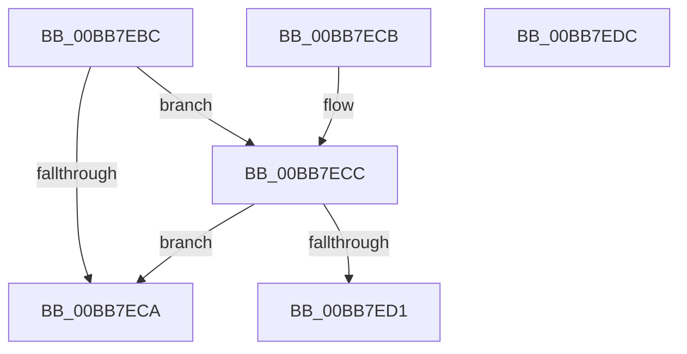

# VfDriverIsKernelImageAddress

- RVA: `0x00BB7EBC`–`0x00BB7EDD` (길이 `33` bytes)
- VA: `0x0000000140BB7EBC`
- 실행 섹션: `PAGEVRFY`
- PDB 이름 있음: `예`; PDB Function 태그: `아니요`
- unwind 정보 RVA: `0x000DB714`
- 디코드: `12`개 명령, `33/33` bytes 표시
- 미해석 바이트: `0` (있으면 어셈블리에 `.byte`로 보존)

> 이 문서는 커널 이미지의 기계어와 PDB 기호를 분석해 생성했습니다. 4번과 5번은 함수 원형과 자료형을 바이너리 사용 방식에서 추정한 C 해석이며 원본 소스 복구 결과는 아닙니다.

## 1. Dependencies

- 직접 호출 지점: **0**; 고유 호출 대상: **0**
- 직접 호출자로 확인된 함수: **19**
- RIP 상대 이미지 참조: **2**

### Outgoing calls
- 직접 디코드된 call 명령이 없습니다.

### Direct callers
- [MmIsVerifierEnabled](../B9/MmIsVerifierEnabled_function_00B92D40.md) at `0x00B92D88`
- [VerifierKeAcquireQueuedSpinLock](../B9/VerifierKeAcquireQueuedSpinLock_function_00B9FBD0.md) at `0x00B9FC27`
- [VfPendingShouldForce](../BA/VfPendingShouldForce_function_00BA1BB8.md) at `0x00BA1BF9`
- [VerifierKeAcquireInStackQueuedSpinLockAtDpcLevel](../BA/VerifierKeAcquireInStackQueuedSpinLockAtDpcLevel_function_00BA4F20.md) at `0x00BA4F6A`
- [VerifierKeAcquireInStackQueuedSpinLockCommon](../BA/VerifierKeAcquireInStackQueuedSpinLockCommon_function_00BA4FD8.md) at `0x00BA503A`
- [VerifierKeAcquireInStackQueuedSpinLockForDpcCommon](../BA/VerifierKeAcquireInStackQueuedSpinLockForDpcCommon_function_00BA5100.md) at `0x00BA5148`
- [VerifierKeAcquireInStackQueuedSpinLockRaiseToSynch](../BA/VerifierKeAcquireInStackQueuedSpinLockRaiseToSynch_function_00BA51C0.md) at `0x00BA5224`
- [VerifierKeAcquireQueuedSpinLockRaiseToSynch](../BA/VerifierKeAcquireQueuedSpinLockRaiseToSynch_function_00BA52C0.md) at `0x00BA531C`
- [VerifierKeAcquireSpinLockAtDpcLevel](../BA/VerifierKeAcquireSpinLockAtDpcLevel_function_00BA53B0.md) at `0x00BA53F3`
- [VerifierKeSynchronizeExecution](../BA/VerifierKeSynchronizeExecution_function_00BA59A0.md) at `0x00BA5A00`
- [VerifierKeTryToAcquireQueuedSpinLock](../BA/VerifierKeTryToAcquireQueuedSpinLock_function_00BA5A80.md) at `0x00BA5AE4`
- [VerifierKeTryToAcquireQueuedSpinLockRaiseToSynch](../BA/VerifierKeTryToAcquireQueuedSpinLockRaiseToSynch_function_00BA5B80.md) at `0x00BA5BE4`
- [VerifierKeTryToAcquireSpinLockAtDpcLevel](../BA/VerifierKeTryToAcquireSpinLockAtDpcLevel_function_00BA5C80.md) at `0x00BA5CC3`
- [VerifierPortKeAcquireSpinLockNoXdv](../BA/VerifierPortKeAcquireSpinLockNoXdv_function_00BA5E80.md) at `0x00BA5EFC`
- [ViKeAcquireSpinLockCommon](../BA/ViKeAcquireSpinLockCommon_function_00BA60B0.md) at `0x00BA612F`
- [ViFaultsInjectionNotification](../BA/ViFaultsInjectionNotification_function_00BA6BDC.md) at `0x00BA6C27`
- [VfTargetDriversGetVerifierData](VfTargetDriversGetVerifierData_function_00BB7E6C.md) at `0x00BB7E70`
- [VfHandlePoolAlloc](VfHandlePoolAlloc_function_00BB8A90.md) at `0x00BB8D56`
- [VfCheckUserHandle](VfCheckUserHandle_function_00BB9218.md) at `0x00BB92BC`

### Static image references
- `0x00BB7EBC` → RVA `0x00F044D0` (`.data`; read)
- `0x00BB7ED1` → RVA `0x00F044D8` (`.data`; read)

## 2. Other-region calls and transfers

- 다른 실행 섹션으로 향하는 call: **0**
- 별도 외부 분기/꼬리 이동을 확인하지 못했습니다.

## 3. Assembly (complete function range)

```asm
00BB7EBC  48 8B 15 0D C6 34 00            mov rdx, qword ptr [rip + 0x34c60d]
00BB7EC3  33 C0                           xor eax, eax
00BB7EC5  48 85 D2                        test rdx, rdx
00BB7EC8  75 02                           jne 0x140bb7ecc
00BB7ECA  C3                              ret
00BB7ECB  CC                              int3
00BB7ECC  48 3B CA                        cmp rcx, rdx
00BB7ECF  72 F9                           jb 0x140bb7eca
00BB7ED1  48 3B 0D 00 C6 34 00            cmp rcx, qword ptr [rip + 0x34c600]
00BB7ED8  0F 92 C0                        setb al
00BB7EDB  C3                              ret
00BB7EDC  CC                              int3
```

## 4. C-style interpretation (structured pseudocode)

```c
__int64 __fastcall VfDriverIsKernelImageAddress(__int64 a1)
{
    __int64 result;

    result = 0;
    if (*(unsigned __int64 *)(v_rip + 3458573) != 0) goto loc_00BB7ECC;
loc_00BB7ECA:
    return result;
loc_00BB7ECC:
    if (a1 < (*(unsigned __int64 *)(v_rip + 3458573))) goto loc_00BB7ECA;
    result = (a1 < (*(unsigned __int64 *)(v_rip + 3458560))) ? 1 : 0;
    return result;
}
```

## 5. (Beta) C Style

```c
int64_t VfDriverIsKernelImageAddress(int64_t Arg1)
{
    int64_t result;

    result = 0;
    if (*(uint64_t *)(v_rip + 0x34C60D) != 0) goto loc_00BB7ECC;
loc_00BB7ECA:
    return result;
loc_00BB7ECC:
    if (Arg1 < (*(uint64_t *)(v_rip + 0x34C60D))) goto loc_00BB7ECA;
    result = (Arg1 < (*(uint64_t *)(v_rip + 0x34C600))) ? 1 : 0;
    return result;
}
```

## 6. Execution-region graph

[열기: 2D/3D 그래프와 함수 탐색 컨트롤 패널](../../../control-panel.html?section=pagevrfy&rva=0x00BB7EBC&view=graph)

- 2D 그래프는 위에서 아래로 흐르고, 3D 그래프는 빈 공간을 드래그해 회전합니다. Shift+드래그는 이동, 휠은 확대·축소, 함수 노드 선택은 대상 보고서 이동입니다.

### Static fallback


