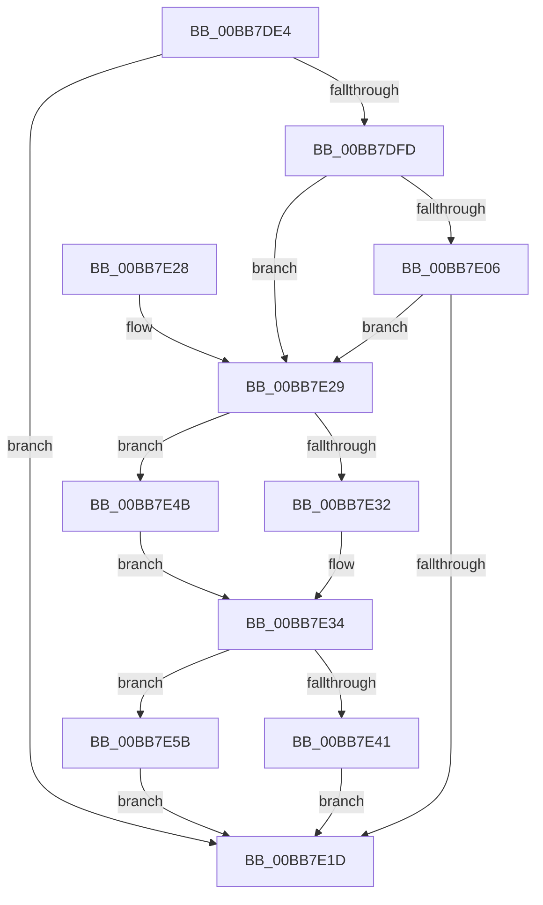

# VfDriverLoadImage

- RVA: `0x00BB7DE4`–`0x00BB7E65` (길이 `129` bytes)
- VA: `0x0000000140BB7DE4`
- 실행 섹션: `PAGEVRFY`
- PDB 이름 있음: `예`; PDB Function 태그: `아니요`
- unwind 정보 RVA: `0x00080918`
- 디코드: `38`개 명령, `129/129` bytes 표시
- 미해석 바이트: `0` (있으면 어셈블리에 `.byte`로 보존)

> 이 문서는 커널 이미지의 기계어와 PDB 기호를 분석해 생성했습니다. 4번과 5번은 함수 원형과 자료형을 바이너리 사용 방식에서 추정한 C 해석이며 원본 소스 복구 결과는 아닙니다.

## 1. Dependencies

- 직접 호출 지점: **4**; 고유 호출 대상: **4**
- 직접 호출자로 확인된 함수: **2**
- RIP 상대 이미지 참조: **3**

### Outgoing calls
- `0x00BB7E14` → [RtlEqualUnicodeString](../../page/93/RtlEqualUnicodeString_function_00932A20.md) (function, `0x00932A20`)
- `0x00BB7E44` → [VfSuspectDriversLoadCallback](../BA/VfSuspectDriversLoadCallback_function_00BAAB2C.md) (function, `0x00BAAB2C`)
- `0x00BB7E4B` → [MiSectionControlArea](../../text/29/MiSectionControlArea_function_00294CB0.md) (function, `0x00294CB0`)
- `0x00BB7E5E` → [VfTargetDriversAdd](../../text/3E/VfTargetDriversAdd_function_003EE2F4.md) (function, `0x003EE2F4`)

### Direct callers
- [MmLoadSystemImageEx](../../page/99/MmLoadSystemImageEx_function_00999B8C.md) at `0x0099A055`
- [VfInitBootDriversLoaded](../../init/C4/VfInitBootDriversLoaded_function_00C4BD0C.md) at `0x00C4BF7B`
- [VfInitBootDriversLoaded](../../init/C4/VfInitBootDriversLoaded_function_00C4BD0C.md) at `0x00C4BFAE`
- [VfInitBootDriversLoaded](../../init/C4/VfInitBootDriversLoaded_function_00C4BD0C.md) at `0x00C4BFEE`

### Static image references
- `0x00BB7DFD` → RVA `0x00FFDA18` (`PAGEVRFD`; read)
- `0x00BB7E0A` → RVA `0x00FF4150` (`PAGEVRFD`; read)
- `0x00BB7E34` → RVA `0x00F04890` (`.data`; read)

## 2. Other-region calls and transfers

- 다른 실행 섹션으로 향하는 call: **3**
  - `0x00BB7E14` → [RtlEqualUnicodeString](../../page/93/RtlEqualUnicodeString_function_00932A20.md) (`PAGEVRFY` → `PAGE`)
  - `0x00BB7E4B` → [MiSectionControlArea](../../text/29/MiSectionControlArea_function_00294CB0.md) (`PAGEVRFY` → `.text`)
  - `0x00BB7E5E` → [VfTargetDriversAdd](../../text/3E/VfTargetDriversAdd_function_003EE2F4.md) (`PAGEVRFY` → `.text`)
- 별도 외부 분기/꼬리 이동을 확인하지 못했습니다.

## 3. Assembly (complete function range)

```asm
00BB7DE4  48 89 5C 24 08                  mov qword ptr [rsp + 8], rbx
00BB7DE9  57                              push rdi
00BB7DEA  48 83 EC 20                     sub rsp, 0x20
00BB7DEE  66 0F BA 61 6E 09               bt word ptr [rcx + 0x6e], 9
00BB7DF4  41 0F B6 F8                     movzx edi, r8b
00BB7DF8  48 8B D9                        mov rbx, rcx
00BB7DFB  72 20                           jb 0x140bb7e1d
00BB7DFD  83 3D 14 5C 44 00 00            cmp dword ptr [rip + 0x445c14], 0
00BB7E04  75 23                           jne 0x140bb7e29
00BB7E06  48 83 C1 58                     add rcx, 0x58
00BB7E0A  48 8D 15 3F C3 43 00            lea rdx, [rip + 0x43c33f]
00BB7E11  41 B0 01                        mov r8b, 1
00BB7E14  E8 07 AC D7 FF                  call 0x140932a20
00BB7E19  84 C0                           test al, al
00BB7E1B  74 0C                           je 0x140bb7e29
00BB7E1D  48 8B 5C 24 30                  mov rbx, qword ptr [rsp + 0x30]
00BB7E22  48 83 C4 20                     add rsp, 0x20
00BB7E26  5F                              pop rdi
00BB7E27  C3                              ret
00BB7E28  CC                              int3
00BB7E29  48 8B 4B 70                     mov rcx, qword ptr [rbx + 0x70]
00BB7E2D  48 85 C9                        test rcx, rcx
00BB7E30  75 19                           jne 0x140bb7e4b
00BB7E32  B2 0C                           mov dl, 0xc
00BB7E34  48 83 3D 54 CA 34 00 00         cmp qword ptr [rip + 0x34ca54], 0
00BB7E3C  48 8B CB                        mov rcx, rbx
00BB7E3F  74 1A                           je 0x140bb7e5b
00BB7E41  44 8B C7                        mov r8d, edi
00BB7E44  E8 E3 2C FF FF                  call 0x140baab2c
00BB7E49  EB D2                           jmp 0x140bb7e1d
00BB7E4B  E8 60 CE 6D FF                  call 0x140294cb0
00BB7E50  48 8B 08                        mov rcx, qword ptr [rax]
00BB7E53  8A 51 0F                        mov dl, byte ptr [rcx + 0xf]
00BB7E56  80 E2 0F                        and dl, 0xf
00BB7E59  EB D9                           jmp 0x140bb7e34
00BB7E5B  45 33 C0                        xor r8d, r8d
00BB7E5E  E8 91 64 83 FF                  call 0x1403ee2f4
00BB7E63  EB B8                           jmp 0x140bb7e1d
```

## 4. C-style interpretation (structured pseudocode)

```c
__int64 __fastcall VfDriverLoadImage(__int64 a1, __int64 a2, unsigned __int8 a3)
{
    __int64 result;
    __int64 v_rsp;
    unsigned __int64 v_stack_p8;

    v_stack_p8 = v_rbx;
    v_rsp = (v_rsp) - (32);
    if (condition_is_below) goto loc_00BB7E1D;
    if ((*(unsigned int *)(v_rip + 4480020)) != 0) goto loc_00BB7E29;
    a1 = (a1) + (88);
    result = RtlEqualUnicodeString(a1, v_rip + 4440895, 1, a4);
    if ((unsigned __int8)(result) == 0) goto loc_00BB7E29;
loc_00BB7E1D:
    v_rsp = (v_rsp) + (32);
    return result;
loc_00BB7E29:
    if (*(unsigned __int64 *)(v_stack_p8 + 112) != 0) goto loc_00BB7E4B;
loc_00BB7E34:
    if ((*(unsigned __int64 *)(v_rip + 3459668)) == 0) goto loc_00BB7E5B;
    result = VfSuspectDriversLoadCallback(v_stack_p8, 12, (unsigned int)(a3), a4);
    goto loc_00BB7E1D;
loc_00BB7E4B:
    result = MiSectionControlArea(v_stack_p8, 12, (unsigned int)(a3), a4);
    a2 = (unsigned __int8)((*(unsigned __int8 *)(*(unsigned __int64 *)(result) + 15)) & (15));
    goto loc_00BB7E34;
loc_00BB7E5B:
    a3 = 0;
    result = VfTargetDriversAdd(*(unsigned __int64 *)(result), a2, a3, a4);
    goto loc_00BB7E1D;
}
```

## 5. (Beta) C Style

```c
int64_t VfDriverLoadImage(void *Arg1, int64_t Arg2, uint8_t Arg3)
{
    uint8_t *arg1 = (uint8_t *)Arg1;

    int64_t result;
    int64_t local_rsp;
    uint64_t v_stack_p8;

    v_stack_p8 = local_rbx;
    local_rsp = (local_rsp) - (32);
    if (condition_is_below) goto loc_00BB7E1D;
    if ((*(uint32_t *)(v_rip + 0x445C14)) != 0) goto loc_00BB7E29;
    Arg1 = (Arg1) + (88);
    result = RtlEqualUnicodeString(Arg1, v_rip + 4440895, 1, a4);
    if ((uint8_t)(result) == 0) goto loc_00BB7E29;
loc_00BB7E1D:
    local_rsp = (local_rsp) + (32);
    return result;
loc_00BB7E29:
    if (*(uint64_t *)(v_stack_p8 + 0x70) != 0) goto loc_00BB7E4B;
loc_00BB7E34:
    if ((*(uint64_t *)(v_rip + 0x34CA54)) == 0) goto loc_00BB7E5B;
    result = VfSuspectDriversLoadCallback(v_stack_p8, 12, (uint32_t)(Arg3), a4);
    goto loc_00BB7E1D;
loc_00BB7E4B:
    result = MiSectionControlArea(v_stack_p8, 12, (uint32_t)(Arg3), a4);
    Arg2 = (uint8_t)((*(uint8_t *)(*(uint64_t *)(result) + 0xF)) & (15));
    goto loc_00BB7E34;
loc_00BB7E5B:
    Arg3 = 0;
    result = VfTargetDriversAdd(*(uint64_t *)(result), Arg2, Arg3, a4);
    goto loc_00BB7E1D;
}
```

### 관측된 메모리 오프셋

구조체 형식이 확인되지 않은 접근은 인자 기준의 오프셋으로만 기록했습니다.

| 기준 인자 | 오프셋 표현 | 폭 (bit) | 접근 |
|---|---:|---:|---|
| `Arg1` | `+ 0x6E` | `16` | `R` |
| `Arg1` | `+ 0x70` | `64` | `R` |

## 6. Execution-region graph

[열기: 2D/3D 그래프와 함수 탐색 컨트롤 패널](../../../control-panel.html?section=pagevrfy&rva=0x00BB7DE4&view=graph)

- 2D 그래프는 위에서 아래로 흐르고, 3D 그래프는 빈 공간을 드래그해 회전합니다. Shift+드래그는 이동, 휠은 확대·축소, 함수 노드 선택은 대상 보고서 이동입니다.

### Static fallback


