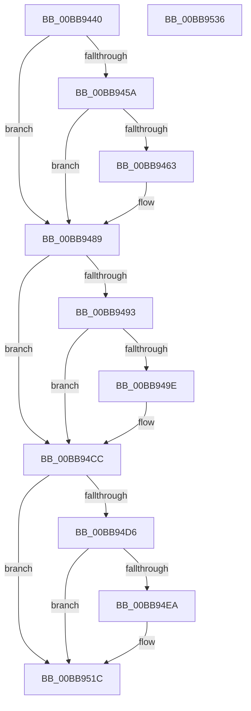

# VfFastIoCheckState

- RVA: `0x00BB9440`–`0x00BB9537` (길이 `247` bytes)
- VA: `0x0000000140BB9440`
- 실행 섹션: `PAGEVRFY`
- PDB 이름 있음: `예`; PDB Function 태그: `아니요`
- unwind 정보 RVA: `0x00065960`
- 디코드: `60`개 명령, `247/247` bytes 표시
- 미해석 바이트: `0` (있으면 어셈블리에 `.byte`로 보존)

> 이 문서는 커널 이미지의 기계어와 PDB 기호를 분석해 생성했습니다. 4번과 5번은 함수 원형과 자료형을 바이너리 사용 방식에서 추정한 C 해석이며 원본 소스 복구 결과는 아닙니다.

## 1. Dependencies

- 직접 호출 지점: **5**; 고유 호출 대상: **3**
- 직접 호출자로 확인된 함수: **13**
- RIP 상대 이미지 참조: **2**

### Outgoing calls
- `0x00BB945A` → [KeAreInterruptsEnabled](../../text/2F/KeAreInterruptsEnabled_function_002F8060.md) (function, `0x002F8060`)
- `0x00BB9484` → [CarReportRuleViolationFromNt](../B9/CarReportRuleViolationFromNt_function_00B9D904.md) (function, `0x00B9D904`)
- `0x00BB94C7` → [CarReportRuleViolationFromNt](../B9/CarReportRuleViolationFromNt_function_00B9D904.md) (function, `0x00B9D904`)
- `0x00BB9517` → [CarReportRuleViolationFromNt](../B9/CarReportRuleViolationFromNt_function_00B9D904.md) (function, `0x00B9D904`)
- `0x00BB9526` → [ExFreeToNPagedLookasideList](../../text/38/ExFreeToNPagedLookasideList_function_0038D9D0.md) (function, `0x0038D9D0`)

### Direct callers
- [IopCompleteUnloadOrDelete](../../text/27/IopCompleteUnloadOrDelete_function_00270BC8.md) at `0x00270D0C`
- [IopParseDevice](../../page/89/IopParseDevice_function_0089E510.md) at `0x0089EE71`
- [IopParseDevice](../../page/89/IopParseDevice_function_0089E510.md) at `0x0089F178`
- [IopGetBasicInformationFile](../../page/8A/IopGetBasicInformationFile_function_008AC038.md) at `0x008AC107`
- [NtQueryInformationFile](../../page/8A/NtQueryInformationFile_function_008AD630.md) at `0x008ADC97`
- [IopReadFile](../../page/8A/IopReadFile_function_008AEFF0.md) at `0x008AF4CD`
- [IopWriteFile](../../page/8E/IopWriteFile_function_008E9790.md) at `0x008E9A4E`
- [IopXxxControlFile](../../page/8E/IopXxxControlFile_function_008E9AD0.md) at `0x008EA1DD`
- [IopQueryInformation](../../page/9D/IopQueryInformation_function_009D8370.md) at `0x009D8594`
- [NtLockFile](../../page/9D/NtLockFile_function_009D86D0.md) at `0x009D8D10`
- [NtUnlockFile](../../page/9E/NtUnlockFile_function_009E5DA0.md) at `0x009E6280`
- [IopParseDevice$fin$0](../../page/B0/IopParseDevice_fin_0_function_00B0E920.md) at `0x00B0E93C`
- [NtQueryInformationFile$fin$0](../../page/B0/NtQueryInformationFile_fin_0_function_00B0EB00.md) at `0x00B0EB1C`
- [sub_00B174A6](../../page/B1/Unknown_function_00B174A6.md) at `0x00B1759D`

### Static image references
- `0x00BB944A` → RVA `0x00F04A20` (`.data`; read)
- `0x00BB951F` → RVA `0x00FFF700` (`PAGEVRFD`; read)

## 2. Other-region calls and transfers

- 다른 실행 섹션으로 향하는 call: **2**
  - `0x00BB945A` → [KeAreInterruptsEnabled](../../text/2F/KeAreInterruptsEnabled_function_002F8060.md) (`PAGEVRFY` → `.text`)
  - `0x00BB9526` → [ExFreeToNPagedLookasideList](../../text/38/ExFreeToNPagedLookasideList_function_0038D9D0.md) (`PAGEVRFY` → `.text`)
- 별도 외부 분기/꼬리 이동을 확인하지 못했습니다.

## 3. Assembly (complete function range)

```asm
00BB9440  48 89 5C 24 08                  mov qword ptr [rsp + 8], rbx
00BB9445  57                              push rdi
00BB9446  48 83 EC 40                     sub rsp, 0x40
00BB944A  8B 05 D0 B5 34 00               mov eax, dword ptr [rip + 0x34b5d0]
00BB9450  48 8B DA                        mov rbx, rdx
00BB9453  48 8B F9                        mov rdi, rcx
00BB9456  A8 10                           test al, 0x10
00BB9458  74 2F                           je 0x140bb9489
00BB945A  E8 01 EC 73 FF                  call 0x1402f8060
00BB945F  84 C0                           test al, al
00BB9461  75 26                           jne 0x140bb9489
00BB9463  BA C3 00 00 00                  mov edx, 0xc3
00BB9468  48 89 5C 24 30                  mov qword ptr [rsp + 0x30], rbx
00BB946D  C7 44 24 28 04 00 00 00         mov dword ptr [rsp + 0x28], 4
00BB9475  45 33 C9                        xor r9d, r9d
00BB9478  48 83 64 24 20 00               and qword ptr [rsp + 0x20], 0
00BB947E  4C 8B C3                        mov r8, rbx
00BB9481  8D 4A 01                        lea ecx, [rdx + 1]
00BB9484  E8 7B 44 FE FF                  call 0x140b9d904
00BB9489  8B 05 91 B5 34 00               mov eax, dword ptr [rip + 0x34b591]
00BB948F  A8 10                           test al, 0x10
00BB9491  74 39                           je 0x140bb94cc
00BB9493  44 0F 20 C0                     mov rax, cr8
00BB9497  0F B6 17                        movzx edx, byte ptr [rdi]
00BB949A  3A D0                           cmp dl, al
00BB949C  74 2E                           je 0x140bb94cc
00BB949E  44 0F 20 C0                     mov rax, cr8
00BB94A2  0F B6 C8                        movzx ecx, al
00BB94A5  44 8B CA                        mov r9d, edx
00BB94A8  48 89 5C 24 30                  mov qword ptr [rsp + 0x30], rbx
00BB94AD  4C 8B C3                        mov r8, rbx
00BB94B0  C7 44 24 28 04 00 00 00         mov dword ptr [rsp + 0x28], 4
00BB94B8  BA 11 00 00 00                  mov edx, 0x11
00BB94BD  48 89 4C 24 20                  mov qword ptr [rsp + 0x20], rcx
00BB94C2  B9 C9 00 00 00                  mov ecx, 0xc9
00BB94C7  E8 38 44 FE FF                  call 0x140b9d904
00BB94CC  8B 05 4E B5 34 00               mov eax, dword ptr [rip + 0x34b54e]
00BB94D2  A8 10                           test al, 0x10
00BB94D4  74 46                           je 0x140bb951c
00BB94D6  65 48 8B 04 25 88 01 00 00      mov rax, qword ptr gs:[0x188]
00BB94DF  8B 57 04                        mov edx, dword ptr [rdi + 4]
00BB94E2  3B 90 E4 01 00 00               cmp edx, dword ptr [rax + 0x1e4]
00BB94E8  74 32                           je 0x140bb951c
00BB94EA  65 48 8B 04 25 88 01 00 00      mov rax, qword ptr gs:[0x188]
00BB94F3  4C 8B C3                        mov r8, rbx
00BB94F6  48 89 5C 24 30                  mov qword ptr [rsp + 0x30], rbx
00BB94FB  C7 44 24 28 04 00 00 00         mov dword ptr [rsp + 0x28], 4
00BB9503  48 89 54 24 20                  mov qword ptr [rsp + 0x20], rdx
00BB9508  BA C6 00 00 00                  mov edx, 0xc6
00BB950D  44 8B 88 E4 01 00 00            mov r9d, dword ptr [rax + 0x1e4]
00BB9514  8D 4A FE                        lea ecx, [rdx - 2]
00BB9517  E8 E8 43 FE FF                  call 0x140b9d904
00BB951C  48 8B D7                        mov rdx, rdi
00BB951F  48 8D 0D DA 61 44 00            lea rcx, [rip + 0x4461da]
00BB9526  E8 A5 44 7D FF                  call 0x14038d9d0
00BB952B  48 8B 5C 24 50                  mov rbx, qword ptr [rsp + 0x50]
00BB9530  48 83 C4 40                     add rsp, 0x40
00BB9534  5F                              pop rdi
00BB9535  C3                              ret
00BB9536  CC                              int3
```

## 4. C-style interpretation (structured pseudocode)

```c
__int64 __fastcall VfFastIoCheckState(__int64 a1, __int64 a2, __int64 a3, int a4)
{
    __int64 result;
    __int64 v_rsp;
    unsigned __int64 v_stack_m18;
    unsigned int v_stack_m20;
    unsigned __int64 v_stack_m28;
    unsigned __int64 v_stack_p8;

    v_stack_p8 = v_rbx;
    v_rsp = (v_rsp) - (64);
    if ((((unsigned __int8)((unsigned int)(*(unsigned int *)(v_rip + 3454416)))) & (16)) == 0) goto loc_00BB9489;
    result = KeAreInterruptsEnabled(a1, a2, a3, a4);
    if ((unsigned __int8)(result) == 0) {
        a2 = 195;
        v_stack_m18 = a2;
        v_stack_m20 = 4;
        a4 = 0;
        a3 = a2;
        a1 = a2 + 1;
        result = CarReportRuleViolationFromNt(a1, a2, a3, a4);
    }
    if ((((unsigned __int8)((unsigned int)(*(unsigned int *)(v_rip + 3454353)))) & (16)) == 0) goto loc_00BB94CC;
    result = v_cr8;
    if (((unsigned __int8)(*(unsigned __int8 *)(a1))) != ((unsigned __int8)(v_cr8))) {
        result = v_cr8;
        a1 = (unsigned __int8)(result);
        a4 = (unsigned int)(*(unsigned __int8 *)(a1));
        v_stack_m18 = a2;
        a3 = a2;
        v_stack_m20 = 4;
        a2 = 17;
        v_stack_m28 = a1;
        a1 = 201;
        result = CarReportRuleViolationFromNt(a1, a2, a3, a4);
    }
    if ((((unsigned __int8)((unsigned int)(*(unsigned int *)(v_rip + 3454286)))) & (16)) == 0) goto loc_00BB951C;
    result = *(unsigned __int64 *)(gs_base + (0 + 392));
    if (((unsigned int)((unsigned int)(*(unsigned int *)(a1 + 4)))) != (*(unsigned int *)(*(unsigned __int64 *)(gs_base + (0 + 392)) + 484))) {
        result = *(unsigned __int64 *)(gs_base + (0 + 392));
        a3 = a2;
        v_stack_m18 = a2;
        v_stack_m20 = 4;
        v_stack_m28 = (unsigned int)(*(unsigned int *)(a1 + 4));
        a2 = 198;
        a4 = *(unsigned int *)(result + 484);
        a1 = a2 - 2;
        result = CarReportRuleViolationFromNt(a1, a2, a3, a4);
    }
    result = ExFreeToNPagedLookasideList(v_rip + 4481498, a1, a3, a4);
    v_rsp = (v_rsp) + (64);
    return result;
}
```

## 5. (Beta) C Style

```c
int64_t VfFastIoCheckState(void *Arg1, int64_t Arg2, int64_t Arg3, int32_t Arg4)
{
    uint8_t *arg1 = (uint8_t *)Arg1;

    int64_t result;
    int64_t local_rsp;
    uint64_t v_stack_m18;
    uint32_t v_stack_m20;
    uint64_t v_stack_m28;
    uint64_t v_stack_p8;

    v_stack_p8 = local_rbx;
    local_rsp = (local_rsp) - (64);
    if ((((uint8_t)((uint32_t)(*(uint32_t *)(v_rip + 0x34B5D0)))) & (16)) == 0) goto loc_00BB9489;
    result = KeAreInterruptsEnabled(Arg1, Arg2, Arg3, Arg4);
    if ((uint8_t)(result) == 0) {
        Arg2 = 195;
        v_stack_m18 = Arg2;
        v_stack_m20 = 4;
        Arg4 = 0;
        Arg3 = Arg2;
        Arg1 = Arg2 + 1;
        result = CarReportRuleViolationFromNt(Arg1, Arg2, Arg3, Arg4);
    }
    if ((((uint8_t)((uint32_t)(*(uint32_t *)(v_rip + 0x34B591)))) & (16)) == 0) goto loc_00BB94CC;
    result = v_cr8;
    if (((uint8_t)(*(uint8_t *)(arg1))) != ((uint8_t)(v_cr8))) {
        result = v_cr8;
        Arg1 = (uint8_t)(result);
        Arg4 = (uint32_t)(*(uint8_t *)(arg1));
        v_stack_m18 = Arg2;
        Arg3 = Arg2;
        v_stack_m20 = 4;
        Arg2 = 17;
        v_stack_m28 = Arg1;
        Arg1 = 201;
        result = CarReportRuleViolationFromNt(Arg1, Arg2, Arg3, Arg4);
    }
    if ((((uint8_t)((uint32_t)(*(uint32_t *)(v_rip + 0x34B54E)))) & (16)) == 0) goto loc_00BB951C;
    result = *(uint64_t *)(gs_base + (0 + 0x188));
    if (((uint32_t)((uint32_t)(*(uint32_t *)(arg1 + 0x4)))) != (*(uint32_t *)(*(uint64_t *)(gs_base + (0 + 0x188)) + 0x1E4))) {
        result = *(uint64_t *)(gs_base + (0 + 0x188));
        Arg3 = Arg2;
        v_stack_m18 = Arg2;
        v_stack_m20 = 4;
        v_stack_m28 = (uint32_t)(*(uint32_t *)(arg1 + 0x4));
        Arg2 = 198;
        Arg4 = *(uint32_t *)(result + 0x1E4);
        Arg1 = Arg2 - 2;
        result = CarReportRuleViolationFromNt(Arg1, Arg2, Arg3, Arg4);
    }
    result = ExFreeToNPagedLookasideList(v_rip + 4481498, Arg1, Arg3, Arg4);
    local_rsp = (local_rsp) + (64);
    return result;
}
```

### 관측된 메모리 오프셋

구조체 형식이 확인되지 않은 접근은 인자 기준의 오프셋으로만 기록했습니다.

| 기준 인자 | 오프셋 표현 | 폭 (bit) | 접근 |
|---|---:|---:|---|
| `Arg1` | `+ 0x0` | `8` | `R` |
| `Arg1` | `+ 0x4` | `32` | `R` |

## 6. Execution-region graph

[열기: 2D/3D 그래프와 함수 탐색 컨트롤 패널](../../../control-panel.html?section=pagevrfy&rva=0x00BB9440&view=graph)

- 2D 그래프는 위에서 아래로 흐르고, 3D 그래프는 빈 공간을 드래그해 회전합니다. Shift+드래그는 이동, 휠은 확대·축소, 함수 노드 선택은 대상 보고서 이동입니다.

### Static fallback


