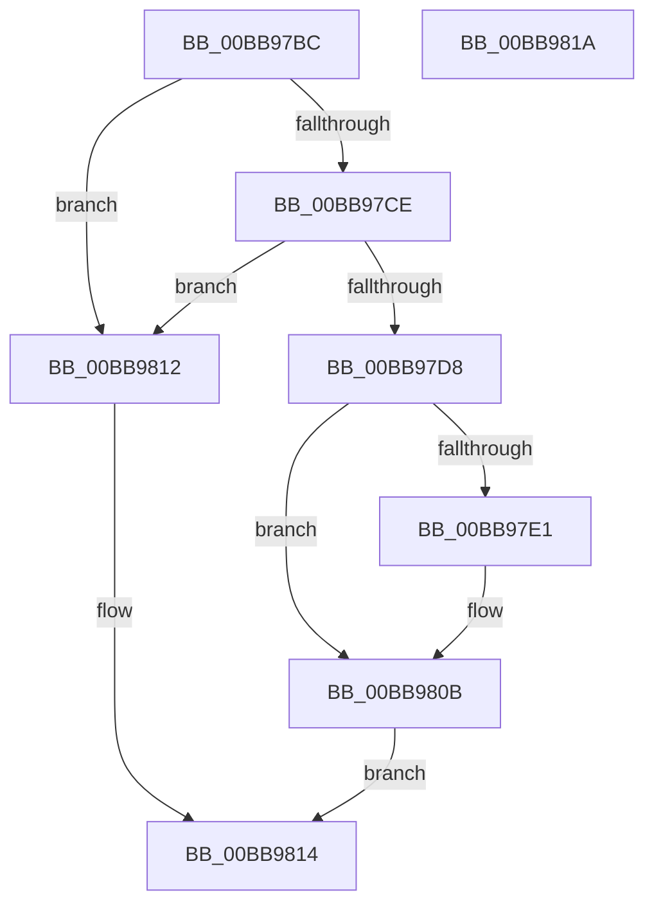

# VfFastIoSnapState

- RVA: `0x00BB97BC`–`0x00BB981B` (길이 `95` bytes)
- VA: `0x0000000140BB97BC`
- 실행 섹션: `PAGEVRFY`
- PDB 이름 있음: `예`; PDB Function 태그: `아니요`
- unwind 정보 RVA: `0x000697A4`
- 디코드: `27`개 명령, `95/95` bytes 표시
- 미해석 바이트: `0` (있으면 어셈블리에 `.byte`로 보존)

> 이 문서는 커널 이미지의 기계어와 PDB 기호를 분석해 생성했습니다. 4번과 5번은 함수 원형과 자료형을 바이너리 사용 방식에서 추정한 C 해석이며 원본 소스 복구 결과는 아닙니다.

## 1. Dependencies

- 직접 호출 지점: **3**; 고유 호출 대상: **3**
- 직접 호출자로 확인된 함수: **11**
- RIP 상대 이미지 참조: **2**

### Outgoing calls
- `0x00BB97D8` → [KeAreInterruptsEnabled](../../text/2F/KeAreInterruptsEnabled_function_002F8060.md) (function, `0x002F8060`)
- `0x00BB9806` → [CarReportRuleViolationFromNt](../B9/CarReportRuleViolationFromNt_function_00B9D904.md) (function, `0x00B9D904`)
- `0x00BB980B` → [ViIoCallbackSnapState](ViIoCallbackSnapState_function_00BB7EE4.md) (function, `0x00BB7EE4`)

### Direct callers
- [IopCompleteUnloadOrDelete](../../text/27/IopCompleteUnloadOrDelete_function_00270BC8.md) at `0x00270CE5`
- [IopParseDevice](../../page/89/IopParseDevice_function_0089E510.md) at `0x0089EF00`
- [IopParseDevice](../../page/89/IopParseDevice_function_0089E510.md) at `0x008A0742`
- [IopGetBasicInformationFile](../../page/8A/IopGetBasicInformationFile_function_008AC038.md) at `0x008AC0F7`
- [NtQueryInformationFile](../../page/8A/NtQueryInformationFile_function_008AD630.md) at `0x008ADCEC`
- [IopReadFile](../../page/8A/IopReadFile_function_008AEFF0.md) at `0x008AF478`
- [IopWriteFile](../../page/8E/IopWriteFile_function_008E9790.md) at `0x008E9A36`
- [IopXxxControlFile](../../page/8E/IopXxxControlFile_function_008E9AD0.md) at `0x008EB0B4`
- [IopQueryInformation](../../page/9D/IopQueryInformation_function_009D8370.md) at `0x009D8581`
- [NtLockFile](../../page/9D/NtLockFile_function_009D86D0.md) at `0x009D8CFD`
- [NtUnlockFile](../../page/9E/NtUnlockFile_function_009E5DA0.md) at `0x009E626D`
- [sub_00B174A6](../../page/B1/Unknown_function_00B174A6.md) at `0x00B17561`

### Static image references
- `0x00BB97C2` → RVA `0x00FFDAB8` (`PAGEVRFD`; read)
- `0x00BB97CE` → RVA `0x00F04A20` (`.data`; read)

## 2. Other-region calls and transfers

- 다른 실행 섹션으로 향하는 call: **1**
  - `0x00BB97D8` → [KeAreInterruptsEnabled](../../text/2F/KeAreInterruptsEnabled_function_002F8060.md) (`PAGEVRFY` → `.text`)
- 별도 외부 분기/꼬리 이동을 확인하지 못했습니다.

## 3. Assembly (complete function range)

```asm
00BB97BC  40 53                           push rbx
00BB97BE  48 83 EC 40                     sub rsp, 0x40
00BB97C2  83 3D EF 42 44 00 00            cmp dword ptr [rip + 0x4442ef], 0
00BB97C9  48 8B D9                        mov rbx, rcx
00BB97CC  74 44                           je 0x140bb9812
00BB97CE  8B 05 4C B2 34 00               mov eax, dword ptr [rip + 0x34b24c]
00BB97D4  A8 10                           test al, 0x10
00BB97D6  74 3A                           je 0x140bb9812
00BB97D8  E8 83 E8 73 FF                  call 0x1402f8060
00BB97DD  84 C0                           test al, al
00BB97DF  75 2A                           jne 0x140bb980b
00BB97E1  48 8B 43 18                     mov rax, qword ptr [rbx + 0x18]
00BB97E5  BA C2 00 00 00                  mov edx, 0xc2
00BB97EA  48 89 44 24 30                  mov qword ptr [rsp + 0x30], rax
00BB97EF  45 33 C9                        xor r9d, r9d
00BB97F2  C7 44 24 28 04 00 00 00         mov dword ptr [rsp + 0x28], 4
00BB97FA  45 33 C0                        xor r8d, r8d
00BB97FD  48 83 64 24 20 00               and qword ptr [rsp + 0x20], 0
00BB9803  8D 4A 07                        lea ecx, [rdx + 7]
00BB9806  E8 F9 40 FE FF                  call 0x140b9d904
00BB980B  E8 D4 E6 FF FF                  call 0x140bb7ee4
00BB9810  EB 02                           jmp 0x140bb9814
00BB9812  33 C0                           xor eax, eax
00BB9814  48 83 C4 40                     add rsp, 0x40
00BB9818  5B                              pop rbx
00BB9819  C3                              ret
00BB981A  CC                              int3
```

## 4. C-style interpretation (structured pseudocode)

```c
__int64 __fastcall VfFastIoSnapState(__int64 a1, __int64 a2, int a3, int a4)
{
    __int64 result;
    __int64 v_rsp;
    unsigned __int64 v_stack_m18;
    unsigned int v_stack_m20;
    unsigned __int64 v_stack_m28;

    v_rsp = (v_rsp) - (64);
    if ((*(unsigned int *)(v_rip + 4473583)) == 0) goto loc_00BB9812;
    if ((((unsigned __int8)((unsigned int)(*(unsigned int *)(v_rip + 3453516)))) & (16)) == 0) goto loc_00BB9812;
    result = KeAreInterruptsEnabled(a1, a2, a3, a4);
    if ((unsigned __int8)(result) == 0) {
        result = *(unsigned __int64 *)(a1 + 24);
        a2 = 194;
        v_stack_m18 = result;
        a4 = 0;
        v_stack_m20 = 4;
        a3 = 0;
        a1 = a2 + 7;
        result = CarReportRuleViolationFromNt(a1, a2, a3, a4);
    }
    result = ViIoCallbackSnapState(a1, a2, a3, a4);
    goto loc_00BB9814;
loc_00BB9812:
    result = 0;
loc_00BB9814:
    v_rsp = (v_rsp) + (64);
    return result;
}
```

## 5. (Beta) C Style

```c
int64_t VfFastIoSnapState(void *Arg1, int64_t Arg2, int32_t Arg3, int32_t Arg4)
{
    uint8_t *arg1 = (uint8_t *)Arg1;

    int64_t result;
    int64_t local_rsp;
    uint64_t v_stack_m18;
    uint32_t v_stack_m20;
    uint64_t v_stack_m28;

    local_rsp = (local_rsp) - (64);
    if ((*(uint32_t *)(v_rip + 0x4442EF)) == 0) goto loc_00BB9812;
    if ((((uint8_t)((uint32_t)(*(uint32_t *)(v_rip + 0x34B24C)))) & (16)) == 0) goto loc_00BB9812;
    result = KeAreInterruptsEnabled(Arg1, Arg2, Arg3, Arg4);
    if ((uint8_t)(result) == 0) {
        result = *(uint64_t *)(arg1 + 0x18);
        Arg2 = 194;
        v_stack_m18 = result;
        Arg4 = 0;
        v_stack_m20 = 4;
        Arg3 = 0;
        Arg1 = Arg2 + 7;
        result = CarReportRuleViolationFromNt(Arg1, Arg2, Arg3, Arg4);
    }
    result = ViIoCallbackSnapState(Arg1, Arg2, Arg3, Arg4);
    goto loc_00BB9814;
loc_00BB9812:
    result = 0;
loc_00BB9814:
    local_rsp = (local_rsp) + (64);
    return result;
}
```

### 관측된 메모리 오프셋

구조체 형식이 확인되지 않은 접근은 인자 기준의 오프셋으로만 기록했습니다.

| 기준 인자 | 오프셋 표현 | 폭 (bit) | 접근 |
|---|---:|---:|---|
| `Arg1` | `+ 0x18` | `64` | `R` |

## 6. Execution-region graph

[열기: 2D/3D 그래프와 함수 탐색 컨트롤 패널](../../../control-panel.html?section=pagevrfy&rva=0x00BB97BC&view=graph)

- 2D 그래프는 위에서 아래로 흐르고, 3D 그래프는 빈 공간을 드래그해 회전합니다. Shift+드래그는 이동, 휠은 확대·축소, 함수 노드 선택은 대상 보고서 이동입니다.

### Static fallback


