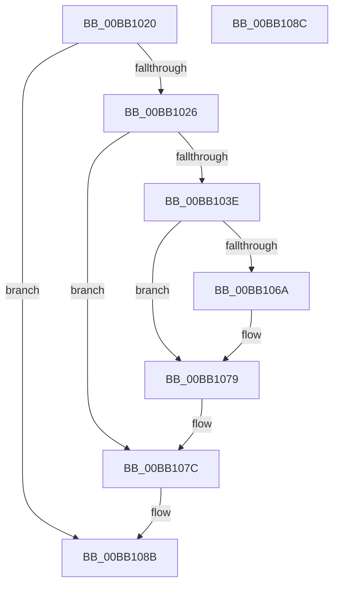

# VfFillAllocatePagesForMdl

- RVA: `0x00BB1020`–`0x00BB108D` (길이 `109` bytes)
- VA: `0x0000000140BB1020`
- 실행 섹션: `PAGEVRFY`
- PDB 이름 있음: `예`; PDB Function 태그: `아니요`
- unwind 정보 RVA: `0x000D2938`
- 디코드: `32`개 명령, `109/109` bytes 표시
- 미해석 바이트: `0` (있으면 어셈블리에 `.byte`로 보존)

> 이 문서는 커널 이미지의 기계어와 PDB 기호를 분석해 생성했습니다. 4번과 5번은 함수 원형과 자료형을 바이너리 사용 방식에서 추정한 C 해석이며 원본 소스 복구 결과는 아닙니다.

## 1. Dependencies

- 직접 호출 지점: **2**; 고유 호출 대상: **2**
- 직접 호출자로 확인된 함수: **2**
- RIP 상대 이미지 참조: **0**

### Outgoing calls
- `0x00BB1060` → [MmMapLockedPagesSpecifyCache](../../text/31/MmMapLockedPagesSpecifyCache_function_00318800.md) (function, `0x00318800`)
- `0x00BB1070` → [MmUnmapLockedPages](../../text/24/MmUnmapLockedPages_function_00246E60.md) (function, `0x00246E60`)

### Direct callers
- [VerifierMmAllocateNodePagesForMdlEx](VerifierMmAllocateNodePagesForMdlEx_function_00BB03E0.md) at `0x00BB0475`
- [VerifierMmAllocatePagesForMdlEx](VerifierMmAllocatePagesForMdlEx_function_00BB05F0.md) at `0x00BB0678`

### Static image references
- 디코드된 RIP-relative 메모리 참조가 없습니다.

## 2. Other-region calls and transfers

- 다른 실행 섹션으로 향하는 call: **2**
  - `0x00BB1060` → [MmMapLockedPagesSpecifyCache](../../text/31/MmMapLockedPagesSpecifyCache_function_00318800.md) (`PAGEVRFY` → `.text`)
  - `0x00BB1070` → [MmUnmapLockedPages](../../text/24/MmUnmapLockedPages_function_00246E60.md) (`PAGEVRFY` → `.text`)
- 별도 외부 분기/꼬리 이동을 확인하지 못했습니다.

## 3. Assembly (complete function range)

```asm
00BB1020  41 F6 C0 01                     test r8b, 1
00BB1024  74 65                           je 0x140bb108b
00BB1026  48 8B C4                        mov rax, rsp
00BB1029  48 89 58 08                     mov qword ptr [rax + 8], rbx
00BB102D  48 89 70 10                     mov qword ptr [rax + 0x10], rsi
00BB1031  57                              push rdi
00BB1032  48 83 EC 30                     sub rsp, 0x30
00BB1036  48 8B D9                        mov rbx, rcx
00BB1039  83 FA 01                        cmp edx, 1
00BB103C  75 3E                           jne 0x140bb107c
00BB103E  8B 79 28                        mov edi, dword ptr [rcx + 0x28]
00BB1041  45 33 C9                        xor r9d, r9d
00BB1044  48 8B 71 18                     mov rsi, qword ptr [rcx + 0x18]
00BB1048  33 D2                           xor edx, edx
00BB104A  C7 40 F0 10 00 00 40            mov dword ptr [rax - 0x10], 0x40000010
00BB1051  83 60 E8 00                     and dword ptr [rax - 0x18], 0
00BB1055  45 8D 41 01                     lea r8d, [r9 + 1]
00BB1059  C7 41 28 00 10 00 00            mov dword ptr [rcx + 0x28], 0x1000
00BB1060  E8 9B 77 76 FF                  call 0x140318800
00BB1065  48 85 C0                        test rax, rax
00BB1068  74 0F                           je 0x140bb1079
00BB106A  48 8B D3                        mov rdx, rbx
00BB106D  48 8B C8                        mov rcx, rax
00BB1070  E8 EB 5D 69 FF                  call 0x140246e60
00BB1075  48 89 73 18                     mov qword ptr [rbx + 0x18], rsi
00BB1079  89 7B 28                        mov dword ptr [rbx + 0x28], edi
00BB107C  48 8B 5C 24 40                  mov rbx, qword ptr [rsp + 0x40]
00BB1081  48 8B 74 24 48                  mov rsi, qword ptr [rsp + 0x48]
00BB1086  48 83 C4 30                     add rsp, 0x30
00BB108A  5F                              pop rdi
00BB108B  C3                              ret
00BB108C  CC                              int3
```

## 4. C-style interpretation (structured pseudocode)

```c
__int64 __fastcall VfFillAllocatePagesForMdl(__int64 a1, int a2, unsigned __int8 a3, int a4)
{
    __int64 result;
    __int64 v_rsp;
    unsigned __int64 v_stack_p10;
    unsigned __int64 v_stack_p8;

    if (((a3) & (1)) == 0) goto loc_00BB108B;
    *(unsigned __int64 *)(v_rsp + 8) = v_rbx;
    *(unsigned __int64 *)(v_rsp + 16) = v_rsi;
    v_rsp = (v_rsp) - (48);
    if (a2 != 1) goto loc_00BB107C;
    a4 = 0;
    a2 = 0;
    *(unsigned int *)(v_rsp - 16) = 0x40000010ULL;
    *(unsigned int *)(a1 + 40) = 0x1000ULL;
    result = MmMapLockedPagesSpecifyCache(a1, a2, a4 + 1, a4);
    if (result != 0) {
        a2 = a1;
        a1 = result;
        result = MmUnmapLockedPages(a1, a2, a4 + 1, a4);
        *(unsigned __int64 *)(a1 + 24) = *(unsigned __int64 *)(a1 + 24);
    }
    *(unsigned int *)(a1 + 40) = (unsigned int)((unsigned int)(*(unsigned int *)(a1 + 40)));
loc_00BB107C:
    v_rsp = (v_rsp) + (48);
loc_00BB108B:
    return result;
}
```

## 5. (Beta) C Style

```c
int64_t VfFillAllocatePagesForMdl(void *Arg1, int32_t Arg2, uint8_t Arg3, int32_t Arg4)
{
    uint8_t *arg1 = (uint8_t *)Arg1;

    int64_t result;
    int64_t local_rsp;
    uint64_t v_stack_p10;
    uint64_t v_stack_p8;

    if (((Arg3) & (1)) == 0) goto loc_00BB108B;
    *(uint64_t *)(local_rsp + 0x8) = local_rbx;
    *(uint64_t *)(local_rsp + 0x10) = local_rsi;
    local_rsp = (local_rsp) - (48);
    if (Arg2 != 1) goto loc_00BB107C;
    Arg4 = 0;
    Arg2 = 0;
    *(uint32_t *)(local_rsp - 0x10) = 0x40000010ULL;
    *(uint32_t *)(arg1 + 0x28) = 0x1000ULL;
    result = MmMapLockedPagesSpecifyCache(Arg1, Arg2, Arg4 + 1, Arg4);
    if (result != 0) {
        Arg2 = Arg1;
        Arg1 = result;
        result = MmUnmapLockedPages(Arg1, Arg2, Arg4 + 1, Arg4);
        *(uint64_t *)(arg1 + 0x18) = *(uint64_t *)(arg1 + 0x18);
    }
    *(uint32_t *)(arg1 + 0x28) = (uint32_t)((uint32_t)(*(uint32_t *)(arg1 + 0x28)));
loc_00BB107C:
    local_rsp = (local_rsp) + (48);
loc_00BB108B:
    return result;
}
```

### 관측된 메모리 오프셋

구조체 형식이 확인되지 않은 접근은 인자 기준의 오프셋으로만 기록했습니다.

| 기준 인자 | 오프셋 표현 | 폭 (bit) | 접근 |
|---|---:|---:|---|
| `Arg1` | `+ 0x18` | `64` | `R` |
| `Arg1` | `+ 0x18` | `64` | `W` |
| `Arg1` | `+ 0x28` | `32` | `R` |
| `Arg1` | `+ 0x28` | `32` | `W` |

## 6. Execution-region graph

[열기: 2D/3D 그래프와 함수 탐색 컨트롤 패널](../../../control-panel.html?section=pagevrfy&rva=0x00BB1020&view=graph)

- 2D 그래프는 위에서 아래로 흐르고, 3D 그래프는 빈 공간을 드래그해 회전합니다. Shift+드래그는 이동, 휠은 확대·축소, 함수 노드 선택은 대상 보고서 이동입니다.

### Static fallback


