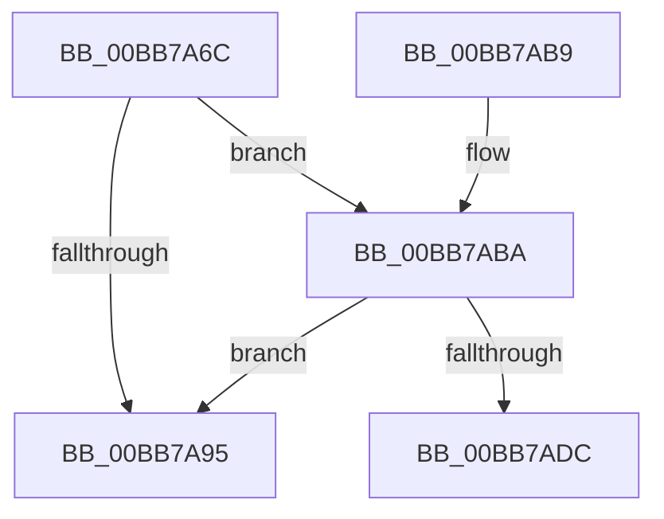

# VfFreeMemoryNotification

- RVA: `0x00BB7A6C`–`0x00BB7AE4` (길이 `120` bytes)
- VA: `0x0000000140BB7A6C`
- 실행 섹션: `PAGEVRFY`
- PDB 이름 있음: `예`; PDB Function 태그: `예`
- unwind 정보 RVA: `0x000B510C`
- 디코드: `36`개 명령, `120/120` bytes 표시
- 미해석 바이트: `0` (있으면 어셈블리에 `.byte`로 보존)

> 이 문서는 커널 이미지의 기계어와 PDB 기호를 분석해 생성했습니다. 4번과 5번은 함수 원형과 자료형을 바이너리 사용 방식에서 추정한 C 해석이며 원본 소스 복구 결과는 아닙니다.

## 1. Dependencies

- 직접 호출 지점: **2**; 고유 호출 대상: **2**
- 직접 호출자로 확인된 함수: **2**
- RIP 상대 이미지 참조: **0**

### Outgoing calls
- `0x00BB7A8C` → [ViDeadlockCanProceed](ViDeadlockCanProceed_function_00BB7B84.md) (function, `0x00BB7B84`)
- `0x00BB7A9B` → [VfRemLockDeleteMemoryRange](VfRemLockDeleteMemoryRange_function_00BB7AEC.md) (function, `0x00BB7AEC`)

### Direct callers
- [VfDriverUnloadImage](../B9/VfDriverUnloadImage_function_00B9A5B0.md) at `0x00B9A5DB`
- [VfPtFreePoolNotification](VfPtFreePoolNotification_function_00BB96DC.md) at `0x00BB9792`

### Static image references
- 디코드된 RIP-relative 메모리 참조가 없습니다.

## 2. Other-region calls and transfers

- 다른 실행 섹션으로 향하는 call: **0**
- call이 아닌 외부 분기/꼬리 이동: **1**
  - `0x00BB7ADF` → [sub_00BBC2F8](Unknown_function_00BBC2F8.md) (`tail-transfer`)

## 3. Assembly (complete function range)

```asm
00BB7A6C  48 89 5C 24 08                  mov qword ptr [rsp + 8], rbx
00BB7A71  48 89 6C 24 10                  mov qword ptr [rsp + 0x10], rbp
00BB7A76  48 89 74 24 18                  mov qword ptr [rsp + 0x18], rsi
00BB7A7B  57                              push rdi
00BB7A7C  41 56                           push r14
00BB7A7E  41 57                           push r15
00BB7A80  48 83 EC 20                     sub rsp, 0x20
00BB7A84  48 8B F9                        mov rdi, rcx
00BB7A87  48 8B F2                        mov rsi, rdx
00BB7A8A  33 C9                           xor ecx, ecx
00BB7A8C  E8 F3 00 00 00                  call 0x140bb7b84
00BB7A91  85 C0                           test eax, eax
00BB7A93  75 25                           jne 0x140bb7aba
00BB7A95  48 8B D6                        mov rdx, rsi
00BB7A98  48 8B CF                        mov rcx, rdi
00BB7A9B  E8 4C 00 00 00                  call 0x140bb7aec
00BB7AA0  48 8B 5C 24 40                  mov rbx, qword ptr [rsp + 0x40]
00BB7AA5  48 8B 6C 24 48                  mov rbp, qword ptr [rsp + 0x48]
00BB7AAA  48 8B 74 24 50                  mov rsi, qword ptr [rsp + 0x50]
00BB7AAF  48 83 C4 20                     add rsp, 0x20
00BB7AB3  41 5F                           pop r15
00BB7AB5  41 5E                           pop r14
00BB7AB7  5F                              pop rdi
00BB7AB8  C3                              ret
00BB7AB9  CC                              int3
00BB7ABA  48 8B CF                        mov rcx, rdi
00BB7ABD  48 8D 2C 37                     lea rbp, [rdi + rsi]
00BB7AC1  81 E1 FF 0F 00 00               and ecx, 0xfff
00BB7AC7  4C 8B F7                        mov r14, rdi
00BB7ACA  48 81 C1 FF 0F 00 00            add rcx, 0xfff
00BB7AD1  48 03 CE                        add rcx, rsi
00BB7AD4  48 C1 E9 0C                     shr rcx, 0xc
00BB7AD8  85 C9                           test ecx, ecx
00BB7ADA  74 B9                           je 0x140bb7a95
00BB7ADC  44 8B F9                        mov r15d, ecx
00BB7ADF  E9 14 48 00 00                  jmp 0x140bbc2f8
```

## 4. C-style interpretation (structured pseudocode)

```c
__int64 __fastcall VfFreeMemoryNotification(__int64 a1, __int64 a2)
{
    __int64 result;
    __int64 v_rsp;
    unsigned __int64 v_stack_p10;
    unsigned __int64 v_stack_p18;
    unsigned __int64 v_stack_p8;

    v_stack_p8 = v_rbx;
    v_stack_p10 = v_rbp;
    v_stack_p18 = v_rsi;
    v_rsp = (v_rsp) - (32);
    a1 = 0;
    result = ViDeadlockCanProceed(a1, a2, a3, a4);
    if ((unsigned int)(result) != 0) goto loc_00BB7ABA;
loc_00BB7A95:
    result = VfRemLockDeleteMemoryRange(0, a2, a3, a4);
    v_rsp = (v_rsp) + (32);
    return result;
loc_00BB7ABA:
    a1 = (unsigned int)((0) & (0xFFFULL));
    a1 = (a1) + (0xFFFULL);
    a1 = (a1) + (v_stack_p18);
    a1 = (a1) >> (12);
    if ((unsigned int)(a1) == 0) goto loc_00BB7A95;
}
```

## 5. (Beta) C Style

```c
int64_t VfFreeMemoryNotification(void *Arg1, int64_t Arg2)
{
    uint8_t *arg1 = (uint8_t *)Arg1;

    int64_t result;
    int64_t local_rsp;
    uint64_t v_stack_p10;
    uint64_t v_stack_p18;
    uint64_t v_stack_p8;

    v_stack_p8 = local_rbx;
    v_stack_p10 = local_rbp;
    v_stack_p18 = local_rsi;
    local_rsp = (local_rsp) - (32);
    Arg1 = 0;
    result = ViDeadlockCanProceed(Arg1, Arg2, a3, a4);
    if ((uint32_t)(result) != 0) goto loc_00BB7ABA;
loc_00BB7A95:
    result = VfRemLockDeleteMemoryRange(0, Arg2, a3, a4);
    local_rsp = (local_rsp) + (32);
    return result;
loc_00BB7ABA:
    Arg1 = (uint32_t)((0) & (0xFFFULL));
    Arg1 = (Arg1) + (0xFFFULL);
    Arg1 = (Arg1) + (v_stack_p18);
    Arg1 = (Arg1) >> (12);
    if ((uint32_t)(Arg1) == 0) goto loc_00BB7A95;
}
```

### 관측된 메모리 오프셋

구조체 형식이 확인되지 않은 접근은 인자 기준의 오프셋으로만 기록했습니다.

| 기준 인자 | 오프셋 표현 | 폭 (bit) | 접근 |
|---|---:|---:|---|
| `Arg1` | `+ 0x0 + rsi*1` | `64` | `R` |

## 6. Execution-region graph

[열기: 2D/3D 그래프와 함수 탐색 컨트롤 패널](../../../control-panel.html?section=pagevrfy&rva=0x00BB7A6C&view=graph)

- 2D 그래프는 위에서 아래로 흐르고, 3D 그래프는 빈 공간을 드래그해 회전합니다. Shift+드래그는 이동, 휠은 확대·축소, 함수 노드 선택은 대상 보고서 이동입니다.

### Static fallback


