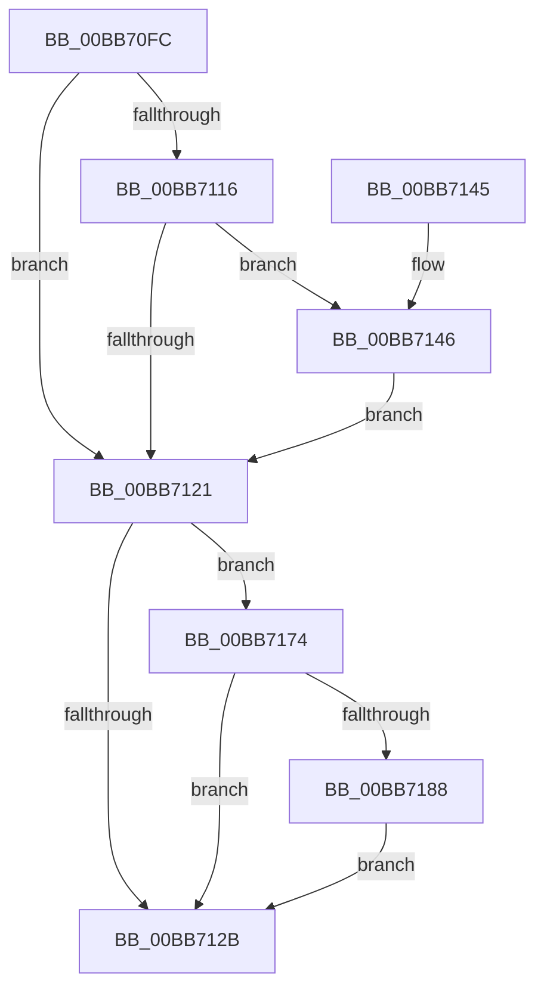

# VfIoCompletionCheckState

- RVA: `0x00BB70FC`–`0x00BB71BF` (길이 `195` bytes)
- VA: `0x0000000140BB70FC`
- 실행 섹션: `PAGEVRFY`
- PDB 이름 있음: `예`; PDB Function 태그: `아니요`
- unwind 정보 RVA: `0x000B08E0`
- 디코드: `48`개 명령, `195/195` bytes 표시
- 미해석 바이트: `0` (있으면 어셈블리에 `.byte`로 보존)

> 이 문서는 커널 이미지의 기계어와 PDB 기호를 분석해 생성했습니다. 4번과 5번은 함수 원형과 자료형을 바이너리 사용 방식에서 추정한 C 해석이며 원본 소스 복구 결과는 아닙니다.

## 1. Dependencies

- 직접 호출 지점: **3**; 고유 호출 대상: **2**
- 직접 호출자로 확인된 함수: **1**
- RIP 상대 이미지 참조: **2**

### Outgoing calls
- `0x00BB7135` → [ExFreeToNPagedLookasideList](../../text/38/ExFreeToNPagedLookasideList_function_0038D9D0.md) (function, `0x0038D9D0`)
- `0x00BB716D` → [CarReportRuleViolationFromNt](../B9/CarReportRuleViolationFromNt_function_00B9D904.md) (function, `0x00B9D904`)
- `0x00BB71B5` → [CarReportRuleViolationFromNt](../B9/CarReportRuleViolationFromNt_function_00B9D904.md) (function, `0x00B9D904`)

### Direct callers
- [IovpLocalCompletionRoutine](IovpLocalCompletionRoutine_function_00BB6B60.md) at `0x00BB6CE9`

### Static image references
- `0x00BB7106` → RVA `0x00F04A20` (`.data`; read)
- `0x00BB712E` → RVA `0x00FFF700` (`PAGEVRFD`; read)

## 2. Other-region calls and transfers

- 다른 실행 섹션으로 향하는 call: **1**
  - `0x00BB7135` → [ExFreeToNPagedLookasideList](../../text/38/ExFreeToNPagedLookasideList_function_0038D9D0.md) (`PAGEVRFY` → `.text`)
- 별도 외부 분기/꼬리 이동을 확인하지 못했습니다.

## 3. Assembly (complete function range)

```asm
00BB70FC  48 89 5C 24 08                  mov qword ptr [rsp + 8], rbx
00BB7101  57                              push rdi
00BB7102  48 83 EC 40                     sub rsp, 0x40
00BB7106  8B 05 14 D9 34 00               mov eax, dword ptr [rip + 0x34d914]
00BB710C  48 8B FA                        mov rdi, rdx
00BB710F  48 8B D9                        mov rbx, rcx
00BB7112  A8 10                           test al, 0x10
00BB7114  74 0B                           je 0x140bb7121
00BB7116  44 0F 20 C0                     mov rax, cr8
00BB711A  0F B6 11                        movzx edx, byte ptr [rcx]
00BB711D  3A D0                           cmp dl, al
00BB711F  75 25                           jne 0x140bb7146
00BB7121  8B 05 F9 D8 34 00               mov eax, dword ptr [rip + 0x34d8f9]
00BB7127  A8 10                           test al, 0x10
00BB7129  75 49                           jne 0x140bb7174
00BB712B  48 8B D3                        mov rdx, rbx
00BB712E  48 8D 0D CB 85 44 00            lea rcx, [rip + 0x4485cb]
00BB7135  E8 96 68 7D FF                  call 0x14038d9d0
00BB713A  48 8B 5C 24 50                  mov rbx, qword ptr [rsp + 0x50]
00BB713F  48 83 C4 40                     add rsp, 0x40
00BB7143  5F                              pop rdi
00BB7144  C3                              ret
00BB7145  CC                              int3
00BB7146  44 0F 20 C0                     mov rax, cr8
00BB714A  0F B6 C8                        movzx ecx, al
00BB714D  4C 8B CA                        mov r9, rdx
00BB7150  BA FA 00 00 00                  mov edx, 0xfa
00BB7155  48 89 7C 24 30                  mov qword ptr [rsp + 0x30], rdi
00BB715A  C7 44 24 28 04 00 00 00         mov dword ptr [rsp + 0x28], 4
00BB7162  4C 8B C7                        mov r8, rdi
00BB7165  48 89 4C 24 20                  mov qword ptr [rsp + 0x20], rcx
00BB716A  8D 4A CA                        lea ecx, [rdx - 0x36]
00BB716D  E8 92 67 FE FF                  call 0x140b9d904
00BB7172  EB AD                           jmp 0x140bb7121
00BB7174  65 48 8B 04 25 88 01 00 00      mov rax, qword ptr gs:[0x188]
00BB717D  8B 53 04                        mov edx, dword ptr [rbx + 4]
00BB7180  3B 90 E4 01 00 00               cmp edx, dword ptr [rax + 0x1e4]
00BB7186  74 A3                           je 0x140bb712b
00BB7188  65 48 8B 04 25 88 01 00 00      mov rax, qword ptr gs:[0x188]
00BB7191  4C 8B C7                        mov r8, rdi
00BB7194  48 89 7C 24 30                  mov qword ptr [rsp + 0x30], rdi
00BB7199  C7 44 24 28 04 00 00 00         mov dword ptr [rsp + 0x28], 4
00BB71A1  48 89 54 24 20                  mov qword ptr [rsp + 0x20], rdx
00BB71A6  BA FB 00 00 00                  mov edx, 0xfb
00BB71AB  44 8B 88 E4 01 00 00            mov r9d, dword ptr [rax + 0x1e4]
00BB71B2  8D 4A C9                        lea ecx, [rdx - 0x37]
00BB71B5  E8 4A 67 FE FF                  call 0x140b9d904
00BB71BA  E9 6C FF FF FF                  jmp 0x140bb712b
```

## 4. C-style interpretation (structured pseudocode)

```c
__int64 __fastcall VfIoCompletionCheckState(__int64 a1, __int64 a2)
{
    __int64 result;
    __int64 v_rsp;
    unsigned __int64 v_stack_p20;
    unsigned int v_stack_p28;
    unsigned __int64 v_stack_p30;
    unsigned __int64 v_stack_p8;

    v_stack_p8 = v_rbx;
    v_rsp = (v_rsp) - (64);
    if ((((unsigned __int8)((unsigned int)(*(unsigned int *)(v_rip + 3463444)))) & (16)) == 0) goto loc_00BB7121;
    if (((unsigned __int8)(*(unsigned __int8 *)(a1))) != ((unsigned __int8)(v_cr8))) goto loc_00BB7146;
loc_00BB7121:
    if ((((unsigned __int8)((unsigned int)(*(unsigned int *)(v_rip + 3463417)))) & (16)) != 0) goto loc_00BB7174;
loc_00BB712B:
    result = ExFreeToNPagedLookasideList(v_rip + 4490699, a1, a3, a4);
    v_rsp = (v_rsp) + (64);
    return result;
loc_00BB7146:
    v_stack_p30 = a2;
    v_stack_p28 = 4;
    v_stack_p20 = (unsigned __int8)(v_cr8);
    result = CarReportRuleViolationFromNt(250 - 54, 250, a2, a1);
    goto loc_00BB7121;
loc_00BB7174:
    if (((unsigned int)((unsigned int)(*(unsigned int *)(v_stack_p8 + 4)))) == (*(unsigned int *)(*(unsigned __int64 *)(gs_base + (0 + 392)) + 484))) goto loc_00BB712B;
    v_stack_p30 = a2;
    v_stack_p28 = 4;
    v_stack_p20 = (unsigned int)(*(unsigned int *)(v_stack_p8 + 4));
    result = CarReportRuleViolationFromNt(251 - 55, 251, a2, (unsigned int)(*(unsigned int *)(*(unsigned __int64 *)(gs_base + (0 + 392)) + 484)));
    goto loc_00BB712B;
}
```

## 5. (Beta) C Style

```c
int64_t VfIoCompletionCheckState(void *Arg1, int64_t Arg2)
{
    uint8_t *arg1 = (uint8_t *)Arg1;

    int64_t result;
    int64_t local_rsp;
    uint64_t v_stack_p20;
    uint32_t v_stack_p28;
    uint64_t v_stack_p30;
    uint64_t v_stack_p8;

    v_stack_p8 = local_rbx;
    local_rsp = (local_rsp) - (64);
    if ((((uint8_t)((uint32_t)(*(uint32_t *)(v_rip + 0x34D914)))) & (16)) == 0) goto loc_00BB7121;
    if (((uint8_t)(*(uint8_t *)(arg1))) != ((uint8_t)(v_cr8))) goto loc_00BB7146;
loc_00BB7121:
    if ((((uint8_t)((uint32_t)(*(uint32_t *)(v_rip + 0x34D8F9)))) & (16)) != 0) goto loc_00BB7174;
loc_00BB712B:
    result = ExFreeToNPagedLookasideList(v_rip + 4490699, Arg1, a3, a4);
    local_rsp = (local_rsp) + (64);
    return result;
loc_00BB7146:
    v_stack_p30 = Arg2;
    v_stack_p28 = 4;
    v_stack_p20 = (uint8_t)(v_cr8);
    result = CarReportRuleViolationFromNt(250 - 54, 250, Arg2, Arg1);
    goto loc_00BB7121;
loc_00BB7174:
    if (((uint32_t)((uint32_t)(*(uint32_t *)(v_stack_p8 + 0x4)))) == (*(uint32_t *)(*(uint64_t *)(gs_base + (0 + 0x188)) + 0x1E4))) goto loc_00BB712B;
    v_stack_p30 = Arg2;
    v_stack_p28 = 4;
    v_stack_p20 = (uint32_t)(*(uint32_t *)(v_stack_p8 + 0x4));
    result = CarReportRuleViolationFromNt(251 - 55, 251, Arg2, (uint32_t)(*(uint32_t *)(*(uint64_t *)(gs_base + (0 + 0x188)) + 0x1E4)));
    goto loc_00BB712B;
}
```

### 관측된 메모리 오프셋

구조체 형식이 확인되지 않은 접근은 인자 기준의 오프셋으로만 기록했습니다.

| 기준 인자 | 오프셋 표현 | 폭 (bit) | 접근 |
|---|---:|---:|---|
| `Arg1` | `+ 0x0` | `8` | `R` |
| `Arg1` | `+ 0x4` | `32` | `R` |

## 6. Execution-region graph

[열기: 2D/3D 그래프와 함수 탐색 컨트롤 패널](../../../control-panel.html?section=pagevrfy&rva=0x00BB70FC&view=graph)

- 2D 그래프는 위에서 아래로 흐르고, 3D 그래프는 빈 공간을 드래그해 회전합니다. Shift+드래그는 이동, 휠은 확대·축소, 함수 노드 선택은 대상 보고서 이동입니다.

### Static fallback


