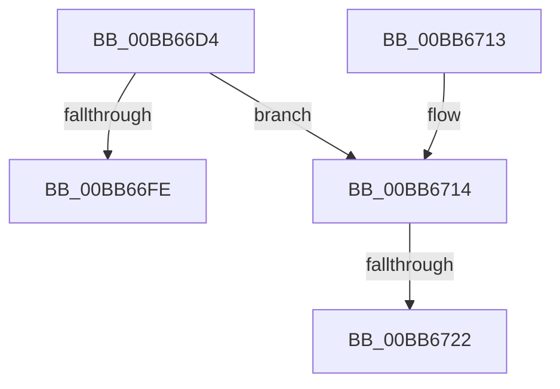

# VfIoInitializeIrp

- RVA: `0x00BB66D4`–`0x00BB6738` (길이 `100` bytes)
- VA: `0x0000000140BB66D4`
- 실행 섹션: `PAGEVRFY`
- PDB 이름 있음: `예`; PDB Function 태그: `예`
- unwind 정보 RVA: `0x000B0784`
- 디코드: `27`개 명령, `100/100` bytes 표시
- 미해석 바이트: `0` (있으면 어셈블리에 `.byte`로 보존)

> 이 문서는 커널 이미지의 기계어와 PDB 기호를 분석해 생성했습니다. 4번과 5번은 함수 원형과 자료형을 바이너리 사용 방식에서 추정한 C 해석이며 원본 소스 복구 결과는 아닙니다.

## 1. Dependencies

- 직접 호출 지점: **2**; 고유 호출 대상: **2**
- 직접 호출자로 확인된 함수: **2**
- RIP 상대 이미지 참조: **0**

### Outgoing calls
- `0x00BB66F1` → [VfIrpDatabaseEntryFindAndLock](VfIrpDatabaseEntryFindAndLock_function_00BB7074.md) (function, `0x00BB7074`)
- `0x00BB672D` → [ViErrorReport1](../../text/61/ViErrorReport1_function_00614584.md) (function, `0x00614584`)

### Direct callers
- [IoReuseIrp](../../text/24/IoReuseIrp_function_0024DD70.md) at `0x0024DDC1`
- [IovInitializeIrp](IovInitializeIrp_function_00BB9418.md) at `0x00BB942C`

### Static image references
- 디코드된 RIP-relative 메모리 참조가 없습니다.

## 2. Other-region calls and transfers

- 다른 실행 섹션으로 향하는 call: **1**
  - `0x00BB672D` → [ViErrorReport1](../../text/61/ViErrorReport1_function_00614584.md) (`PAGEVRFY` → `.text`)
- call이 아닌 외부 분기/꼬리 이동: **2**
  - `0x00BB671C` → [sub_00BBBC60](Unknown_function_00BBBC60.md) (`tail-transfer`)
  - `0x00BB6733` → [sub_00BBBC60](Unknown_function_00BBBC60.md) (`tail-transfer`)

## 3. Assembly (complete function range)

```asm
00BB66D4  48 89 5C 24 08                  mov qword ptr [rsp + 8], rbx
00BB66D9  48 89 6C 24 10                  mov qword ptr [rsp + 0x10], rbp
00BB66DE  48 89 74 24 18                  mov qword ptr [rsp + 0x18], rsi
00BB66E3  57                              push rdi
00BB66E4  48 83 EC 20                     sub rsp, 0x20
00BB66E8  41 8A E8                        mov bpl, r8b
00BB66EB  48 8B F2                        mov rsi, rdx
00BB66EE  48 8B D9                        mov rbx, rcx
00BB66F1  E8 7E 09 00 00                  call 0x140bb7074
00BB66F6  48 8B F8                        mov rdi, rax
00BB66F9  48 85 C0                        test rax, rax
00BB66FC  75 16                           jne 0x140bb6714
00BB66FE  48 8B 5C 24 30                  mov rbx, qword ptr [rsp + 0x30]
00BB6703  48 8B 6C 24 38                  mov rbp, qword ptr [rsp + 0x38]
00BB6708  48 8B 74 24 40                  mov rsi, qword ptr [rsp + 0x40]
00BB670D  48 83 C4 20                     add rsp, 0x20
00BB6711  5F                              pop rdi
00BB6712  C3                              ret
00BB6713  CC                              int3
00BB6714  48 83 B8 F0 00 00 00 00         cmp qword ptr [rax + 0xf0], 0
00BB671C  0F 84 3E 55 00 00               je 0x140bbbc60
00BB6722  4C 8B C3                        mov r8, rbx
00BB6725  48 8B D6                        mov rdx, rsi
00BB6728  B9 10 03 00 00                  mov ecx, 0x310
00BB672D  E8 52 DE A5 FF                  call 0x140614584
00BB6732  90                              nop
00BB6733  E9 28 55 00 00                  jmp 0x140bbbc60
```

## 4. C-style interpretation (structured pseudocode)

```c
__int64 __fastcall VfIoInitializeIrp(__int64 a1, __int64 a2, unsigned __int8 a3)
{
    __int64 result;
    __int64 v_rsp;
    unsigned __int64 v_stack_p10;
    unsigned __int64 v_stack_p18;
    unsigned __int64 v_stack_p8;

    v_stack_p8 = v_rbx;
    v_stack_p10 = v_rbp;
    v_stack_p18 = v_rsi;
    v_rsp = (v_rsp) - (32);
    result = VfIrpDatabaseEntryFindAndLock(a1, a2, a3, a4);
    if (result != 0) goto loc_00BB6714;
    v_rsp = (v_rsp) + (32);
    return result;
loc_00BB6714:
    result = ViErrorReport1(784, v_stack_p18, v_stack_p8, a4);
}
```

## 5. (Beta) C Style

```c
int64_t VfIoInitializeIrp(int64_t Arg1, int64_t Arg2, uint8_t Arg3)
{
    int64_t result;
    int64_t local_rsp;
    uint64_t v_stack_p10;
    uint64_t v_stack_p18;
    uint64_t v_stack_p8;

    v_stack_p8 = local_rbx;
    v_stack_p10 = local_rbp;
    v_stack_p18 = local_rsi;
    local_rsp = (local_rsp) - (32);
    result = VfIrpDatabaseEntryFindAndLock(Arg1, Arg2, Arg3, a4);
    if (result != 0) goto loc_00BB6714;
    local_rsp = (local_rsp) + (32);
    return result;
loc_00BB6714:
    result = ViErrorReport1(784, v_stack_p18, v_stack_p8, a4);
}
```

## 6. Execution-region graph

[열기: 2D/3D 그래프와 함수 탐색 컨트롤 패널](../../../control-panel.html?section=pagevrfy&rva=0x00BB66D4&view=graph)

- 2D 그래프는 위에서 아래로 흐르고, 3D 그래프는 빈 공간을 드래그해 회전합니다. Shift+드래그는 이동, 휠은 확대·축소, 함수 노드 선택은 대상 보고서 이동입니다.

### Static fallback


