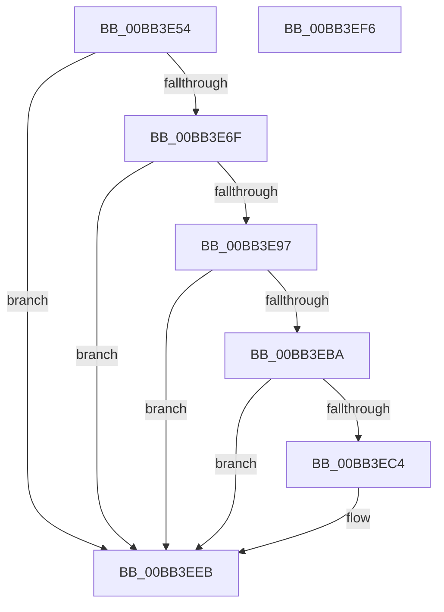

# VfIrpDatabaseCheckExFreePool

- RVA: `0x00BB3E54`–`0x00BB3EF7` (길이 `163` bytes)
- VA: `0x0000000140BB3E54`
- 실행 섹션: `PAGEVRFY`
- PDB 이름 있음: `예`; PDB Function 태그: `아니요`
- unwind 정보 RVA: `0x00065960`
- 디코드: `43`개 명령, `163/163` bytes 표시
- 미해석 바이트: `0` (있으면 어셈블리에 `.byte`로 보존)

> 이 문서는 커널 이미지의 기계어와 PDB 기호를 분석해 생성했습니다. 4번과 5번은 함수 원형과 자료형을 바이너리 사용 방식에서 추정한 C 해석이며 원본 소스 복구 결과는 아닙니다.

## 1. Dependencies

- 직접 호출 지점: **5**; 고유 호출 대상: **5**
- 직접 호출자로 확인된 함수: **1**
- RIP 상대 이미지 참조: **3**

### Outgoing calls
- `0x00BB3E8E` → [VfUtilAddressRangeFitNoLock](../B9/VfUtilAddressRangeFitNoLock_function_00B921E0.md) (function, `0x00B921E0`)
- `0x00BB3E9C` → [ViIrpDatabaseAcquireLockShared](../../text/61/ViIrpDatabaseAcquireLockShared_function_006176FC.md) (function, `0x006176FC`)
- `0x00BB3EA4` → [ViIrpDatabaseFindPointer](ViIrpDatabaseFindPointer_function_00BB4140.md) (function, `0x00BB4140`)
- `0x00BB3EB0` → [ViIrpDatabaseReleaseLockShared](../../text/61/ViIrpDatabaseReleaseLockShared_function_00617740.md) (function, `0x00617740`)
- `0x00BB3EE6` → [CarReportRuleViolationFromNt](../B9/CarReportRuleViolationFromNt_function_00B9D904.md) (function, `0x00B9D904`)

### Direct callers
- [VfPoolCheckIncorrectFreeApi](../BA/VfPoolCheckIncorrectFreeApi_function_00BAA3C8.md) at `0x00BAA3CC`

### Static image references
- `0x00BB3E5E` → RVA `0x00F04864` (`.data`; read)
- `0x00BB3E87` → RVA `0x00F04880` (`.data`; read)
- `0x00BB3EBA` → RVA `0x00F04A20` (`.data`; read)

## 2. Other-region calls and transfers

- 다른 실행 섹션으로 향하는 call: **2**
  - `0x00BB3E9C` → [ViIrpDatabaseAcquireLockShared](../../text/61/ViIrpDatabaseAcquireLockShared_function_006176FC.md) (`PAGEVRFY` → `.text`)
  - `0x00BB3EB0` → [ViIrpDatabaseReleaseLockShared](../../text/61/ViIrpDatabaseReleaseLockShared_function_00617740.md) (`PAGEVRFY` → `.text`)
- 별도 외부 분기/꼬리 이동을 확인하지 못했습니다.

## 3. Assembly (complete function range)

```asm
00BB3E54  48 89 5C 24 08                  mov qword ptr [rsp + 8], rbx
00BB3E59  57                              push rdi
00BB3E5A  48 83 EC 40                     sub rsp, 0x40
00BB3E5E  83 3D FF 09 35 00 00            cmp dword ptr [rip + 0x3509ff], 0
00BB3E65  48 8B F9                        mov rdi, rcx
00BB3E68  C6 44 24 58 00                  mov byte ptr [rsp + 0x58], 0
00BB3E6D  74 7C                           je 0x140bb3eeb
00BB3E6F  48 8B C1                        mov rax, rcx
00BB3E72  4C 8D 41 01                     lea r8, [rcx + 1]
00BB3E76  48 C1 E8 0C                     shr rax, 0xc
00BB3E7A  48 8B D7                        mov rdx, rdi
00BB3E7D  6B C0 83                        imul eax, eax, -0x7d
00BB3E80  0F B6 C8                        movzx ecx, al
00BB3E83  48 C1 E1 04                     shl rcx, 4
00BB3E87  48 03 0D F2 09 35 00            add rcx, qword ptr [rip + 0x3509f2]
00BB3E8E  E8 4D E3 FD FF                  call 0x140b921e0
00BB3E93  85 C0                           test eax, eax
00BB3E95  74 54                           je 0x140bb3eeb
00BB3E97  48 8D 4C 24 58                  lea rcx, [rsp + 0x58]
00BB3E9C  E8 5B 38 A6 FF                  call 0x1406176fc
00BB3EA1  48 8B CF                        mov rcx, rdi
00BB3EA4  E8 97 02 00 00                  call 0x140bb4140
00BB3EA9  8A 4C 24 58                     mov cl, byte ptr [rsp + 0x58]
00BB3EAD  48 8B D8                        mov rbx, rax
00BB3EB0  E8 8B 38 A6 FF                  call 0x140617740
00BB3EB5  48 85 DB                        test rbx, rbx
00BB3EB8  74 31                           je 0x140bb3eeb
00BB3EBA  8B 05 60 0B 35 00               mov eax, dword ptr [rip + 0x350b60]
00BB3EC0  A8 10                           test al, 0x10
00BB3EC2  74 27                           je 0x140bb3eeb
00BB3EC4  48 83 64 24 30 00               and qword ptr [rsp + 0x30], 0
00BB3ECA  BA 05 01 00 00                  mov edx, 0x105
00BB3ECF  C7 44 24 28 04 00 00 00         mov dword ptr [rsp + 0x28], 4
00BB3ED7  45 33 C9                        xor r9d, r9d
00BB3EDA  48 83 64 24 20 00               and qword ptr [rsp + 0x20], 0
00BB3EE0  4C 8B C7                        mov r8, rdi
00BB3EE3  8D 4A BF                        lea ecx, [rdx - 0x41]
00BB3EE6  E8 19 9A FE FF                  call 0x140b9d904
00BB3EEB  48 8B 5C 24 50                  mov rbx, qword ptr [rsp + 0x50]
00BB3EF0  48 83 C4 40                     add rsp, 0x40
00BB3EF4  5F                              pop rdi
00BB3EF5  C3                              ret
00BB3EF6  CC                              int3
```

## 4. C-style interpretation (structured pseudocode)

```c
__int64 __fastcall VfIrpDatabaseCheckExFreePool(__int64 a1, __int64 a2, __int64 a3, int a4)
{
    __int64 result;
    __int64 v_rsp;
    unsigned __int64 v_stack_m18;
    unsigned int v_stack_m20;
    unsigned __int64 v_stack_m28;
    unsigned __int8 v_stack_p10;
    unsigned __int64 v_stack_p8;

    v_stack_p8 = v_rbx;
    v_rsp = (v_rsp) - (64);
    v_stack_p10 = 0;
    if ((*(unsigned int *)(v_rip + 3475967)) == 0) goto loc_00BB3EEB;
    result = (a1) >> (12);
    result = (unsigned int)((result) * ((unsigned int)(result)));
    a1 = ((unsigned __int8)(result)) << (4);
    a1 = (a1) + (*(unsigned __int64 *)(v_rip + 3475954));
    result = VfUtilAddressRangeFitNoLock(a1, a1, a1 + 1, a4);
    if ((unsigned int)(result) == 0) goto loc_00BB3EEB;
    result = ViIrpDatabaseAcquireLockShared(v_stack_p10, a1, a1 + 1, a4);
    result = ViIrpDatabaseFindPointer(a1, a1, a1 + 1, a4);
    result = ViIrpDatabaseReleaseLockShared(v_stack_p10, a1, a1 + 1, a4);
    if (result == 0) goto loc_00BB3EEB;
    result = (unsigned int)(*(unsigned int *)(v_rip + 3476320));
    if ((((unsigned __int8)((unsigned int)(*(unsigned int *)(v_rip + 3476320)))) & (16)) != 0) {
        a2 = 261;
        v_stack_m20 = 4;
        a4 = 0;
        a3 = a1;
        a1 = a2 - 65;
        result = CarReportRuleViolationFromNt(a1, a2, a3, a4);
    }
    v_rsp = (v_rsp) + (64);
    return result;
}
```

## 5. (Beta) C Style

```c
int64_t VfIrpDatabaseCheckExFreePool(void *Arg1, int64_t Arg2, int64_t Arg3, int32_t Arg4)
{
    uint8_t *arg1 = (uint8_t *)Arg1;

    int64_t result;
    int64_t local_rsp;
    uint64_t v_stack_m18;
    uint32_t v_stack_m20;
    uint64_t v_stack_m28;
    uint8_t v_stack_p10;
    uint64_t v_stack_p8;

    v_stack_p8 = local_rbx;
    local_rsp = (local_rsp) - (64);
    v_stack_p10 = 0;
    if ((*(uint32_t *)(v_rip + 0x3509FF)) == 0) goto loc_00BB3EEB;
    result = (Arg1) >> (12);
    result = (uint32_t)((result) * ((uint32_t)(result)));
    Arg1 = ((uint8_t)(result)) << (4);
    Arg1 = (Arg1) + (*(uint64_t *)(v_rip + 0x3509F2));
    result = VfUtilAddressRangeFitNoLock(Arg1, Arg1, Arg1 + 1, Arg4);
    if ((uint32_t)(result) == 0) goto loc_00BB3EEB;
    result = ViIrpDatabaseAcquireLockShared(v_stack_p10, Arg1, Arg1 + 1, Arg4);
    result = ViIrpDatabaseFindPointer(Arg1, Arg1, Arg1 + 1, Arg4);
    result = ViIrpDatabaseReleaseLockShared(v_stack_p10, Arg1, Arg1 + 1, Arg4);
    if (result == 0) goto loc_00BB3EEB;
    result = (uint32_t)(*(uint32_t *)(v_rip + 0x350B60));
    if ((((uint8_t)((uint32_t)(*(uint32_t *)(v_rip + 0x350B60)))) & (16)) != 0) {
        Arg2 = 261;
        v_stack_m20 = 4;
        Arg4 = 0;
        Arg3 = Arg1;
        Arg1 = Arg2 - 65;
        result = CarReportRuleViolationFromNt(Arg1, Arg2, Arg3, Arg4);
    }
    local_rsp = (local_rsp) + (64);
    return result;
}
```

### 관측된 메모리 오프셋

구조체 형식이 확인되지 않은 접근은 인자 기준의 오프셋으로만 기록했습니다.

| 기준 인자 | 오프셋 표현 | 폭 (bit) | 접근 |
|---|---:|---:|---|
| `Arg1` | `+ 0x1` | `64` | `R` |

## 6. Execution-region graph

[열기: 2D/3D 그래프와 함수 탐색 컨트롤 패널](../../../control-panel.html?section=pagevrfy&rva=0x00BB3E54&view=graph)

- 2D 그래프는 위에서 아래로 흐르고, 3D 그래프는 빈 공간을 드래그해 회전합니다. Shift+드래그는 이동, 휠은 확대·축소, 함수 노드 선택은 대상 보고서 이동입니다.

### Static fallback


