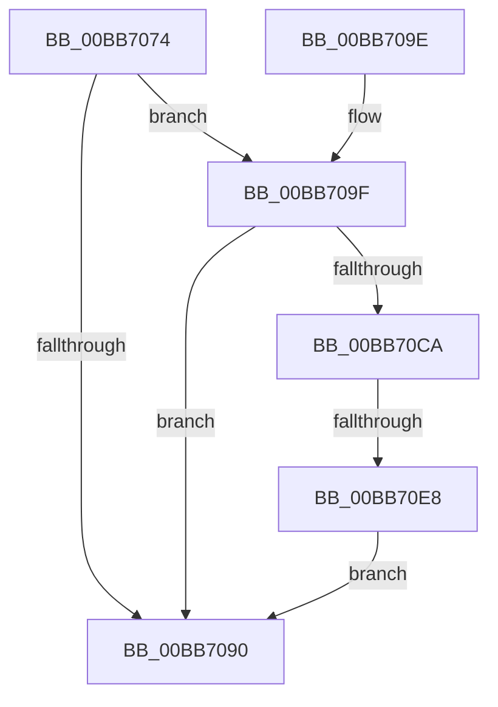

# VfIrpDatabaseEntryFindAndLock

- RVA: `0x00BB7074`–`0x00BB70F3` (길이 `127` bytes)
- VA: `0x0000000140BB7074`
- 실행 섹션: `PAGEVRFY`
- PDB 이름 있음: `예`; PDB Function 태그: `예`
- unwind 정보 RVA: `0x000B08C0`
- 디코드: `35`개 명령, `127/127` bytes 표시
- 미해석 바이트: `0` (있으면 어셈블리에 `.byte`로 보존)

> 이 문서는 커널 이미지의 기계어와 PDB 기호를 분석해 생성했습니다. 4번과 5번은 함수 원형과 자료형을 바이너리 사용 방식에서 추정한 C 해석이며 원본 소스 복구 결과는 아닙니다.

## 1. Dependencies

- 직접 호출 지점: **4**; 고유 호출 대상: **4**
- 직접 호출자로 확인된 함수: **10**
- RIP 상대 이미지 참조: **2**

### Outgoing calls
- `0x00BB70C1` → [VfUtilAddressRangeFitNoLock](../B9/VfUtilAddressRangeFitNoLock_function_00B921E0.md) (function, `0x00B921E0`)
- `0x00BB70CF` → [ViIrpDatabaseAcquireLockShared](../../text/61/ViIrpDatabaseAcquireLockShared_function_006176FC.md) (function, `0x006176FC`)
- `0x00BB70D7` → [ViIrpDatabaseFindPointer](ViIrpDatabaseFindPointer_function_00BB4140.md) (function, `0x00BB4140`)
- `0x00BB70EC` → [ViIrpDatabaseReleaseLockShared](../../text/61/ViIrpDatabaseReleaseLockShared_function_00617740.md) (function, `0x00617740`)

### Direct callers
- [IovCancelIrp](../B9/IovCancelIrp_function_00B926E0.md) at `0x00B926F1`
- [IovpCallDriver1](../B9/IovpCallDriver1_function_00B9CCA4.md) at `0x00B9CCEF`
- [IovpCallDriver1](../B9/IovpCallDriver1_function_00B9CCA4.md) at `0x00B9CD08`
- [IovpCheckIrpForCriticalTracking](../B9/IovpCheckIrpForCriticalTracking_function_00B9D524.md) at `0x00B9D544`
- [IovpCheckIrpForCriticalTracking](../B9/IovpCheckIrpForCriticalTracking_function_00B9D524.md) at `0x00B9D54B`
- [VfIrpWatermark](../B9/VfIrpWatermark_function_00B9E070.md) at `0x00B9E078`
- [VfIrpDatabaseEntryInsertAndLock](VfIrpDatabaseEntryInsertAndLock_function_00BB3F00.md) at `0x00BB3FAF`
- [VfIoInitializeIrp](VfIoInitializeIrp_function_00BB66D4.md) at `0x00BB66F1`
- [VfPacketFindAndLock](VfPacketFindAndLock_function_00BB6740.md) at `0x00BB6744`
- [IovpCompleteRequest1](IovpCompleteRequest1_function_00BB69D8.md) at `0x00BB69FB`
- [IovFreeIrpPrivate](IovFreeIrpPrivate_function_00BB6F20.md) at `0x00BB6F4C`
- [VfPendingMoreProcessingRequired](VfPendingMoreProcessingRequired_function_00BB6FF0.md) at `0x00BB7017`

### Static image references
- `0x00BB7085` → RVA `0x00F04864` (`.data`; read)
- `0x00BB70BA` → RVA `0x00F04880` (`.data`; read)

## 2. Other-region calls and transfers

- 다른 실행 섹션으로 향하는 call: **2**
  - `0x00BB70CF` → [ViIrpDatabaseAcquireLockShared](../../text/61/ViIrpDatabaseAcquireLockShared_function_006176FC.md) (`PAGEVRFY` → `.text`)
  - `0x00BB70EC` → [ViIrpDatabaseReleaseLockShared](../../text/61/ViIrpDatabaseReleaseLockShared_function_00617740.md) (`PAGEVRFY` → `.text`)
- call이 아닌 외부 분기/꼬리 이동: **1**
  - `0x00BB70E2` → [sub_00BBC2B4](Unknown_function_00BBC2B4.md) (`tail-transfer`)

## 3. Assembly (complete function range)

```asm
00BB7074  48 89 5C 24 08                  mov qword ptr [rsp + 8], rbx
00BB7079  57                              push rdi
00BB707A  48 83 EC 20                     sub rsp, 0x20
00BB707E  33 FF                           xor edi, edi
00BB7080  C6 44 24 38 00                  mov byte ptr [rsp + 0x38], 0
00BB7085  39 3D D9 D7 34 00               cmp dword ptr [rip + 0x34d7d9], edi
00BB708B  48 8B D9                        mov rbx, rcx
00BB708E  75 0F                           jne 0x140bb709f
00BB7090  48 8B 5C 24 30                  mov rbx, qword ptr [rsp + 0x30]
00BB7095  48 8B C7                        mov rax, rdi
00BB7098  48 83 C4 20                     add rsp, 0x20
00BB709C  5F                              pop rdi
00BB709D  C3                              ret
00BB709E  CC                              int3
00BB709F  4C 8D 81 D0 00 00 00            lea r8, [rcx + 0xd0]
00BB70A6  48 8B C3                        mov rax, rbx
00BB70A9  48 C1 E8 0C                     shr rax, 0xc
00BB70AD  48 8B D3                        mov rdx, rbx
00BB70B0  6B C0 83                        imul eax, eax, -0x7d
00BB70B3  0F B6 C8                        movzx ecx, al
00BB70B6  48 C1 E1 04                     shl rcx, 4
00BB70BA  48 03 0D BF D7 34 00            add rcx, qword ptr [rip + 0x34d7bf]
00BB70C1  E8 1A B1 FD FF                  call 0x140b921e0
00BB70C6  85 C0                           test eax, eax
00BB70C8  74 C6                           je 0x140bb7090
00BB70CA  48 8D 4C 24 38                  lea rcx, [rsp + 0x38]
00BB70CF  E8 28 06 A6 FF                  call 0x1406176fc
00BB70D4  48 8B CB                        mov rcx, rbx
00BB70D7  E8 64 D0 FF FF                  call 0x140bb4140
00BB70DC  48 8B F8                        mov rdi, rax
00BB70DF  48 85 C0                        test rax, rax
00BB70E2  0F 85 CC 51 00 00               jne 0x140bbc2b4
00BB70E8  8A 4C 24 38                     mov cl, byte ptr [rsp + 0x38]
00BB70EC  E8 4F 06 A6 FF                  call 0x140617740
00BB70F1  EB 9D                           jmp 0x140bb7090
```

## 4. C-style interpretation (structured pseudocode)

```c
__int64 __fastcall VfIrpDatabaseEntryFindAndLock(__int64 a1)
{
    __int64 result;
    __int64 v_rdi;
    __int64 v_rsp;
    unsigned __int8 v_stack_p10;
    unsigned __int64 v_stack_p38;
    unsigned __int64 v_stack_p8;

    v_stack_p8 = v_rbx;
    v_rsp = (v_rsp) - (32);
    v_rdi = 0;
    v_stack_p10 = 0;
    if ((*(unsigned int *)(v_rip + 3463129)) != 0) goto loc_00BB709F;
loc_00BB7090:
    v_rsp = (v_rsp) + (32);
    return 0;
loc_00BB709F:
    result = (v_stack_p8) >> (12);
    result = (unsigned int)((result) * ((unsigned int)(result)));
    a1 = ((unsigned __int8)(result)) << (4);
    a1 = (a1) + (*(unsigned __int64 *)(v_rip + 3463103));
    result = VfUtilAddressRangeFitNoLock(a1, v_stack_p8, a1 + 208, a4);
    if ((unsigned int)(result) == 0) goto loc_00BB7090;
    result = ViIrpDatabaseAcquireLockShared(v_stack_p38, v_stack_p8, a1 + 208, a4);
    result = ViIrpDatabaseFindPointer(v_stack_p8, v_stack_p8, a1 + 208, a4);
    result = ViIrpDatabaseReleaseLockShared(v_stack_p38, v_stack_p8, a1 + 208, a4);
    goto loc_00BB7090;
}
```

## 5. (Beta) C Style

```c
int64_t VfIrpDatabaseEntryFindAndLock(void *Arg1)
{
    uint8_t *arg1 = (uint8_t *)Arg1;

    int64_t result;
    int64_t local_rdi;
    int64_t local_rsp;
    uint8_t v_stack_p10;
    uint64_t v_stack_p38;
    uint64_t v_stack_p8;

    v_stack_p8 = local_rbx;
    local_rsp = (local_rsp) - (32);
    local_rdi = 0;
    v_stack_p10 = 0;
    if ((*(uint32_t *)(v_rip + 0x34D7D9)) != 0) goto loc_00BB709F;
loc_00BB7090:
    local_rsp = (local_rsp) + (32);
    return 0;
loc_00BB709F:
    result = (v_stack_p8) >> (12);
    result = (uint32_t)((result) * ((uint32_t)(result)));
    Arg1 = ((uint8_t)(result)) << (4);
    Arg1 = (Arg1) + (*(uint64_t *)(v_rip + 0x34D7BF));
    result = VfUtilAddressRangeFitNoLock(Arg1, v_stack_p8, Arg1 + 208, a4);
    if ((uint32_t)(result) == 0) goto loc_00BB7090;
    result = ViIrpDatabaseAcquireLockShared(v_stack_p38, v_stack_p8, Arg1 + 208, a4);
    result = ViIrpDatabaseFindPointer(v_stack_p8, v_stack_p8, Arg1 + 208, a4);
    result = ViIrpDatabaseReleaseLockShared(v_stack_p38, v_stack_p8, Arg1 + 208, a4);
    goto loc_00BB7090;
}
```

### 관측된 메모리 오프셋

구조체 형식이 확인되지 않은 접근은 인자 기준의 오프셋으로만 기록했습니다.

| 기준 인자 | 오프셋 표현 | 폭 (bit) | 접근 |
|---|---:|---:|---|
| `Arg1` | `+ 0xD0` | `64` | `R` |

## 6. Execution-region graph

[열기: 2D/3D 그래프와 함수 탐색 컨트롤 패널](../../../control-panel.html?section=pagevrfy&rva=0x00BB7074&view=graph)

- 2D 그래프는 위에서 아래로 흐르고, 3D 그래프는 빈 공간을 드래그해 회전합니다. Shift+드래그는 이동, 휠은 확대·축소, 함수 노드 선택은 대상 보고서 이동입니다.

### Static fallback


