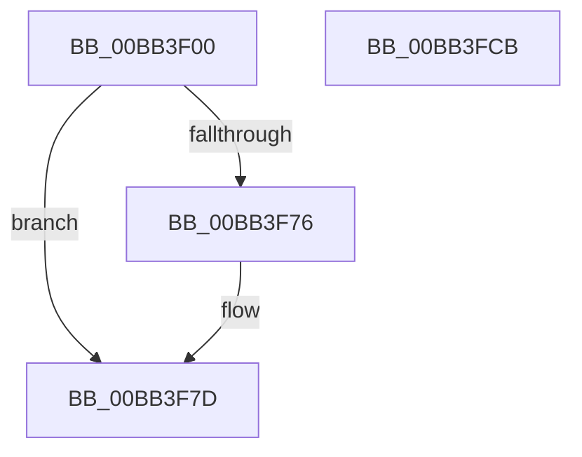

# VfIrpDatabaseEntryInsertAndLock

- RVA: `0x00BB3F00`–`0x00BB3FCC` (길이 `204` bytes)
- VA: `0x0000000140BB3F00`
- 실행 섹션: `PAGEVRFY`
- PDB 이름 있음: `예`; PDB Function 태그: `아니요`
- unwind 정보 RVA: `0x000D25E0`
- 디코드: `55`개 명령, `204/204` bytes 표시
- 미해석 바이트: `0` (있으면 어셈블리에 `.byte`로 보존)

> 이 문서는 커널 이미지의 기계어와 PDB 기호를 분석해 생성했습니다. 4번과 5번은 함수 원형과 자료형을 바이너리 사용 방식에서 추정한 C 해석이며 원본 소스 복구 결과는 아닙니다.

## 1. Dependencies

- 직접 호출 지점: **4**; 고유 호출 대상: **4**
- 직접 호출자로 확인된 함수: **1**
- RIP 상대 이미지 참조: **3**

### Outgoing calls
- `0x00BB3F4C` → [ViIrpDatabaseAcquireLockExclusive](../../text/61/ViIrpDatabaseAcquireLockExclusive_function_006176D8.md) (function, `0x006176D8`)
- `0x00BB3F9E` → [VfUtilAddressRangeAdd](../B9/VfUtilAddressRangeAdd_function_00B93108.md) (function, `0x00B93108`)
- `0x00BB3FA7` → [ViIrpDatabaseReleaseLockExclusive](../../text/61/ViIrpDatabaseReleaseLockExclusive_function_00617720.md) (function, `0x00617720`)
- `0x00BB3FAF` → [VfIrpDatabaseEntryFindAndLock](VfIrpDatabaseEntryFindAndLock_function_00BB7074.md) (function, `0x00BB7074`)

### Direct callers
- [VfPacketCreateAndLock](../BA/VfPacketCreateAndLock_function_00BAB420.md) at `0x00BAB4DD`

### Static image references
- `0x00BB3F3A` → RVA `0x00BAB520` (`ViPacketNotificationCallback`; read)
- `0x00BB3F51` → RVA `0x00F04878` (`.data`; read)
- `0x00BB3F91` → RVA `0x00F04880` (`.data`; read)

## 2. Other-region calls and transfers

- 다른 실행 섹션으로 향하는 call: **2**
  - `0x00BB3F4C` → [ViIrpDatabaseAcquireLockExclusive](../../text/61/ViIrpDatabaseAcquireLockExclusive_function_006176D8.md) (`PAGEVRFY` → `.text`)
  - `0x00BB3FA7` → [ViIrpDatabaseReleaseLockExclusive](../../text/61/ViIrpDatabaseReleaseLockExclusive_function_00617720.md) (`PAGEVRFY` → `.text`)
- 별도 외부 분기/꼬리 이동을 확인하지 못했습니다.

## 3. Assembly (complete function range)

```asm
00BB3F00  48 8B C4                        mov rax, rsp
00BB3F03  48 89 58 08                     mov qword ptr [rax + 8], rbx
00BB3F07  48 89 70 18                     mov qword ptr [rax + 0x18], rsi
00BB3F0B  48 89 50 10                     mov qword ptr [rax + 0x10], rdx
00BB3F0F  57                              push rdi
00BB3F10  48 83 EC 20                     sub rsp, 0x20
00BB3F14  48 8B F1                        mov rsi, rcx
00BB3F17  49 8D 78 20                     lea rdi, [r8 + 0x20]
00BB3F1B  33 C9                           xor ecx, ecx
00BB3F1D  49 89 30                        mov qword ptr [r8], rsi
00BB3F20  88 48 10                        mov byte ptr [rax + 0x10], cl
00BB3F23  49 8B D8                        mov rbx, r8
00BB3F26  49 89 48 08                     mov qword ptr [r8 + 8], rcx
00BB3F2A  8D 41 01                        lea eax, [rcx + 1]
00BB3F2D  41 89 40 14                     mov dword ptr [r8 + 0x14], eax
00BB3F31  48 8D 4C 24 38                  lea rcx, [rsp + 0x38]
00BB3F36  49 89 40 18                     mov qword ptr [r8 + 0x18], rax
00BB3F3A  48 8D 05 DF 75 FF FF            lea rax, [rip - 0x8a21]
00BB3F41  48 89 7F 08                     mov qword ptr [rdi + 8], rdi
00BB3F45  48 89 3F                        mov qword ptr [rdi], rdi
00BB3F48  49 89 40 30                     mov qword ptr [r8 + 0x30], rax
00BB3F4C  E8 87 37 A6 FF                  call 0x1406176d8
00BB3F51  48 8B 0D 20 09 35 00            mov rcx, qword ptr [rip + 0x350920]
00BB3F58  48 8B C6                        mov rax, rsi
00BB3F5B  48 C1 E8 0C                     shr rax, 0xc
00BB3F5F  48 6B C0 83                     imul rax, rax, -0x7d
00BB3F63  0F B6 D0                        movzx edx, al
00BB3F66  48 C1 E2 04                     shl rdx, 4
00BB3F6A  48 03 CA                        add rcx, rdx
00BB3F6D  48 8B 01                        mov rax, qword ptr [rcx]
00BB3F70  48 39 48 08                     cmp qword ptr [rax + 8], rcx
00BB3F74  74 07                           je 0x140bb3f7d
00BB3F76  B9 03 00 00 00                  mov ecx, 3
00BB3F7B  CD 29                           int 0x29
00BB3F7D  48 89 4F 08                     mov qword ptr [rdi + 8], rcx
00BB3F81  41 B8 D0 00 00 00               mov r8d, 0xd0
00BB3F87  48 89 07                        mov qword ptr [rdi], rax
00BB3F8A  48 89 78 08                     mov qword ptr [rax + 8], rdi
00BB3F8E  48 89 39                        mov qword ptr [rcx], rdi
00BB3F91  48 8B 0D E8 08 35 00            mov rcx, qword ptr [rip + 0x3508e8]
00BB3F98  48 03 CA                        add rcx, rdx
00BB3F9B  48 8B D6                        mov rdx, rsi
00BB3F9E  E8 65 F1 FD FF                  call 0x140b93108
00BB3FA3  8A 4C 24 38                     mov cl, byte ptr [rsp + 0x38]
00BB3FA7  E8 74 37 A6 FF                  call 0x140617720
00BB3FAC  48 8B CE                        mov rcx, rsi
00BB3FAF  E8 C0 30 00 00                  call 0x140bb7074
00BB3FB4  F0 FF 4B 14                     lock dec dword ptr [rbx + 0x14]
00BB3FB8  FF 4B 18                        dec dword ptr [rbx + 0x18]
00BB3FBB  48 8B 5C 24 30                  mov rbx, qword ptr [rsp + 0x30]
00BB3FC0  48 8B 74 24 40                  mov rsi, qword ptr [rsp + 0x40]
00BB3FC5  48 83 C4 20                     add rsp, 0x20
00BB3FC9  5F                              pop rdi
00BB3FCA  C3                              ret
00BB3FCB  CC                              int3
```

## 4. C-style interpretation (structured pseudocode)

```c
__int64 __fastcall VfIrpDatabaseEntryInsertAndLock(__int64 a1, __int64 a2, __int64 a3)
{
    __int64 result;
    __int64 v_rsp;
    unsigned __int64 v_stack_p10;
    unsigned __int64 v_stack_p18;
    unsigned __int64 v_stack_p8;

    *(unsigned __int64 *)(v_rsp + 8) = v_rbx;
    *(unsigned __int64 *)(v_rsp + 24) = v_rsi;
    *(unsigned __int64 *)(v_rsp + 16) = a2;
    v_rsp = (v_rsp) - (32);
    a1 = 0;
    *(unsigned __int64 *)(a3) = 0;
    *(unsigned __int8 *)(v_rsp + 16) = 0;
    *(unsigned __int64 *)(a3 + 8) = 0;
    *(unsigned int *)(a3 + 20) = (unsigned int)(a1 + 1);
    *(unsigned __int64 *)(a3 + 24) = a1 + 1;
    *(unsigned __int64 *)(a3 + 32 + 8) = a3 + 32;
    *(unsigned __int64 *)(a3 + 32) = a3 + 32;
    *(unsigned __int64 *)(a3 + 48) = v_rip - 35361;
    result = ViIrpDatabaseAcquireLockExclusive(v_stack_p10, a2, a3, a4);
    result = (0) >> (12);
    result = (result) * (result);
    a2 = ((unsigned __int8)(result)) << (4);
    a1 = (*(unsigned __int64 *)(v_rip + 3475744)) + (a2);
    if ((*(unsigned __int64 *)(*(unsigned __int64 *)(a1) + 8)) != a1) {
        a1 = 3;
    }
    *(unsigned __int64 *)(a3 + 32 + 8) = a1;
    *(unsigned __int64 *)(a3 + 32) = *(unsigned __int64 *)(a1);
    *(unsigned __int64 *)(*(unsigned __int64 *)(a1) + 8) = a3 + 32;
    *(unsigned __int64 *)(a1) = a3 + 32;
    a1 = (*(unsigned __int64 *)(v_rip + 3475688)) + (a2);
    result = VfUtilAddressRangeAdd(a1, a1, 208, a4);
    result = ViIrpDatabaseReleaseLockExclusive(v_stack_p10, a1, 208, a4);
    result = VfIrpDatabaseEntryFindAndLock(a1, a1, 208, a4);
    v_rsp = (v_rsp) + (32);
    return result;
}
```

## 5. (Beta) C Style

```c
int64_t VfIrpDatabaseEntryInsertAndLock(int64_t Arg1, int64_t Arg2, void *Arg3)
{
    uint8_t *arg3 = (uint8_t *)Arg3;

    int64_t result;
    int64_t local_rsp;
    uint64_t v_stack_p10;
    uint64_t v_stack_p18;
    uint64_t v_stack_p8;

    *(uint64_t *)(local_rsp + 0x8) = local_rbx;
    *(uint64_t *)(local_rsp + 0x18) = local_rsi;
    *(uint64_t *)(local_rsp + 0x10) = Arg2;
    local_rsp = (local_rsp) - (32);
    Arg1 = 0;
    *(uint64_t *)(arg3) = 0;
    *(uint8_t *)(local_rsp + 0x10) = 0;
    *(uint64_t *)(arg3 + 0x8) = 0;
    *(uint32_t *)(arg3 + 0x14) = (uint32_t)(Arg1 + 1);
    *(uint64_t *)(arg3 + 0x18) = Arg1 + 1;
    *(void **)(arg3 + 0x20 + 0x8) = Arg3 + 32;
    *(void **)(arg3 + 0x20) = Arg3 + 32;
    *(uint64_t *)(arg3 + 0x30) = v_rip - 35361;
    result = ViIrpDatabaseAcquireLockExclusive(v_stack_p10, Arg2, Arg3, a4);
    result = (0) >> (12);
    result = (result) * (result);
    Arg2 = ((uint8_t)(result)) << (4);
    Arg1 = (*(uint64_t *)(v_rip + 0x350920)) + (Arg2);
    if ((*(uint64_t *)(*(uint64_t *)(Arg1) + 0x8)) != Arg1) {
        Arg1 = 3;
    }
    *(uint64_t *)(arg3 + 0x20 + 0x8) = Arg1;
    *(uint64_t *)(arg3 + 0x20) = *(uint64_t *)(Arg1);
    *(void **)(*(uint64_t *)(Arg1) + 0x8) = Arg3 + 32;
    *(void **)(Arg1) = Arg3 + 32;
    Arg1 = (*(uint64_t *)(v_rip + 0x3508E8)) + (Arg2);
    result = VfUtilAddressRangeAdd(Arg1, Arg1, 208, a4);
    result = ViIrpDatabaseReleaseLockExclusive(v_stack_p10, Arg1, 208, a4);
    result = VfIrpDatabaseEntryFindAndLock(Arg1, Arg1, 208, a4);
    local_rsp = (local_rsp) + (32);
    return result;
}
```

### 관측된 메모리 오프셋

구조체 형식이 확인되지 않은 접근은 인자 기준의 오프셋으로만 기록했습니다.

| 기준 인자 | 오프셋 표현 | 폭 (bit) | 접근 |
|---|---:|---:|---|
| `Arg3` | `+ 0x0` | `64` | `W` |
| `Arg3` | `+ 0x8` | `64` | `W` |
| `Arg3` | `+ 0x14` | `32` | `R/W` |
| `Arg3` | `+ 0x14` | `32` | `W` |
| `Arg3` | `+ 0x18` | `32` | `R/W` |
| `Arg3` | `+ 0x18` | `64` | `W` |
| `Arg3` | `+ 0x20` | `64` | `R` |
| `Arg3` | `+ 0x30` | `64` | `W` |

## 6. Execution-region graph

[열기: 2D/3D 그래프와 함수 탐색 컨트롤 패널](../../../control-panel.html?section=pagevrfy&rva=0x00BB3F00&view=graph)

- 2D 그래프는 위에서 아래로 흐르고, 3D 그래프는 빈 공간을 드래그해 회전합니다. Shift+드래그는 이동, 휠은 확대·축소, 함수 노드 선택은 대상 보고서 이동입니다.

### Static fallback


