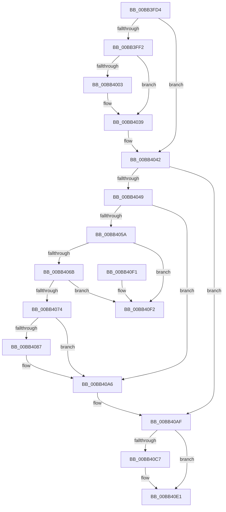

# VfIrpDatabaseEntryReleaseLock

- RVA: `0x00BB3FD4`–`0x00BB40F9` (길이 `293` bytes)
- VA: `0x0000000140BB3FD4`
- 실행 섹션: `PAGEVRFY`
- PDB 이름 있음: `예`; PDB Function 태그: `아니요`
- unwind 정보 RVA: `0x000D29C0`
- 디코드: `82`개 명령, `293/293` bytes 표시
- 미해석 바이트: `0` (있으면 어셈블리에 `.byte`로 보존)

> 이 문서는 커널 이미지의 기계어와 PDB 기호를 분석해 생성했습니다. 4번과 5번은 함수 원형과 자료형을 바이너리 사용 방식에서 추정한 C 해석이며 원본 소스 복구 결과는 아닙니다.

## 1. Dependencies

- 직접 호출 지점: **8**; 고유 호출 대상: **5**
- 직접 호출자로 확인된 함수: **19**
- RIP 상대 이미지 참조: **2**

### Outgoing calls
- `0x00BB3FF6` → [ViIrpDatabaseAcquireLockExclusive](../../text/61/ViIrpDatabaseAcquireLockExclusive_function_006176D8.md) (function, `0x006176D8`)
- `0x00BB4011` → [guard_dispatch_icall](../../text/6B/guard_dispatch_icall_function_006BAAD0.md) (function, `0x006BAAD0`)
- `0x00BB4034` → [VfUtilAddressRangeRemoveCheckEmpty](../B9/VfUtilAddressRangeRemoveCheckEmpty_function_00B931A8.md) (function, `0x00B931A8`)
- `0x00BB403D` → [ViIrpDatabaseReleaseLockExclusive](../../text/61/ViIrpDatabaseReleaseLockExclusive_function_00617720.md) (function, `0x00617720`)
- `0x00BB404E` → [ViIrpDatabaseAcquireLockExclusive](../../text/61/ViIrpDatabaseAcquireLockExclusive_function_006176D8.md) (function, `0x006176D8`)
- `0x00BB40AA` → [ViIrpDatabaseReleaseLockExclusive](../../text/61/ViIrpDatabaseReleaseLockExclusive_function_00617720.md) (function, `0x00617720`)
- `0x00BB40BD` → [KeReleaseSpinLock](../../text/39/KeReleaseSpinLock_function_00392BA0.md) (function, `0x00392BA0`)
- `0x00BB40DC` → [guard_dispatch_icall](../../text/6B/guard_dispatch_icall_function_006BAAD0.md) (function, `0x006BAAD0`)

### Direct callers
- [IovCancelIrp](../B9/IovCancelIrp_function_00B926E0.md) at `0x00B92712`
- [IovpCallDriver1](../B9/IovpCallDriver1_function_00B9CCA4.md) at `0x00B9D235`
- [IovpCallDriver2](../B9/IovpCallDriver2_function_00B9D270.md) at `0x00B9D4C6`
- [IovpCheckIrpForCriticalTracking](../B9/IovpCheckIrpForCriticalTracking_function_00B9D524.md) at `0x00B9D577`
- [VfIoAllocateIrp1](../B9/VfIoAllocateIrp1_function_00B9DD94.md) at `0x00B9DDF0`
- [VfIoAllocateIrp2](../B9/VfIoAllocateIrp2_function_00B9DE0C.md) at `0x00B9DE77`
- [VfIrpWatermark](../B9/VfIrpWatermark_function_00B9E070.md) at `0x00B9E098`
- [ViPendingCompleteAfterWait](../BA/ViPendingCompleteAfterWait_function_00BA1D18.md) at `0x00BA1DE7`
- [VfPacketReleaseLock](../BA/VfPacketReleaseLock_function_00BAB500.md) at `0x00BAB504`
- [IovpCompleteRequest1](IovpCompleteRequest1_function_00BB69D8.md) at `0x00BB6A4E`
- [IovpCompleteRequest5](IovpCompleteRequest5_function_00BB6E40.md) at `0x00BB6E7D`
- [sub_00BBBC60](Unknown_function_00BBBC60.md) at `0x00BBBCA7`
- [sub_00BBBCB2](Unknown_function_00BBBCB2.md) at `0x00BBBD46`
- [sub_00BBBD62](Unknown_function_00BBBD62.md) at `0x00BBBDE8`
- [sub_00BBBE00](Unknown_function_00BBBE00.md) at `0x00BBC0A4`
- [sub_00BBC0B2](Unknown_function_00BBC0B2.md) at `0x00BBC0BD`
- [sub_00BBC0C8](Unknown_function_00BBC0C8.md) at `0x00BBC0DB`
- [sub_00BBC0C8](Unknown_function_00BBC0C8.md) at `0x00BBC164`
- [sub_00BBC0C8](Unknown_function_00BBC0C8.md) at `0x00BBC1F2`
- [sub_00BBC208](Unknown_function_00BBC208.md) at `0x00BBC20B`
- [sub_00BBC208](Unknown_function_00BBC208.md) at `0x00BBC2A8`
- [sub_00BBC2B4](Unknown_function_00BBC2B4.md) at `0x00BBC2E0`

### Static image references
- `0x00BB402D` → RVA `0x00F04880` (`.data`; read)
- `0x00BB4087` → RVA `0x00F04878` (`.data`; read)

## 2. Other-region calls and transfers

- 다른 실행 섹션으로 향하는 call: **7**
  - `0x00BB3FF6` → [ViIrpDatabaseAcquireLockExclusive](../../text/61/ViIrpDatabaseAcquireLockExclusive_function_006176D8.md) (`PAGEVRFY` → `.text`)
  - `0x00BB4011` → [guard_dispatch_icall](../../text/6B/guard_dispatch_icall_function_006BAAD0.md) (`PAGEVRFY` → `.text`)
  - `0x00BB403D` → [ViIrpDatabaseReleaseLockExclusive](../../text/61/ViIrpDatabaseReleaseLockExclusive_function_00617720.md) (`PAGEVRFY` → `.text`)
  - `0x00BB404E` → [ViIrpDatabaseAcquireLockExclusive](../../text/61/ViIrpDatabaseAcquireLockExclusive_function_006176D8.md) (`PAGEVRFY` → `.text`)
  - `0x00BB40AA` → [ViIrpDatabaseReleaseLockExclusive](../../text/61/ViIrpDatabaseReleaseLockExclusive_function_00617720.md) (`PAGEVRFY` → `.text`)
  - `0x00BB40BD` → [KeReleaseSpinLock](../../text/39/KeReleaseSpinLock_function_00392BA0.md) (`PAGEVRFY` → `.text`)
  - `0x00BB40DC` → [guard_dispatch_icall](../../text/6B/guard_dispatch_icall_function_006BAAD0.md) (`PAGEVRFY` → `.text`)
- 별도 외부 분기/꼬리 이동을 확인하지 못했습니다.

## 3. Assembly (complete function range)

```asm
00BB3FD4  48 8B C4                        mov rax, rsp
00BB3FD7  48 89 58 10                     mov qword ptr [rax + 0x10], rbx
00BB3FDB  48 89 70 18                     mov qword ptr [rax + 0x18], rsi
00BB3FDF  57                              push rdi
00BB3FE0  48 83 EC 20                     sub rsp, 0x20
00BB3FE4  33 FF                           xor edi, edi
00BB3FE6  48 8B F1                        mov rsi, rcx
00BB3FE9  40 88 78 08                     mov byte ptr [rax + 8], dil
00BB3FED  39 79 18                        cmp dword ptr [rcx + 0x18], edi
00BB3FF0  75 50                           jne 0x140bb4042
00BB3FF2  48 8D 48 08                     lea rcx, [rax + 8]
00BB3FF6  E8 DD 36 A6 FF                  call 0x1406176d8
00BB3FFB  48 8B 1E                        mov rbx, qword ptr [rsi]
00BB3FFE  48 85 DB                        test rbx, rbx
00BB4001  74 36                           je 0x140bb4039
00BB4003  48 8B 46 30                     mov rax, qword ptr [rsi + 0x30]
00BB4007  44 8D 47 01                     lea r8d, [rdi + 1]
00BB400B  48 8B D3                        mov rdx, rbx
00BB400E  48 8B CE                        mov rcx, rsi
00BB4011  E8 BA 6A B0 FF                  call 0x1406baad0
00BB4016  48 8B C3                        mov rax, rbx
00BB4019  48 89 3E                        mov qword ptr [rsi], rdi
00BB401C  48 C1 E8 0C                     shr rax, 0xc
00BB4020  48 8B D3                        mov rdx, rbx
00BB4023  6B C0 83                        imul eax, eax, -0x7d
00BB4026  0F B6 C8                        movzx ecx, al
00BB4029  48 C1 E1 04                     shl rcx, 4
00BB402D  48 03 0D 4C 08 35 00            add rcx, qword ptr [rip + 0x35084c]
00BB4034  E8 6F F1 FD FF                  call 0x140b931a8
00BB4039  8A 4C 24 30                     mov cl, byte ptr [rsp + 0x30]
00BB403D  E8 DE 36 A6 FF                  call 0x140617720
00BB4042  8B 46 14                        mov eax, dword ptr [rsi + 0x14]
00BB4045  85 C0                           test eax, eax
00BB4047  75 66                           jne 0x140bb40af
00BB4049  48 8D 4C 24 30                  lea rcx, [rsp + 0x30]
00BB404E  E8 85 36 A6 FF                  call 0x1406176d8
00BB4053  8B 46 14                        mov eax, dword ptr [rsi + 0x14]
00BB4056  85 C0                           test eax, eax
00BB4058  75 4C                           jne 0x140bb40a6
00BB405A  48 8D 4E 20                     lea rcx, [rsi + 0x20]
00BB405E  48 8B 01                        mov rax, qword ptr [rcx]
00BB4061  48 39 48 08                     cmp qword ptr [rax + 8], rcx
00BB4065  0F 85 87 00 00 00               jne 0x140bb40f2
00BB406B  48 8B 51 08                     mov rdx, qword ptr [rcx + 8]
00BB406F  48 39 0A                        cmp qword ptr [rdx], rcx
00BB4072  75 7E                           jne 0x140bb40f2
00BB4074  48 89 02                        mov qword ptr [rdx], rax
00BB4077  48 89 50 08                     mov qword ptr [rax + 8], rdx
00BB407B  48 89 49 08                     mov qword ptr [rcx + 8], rcx
00BB407F  48 89 09                        mov qword ptr [rcx], rcx
00BB4082  48 39 00                        cmp qword ptr [rax], rax
00BB4085  75 1F                           jne 0x140bb40a6
00BB4087  48 2B 05 EA 07 35 00            sub rax, qword ptr [rip + 0x3507ea]
00BB408E  48 C1 F8 04                     sar rax, 4
00BB4092  8B C0                           mov eax, eax
00BB4094  48 C1 E0 04                     shl rax, 4
00BB4098  48 03 05 E1 07 35 00            add rax, qword ptr [rip + 0x3507e1]
00BB409F  48 89 38                        mov qword ptr [rax], rdi
00BB40A2  48 89 78 08                     mov qword ptr [rax + 8], rdi
00BB40A6  8A 4C 24 30                     mov cl, byte ptr [rsp + 0x30]
00BB40AA  E8 71 36 A6 FF                  call 0x140617720
00BB40AF  8A 56 10                        mov dl, byte ptr [rsi + 0x10]
00BB40B2  48 8D 7E 20                     lea rdi, [rsi + 0x20]
00BB40B6  48 8B 1F                        mov rbx, qword ptr [rdi]
00BB40B9  48 8D 4E 08                     lea rcx, [rsi + 8]
00BB40BD  E8 DE EA 7D FF                  call 0x140392ba0
00BB40C2  48 3B DF                        cmp rbx, rdi
00BB40C5  75 1A                           jne 0x140bb40e1
00BB40C7  0F BA 6E 1C 1F                  bts dword ptr [rsi + 0x1c], 0x1f
00BB40CC  41 B8 02 00 00 00               mov r8d, 2
00BB40D2  48 8B 46 30                     mov rax, qword ptr [rsi + 0x30]
00BB40D6  48 8B CE                        mov rcx, rsi
00BB40D9  48 8B 16                        mov rdx, qword ptr [rsi]
00BB40DC  E8 EF 69 B0 FF                  call 0x1406baad0
00BB40E1  48 8B 5C 24 38                  mov rbx, qword ptr [rsp + 0x38]
00BB40E6  48 8B 74 24 40                  mov rsi, qword ptr [rsp + 0x40]
00BB40EB  48 83 C4 20                     add rsp, 0x20
00BB40EF  5F                              pop rdi
00BB40F0  C3                              ret
00BB40F1  CC                              int3
00BB40F2  B9 03 00 00 00                  mov ecx, 3
00BB40F7  CD 29                           int 0x29
```

## 4. C-style interpretation (structured pseudocode)

```c
__int64 __fastcall VfIrpDatabaseEntryReleaseLock(__int64 a1)
{
    __int64 result;
    __int64 v_rdi;
    __int64 v_rsp;
    unsigned __int64 v_stack_p10;
    unsigned __int64 v_stack_p18;
    unsigned __int8 v_stack_p8;

    *(unsigned __int64 *)(v_rsp + 16) = v_rbx;
    *(unsigned __int64 *)(v_rsp + 24) = v_rsi;
    v_rsp = (v_rsp) - (32);
    v_rdi = 0;
    *(unsigned __int8 *)(v_rsp + 8) = 0;
    if ((*(unsigned int *)(a1 + 24)) != 0) goto loc_00BB4042;
    result = ViIrpDatabaseAcquireLockExclusive(v_rsp + 8, a2, a3, a4);
    if (*(unsigned __int64 *)(a1) != 0) {
        result = *(unsigned __int64 *)(a1 + 48);
        a3 = v_rdi + 1;
        a2 = *(unsigned __int64 *)(a1);
        a1 = a1;
        result = guard_dispatch_icall(a1, a2, a3, a4);
        result = *(unsigned __int64 *)(a1);
        *(unsigned __int64 *)(a1) = 0;
        result = (result) >> (12);
        a2 = *(unsigned __int64 *)(a1);
        result = (unsigned int)((result) * ((unsigned int)(result)));
        a1 = (unsigned __int8)(result);
        a1 = (a1) << (4);
        a1 = (a1) + (*(unsigned __int64 *)(v_rip + 3475532));
        result = VfUtilAddressRangeRemoveCheckEmpty(a1, a2, a3, a4);
    }
    result = ViIrpDatabaseReleaseLockExclusive(v_stack_p8, a2, a3, a4);
loc_00BB4042:
    if ((unsigned int)((unsigned int)(*(unsigned int *)(a1 + 20))) != 0) goto loc_00BB40AF;
    result = ViIrpDatabaseAcquireLockExclusive(v_stack_p8, a2, a3, a4);
    if ((unsigned int)((unsigned int)(*(unsigned int *)(a1 + 20))) != 0) goto loc_00BB40A6;
    if ((*(unsigned __int64 *)(*(unsigned __int64 *)(a1 + 32) + 8)) != (a1 + 32)) goto loc_00BB40F2;
    if ((*(unsigned __int64 *)(*(unsigned __int64 *)(a1 + 32 + 8))) != (a1 + 32)) goto loc_00BB40F2;
    *(unsigned __int64 *)(*(unsigned __int64 *)(a1 + 32 + 8)) = *(unsigned __int64 *)(a1 + 32);
    *(unsigned __int64 *)(*(unsigned __int64 *)(a1 + 32) + 8) = *(unsigned __int64 *)(a1 + 32 + 8);
    *(unsigned __int64 *)(a1 + 32 + 8) = a1 + 32;
    *(unsigned __int64 *)(a1 + 32) = a1 + 32;
    result = *(unsigned __int64 *)(a1 + 32);
    if ((*(unsigned __int64 *)(*(unsigned __int64 *)(a1 + 32))) == (*(unsigned __int64 *)(a1 + 32))) {
        result = (*(unsigned __int64 *)(a1 + 32)) - (*(unsigned __int64 *)(v_rip + 3475434));
        result = (result) >> (4);
        result = (unsigned int)(result);
        result = (result) << (4);
        result = (result) + (*(unsigned __int64 *)(v_rip + 3475425));
        *(unsigned __int64 *)(result) = 0;
        *(unsigned __int64 *)(result + 8) = 0;
    }
    result = ViIrpDatabaseReleaseLockExclusive(v_stack_p8, *(unsigned __int64 *)(a1 + 32 + 8), a3, a4);
loc_00BB40AF:
    result = KeReleaseSpinLock(a1 + 8, *(unsigned __int8 *)(a1 + 16), a3, a4);
    if ((*(unsigned __int64 *)(a1 + 32)) == (a1 + 32)) {
        a3 = 2;
        result = *(unsigned __int64 *)(a1 + 48);
        a1 = a1;
        a2 = *(unsigned __int64 *)(a1);
        result = guard_dispatch_icall(a1, a2, a3, a4);
    }
    v_rsp = (v_rsp) + (32);
    return result;
loc_00BB40F2:
    return result;
}
```

## 5. (Beta) C Style

```c
int64_t VfIrpDatabaseEntryReleaseLock(void *Arg1)
{
    uint8_t *arg1 = (uint8_t *)Arg1;

    int64_t result;
    int64_t local_rdi;
    int64_t local_rsp;
    uint64_t v_stack_p10;
    uint64_t v_stack_p18;
    uint8_t v_stack_p8;

    *(uint64_t *)(local_rsp + 0x10) = local_rbx;
    *(uint64_t *)(local_rsp + 0x18) = local_rsi;
    local_rsp = (local_rsp) - (32);
    local_rdi = 0;
    *(uint8_t *)(local_rsp + 0x8) = 0;
    if ((*(uint32_t *)(arg1 + 0x18)) != 0) goto loc_00BB4042;
    result = ViIrpDatabaseAcquireLockExclusive(local_rsp + 8, a2, a3, a4);
    if (*(uint64_t *)(arg1) != 0) {
        result = *(uint64_t *)(arg1 + 0x30);
        a3 = local_rdi + 1;
        a2 = *(uint64_t *)(arg1);
        Arg1 = Arg1;
        result = guard_dispatch_icall(Arg1, a2, a3, a4);
        result = *(uint64_t *)(arg1);
        *(uint64_t *)(arg1) = 0;
        result = (result) >> (12);
        a2 = *(uint64_t *)(arg1);
        result = (uint32_t)((result) * ((uint32_t)(result)));
        Arg1 = (uint8_t)(result);
        Arg1 = (Arg1) << (4);
        Arg1 = (Arg1) + (*(uint64_t *)(v_rip + 0x35084C));
        result = VfUtilAddressRangeRemoveCheckEmpty(Arg1, a2, a3, a4);
    }
    result = ViIrpDatabaseReleaseLockExclusive(v_stack_p8, a2, a3, a4);
loc_00BB4042:
    if ((uint32_t)((uint32_t)(*(uint32_t *)(arg1 + 0x14))) != 0) goto loc_00BB40AF;
    result = ViIrpDatabaseAcquireLockExclusive(v_stack_p8, a2, a3, a4);
    if ((uint32_t)((uint32_t)(*(uint32_t *)(arg1 + 0x14))) != 0) goto loc_00BB40A6;
    if ((*(uint64_t *)(*(uint64_t *)(arg1 + 0x20) + 0x8)) != (Arg1 + 32)) goto loc_00BB40F2;
    if ((*(uint64_t *)(*(uint64_t *)(arg1 + 0x20 + 0x8))) != (Arg1 + 32)) goto loc_00BB40F2;
    *(uint64_t *)(*(uint64_t *)(arg1 + 0x20 + 0x8)) = *(uint64_t *)(arg1 + 0x20);
    *(uint64_t *)(*(uint64_t *)(arg1 + 0x20) + 0x8) = *(uint64_t *)(arg1 + 0x20 + 0x8);
    *(void **)(arg1 + 0x20 + 0x8) = Arg1 + 32;
    *(void **)(arg1 + 0x20) = Arg1 + 32;
    result = *(uint64_t *)(arg1 + 0x20);
    if ((*(uint64_t *)(*(uint64_t *)(arg1 + 0x20))) == (*(uint64_t *)(arg1 + 0x20))) {
        result = (*(uint64_t *)(arg1 + 0x20)) - (*(uint64_t *)(v_rip + 0x3507EA));
        result = (result) >> (4);
        result = (uint32_t)(result);
        result = (result) << (4);
        result = (result) + (*(uint64_t *)(v_rip + 0x3507E1));
        *(uint64_t *)(result) = 0;
        *(uint64_t *)(result + 0x8) = 0;
    }
    result = ViIrpDatabaseReleaseLockExclusive(v_stack_p8, *(uint64_t *)(arg1 + 0x20 + 0x8), a3, a4);
loc_00BB40AF:
    result = KeReleaseSpinLock(Arg1 + 8, *(uint8_t *)(arg1 + 0x10), a3, a4);
    if ((*(uint64_t *)(arg1 + 0x20)) == (Arg1 + 32)) {
        a3 = 2;
        result = *(uint64_t *)(arg1 + 0x30);
        Arg1 = Arg1;
        a2 = *(uint64_t *)(arg1);
        result = guard_dispatch_icall(Arg1, a2, a3, a4);
    }
    local_rsp = (local_rsp) + (32);
    return result;
loc_00BB40F2:
    return result;
}
```

### 관측된 메모리 오프셋

구조체 형식이 확인되지 않은 접근은 인자 기준의 오프셋으로만 기록했습니다.

| 기준 인자 | 오프셋 표현 | 폭 (bit) | 접근 |
|---|---:|---:|---|
| `Arg1` | `+ 0x0` | `64` | `R` |
| `Arg1` | `+ 0x0` | `64` | `W` |
| `Arg1` | `+ 0x8` | `64` | `R` |
| `Arg1` | `+ 0x8` | `64` | `W` |
| `Arg1` | `+ 0x10` | `8` | `R` |
| `Arg1` | `+ 0x14` | `32` | `R` |
| `Arg1` | `+ 0x18` | `32` | `R` |
| `Arg1` | `+ 0x1C` | `32` | `R/W` |
| `Arg1` | `+ 0x20` | `64` | `R` |
| `Arg1` | `+ 0x30` | `64` | `R` |

## 6. Execution-region graph

[열기: 2D/3D 그래프와 함수 탐색 컨트롤 패널](../../../control-panel.html?section=pagevrfy&rva=0x00BB3FD4&view=graph)

- 2D 그래프는 위에서 아래로 흐르고, 3D 그래프는 빈 공간을 드래그해 회전합니다. Shift+드래그는 이동, 휠은 확대·축소, 함수 노드 선택은 대상 보고서 이동입니다.

### Static fallback


