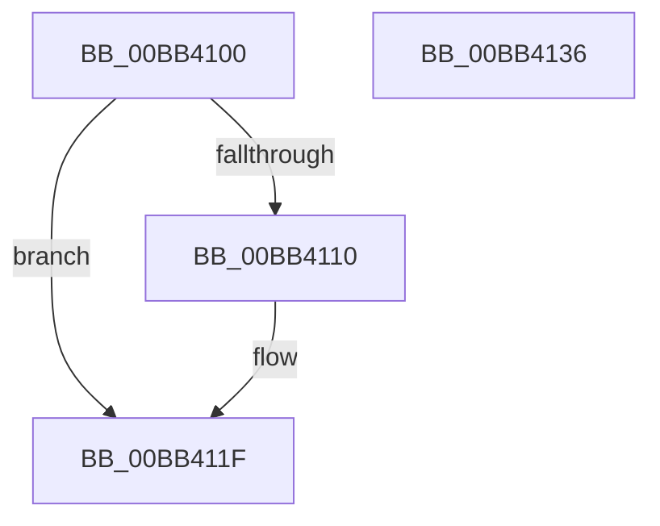

# VfIrpDatabaseUninitialize

- RVA: `0x00BB4100`–`0x00BB4137` (길이 `55` bytes)
- VA: `0x0000000140BB4100`
- 실행 섹션: `PAGEVRFY`
- PDB 이름 있음: `예`; PDB Function 태그: `아니요`
- unwind 정보 RVA: `0x0005C788`
- 디코드: `13`개 명령, `55/55` bytes 표시
- 미해석 바이트: `0` (있으면 어셈블리에 `.byte`로 보존)

> 이 문서는 커널 이미지의 기계어와 PDB 기호를 분석해 생성했습니다. 4번과 5번은 함수 원형과 자료형을 바이너리 사용 방식에서 추정한 C 해석이며 원본 소스 복구 결과는 아닙니다.

## 1. Dependencies

- 직접 호출 지점: **1**; 고유 호출 대상: **1**
- 직접 호출자로 확인된 함수: **2**
- RIP 상대 이미지 참조: **4**

### Outgoing calls
- `0x00BB4112` → [ExFreePoolWithTag](../../poolcode/B8/ExFreePoolWithTag_function_00B82870.md) (function, `0x00B82870`)

### Direct callers
- [ViIovPluginUnload](../../text/6A/ViIovPluginUnload_function_006AADB0.md) at `0x006AADE5`
- [ViPacketNotificationCallback](../BA/ViPacketNotificationCallback_function_00BAB520.md) at `0x00BAB56C`

### Static image references
- `0x00BB4104` → RVA `0x00F04878` (`.data`; read)
- `0x00BB4117` → RVA `0x00F04878` (`.data`; read/write)
- `0x00BB4121` → RVA `0x00F04864` (`.data`; read/write)
- `0x00BB4127` → RVA `0x00F04888` (`.data`; write)

## 2. Other-region calls and transfers

- 다른 실행 섹션으로 향하는 call: **1**
  - `0x00BB4112` → [ExFreePoolWithTag](../../poolcode/B8/ExFreePoolWithTag_function_00B82870.md) (`PAGEVRFY` → `POOLCODE`)
- 별도 외부 분기/꼬리 이동을 확인하지 못했습니다.

## 3. Assembly (complete function range)

```asm
00BB4100  48 83 EC 28                     sub rsp, 0x28
00BB4104  48 8B 0D 6D 07 35 00            mov rcx, qword ptr [rip + 0x35076d]
00BB410B  48 85 C9                        test rcx, rcx
00BB410E  74 0F                           je 0x140bb411f
00BB4110  33 D2                           xor edx, edx
00BB4112  E8 59 E7 FC FF                  call 0x140b82870
00BB4117  48 83 25 59 07 35 00 00         and qword ptr [rip + 0x350759], 0
00BB411F  33 C0                           xor eax, eax
00BB4121  87 05 3D 07 35 00               xchg dword ptr [rip + 0x35073d], eax
00BB4127  C7 05 57 07 35 00 00 00 00 00   mov dword ptr [rip + 0x350757], 0
00BB4131  48 83 C4 28                     add rsp, 0x28
00BB4135  C3                              ret
00BB4136  CC                              int3
```

## 4. C-style interpretation (structured pseudocode)

```c
__int64 __fastcall VfIrpDatabaseUninitialize(__int64 a1, int a2)
{
    __int64 result;
    __int64 v_rsp;

    v_rsp = (v_rsp) - (40);
    if (*(unsigned __int64 *)(v_rip + 3475309) != 0) {
        a2 = 0;
        result = ExFreePoolWithTag(*(unsigned __int64 *)(v_rip + 3475309), a2, a3, a4);
    }
    result = 0;
    *(unsigned int *)(v_rip + 3475287) = 0;
    v_rsp = (v_rsp) + (40);
    return result;
}
```

## 5. (Beta) C Style

```c
int64_t VfIrpDatabaseUninitialize(int64_t Arg1, int32_t Arg2)
{
    int64_t result;
    int64_t local_rsp;

    local_rsp = (local_rsp) - (40);
    if (*(uint64_t *)(v_rip + 0x35076D) != 0) {
        Arg2 = 0;
        result = ExFreePoolWithTag(*(uint64_t *)(v_rip + 0x35076D), Arg2, a3, a4);
    }
    result = 0;
    *(uint32_t *)(v_rip + 0x350757) = 0;
    local_rsp = (local_rsp) + (40);
    return result;
}
```

## 6. Execution-region graph

[열기: 2D/3D 그래프와 함수 탐색 컨트롤 패널](../../../control-panel.html?section=pagevrfy&rva=0x00BB4100&view=graph)

- 2D 그래프는 위에서 아래로 흐르고, 3D 그래프는 빈 공간을 드래그해 회전합니다. Shift+드래그는 이동, 휠은 확대·축소, 함수 노드 선택은 대상 보고서 이동입니다.

### Static fallback


